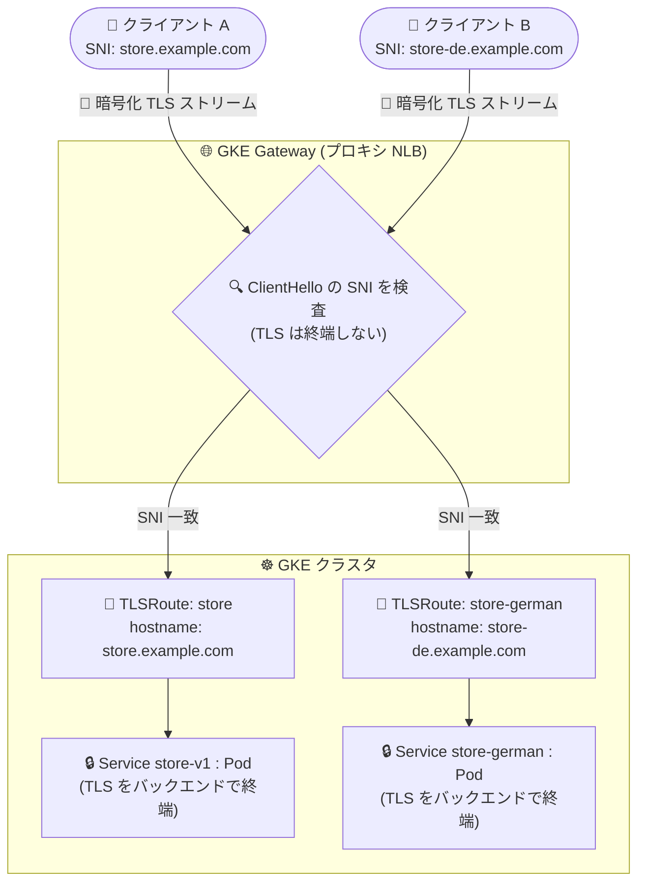

# Google Kubernetes Engine: GKE Gateway が TLSRoute による SNI ベースルーティング (TLS パススルー) をサポート

**リリース日**: 2026-11-09

**サービス**: Google Kubernetes Engine (GKE)

**機能**: GKE Gateway の SNI ベースルーティングと TLS パススルー (TLSRoute リソース)

**ステータス**: 一般提供 (GA)

📊 [このアップデートのインフォグラフィックを見る](https://takech9203.github.io/google-cloud-news-summary/20261109-gke-gateway-tlsroute-sni-passthrough.html)

## 概要

GKE Gateway が Server Name Indication (SNI) ベースのルーティングと TLS パススルーをサポートしました。TLS プロトコル固有のルールを使用して、GKE Gateway のロードバランサで TLS を終端せずに、受信した TLS ストリームを SNI ホスト名に基づいて Kubernetes Service にルーティングできます。アプリケーション開発者は TLSRoute リソースを作成することで、GKE クラスタ内で稼働するアプリケーションにセキュアな TLS トラフィックを公開できます。

TLS パススルーでは、ロードバランサは TLS セッションを終端 (復号) しません。クライアントが TLS ハンドシェイクを開始すると、ロードバランサは暗号化されていない ClientHello メッセージから SNI ホスト名を読み取り、そのホスト名に基づいて暗号化された TCP ストリームをそのまま適切なバックエンド Service に転送します。TLS の終端はバックエンドの Pod 側で行われるため、クライアントから Pod までのエンドツーエンド暗号化が維持されます。

TLSRoute リソースの作成には Gateway API バージョン 1.5.0 以降の CRD (Standard チャネル) が必要で、これは GKE バージョン 1.35.2-gke.1842000 以降にインストールされます。シングルクラスタおよびマルチクラスタの GKE Gateway ロードバランサの両方がサポートされます。なお、同日に Cloud Load Balancing 側でもプロキシ ネットワーク ロードバランサの SNI ベースルーティングの GA が発表されており ([関連レポート](./2026-11-09-cloud-load-balancing-sni-tls-routes-ga.md))、本機能はその基盤を GKE Gateway API から利用できるようにするものです。

**アップデート前の課題**

- GKE Gateway は L7 (HTTP/HTTPS) のアプリケーション ロードバランサが中心で、Gateway でのルーティングには TLS の終端が前提だった。エンドツーエンド暗号化や mTLS が必須のゼロトラスト要件を Gateway API で満たすことが難しかった
- ロードバランサで TLS を終端するため、証明書と秘密鍵をロードバランサ側に配置する必要があり、バックエンドで直接クライアント認証 (mTLS) を行う構成が組めなかった
- 非 HTTP の TLS ベースプロトコル (データベース、カスタム gRPC、独自プロトコルなど) を Gateway API 経由で公開できず、サービスごとに個別の IP アドレスや別のロードバランサが必要になるケースがあった

**アップデート後の改善**

- TLSRoute リソースにより、ロードバランサで TLS を終端せずに SNI ホスト名ベースで暗号化ストリームをバックエンド Service にルーティングできるようになった
- クライアントから Pod までのエンドツーエンド暗号化が維持され、ロードバランサに秘密鍵を渡す必要がなくなり、バックエンドでの mTLS 認証が可能になった
- 単一の Gateway IP アドレスとポート (443 など) で複数ドメインの独立した TLS サービスを多重化でき、IPv4 アドレスを節約できるようになった
- 非 HTTP の TLS ベースプロトコルも Gateway API で公開できるようになった

## アーキテクチャ図



GKE Gateway (プロキシ ネットワーク ロードバランサ) は ClientHello の SNI ホスト名のみを検査し、暗号化されたままの TCP ストリームを TLSRoute の定義に従ってバックエンド Service に転送します。TLS 終端はバックエンド Pod で行われ、エンドツーエンド暗号化が維持されます。

## サービスアップデートの詳細

### 主要機能

1. **SNI ベースルーティング (TLS パススルー)**
   - Gateway の TLS リスナー (`protocol: TLS`、`tls.mode: Passthrough`) が ClientHello の SNI ホスト名を検査し、復号せずにバックエンドへルーティング
   - 複数のリスナーが同一ポート (443 など) を共有し、SNI ホスト名ごとに異なるバックエンドへ振り分け可能
   - Passthrough モードでは `tls` ブロックに `certificateRefs` フィールドは不要 (証明書はバックエンド Pod 側に配置)

2. **TLSRoute リソース**
   - `gateway.networking.k8s.io/v1` の TLSRoute リソースで、`hostnames` に一致する接続を `backendRefs` の Service にルーティング
   - ワイルドカード ホスト名マッチング (`*.example.com`) に対応。完全一致がワイルドカードより優先され、競合時は作成タイムスタンプが古いルートが優先される
   - ReferenceGrant によるクロス namespace ルーティングに対応し、プラットフォームチームと開発チームの責務分離 (マルチテナント構成) が可能
   - GKE 固有のステータス条件 `Reconciled` により、基盤となる Google Cloud リソースの作成状況を確認可能

3. **シングルクラスタ / マルチクラスタ対応**
   - 対応 GatewayClass: `gke-l7-rilb`、`gke-l7-regional-external-managed`、`gke-l7-rilb-mc`、`gke-l7-regional-external-managed-mc`、`gke-l7-cross-regional-internal-managed-mc`
   - マルチクラスタ構成では ServiceExport / ServiceImport を使用してフリート内の複数クラスタにまたがるバックエンドを参照
   - クロスリージョン マルチクラスタ Gateway では `spec.addresses` に複数リージョンの IP アドレスを定義可能。各 IP は個別の転送ルールに変換されるが、ターゲット プロキシとルーティング設定は共有され、TLSRoute の重複やクォータ枯渇を防止

## 技術仕様

### 要件と対応構成

| 項目 | 詳細 |
|------|------|
| 必要な Gateway API バージョン | 1.5.0 以降の CRD (Standard チャネル) |
| 必要な GKE バージョン | 1.35.2-gke.1842000 以降 |
| 対応 GatewayClass (シングルクラスタ) | `gke-l7-rilb`、`gke-l7-regional-external-managed` |
| 対応 GatewayClass (マルチクラスタ) | `gke-l7-rilb-mc`、`gke-l7-regional-external-managed-mc`、`gke-l7-cross-regional-internal-managed-mc` |
| 非対応 GatewayClass | `gke-l7-global-external-managed`、`gke-l7-global-external-managed-mc`、`gke-l7-gxlb`、`gke-l7-gxlb-mc` |
| 基盤となるロードバランサ | リージョン外部/リージョン内部/クロスリージョン内部プロキシ ネットワーク ロードバランサ (TCP プロキシ) |
| リスナー設定 | `protocol: TLS`、`tls.mode: Passthrough` (Passthrough は TLS リスナーのみ対応) |
| バックエンド参照 | Service (シングルクラスタ)、ServiceImport (マルチクラスタ、`group: net.gke.io`) |
| ヘルスチェック | バックエンドとの TLS ハンドシェイク完了により判定 |

### Gateway と TLSRoute のマニフェスト例

```yaml
kind: Gateway
apiVersion: gateway.networking.k8s.io/v1
metadata:
  name: store-tls
spec:
  gatewayClassName: gke-l7-regional-external-managed
  listeners:
  - name: store
    protocol: TLS
    port: 443
    hostname: "store.example.com"
    tls:
      mode: Passthrough
    allowedRoutes:
      kinds:
      - kind: TLSRoute
---
kind: TLSRoute
apiVersion: gateway.networking.k8s.io/v1
metadata:
  name: store
spec:
  parentRefs:
  - kind: Gateway
    name: store-tls
    sectionName: store
  hostnames:
  - "store.example.com"
  rules:
  - backendRefs:
    - name: store-v1
      port: 443
```

`sectionName` で Gateway 上のターゲット リスナーを選択します。`port` はコンテナポートではなく Service のポートを指定します。

## 設定方法

### 前提条件

1. GKE バージョン 1.35.2-gke.1842000 以降のクラスタ (Gateway API 1.5.0 CRD がインストール済み) で Gateway API が有効であること
2. リージョン Gateway を使用するリージョンにプロキシ専用サブネット (`purpose=REGIONAL_MANAGED_PROXY`) が存在すること
3. (推奨) Gateway 用のリージョン静的 IP アドレスを予約済みであること
4. バックエンド Pod が TLS を終端できること (証明書をバックエンド側に配置)

### 手順

#### ステップ 1: TLS パススルー リスナーを持つ Gateway をデプロイ

```bash
kubectl apply -f store-gateway.yaml

# Gateway がプログラムされたことを確認 (プロビジョニングには数分かかる)
kubectl get gateway store-tls
```

`tls.mode: Passthrough` の TLS リスナーを定義した Gateway を作成します。内部公開の場合は `gatewayClassName` を `gke-l7-rilb` に変更し、`addresses` フィールドを削除します。

#### ステップ 2: TLSRoute をデプロイしてルーティングを検証

```bash
kubectl apply -f store-tls-routes.yaml

# Gateway コントローラがルートを受理したことを確認
kubectl get tlsroute store -o yaml

# SNI によるルーティングを検証 (-servername の値だけで返る証明書が変わる)
openssl s_client -connect GATEWAY_IP:443 \
  -servername store-de.example.com </dev/null 2>/dev/null \
  | openssl x509 -noout -subject
```

ステータスの `Accepted` と GKE 固有の `Reconciled` 条件が `True` であれば、基盤の Google Cloud リソースが作成されています。どのリスナーにも一致しない SNI ホスト名の接続はクローズされます。

## メリット

### ビジネス面

- **ゼロトラスト コンプライアンス対応**: クライアントからバックエンド Pod までトラフィックが完全に暗号化されたまま維持され、ロードバランサに秘密鍵や平文データへのアクセスを与えないため、厳格なセキュリティ/コンプライアンス要件を満たしやすい
- **コスト・リソース効率**: 単一の Gateway IP アドレスとポートで複数ドメインの TLS サービスを多重化でき、IPv4 アドレスとロードバランサ リソースを節約できる

### 技術面

- **バックエンドでの mTLS 認証**: TLS 終端がバックエンドで行われるため、アプリケーション層でクライアント証明書を直接検証する mTLS 構成が可能
- **非 HTTP プロトコルのサポート**: ステートフル ワークロード、データベース、カスタム gRPC、独自プロトコルなど TLS 上で動作する任意のプロトコルをルーティング可能
- **Gateway API の標準リソースで宣言的に管理**: ロール指向の Gateway API モデルに従い、インフラチームが Gateway を、開発チームが TLSRoute を管理する分離構成 (ReferenceGrant 併用) が組める

## デメリット・制約事項

### 制限事項

- グローバル GatewayClass (`gke-l7-global-external-managed`、`gke-l7-global-external-managed-mc`) および classic GatewayClass (`gke-l7-gxlb`、`gke-l7-gxlb-mc`) は TLS パススルーと TLSRoute に非対応 (リージョン/クロスリージョン構成のみ)
- L4 TCP プロキシ ロードバランサのため、URL リライト、パスベース ルーティング、HTTP ヘッダー変換などの L7 機能は適用されない
- Gateway API 1.5.0 以降の CRD が必要で、GKE 1.35.2-gke.1842000 以降へのアップグレードが前提

### 考慮すべき点

- **HTTP/2 コネクション結合 (connection coalescing)**: 同一 Gateway IP の背後で複数の HTTPS サービスを多重化する場合、バックエンド証明書のドメインが重複 (ワイルドカード証明書や共通 SAN) していると、HTTP/2 クライアントが既存接続を再利用して誤ったバックエンドにリクエストが届く可能性がある。重複しない証明書を使用するか、バックエンドで `421 Misdirected Request` を返す実装が推奨される
- TLS 終端とヘルスチェック (TLS ハンドシェイク) がバックエンドで行われるため、Pod 側に証明書管理の責務が移る。初回ヘルスチェックの通過に数分かかる場合がある
- HTTPRoute と TLSRoute が同じ Service を参照する場合、HealthCheckPolicy は両方のバックエンドに適用される。独立したヘルスチェックが必要な場合はルートごとに別の Service を作成する

## ユースケース

### ユースケース 1: mTLS 必須の金融系 API をエンドツーエンド暗号化で公開

**シナリオ**: 規制要件により、クライアントからアプリケーションまでの通信を中間で復号せず、アプリケーション層でクライアント証明書を検証 (mTLS) する必要がある金融系 API を GKE 上で運用する。

**実装例**:
```yaml
kind: Gateway
apiVersion: gateway.networking.k8s.io/v1
metadata:
  name: fintech-gateway
spec:
  gatewayClassName: gke-l7-rilb   # VPC 内部公開
  listeners:
  - name: payments
    protocol: TLS
    port: 443
    hostname: "payments.internal.example.com"
    tls:
      mode: Passthrough
    allowedRoutes:
      kinds:
      - kind: TLSRoute
```

**効果**: ロードバランサに秘密鍵を配置せずに VPC 内部でサービスを公開でき、バックエンド Pod が直接 mTLS でクライアントを認証。ゼロトラスト要件を Gateway API の標準リソースだけで実現できる。

### ユースケース 2: 単一 IP で複数ドメインの TLS サービスを多重化 (マルチクラスタ)

**シナリオ**: SaaS 事業者が、複数リージョンの GKE クラスタで稼働するテナントごとの TLS サービス (非 HTTP プロトコルを含む) を、単一の内部 VIP で公開したい。

**効果**: `gke-l7-cross-regional-internal-managed-mc` GatewayClass と ServiceImport を使用し、SNI ホスト名ごとに適切なクラスタ/Service へルーティング。単一 Gateway の `spec.addresses` に複数リージョンの IP を定義してもルーティング設定は共有されるため、IP アドレスとクォータを節約しながらクロスリージョンの可用性を確保できる。

## 料金

GKE Gateway 自体に追加料金はなく、基盤として作成されるプロキシ ネットワーク ロードバランサ (リージョン外部/内部、クロスリージョン内部) の料金が Cloud Load Balancing の料金体系に従って課金されます。詳細は [Cloud Load Balancing の料金ページ](https://cloud.google.com/vpc/network-pricing#lb) を参照してください。

## 利用可能リージョン

リージョン外部/リージョン内部プロキシ ネットワーク ロードバランサが利用可能なリージョンで使用できます。クラスタが GKE 1.35.2-gke.1842000 以降である必要があります。詳細は[公式ドキュメント](https://docs.cloud.google.com/kubernetes-engine/docs/how-to/deploy-tls-passthrough-gateway)を参照してください。

## 関連サービス・機能

- **Cloud Load Balancing**: 本機能の基盤。同日にプロキシ ネットワーク ロードバランサの SNI ベースルーティング GA が発表されている ([関連レポート](./2026-11-09-cloud-load-balancing-sni-tls-routes-ga.md))
- **マルチクラスタ Service (MCS)**: マルチクラスタ構成で ServiceExport / ServiceImport を使用してフリート内のバックエンドを参照
- **GKE Gateway コントローラ**: Gateway / HTTPRoute / TLSRoute リソースを Google Cloud のロードバランサ リソースに変換する Google ホスト型コントローラ
- **Certificate Manager / Secret**: Passthrough モードでは不使用。証明書はバックエンド Pod 側 (アプリケーションや cert-manager など) で管理する

## 参考リンク

- 📊 [インフォグラフィック](https://takech9203.github.io/google-cloud-news-summary/20261109-gke-gateway-tlsroute-sni-passthrough.html)
- [公式リリースノート](https://docs.cloud.google.com/release-notes#November_09_2026)
- [ドキュメント: Deploy a TLS passthrough Gateway](https://docs.cloud.google.com/kubernetes-engine/docs/how-to/deploy-tls-passthrough-gateway)
- [ドキュメント: GatewayClass capabilities](https://docs.cloud.google.com/kubernetes-engine/docs/how-to/gatewayclass-capabilities)
- [ドキュメント: GKE Gateway API の概要](https://docs.cloud.google.com/kubernetes-engine/docs/concepts/gateway-api)
- [料金ページ (Cloud Load Balancing)](https://cloud.google.com/vpc/network-pricing#lb)

## まとめ

GKE Gateway の TLSRoute サポートにより、ロードバランサで TLS を終端せずに SNI ベースで暗号化トラフィックをルーティングできるようになり、エンドツーエンド暗号化・mTLS・非 HTTP プロトコル公開といった要件を Gateway API の標準リソースで満たせるようになりました。従来 Ingress や独自構成で TLS パススルーを実現していたチームは、GKE 1.35.2-gke.1842000 以降へのアップグレードと対応 GatewayClass の確認を行い、Gateway API ベースへの移行を検討することを推奨します。

---

**タグ**: #GKE #GatewayAPI #TLSRoute #SNI #TLSPassthrough #ネットワーキング #セキュリティ #mTLS #GA
