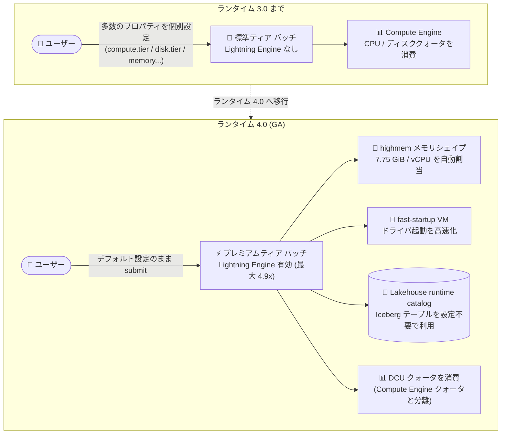

# Managed Service for Apache Spark: ランタイムバージョン 4.0 が一般提供 (GA)

**リリース日**: 2026-11-09

**サービス**: Managed Service for Apache Spark (旧 Google Cloud Serverless for Apache Spark)

**機能**: Spark ランタイムバージョン 4.0 の一般提供 (GA)

**ステータス**: GA (一般提供)

📊 [このアップデートのインフォグラフィックを見る](https://takech9203.github.io/google-cloud-news-summary/20261109-managed-service-apache-spark-runtime-4-0-ga.html)

## 概要

Managed Service for Apache Spark (旧称: Google Cloud Serverless for Apache Spark) のランタイムバージョン 4.0 が一般提供 (GA) になりました。Apache Spark 4.2.0、BigQuery Connector 0.46.0、Cloud Storage Connector 4.0.7、Java 25、Python 3.13、Scala 2.13.17 といった最新のコンポーネント群で構成され、サーバーレス Spark の実行基盤が大幅に刷新されています。

ランタイム 4.0 は単なるコンポーネント更新に留まらず、実行モデルのデフォルトが大きく変わるメジャーアップデートです。バッチワークロードはデフォルトでプレミアムティアで実行され、Google 独自の高速クエリ実行エンジン「Lightning Engine」(オープンソース Spark 比で最大 4.9 倍の性能) が標準で有効化されます。また、「メモリシェイプ」によるメモリ設定の簡素化、fast-startup VM によるドライバ起動時間の短縮、Apache Iceberg テーブルを設定不要で扱える Lakehouse runtime catalog のデフォルト化、Compute Engine クォータに代わる DCU (Data Compute Units) クォータの導入など、設定の簡素化とパフォーマンス向上を両立する変更が多数含まれます。

ETL パイプラインやデータレイクハウス処理をサーバーレス Spark で運用しているデータエンジニア、および Dataproc Serverless からの移行を検討しているチームにとって重要なアップデートです。一方で、SparkR バッチ、Jupyter セッション、Persistent History Server など一部機能が非サポートとなるため、移行時には挙動変更の確認が必要です。

**アップデート前の課題**

- Lightning Engine やプレミアムコンピュート/ディスクを使うには `spark.dataproc.driver.compute.tier` や `spark.dataproc.executor.disk.tier` など複数のプロパティを個別に設定する必要があった
- ドライバ/エグゼキュータのメモリは `spark.driver.memory` や `spark.executor.memoryOverhead` などを手動で調整する必要があり、適切なサイジングに試行錯誤が必要だった
- Apache Iceberg テーブルを利用するには Spark カタログの構成を明示的に行う必要があった
- ワークロードのリソース消費がプロジェクトの Compute Engine CPU / ディスククォータを圧迫し、他のワークロードとクォータを奪い合う構造だった

**アップデート後の改善**

- バッチワークロードがデフォルトでプレミアムティア + Lightning Engine で実行され、設定なしで高速なクエリ実行が得られるようになった (`dataproc.tier` プロパティ 1 つでティアを制御)
- メモリシェイプ (デフォルト `highmem`: 7.75 GiB/vCPU) の導入により、メモリ関連プロパティを設定しなくても自動的に Spark ヒープとオーバーヘッドがサイジングされるようになった
- デフォルトのドライバ構成を使うプレミアムティアワークロードは fast-startup VM でドライバを起動でき、ワークロードの起動時間が短縮された
- Lakehouse runtime catalog がデフォルトの Spark カタログとなり、カタログ設定なしで Iceberg テーブルの作成・クエリが可能になった
- GPU を使わないワークロードは専用の DCU クォータを消費するようになり、プロジェクトの Compute Engine CPU / ディスククォータと分離された

## アーキテクチャ図



ランタイム 4.0 では、プレミアムティア + Lightning Engine + highmem メモリシェイプがデフォルトとなり、ユーザーが個別にプロパティを設定しなくても高性能な構成でバッチワークロードが実行されます。クォータも Compute Engine から専用の DCU クォータに移行します。

## サービスアップデートの詳細

### 主要機能

1. **最新コンポーネントへの刷新**
   - Apache Spark 4.2.0、BigQuery Connector 0.46.0、Cloud Storage Connector 4.0.7、Java 25、Python 3.13、Scala 2.13.17 を搭載
   - デフォルト文字エンコーディングは UTF-8
   - Python 環境の管理が Conda から [Pixi](https://pixi.prefix.dev) に変更

2. **プレミアムティア + Lightning Engine がデフォルト**
   - バッチワークロードは `dataproc.tier` を `standard` に設定しない限りプレミアムティアで実行 (インタラクティブセッションは常にプレミアムティア)
   - プレミアムティアのバッチワークロードは Lightning Engine をデフォルトで使用 (オプトアウトは `spark.dataproc.engine=default`)
   - インタラクティブセッションで Lightning Engine を使う場合は `spark.dataproc.engine=lightningEngine` を設定、Native Query Execution も使う場合は `spark.dataproc.lightningEngine.runtime=native` を追加
   - 従来の `spark.dataproc.driver.compute.tier` などの個別プロパティは廃止され、`dataproc.tier` 1 つでドライバ/エグゼキュータのコンピュート・ディスクリソースが決まる

3. **メモリシェイプの導入**
   - ドライバ/エグゼキュータのメモリをシェイプ (`highmem` / `standard`) で指定する新方式
   - デフォルトは `highmem` (7.75 GiB/vCPU)。`standard` は 3.75 GiB/vCPU
   - Spark ヒープとメモリオーバーヘッドへの分割は自動 (`spark.driver.memory` などの手動設定が不要に)
   - 分割比率を変えたい場合は `spark.driver.memoryOverheadFactor` / `spark.executor.memoryOverheadFactor` を使用

4. **fast-startup VM によるドライバ起動高速化**
   - プレミアムティアでデフォルトのドライバ構成 (4 vCPU、メモリシェイプ使用、ディスク 450 GiB 以下、メモリ手動設定・GPU なし) を使う場合、ドライバが fast-startup VM で起動し、ワークロードの起動時間が短縮される

5. **Lakehouse runtime catalog がデフォルトカタログ**
   - バッチワークロードとインタラクティブセッションのデフォルト Spark カタログが Lakehouse runtime catalog になり、カタログを構成せずに Apache Iceberg テーブルの作成・クエリが可能
   - 従来の事前構成済み `bigquery` Spark カタログも引き続き利用可能

6. **DCU クォータの導入**
   - GPU を使わないワークロードは、Compute Engine の CPU / ディスククォータではなく Dataproc API の DCU クォータ (`dataproc.googleapis.com/data_compute_units`) を消費
   - GPU、予約、グローバル Compute Engine クォータは DCU クォータモデルの対象外

## 技術仕様

### ランタイム 4.0 コンポーネント

| コンポーネント | バージョン |
|------|------|
| Apache Spark | 4.2.0 |
| BigQuery Connector | 0.46.0 |
| Cloud Storage Connector | 4.0.7 |
| Java | 25 |
| Python | 3.13 |
| Scala | 2.13.17 |

### メモリシェイプ (4 vCPU 時のデフォルト設定)

| メモリシェイプ | メモリ/vCPU | PySpark バッチ (memory / overhead) | その他バッチ・セッション (memory / overhead) |
|------|------|------|------|
| `highmem` (デフォルト) | 7.75 GiB | 21154m / 8462m | 26924m / 2692m |
| `standard` | 3.75 GiB | 9681m / 3872m | 12321m / 1232m |

### デフォルトディスクサイズ

| ティア | ドライバ/エグゼキュータごとのデフォルトディスクサイズ |
|------|------|
| プレミアム (デフォルト) | 100 GiB/vCPU、最低 375 GiB (例: 4 vCPU で 400 GiB) |
| スタンダード | 75 GiB/vCPU、最大 1,000 GiB (例: 4 vCPU で 300 GiB) |

### DCU 消費量の計算

DCU 使用量はノードごとに VM シェイプから算出されます。

- vCPU あたり 0.6 DCU
- メモリ 1 GB あたり 0.1 DCU (vCPU あたり 8 GB まで)
- vCPU あたり 8 GB を超えるメモリ (拡張メモリ) は 1 GB あたり 0.2 DCU
- プレミアムティアのノードは同一シェイプのスタンダードティアの 1.5 倍の DCU としてカウント

例: スタンダードティアで 4 vCPU / 16 GB メモリのノードは 4 × 0.6 + 16 × 0.1 = 4 DCU。ドライバ 1 + エグゼキュータ 10 のバッチは 44 DCU、同じ構成をプレミアムティアで実行すると 66 DCU を消費します。

## 設定方法

### 前提条件

1. Dataproc API が有効化されている Google Cloud プロジェクト
2. ランタイム 4.0 ではサブネットワークの明示的な指定が必須 (デュアルスタック / IPv6 専用サブネットは非サポート)
3. 想定するワークロードサイズと同時実行数に対して十分な DCU クォータ (`dataproc.googleapis.com/data_compute_units`) があることを事前に確認

### 手順

#### ステップ 1: ランタイム 4.0 でバッチワークロードを送信

```bash
gcloud dataproc batches submit pyspark gs://my-bucket/my_job.py \
  --region=us-central1 \
  --version=4.0 \
  --subnet=projects/my-project/regions/us-central1/subnetworks/my-subnet
```

デフォルトでプレミアムティア + Lightning Engine + `highmem` メモリシェイプで実行されます。

#### ステップ 2: 必要に応じてティアやメモリシェイプを変更

```bash
# スタンダードティアで実行する場合 (Lightning Engine は使用不可)
gcloud dataproc batches submit pyspark gs://my-bucket/my_job.py \
  --region=us-central1 \
  --version=4.0 \
  --subnet=my-subnet \
  --properties=dataproc.tier=standard,spark.dataproc.executor.memory.shape=standard
```

メモリシェイプと `spark.driver.memory` / `spark.executor.memory` などの手動メモリ設定は同時指定できない点に注意してください。

#### ステップ 3: DCU クォータの確認・調整

```bash
# Google Cloud コンソールの「割り当て」ページ (Dataproc API) で
# data_compute_units クォータを確認し、必要に応じて引き上げを申請
```

使用量が上限に近づいたときに自動でクォータを引き上げる quota adjuster の有効化も検討できます。

## メリット

### ビジネス面

- **性能向上によるコスト効率改善**: Lightning Engine により最大 4.9 倍の実行性能が標準で得られ、ジョブ実行時間の短縮が課金時間の削減に直結する
- **予測可能な料金モデル**: プレミアムティアの DCU 単価に Lightning Engine、拡張メモリ、シャッフル集約型ジョブ向けインフラの利用料が含まれ、追加コンピュート費用なしで全プレミアム機能にアクセスできる
- **運用負荷の軽減**: チューニング用プロパティの削減により、Spark 設定の属人化や試行錯誤の工数を削減できる

### 技術面

- **設定の簡素化**: ティア、メモリシェイプ、ディスクサイズがそれぞれ少数のプロパティで決まり、従来の個別プロパティ群が不要になった
- **最新スタックの利用**: Spark 4.2.0、Java 25、Python 3.13 など最新のランタイムで、新しい言語機能やライブラリを利用できる
- **レイクハウス対応の強化**: Lakehouse runtime catalog により Iceberg テーブルをゼロコンフィグで利用でき、BigQuery との連携も `bigquery` カタログで維持
- **クォータの分離**: Spark ワークロードが Compute Engine クォータを消費しなくなり、同一プロジェクト内の他ワークロードとのクォータ競合を回避できる

## デメリット・制約事項

### 制限事項

- `spark.dataproc.driver.compute.tier`、`spark.dataproc.executor.compute.tier`、`spark.dataproc.driver.disk.tier`、`spark.dataproc.executor.disk.tier` プロパティは非サポート (`dataproc.tier` を使用)
- `spark.memory.offHeap.enabled` / `spark.memory.offHeap.size` (オフヒープメモリ) プロパティは非サポート
- SparkR バッチは非サポート (代替: sparklyr)
- Jupyter セッションは非サポート (代替: Spark Connect セッション)
- Persistent History Server (PHS) は非サポート (代替: Spark UI)
- Cloud Storage ステージングバケットは使用されない
- サブネットワークの明示指定が必須。デュアルスタック (IPv4/IPv6) および IPv6 専用サブネットは非サポート
- GPU、予約、グローバル Compute Engine クォータは DCU クォータモデルの対象外
- autoscaling (デフォルト有効) と分散 Spark XGBoost は併用不可 (`spark.dynamicAllocation.enabled=false` で回避)

### 考慮すべき点

- **デフォルトがプレミアムティアに変更**: プレミアム DCU 単価 (約 1.5 倍の DCU カウント) で課金されるため、コスト重視のワークロードは `dataproc.tier=standard` の明示設定を検討する
- **メモリ使用量の増加**: デフォルトの `highmem` シェイプは 3.0 ランタイムのデフォルトより多くのメモリ (7.75 GiB/vCPU) を割り当てるため、DCU 消費が増える。コスト最適化には `standard` シェイプの検討も有効
- **カスタム BigQuery コネクタ利用時の注意**: 独自の Spark BigQuery コネクタ JAR を追加する場合、`dataproc.artifacts.remove=spark-bigquery-connector` を設定しないとバッチワークロードが失敗する
- **移行前の DCU クォータ確認**: ランタイム 4.0 へのオンボーディング時は、想定ワークロードに対して十分な DCU クォータがあるか必ず確認する

## ユースケース

### ユースケース 1: 大規模 ETL パイプラインの高速化

**シナリオ**: Cloud Storage 上の Parquet データを変換して BigQuery にロードする夜間 ETL バッチの実行時間が長く、コスト削減と SLA 短縮が課題。

**実装例**:
```bash
gcloud dataproc batches submit pyspark gs://my-bucket/etl_job.py \
  --region=asia-northeast1 \
  --version=4.0 \
  --subnet=my-subnet
```

**効果**: Lightning Engine がデフォルトで有効になり、コード変更なしで最大 4.9 倍のクエリ実行性能を得られる。実行時間短縮により DCU 課金時間も削減される。

### ユースケース 2: Iceberg ベースのオープンレイクハウス構築

**シナリオ**: Apache Iceberg を中核としたレイクハウスを構築したいが、Spark カタログの構成・管理が負担になっている。

**効果**: Lakehouse runtime catalog がデフォルトカタログのため、カタログ設定なしで Iceberg テーブルの作成・クエリが可能。BigQuery との相互運用も `bigquery` カタログで維持でき、マルチエンジン分析基盤を素早く立ち上げられる。

### ユースケース 3: 起動レイテンシに敏感なスケジュールジョブ

**シナリオ**: Cloud Composer から高頻度で短時間の Spark ジョブを起動しており、ワークロードの起動時間がパイプライン全体のレイテンシのボトルネックになっている。

**効果**: デフォルトドライバ構成のままプレミアムティアで実行すれば fast-startup VM が適用され、起動時間が短縮される。標準/プレミアムティアの平均起動時間は 40〜50 秒。

## 料金

Managed Service for Apache Spark のサーバーレスデプロイは DCU (Data Compute Unit)、シャッフルストレージ、GPU (使用時) に対して秒単位で課金されます。ランタイム 4.0 ではバッチワークロードがデフォルトでプレミアムティアとなるため、プレミアム DCU 単価が適用される点に注意が必要です。

### 料金例 (公開されている開始価格)

| 項目 | 料金 (開始価格) |
|--------|-----------------|
| サーバーレス スタンダードティア | $0.06 / DCU 時間〜 |
| サーバーレス プレミアムティア (Lightning Engine / GPU 対応) | $0.089 / DCU 時間〜 |

プレミアムティアでは Lightning Engine、拡張メモリ、シャッフル集約型ジョブ向けインフラの利用がプレミアム DCU 単価に含まれ、これらの機能を有効化しても追加のコンピュート費用は発生しません。リージョン別の詳細は[料金ページ](https://cloud.google.com/products/managed-service-for-apache-spark/pricing)を参照してください。

## 利用可能リージョン

リージョン別の提供状況は[公式ドキュメント](https://docs.cloud.google.com/managed-spark/docs)および[料金ページ](https://cloud.google.com/products/managed-service-for-apache-spark/pricing)を参照してください。

## 関連サービス・機能

- **BigQuery**: BigQuery Connector 0.46.0 を同梱。`bigquery` Spark カタログにより BigQuery ネイティブテーブルとシームレスに連携
- **BigLake / Apache Iceberg**: Lakehouse runtime catalog により Iceberg テーブルをデフォルトで利用可能。オープンレイクハウス構成の中核エンジンとなる
- **Cloud Storage**: Cloud Storage Connector 4.0.7 でデータレイクへのアクセスを提供 (4.0 ではステージングバケットは不使用)
- **Dataproc (マネージドクラスタ)**: 同一プロダクト配下のクラスタ型デプロイメント。細かい制御や既存ワークロード移行にはクラスタ、ゼロオペレーションにはサーバーレスを選択
- **Cloud Composer / Workflows**: バッチワークロードのオーケストレーションに利用
- **Cloud Monitoring / Spark UI**: PHS 廃止に伴い、モニタリングとトラブルシューティングは Spark UI と Cloud Monitoring を使用

## 参考リンク

- 📊 [インフォグラフィック](https://takech9203.github.io/google-cloud-news-summary/20261109-managed-service-apache-spark-runtime-4-0-ga.html)
- [公式リリースノート](https://docs.cloud.google.com/release-notes#November_09_2026)
- [Spark ランタイム 4.0 ドキュメント](https://docs.cloud.google.com/managed-spark/docs/concepts/versions/spark-runtime-4.0)
- [スタンダード / プレミアムティア](https://docs.cloud.google.com/managed-spark/docs/tiers)
- [Lightning Engine](https://docs.cloud.google.com/managed-spark/docs/guides/lightning-engine-serverless)
- [サーバーレス DCU クォータ](https://docs.cloud.google.com/managed-spark/quotas-serverless)
- [料金ページ](https://cloud.google.com/products/managed-service-for-apache-spark/pricing)

## まとめ

ランタイム 4.0 は、Spark 4.2.0 / Java 25 / Python 3.13 への刷新に加え、プレミアムティア + Lightning Engine のデフォルト化、メモリシェイプ、DCU クォータ移行など実行モデルの大きな変更を伴う GA リリースです。性能と設定の簡素化のメリットが大きい一方、デフォルトのティア変更によるコスト影響や SparkR / Jupyter セッション / PHS の非サポートなど移行時の確認事項も多いため、既存ワークロードは「Unsupported functionality and behavior changes」を確認のうえ、DCU クォータを事前に見積もってから段階的に 4.0 へ移行することを推奨します。

---

**タグ**: Managed Service for Apache Spark, Serverless Spark, Runtime 4.0, Lightning Engine, Apache Spark 4.2, GA, データ分析, レイクハウス, Apache Iceberg
