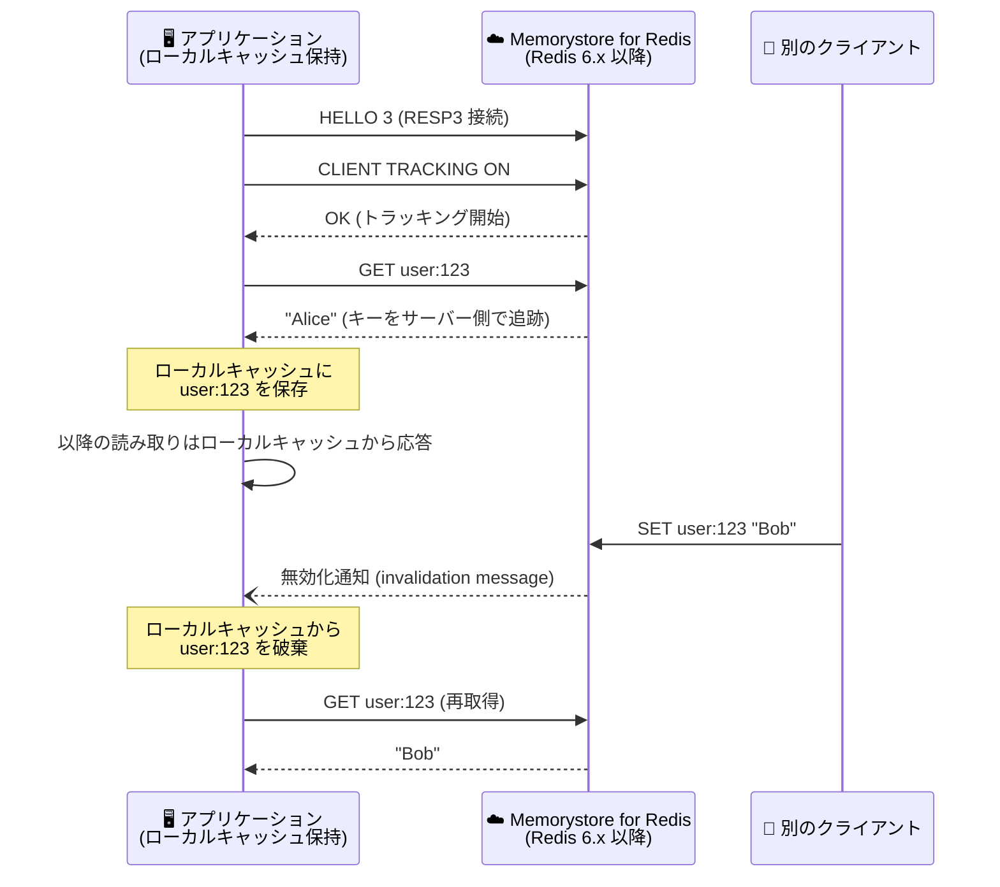

# Memorystore for Redis: CLIENT コマンドおよびサブコマンドのサポートが GA

**リリース日**: 2026-11-09

**サービス**: Memorystore for Redis

**機能**: CLIENT コマンドと 13 のサブコマンド (CACHING / GETNAME / GETREDIR / HELP / ID / INFO / KILL / LIST / NO-TOUCH / REPLY / SETNAME / TRACKING / TRACKINGINFO) のサポート

**ステータス**: GA (一般提供)

📊 [このアップデートのインフォグラフィックを見る](https://takech9203.github.io/google-cloud-news-summary/20261109-memorystore-redis-client-command-ga.html)

## 概要

Memorystore for Redis が Redis の `CLIENT` コマンドと 13 のサブコマンド (`CACHING`、`GETNAME`、`GETREDIR`、`HELP`、`ID`、`INFO`、`KILL`、`LIST`、`NO-TOUCH`、`REPLY`、`SETNAME`、`TRACKING`、`TRACKINGINFO`) をサポートし、一般提供 (GA) となりました。`CLIENT` コマンドは、Redis サーバーに接続しているクライアント接続の管理・調査を行うためのコマンド群で、接続のトラブルシューティングやクライアントサイドキャッシング (Client-side Caching) の実現に不可欠な機能です。

特に注目すべきは `CLIENT TRACKING` / `CLIENT CACHING` / `CLIENT TRACKINGINFO` / `CLIENT GETREDIR` のサポートです。これらは Redis 6 で導入されたクライアントサイドキャッシング機能 (サーバー支援型のキャッシュ無効化通知) を構成するコマンドであり、アプリケーション側のローカルキャッシュとサーバー側データの整合性をサーバーからの無効化通知で保つことができるようになります。これにより、頻繁に読み取られるデータへのアクセスをアプリケーションのメモリ内で完結させ、Redis への往復 (ラウンドトリップ) を大幅に削減できます。

対象ユーザーは、Memorystore for Redis を利用するすべての開発者・運用者です。接続管理 (`CLIENT LIST` / `CLIENT KILL` / `CLIENT INFO`) による運用トラブルシューティングと、クライアントサイドキャッシングによるレイテンシ削減の両面でメリットがあります。なお、公式ドキュメントによると、この CLIENT コマンドグループは Redis バージョン 6.x 以降のインスタンスでのみサポートされます。

**アップデート前の課題**

- Memorystore for Redis では `CLIENT` コマンドグループが利用できず、接続中のクライアントの一覧取得 (`CLIENT LIST`) や問題のある接続の強制切断 (`CLIENT KILL`) をサーバーコマンドで行えなかった
- Redis 6 で導入されたサーバー支援型クライアントサイドキャッシング (`CLIENT TRACKING`) が利用できず、ローカルキャッシュの無効化は TTL ベースなどアプリケーション独自の仕組みで実装する必要があった
- 接続に名前を付けて識別する (`CLIENT SETNAME` / `GETNAME`) ことができず、多数の接続の中からアプリケーションやワーカーを特定するトラブルシューティングが困難だった

**アップデート後の改善**

- `CLIENT LIST` / `CLIENT INFO` / `CLIENT ID` / `CLIENT KILL` により、接続の可視化・特定・強制切断といった接続管理操作がオープンソース Redis と同じ方法で可能になった
- `CLIENT TRACKING` / `CLIENT CACHING` / `CLIENT TRACKINGINFO` / `CLIENT GETREDIR` により、サーバーからの無効化通知を活用したクライアントサイドキャッシングを Memorystore for Redis 上で実装できるようになった
- `CLIENT SETNAME` / `CLIENT GETNAME` による接続の命名、`CLIENT NO-TOUCH` による LRU/LFU 情報へ影響を与えない読み取り、`CLIENT REPLY` による応答制御が可能になり、オープンソース Redis との互換性が向上した

## アーキテクチャ図



`CLIENT TRACKING` を有効にしたクライアントサイドキャッシングのフローです。クライアントが読み取ったキーをサーバーが追跡し、他のクライアントがそのキーを変更するとサーバーから無効化通知が届くため、ローカルキャッシュとサーバーデータの整合性を保ちながら Redis への往復を削減できます。

## サービスアップデートの詳細

### 主要機能

1. **接続管理・調査コマンド (`LIST` / `INFO` / `ID` / `GETNAME` / `SETNAME` / `KILL`)**
   - `CLIENT LIST`: サーバーに接続中の全クライアントの情報 (アドレス、名前、アイドル時間など) を一覧表示
   - `CLIENT INFO` / `CLIENT ID`: 現在の接続自身の情報・一意な ID を取得
   - `CLIENT SETNAME` / `CLIENT GETNAME`: 接続に名前を設定・取得し、アプリケーションやワーカー単位で接続を識別
   - `CLIENT KILL`: アドレス、ID、名前などの条件を指定して特定のクライアント接続を強制切断

2. **クライアントサイドキャッシング関連コマンド (`TRACKING` / `CACHING` / `TRACKINGINFO` / `GETREDIR`)**
   - `CLIENT TRACKING ON`: サーバー支援型のキー無効化通知を有効化。デフォルトモードのほか、`OPTIN` / `OPTOUT` / `BCAST` (プレフィックス単位のブロードキャスト) モードを指定可能
   - `CLIENT CACHING YES|NO`: `OPTIN` / `OPTOUT` モード使用時に、次のコマンドで読むキーをキャッシュ対象にするかを個別指定
   - `CLIENT TRACKINGINFO`: 現在の接続のトラッキング状態 (フラグ、リダイレクト先など) を確認
   - `CLIENT GETREDIR`: 無効化通知のリダイレクト先クライアント ID を取得 (RESP2 クライアントが Pub/Sub 経由で通知を受ける構成で使用)

3. **その他の制御コマンド (`NO-TOUCH` / `REPLY` / `HELP`)**
   - `CLIENT NO-TOUCH ON`: コマンド実行時にキーの LRU/LFU アクセス情報を更新しないよう設定。デバッグ目的の読み取りがエビクション判断へ影響することを防止
   - `CLIENT REPLY OFF|SKIP|ON`: サーバーからの応答を抑制・スキップし、応答を読まない一方向の書き込みを効率化
   - `CLIENT HELP`: サブコマンドのヘルプを表示

## 技術仕様

### サポート対象とバージョン要件

| 項目 | 詳細 |
|------|------|
| 対象サービス | Memorystore for Redis |
| サポートされるサブコマンド | CACHING, GETNAME, GETREDIR, HELP, ID, INFO, KILL, LIST, NO-TOUCH, REPLY, SETNAME, TRACKING, TRACKINGINFO |
| バージョン要件 | Redis 6.x 以降のインスタンスでのみサポート |
| 引き続きブロックされるサブコマンド | CLIENT NO-EVICT, CLIENT PAUSE, CLIENT SETINFO, CLIENT UNBLOCK, CLIENT UNPAUSE (NOPERM エラーを返す) |
| ステータス | GA (一般提供) |

### クライアントサイドキャッシングの通知方式

| 方式 | プロトコル | 説明 |
|------|-----------|------|
| デフォルト (RESP3) | RESP3 | `HELLO 3` で接続し、同一接続上で無効化通知 (push メッセージ) を受信 |
| リダイレクトモード (RESP2) | RESP2 | `CLIENT TRACKING ON REDIRECT <client-id>` で別接続に通知をリダイレクトし、`__redis__:invalidate` チャネルの Pub/Sub で受信 |
| ブロードキャストモード | RESP3/RESP2 | `CLIENT TRACKING ON BCAST PREFIX <prefix>` でプレフィックスに一致するキーの変更を全購読クライアントへ通知 (サーバー側のキー追跡メモリが不要) |

## 設定方法

### 前提条件

1. Memorystore for Redis インスタンスが Redis バージョン 6.x 以降であること
2. インスタンスに接続できるクライアント環境 (`redis-cli` など) があること

### 手順

#### ステップ 1: 接続管理コマンドの利用

```bash
# インスタンスに接続
redis-cli -h <INSTANCE_IP> -p 6379

# 接続に名前を付ける
CLIENT SETNAME my-worker-01

# 接続中のクライアント一覧を確認
CLIENT LIST

# 問題のある接続を ID 指定で切断
CLIENT KILL ID <client-id>
```

`CLIENT LIST` の出力から、各接続のアドレス・名前・アイドル時間などを確認し、必要に応じて `CLIENT KILL` で切断できます。

#### ステップ 2: クライアントサイドキャッシングの有効化

```bash
# RESP3 で接続 (redis-cli の場合は -3 オプション)
redis-cli -3 -h <INSTANCE_IP> -p 6379

# トラッキングを有効化
CLIENT TRACKING ON

# キーを読み取る (このキーがサーバー側で追跡される)
GET user:123

# トラッキング状態を確認
CLIENT TRACKINGINFO
```

トラッキング有効化後にクライアントが読み取ったキーが他のクライアントによって変更されると、サーバーから無効化通知が届きます。アプリケーションではこの通知を受けてローカルキャッシュのエントリを破棄します。実運用では、クライアントサイドキャッシングに対応した Redis クライアントライブラリの利用を推奨します。

## メリット

### ビジネス面

- **レイテンシ削減によるユーザー体験向上**: クライアントサイドキャッシングにより、頻繁に読まれるデータをアプリケーションのメモリから直接返せるため、応答時間を短縮できる
- **Redis 負荷とコストの抑制**: 読み取りリクエストの多くをローカルキャッシュで吸収できるため、Redis インスタンスへの負荷が下がり、容量・ティアのスケールアップを抑制できる可能性がある

### 技術面

- **オープンソース Redis との互換性向上**: セルフマネージド Redis で利用していた接続管理・クライアントサイドキャッシングのコードやツールを、Memorystore for Redis へそのまま移行しやすくなった
- **運用トラブルシューティングの強化**: `CLIENT LIST` / `CLIENT KILL` で接続リークや暴走クライアントの特定・切断が可能になり、`CLIENT SETNAME` で接続の由来を識別できる
- **キャッシュ整合性の担保**: TTL 頼みのローカルキャッシュと異なり、サーバーからの無効化通知により古いデータを即座に破棄できる

## デメリット・制約事項

### 制限事項

- この CLIENT コマンドグループは Redis バージョン 6.x 以降のインスタンスでのみサポートされる
- `CLIENT NO-EVICT`、`CLIENT PAUSE`、`CLIENT SETINFO`、`CLIENT UNBLOCK`、`CLIENT UNPAUSE` は引き続きブロックされており、実行すると NOPERM エラーが返る

### 考慮すべき点

- デフォルトのトラッキングモードでは、サーバー側で各クライアントが読み取ったキーを追跡するためのメモリを消費する。追跡対象キーが非常に多い場合は、`BCAST` モード (プレフィックス単位) の利用を検討する
- クライアントサイドキャッシングは接続断で無効化通知を受け取れなくなるため、再接続時にローカルキャッシュをフラッシュするなどの実装上の考慮が必要
- 無効化通知の受信にはクライアントライブラリ側の対応 (RESP3 サポートなど) が必要

## ユースケース

### ユースケース 1: ホットキーのクライアントサイドキャッシング

**シナリオ**: EC サイトで商品マスタや設定情報など、読み取り頻度が非常に高く更新頻度が低いデータを Memorystore for Redis に格納している。Redis への読み取りリクエストが集中し、ネットワーク往復がレイテンシの主因になっている。

**実装例**:
```bash
# RESP3 接続でプレフィックス単位のブロードキャストトラッキングを有効化
CLIENT TRACKING ON BCAST PREFIX product: PREFIX config:
GET product:1001   # 結果をローカルキャッシュに保存
# 以降、product:1001 の読み取りはローカルキャッシュで応答
# 他クライアントが SET product:1001 ... を実行すると無効化通知が届く
```

**効果**: ホットキーの読み取りがアプリケーションのメモリ内で完結し、Redis への往復が削減される。無効化通知により更新時の整合性も担保される。

### ユースケース 2: 接続リーク・暴走クライアントのトラブルシューティング

**シナリオ**: アプリケーションのコネクションプール設定ミスにより Redis への接続数が増加し、maxclients 到達が懸念される。どのアプリケーションが接続を占有しているかを特定したい。

**効果**: `CLIENT SETNAME` でアプリケーションごとに接続へ名前を付けておけば、`CLIENT LIST` の出力から接続元を即座に特定できる。問題のある接続は `CLIENT KILL` で個別に切断し、サービス全体を再起動することなく復旧できる。

## 料金

`CLIENT` コマンドのサポート自体に追加料金はありません。Memorystore for Redis の料金は、ティア (Basic / Standard)、プロビジョニングした容量、リージョンに基づく従来どおりの体系です。詳細は [Memorystore 料金ページ](https://cloud.google.com/memorystore/docs/redis/pricing) を参照してください。

## 利用可能リージョン

Memorystore for Redis が提供されているすべてのリージョンで利用できます (インスタンスが Redis 6.x 以降であることが条件)。リージョンの一覧は [公式ドキュメント](https://cloud.google.com/memorystore/docs/redis/regions) を参照してください。

## 関連サービス・機能

- **Memorystore for Redis Cluster**: クラスタ構成のマネージド Redis。こちらでも `CLIENT CACHING` / `TRACKING` などの CLIENT コマンド群がサポートされている
- **Memorystore for Valkey**: Redis 互換のオープンソース Valkey のマネージドサービス。Redis からの移行先の選択肢
- **Cloud Monitoring / Cloud Trace**: Memorystore for Redis のサーバーサイドメトリクスに加え、OpenTelemetry によるクライアントサイドメトリクスと組み合わせることで、レイテンシの原因 (アプリ / ネットワーク / サーバー) を切り分け可能

## 参考リンク

- 📊 [インフォグラフィック](https://takech9203.github.io/google-cloud-news-summary/20261109-memorystore-redis-client-command-ga.html)
- [公式リリースノート](https://docs.cloud.google.com/release-notes#November_09_2026)
- [サポートされるコマンドとブロックされるコマンド](https://docs.cloud.google.com/memorystore/docs/redis/supported-commands)
- [料金ページ](https://cloud.google.com/memorystore/docs/redis/pricing)

## まとめ

Memorystore for Redis で `CLIENT` コマンドと 13 のサブコマンドが GA となり、接続管理のトラブルシューティングと、Redis 6 のサーバー支援型クライアントサイドキャッシングがマネージド環境で利用可能になりました。読み取り負荷の高いワークロードを運用しているチームは、`CLIENT TRACKING` を活用したローカルキャッシュの導入によるレイテンシ削減と Redis 負荷軽減を検討することを推奨します。なお、利用には Redis 6.x 以降のインスタンスが必要です。

---

**タグ**: Memorystore for Redis, CLIENT コマンド, クライアントサイドキャッシング, CLIENT TRACKING, 接続管理, GA, データベース, キャッシュ
