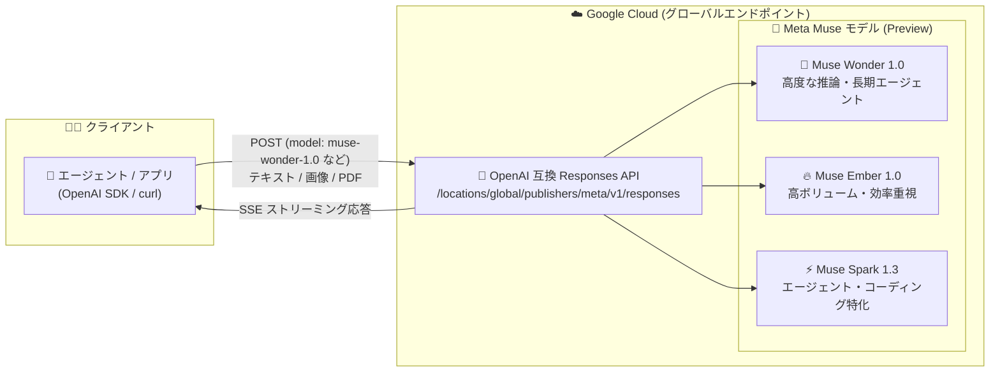

# Gemini Enterprise Agent Platform: Meta Muse モデル 3 種が Preview で利用可能に

**リリース日**: 2026-11-09

**サービス**: Gemini Enterprise Agent Platform

**機能**: Meta Muse モデル (Muse Wonder 1.0 / Muse Ember 1.0 / Muse Spark 1.3) の Preview 提供

**ステータス**: Preview

📊 [このアップデートのインフォグラフィックを見る](https://takech9203.github.io/google-cloud-news-summary/20261109-meta-muse-models-preview.html)

## 概要

Gemini Enterprise Agent Platform の Model Garden で、Meta の Muse ファミリー 3 モデルが Preview として利用可能になりました。対象は Muse Wonder 1.0 (`meta/muse-wonder-1.0`)、Muse Ember 1.0 (`meta/muse-ember-1.0`)、Muse Spark 1.3 (`meta/muse-spark-1.3`) で、いずれもグローバルエンドポイント上の OpenAI 互換 Responses API (ステートレス) を通じてマネージド API として提供されます。

3 モデルはすべて推論 (Reasoning)、関数呼び出し (Function Calling)、構造化出力 (Structured Output)、および 100 万トークン (1,048,576) のコンテキストウィンドウをサポートします。入力モダリティはモデルごとに異なり、Muse Wonder 1.0 と Muse Spark 1.3 はテキスト・画像・PDF を、Muse Ember 1.0 はテキスト・画像を受け付けます。複雑なソフトウェアエンジニアリングや長時間のエージェントワークフローを担う Muse Wonder、高ボリュームのエージェントタスクを効率的に処理する Muse Ember、エージェントワークフローと競技プログラミング級のコーディングに特化した Muse Spark という役割分担で、用途に応じた使い分けが可能です。

OpenAI 互換の Responses API で提供されるため、既存の OpenAI SDK やツールチェーンをエンドポイント URL の変更だけで流用でき、マルチモデル戦略を採る企業やエージェント基盤を構築する開発者にとって選択肢が大きく広がるアップデートです。

**アップデート前の課題**

- Gemini Enterprise Agent Platform の Model Garden では Meta の Muse ファミリーをマネージド API として利用できず、Meta のモデルを使うには別プラットフォームとの併用やセルフホスティングが必要だった
- Google Cloud の IAM・課金・ガバナンスの枠内で Meta の最新推論モデルを評価・運用する手段がなかった
- OpenAI 互換のクライアント資産 (SDK、エージェントフレームワーク) から Meta モデルを呼び出す統一的な経路がなかった

**アップデート後の改善**

- Muse Wonder 1.0 / Muse Ember 1.0 / Muse Spark 1.3 の 3 モデルを Model Garden から有効化し、マネージド API としてすぐに利用できるようになった
- グローバルエンドポイントの OpenAI 互換 Responses API 経由で呼び出せるため、OpenAI SDK など既存クライアントの `base_url` 変更のみで移行できる
- 3 モデル共通で推論・関数呼び出し・構造化出力・1M トークンコンテキストが利用でき、SSE によるストリーミング応答にも対応した

## アーキテクチャ図



クライアントはグローバルエンドポイント上の OpenAI 互換 Responses API に対して bare モデル ID を指定してリクエストを送信し、用途に応じた Muse モデルから応答 (SSE ストリーミング対応) を受け取ります。

## サービスアップデートの詳細

### 主要機能

1. **Muse Wonder 1.0 (`meta/muse-wonder-1.0`)**
   - 複雑なソフトウェアエンジニアリングと長時間 (long-horizon) のエージェント作業向けに構築された高性能推論モデル
   - マルチステップコーディング、自律エージェント、コンピュータ操作 (computer use) ワークフローにおいて、タスク計画、サブエージェントへの委譲、並列ツール呼び出し、エラーからの復旧が可能
   - 入力: テキスト・画像・PDF / 最大入力 1,048,576 トークン

2. **Muse Ember 1.0 (`meta/muse-ember-1.0`)**
   - ツール呼び出し、コーディングサブタスク、ルーティング、情報抽出、長文ドキュメント処理など、高ボリュームのエージェントタスク向けの効率的な推論モデル
   - Muse Wonder 1.0 や Muse Spark 1.3 と組み合わせ、プランニングは上位モデル・実行はEmber という役割分担が公式に推奨されている
   - 入力: テキスト・画像 / 最大入力 1,048,576 トークン、最大出力 524,288 トークン

3. **Muse Spark 1.3 (`meta/muse-spark-1.3`)**
   - エージェントワークフローと競技プログラミング級のコーディング向けにトレーニングされた推論モデル
   - Model Context Protocol (MCP) 対応の組み込みツール呼び出しをサポート
   - 入力: テキスト・画像・PDF / 最大入力 1,048,576 トークン

4. **OpenAI 互換 Responses API (ステートレス) での提供**
   - エンドポイント: `https://aiplatform.googleapis.com/v1/projects/PROJECT_ID/locations/global/publishers/meta/v1/responses`
   - `model` フィールドには `meta/` プレフィックスなしの bare モデル ID (`muse-wonder-1.0` など) を指定
   - ステートフルなレスポンス保存 (`store: true`) は非サポート。SSE によるストリーミング応答に対応

## 技術仕様

### モデル比較

| 項目 | Muse Wonder 1.0 | Muse Ember 1.0 | Muse Spark 1.3 |
|------|----------------|----------------|----------------|
| モデル ID | `meta/muse-wonder-1.0` | `meta/muse-ember-1.0` | `meta/muse-spark-1.3` |
| ステータス | Preview | Preview | Preview |
| 入力モダリティ | テキスト、画像、PDF | テキスト、画像 | テキスト、画像、PDF |
| 出力 | テキスト | テキスト | テキスト |
| 最大入力トークン | 1,048,576 | 1,048,576 | 1,048,576 |
| 最大出力トークン | - (公表なし) | 524,288 | - (公表なし) |
| 推論 / 関数呼び出し / 構造化出力 | 対応 (Preview) | 対応 (Preview) | 対応 (Preview) |
| MCP 組み込みツール呼び出し | - | - | 対応 |
| バッチ予測 | 非対応 | 非対応 | 非対応 |
| 利用形態 | Standard PayGo / 固定クォータ | Standard PayGo / 固定クォータ | Standard PayGo / 固定クォータ |
| Provisioned Throughput | 非対応 | 非対応 | 非対応 |
| 提供エンドポイント | global | global | global |
| リリース日 | 2026-11-09 | 2026-11-09 | 2026-09-24 (Platform 掲載は 11-09) |

### リクエスト例

```bash
curl -X POST \
  -H "Authorization: Bearer $(gcloud auth application-default print-access-token)" \
  -H "Content-Type: application/json" \
  "https://aiplatform.googleapis.com/v1/projects/PROJECT_ID/locations/global/publishers/meta/v1/responses" \
  -d '{
    "model": "muse-wonder-1.0",
    "input": "Write a Python binary search function with type annotations.",
    "max_output_tokens": 4096,
    "stream": false
  }'
```

## 設定方法

### 前提条件

1. Google Cloud プロジェクトで Gemini Enterprise Agent Platform API (`aiplatform.googleapis.com`) が有効化されていること
2. 組織ポリシーでモデルアクセスが制限されている場合は、該当ポリシーで Meta モデルを許可すること
3. Meta モデルは Google 製品ではなく、サービス固有規約の「Separate Offerings」条項およびモデルカードの個別規約が適用されることを確認すること

### 手順

#### ステップ 1: Model Garden でモデルを有効化

Model Garden (`console.cloud.google.com/agent-platform/model-garden`) で利用したい Muse モデルのモデルカードを開き、モデルを有効化します。

#### ステップ 2: Responses API でリクエストを送信

```bash
curl -X POST \
  -H "Authorization: Bearer $(gcloud auth application-default print-access-token)" \
  -H "Content-Type: application/json" \
  "https://aiplatform.googleapis.com/v1/projects/PROJECT_ID/locations/global/publishers/meta/v1/responses" \
  -d '{
    "model": "muse-spark-1.3",
    "input": "Summarize this architecture decision record.",
    "stream": true
  }'
```

`model` フィールドには bare モデル ID (`muse-wonder-1.0`、`muse-ember-1.0`、`muse-spark-1.3`) を指定します。`stream: true` で SSE ストリーミング応答を受け取れます。

## メリット

### ビジネス面

- **マルチモデル戦略の拡充**: Google (Gemini)、Anthropic、OpenAI、xAI に加えて Meta の最新推論モデルを同一プラットフォーム・同一課金体系で利用でき、ベンダーロックインを回避しながら用途別に最適なモデルを選択できる
- **導入コストの低減**: マネージド API として提供されるため、Meta モデルのセルフホスティング (GPU 確保、サービング基盤構築) が不要になる

### 技術面

- **OpenAI 互換による移行容易性**: Responses API 互換のため、既存の OpenAI SDK やエージェントフレームワークをエンドポイント変更のみで再利用できる
- **1M トークンコンテキスト**: 3 モデル共通で 1,048,576 トークンの入力を扱え、大規模コードベースや長文ドキュメントを一括処理できる
- **モデルの役割分担**: プランニングは Wonder、高ボリューム実行は Ember、コーディング特化タスクは Spark という公式推奨の組み合わせでコストと性能を最適化できる

## デメリット・制約事項

### 制限事項

- Preview 段階のため Pre-GA Offerings Terms が適用され、サポートが限定される場合がある。本番ワークロードへの適用は慎重に判断が必要
- 提供はグローバルエンドポイントのみで、リージョナルエンドポイントは利用できない (データレジデンシー要件がある場合は注意)
- ステートフルなレスポンス保存 (`store: true`) は非サポートで、会話状態はクライアント側で管理する必要がある
- バッチ予測および Provisioned Throughput は非対応 (Standard PayGo と固定クォータのみ)

### 考慮すべき点

- Meta モデルは Google 製品ではなく「Separate Offerings」として提供されるため、利用規約・データ取り扱い条件をモデルカードで確認する必要がある
- 組織で `constraints/gcp.restrictEndpointUsage` によりグローバルエンドポイントを制限している場合は利用できない
- グローバルエンドポイントではリクエストがモデルがサポートする任意のリージョンから処理されるため、レイテンシが変動する可能性がある

## ユースケース

### ユースケース 1: 長期稼働する自律コーディングエージェント

**シナリオ**: 大規模コードベースのリファクタリングを、計画立案からサブタスク実行まで自律的に行うエージェントを構築したい。

**実装例**:
```
1. Muse Wonder 1.0 がタスク全体を計画し、サブエージェントに委譲
2. Muse Ember 1.0 がツール呼び出し・コード編集などのサブタスクを並列実行
3. 1M トークンコンテキストでリポジトリ全体のコンテキストを維持
```

**効果**: 高性能モデルと効率モデルの役割分担により、品質を保ちながら高ボリュームタスクのコストを抑制できる。

### ユースケース 2: MCP ツールを活用したコーディング支援

**シナリオ**: 社内の MCP サーバー (チケット管理、CI/CD、ドキュメント検索) と連携するコーディングアシスタントを構築したい。

**効果**: Muse Spark 1.3 の MCP 対応組み込みツール呼び出しにより、エージェントフレームワーク側の実装を簡素化しつつ、競技プログラミング級のコーディング能力を活用できる。

### ユースケース 3: 長文ドキュメント・PDF の構造化抽出パイプライン

**シナリオ**: 契約書や技術仕様書 (PDF) を大量に取り込み、構造化データとして抽出したい。

**効果**: Muse Wonder 1.0 / Muse Spark 1.3 の PDF 入力対応と構造化出力 (JSON Schema) により、OCR 前処理を挟まず 1M トークンコンテキストで長大な文書を一括処理できる。

## 料金

Standard pay-as-you-go (トークン単位の従量課金) と固定クォータに対応します。Provisioned Throughput は非対応です。Muse モデルの具体的な単価は公式の料金ページを参照してください。

- [Gemini Enterprise Agent Platform の生成 AI 料金ページ](https://cloud.google.com/gemini-enterprise-agent-platform/generative-ai/pricing)

## 利用可能リージョン

グローバルエンドポイント (`global`) のみで提供されます。リージョナルエンドポイントおよびマルチリージョンエンドポイントは現時点で非対応です。

## 関連サービス・機能

- **Model Garden**: Muse モデルの有効化とモデルカードの確認を行うカタログ。Meta のほか Anthropic、OpenAI、xAI などのパートナーモデルも提供
- **OpenAI 互換 Responses API**: OpenAI パートナーモデルや xAI Grok でも採用されている API 形式で、OpenAI SDK からの呼び出しに対応
- **組織ポリシー (`gcp.restrictEndpointUsage` / モデルアクセス制御)**: グローバルエンドポイントの利用制限や、組織内で利用可能なモデルの制御に使用

## 参考リンク

- 📊 [インフォグラフィック](https://takech9203.github.io/google-cloud-news-summary/20261109-meta-muse-models-preview.html)
- [公式リリースノート](https://docs.cloud.google.com/release-notes#November_09_2026)
- [ドキュメント: Muse models from Meta](https://docs.cloud.google.com/gemini-enterprise-agent-platform/models/partner-models/meta)
- [モデル詳細: Muse Wonder 1.0](https://docs.cloud.google.com/gemini-enterprise-agent-platform/models/partner-models/meta/muse-wonder-1-0)
- [モデル詳細: Muse Ember 1.0](https://docs.cloud.google.com/gemini-enterprise-agent-platform/models/partner-models/meta/muse-ember-1-0)
- [モデル詳細: Muse Spark 1.3](https://docs.cloud.google.com/gemini-enterprise-agent-platform/models/partner-models/meta/muse-spark-1-3)
- [料金ページ](https://cloud.google.com/gemini-enterprise-agent-platform/generative-ai/pricing)

## まとめ

Meta の Muse ファミリー 3 モデルが Gemini Enterprise Agent Platform に Preview で加わり、OpenAI 互換 Responses API 経由で推論・関数呼び出し・構造化出力・1M トークンコンテキストを利用できるようになりました。マルチモデル戦略を検討している組織は、Model Garden からモデルを有効化し、既存の OpenAI SDK 資産を活かして評価を始めることを推奨します。Preview 段階のため、本番適用はグローバルエンドポイント限定・ステートレス動作などの制約を踏まえて判断してください。

---

**タグ**: #GeminiEnterpriseAgentPlatform #Meta #Muse #ModelGarden #Preview #ResponsesAPI #生成AI #エージェント
