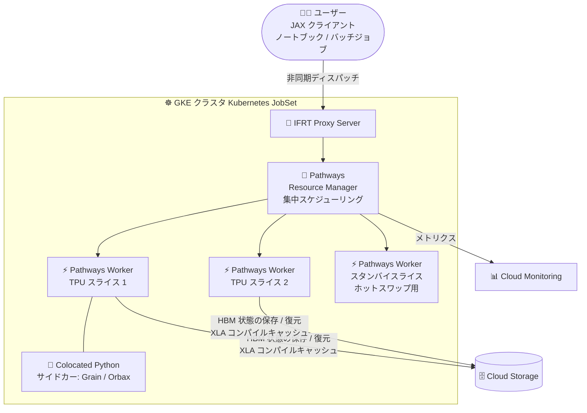

# AI Hypercomputer / GKE: Pathways on Cloud が GKE で一般提供 (GA) 開始

**リリース日**: 2026-11-09

**サービス**: AI Hypercomputer / Google Kubernetes Engine (GKE)

**機能**: Pathways on Cloud (GKE 上での大規模 TPU ワークロードオーケストレーション)

**ステータス**: Generally Available (GA)

📊 [このアップデートのインフォグラフィックを見る](https://takech9203.github.io/google-cloud-news-summary/20261109-pathways-on-cloud-gke-ga.html)

## 概要

Pathways on Cloud が Google Kubernetes Engine (GKE) 上で一般提供 (GA) となりました。Pathways は Google が Gemini などの大規模モデルの学習に社内で使用している大規模 ML オーケストレーションシステムで、単一の JAX クライアントプロセスから数千〜数万チップ規模の Cloud TPU スライス群を統合的に制御できます。Pathways on Cloud はこの仕組みを Google Cloud の顧客に提供するものです。

GA 版では、単一コントローラ実行モデル、ハードウェア障害に耐えるレジリエント / エラスティックトレーニング、TPU ホスト VM 上で動く Python サイドカーコンテナ、ノートブックからのインタラクティブ実行、Cluster Director / Cluster Toolkit / GKE JobSet との統合など、大規模トレーニング・推論・強化学習 (RL) に必要な機能が一通り揃いました。対象ユーザーは、JAX で大規模な LLM 学習やマルチホスト推論を TPU 上で実行する ML エンジニア / プラットフォームチームです。

**アップデート前の課題**

- JAX のデフォルトであるマルチコントローラ構成では、各ホストが自分に接続されたデバイスしか見えず、基本的に SPMD (Single Program, Multiple Data) パラダイムに限定され、スライスをまたぐリソース管理の柔軟性が低かった
- マルチスライス学習中に 1 つのスライスでハードウェア障害が発生すると、ジョブ全体の再起動が必要だった
- GKE の計画的なプリエンプション (退避) に対応するには、ユーザー側で独自のプリエンプションハンドリングコードを実装する必要があった

**アップデート後の改善**

- 単一の Python クライアントからマルチスライス・マルチホスト TPU ワークロードを統合制御でき、SPMD に加えて MPMD (例: 学習と RL ループの併走) もサポートされた
- エラスティックトレーニングにより、障害発生時に健全なスライスだけでジョブを継続し、交換スライスの復帰後にジョブを再起動せずスケールバックアップできるようになった
- サスペンド・レジューム (HBM 状態の Cloud Storage への自動保存・復元) とホットスワップ (スタンバイ / 低優先度スライスへの約 1 分以内での再マッピング) により、計画・非計画の中断への耐性が標準で得られるようになった
- GA により本番ワークロードでの利用が可能になり、TPU7x (Ironwood) を含む最新 TPU 世代がサポートされた

## アーキテクチャ図



単一の JAX クライアントが IFRT Proxy Server を経由して Pathways Resource Manager に接続し、複数の TPU スライス上の Pathways Worker を集中制御します。障害時は健全なスライスでの継続 (エラスティック) やスタンバイスライスへのホットスワップで学習を継続し、HBM 状態やコンパイルキャッシュは Cloud Storage に永続化されます。

## サービスアップデートの詳細

### 主要機能

1. **単一コントローラ実行モデル**
   - 単一の Python クライアントプロセスからマルチスライス・マルチホスト Cloud TPU ワークロードを統合制御
   - 非同期ディスパッチと集中スケジューリングにより、SPMD に加えて MPMD ワークロード (学習と強化学習ループの併走など) をサポート
   - クライアントからは全デバイスが「多数のローカルアクセラレータを持つ 1 台の巨大マシン」のように見え、非対称なパイプライン並列や計算のスパース化など SPMD を超える計算パターンが可能

2. **レジリエント / エラスティックトレーニング**
   - **エラスティックトレーニング**: ハードウェア障害時に健全な TPU スライスへ動的にスケールダウンし、交換スライスの復帰後にジョブ全体を再起動せずスケールバックアップ。`pathwaysutils.elastic.manager.Manager` と `elastic_retry` デコレータで「一時停止 / 再開」または「レプリカリサイズ」の 2 つの回復戦略を選択可能
   - **サスペンド・レジューム**: GKE の計画的プリエンプション時に HBM (高帯域メモリ) の状態を Cloud Storage へ自動保存・復元。独自のプリエンプションハンドリングコードは不要
   - **ホットスワップ**: 中断されたワークロードをスタンバイまたは低優先度の TPU スライスへ再マッピング (通常 1 分未満)。Kubernetes の PriorityClass と連携
   - **Multi-Tier Checkpointing**: Colocated Python を使い、ローカル / ピアレプリケートの高頻度チェックポイントと Cloud Storage への非同期バックアップを組み合わせて復旧時間を短縮

3. **Colocated Python サイドカーコンテナ**
   - TPU ホスト VM 上で Pathways ワーカーと並んでカスタム Python コードを実行
   - 例: Grain / RemoteIterator によるマルチホストデータローディング、Orbax による分散非同期チェックポインティング

4. **インタラクティブモードと Shared Pathways Service**
   - ノートブックやターミナルから JAX ワークロードを対話的に実行・検査・デバッグ
   - 長時間稼働する TPU スライスプールを複数ユーザー・複数ジョブでオンデマンド共有

5. **Cluster Director / Cluster Toolkit / GKE 統合**
   - Cluster Director または Cluster Toolkit (`gcluster` の `--pathways` / `--pathways-headless` フラグ) で Pathways ランタイム上の JAX ワークロードを起動
   - GKE では Kubernetes JobSet マニフェストによるデプロイが可能

6. **pathwaysutils パッケージと libtpu レイヤリング**
   - `pathwaysutils` Python パッケージで Shared Pathways Service、エラスティシティ、`experimental.reshard` (ICI / DCN 経由のホスト間デバイスサイドデータ転送) などの高度な機能を利用
   - 標準の `libtpu.so` 上にレイヤリングされ、`PathwaysJobSet.with_custom_libtpu` でユーザー提供の `libtpu.so` を実行時に動的リンク可能

7. **可観測性・プロファイリング・デバッグ**
   - クライアント・プロキシ・リソースマネージャ・TPU ホストを横断するエンドツーエンドの JAX プロファイラトレースを単一プロセスから取得
   - Cloud Storage 上の永続 XLA コンパイルキャッシュでコンパイル済みモジュールを再利用
   - Pathways のコントロールプレーン / データプレーンメトリクスを Cloud Monitoring で可視化
   - `pathways-workload` エージェントスキルにより、AI エージェントが Cloud Logging のコンテナログ、ノードカーネルログ、GKE イベントを調査して障害の根本原因特定を支援 (エージェンティックデバッグ)

## 技術仕様

### 単一コントローラ (Pathways) とマルチコントローラ (JAX デフォルト) の比較

| 項目 | 単一コントローラ (Pathways) | マルチコントローラ (JAX デフォルト) |
|------|---------------------------|-----------------------------------|
| 制御 | 単一クライアントプログラムが中央コントローラとして動作 | 複数プロセスがそれぞれ Python インタープリタを持ち分散制御 |
| ビュー | 全デバイスを単一の統合システムとして見る | 各プロセスは自分に接続されたデバイスのみ見える |
| プログラミング | 単一クライアントとの対話のみで多数のアクセラレータを扱える | 基本的に SPMD パラダイムに限定 |
| 柔軟性 | 非対称パイプライン並列や計算のスパース化など SPMD を超えるパターンに対応 | スライスをまたぐリソース管理の柔軟性が低い |

### サポート対象バージョンとコンテナイメージ

| 項目 | 詳細 |
|------|------|
| 対応 TPU | TPU7x (Ironwood)、TPU v6e (Trillium)、TPU v5p、TPU v5e |
| 対応 JAX バージョン | 0.12.0.1 / 0.12.0 / 0.11.2 / 0.11.1 / 0.11.0 / 0.10.2 / 0.10.1 |
| Resource Manager / Worker イメージ | `us-docker.pkg.dev/cloud-tpu-v2-images/cloud-pathways/server:TAG` |
| IFRT Proxy Server イメージ | `us-docker.pkg.dev/cloud-tpu-v2-images/cloud-pathways/proxy_server:TAG` |
| Colocated Python サイドカーイメージ | `us-docker.pkg.dev/cloud-tpu-v2-images/cloud-pathways/colocated_python_sidecar:TAG` |
| イメージタグ | `YYYYMMDD-jax_JAX_VERSION` (日付ピン留め、例: `20261108-jax_0.12.0.1`) または `jax-JAX_VERSION` (ローリング) |

### GKE 上の Pathways コンポーネント構成例 (Resource Manager)

```yaml
- name: pathways-rm
  image: us-docker.pkg.dev/cloud-tpu-v2-images/cloud-pathways/server:latest
  env:
    - name: HOST_ADDRESS
      valueFrom:
        fieldRef:
          fieldPath: "metadata.labels['jobset.sigs.k8s.io/coordinator']"
    - name: TPU_SKIP_MDS_QUERY
      value: "true"
  args:
    - --server_port=29001
    - --node_type=resource_manager
    - --instance_count=WORKLOAD_NODEPOOL_COUNT
    - --instance_type=SLICE_TOPOLOGY   # 例: tpuv5e:4x4
    - --gcs_scratch_location=gs://BUCKET_NAME
```

## 設定方法

### 前提条件 (GKE の場合)

1. Kubernetes ツール (kubectl など) のインストール
2. Google Cloud CLI のインストール
3. Kubernetes Engine API の有効化
4. GKE での TPU (単一スライス / マルチスライス) の利用に関する基本知識
5. エラスティックトレーニングを使う場合: ワークロードコンテナイメージに `pathwaysutils`、Orbax (`orbax-checkpoint` >= 0.12.6)、(必要に応じて) Grain をインストール

### 手順

#### ステップ 1: Pathways 対応 GKE クラスタの作成

Cluster Toolkit の TPU ブループリント (`gcluster`) で `--pathways` (フルマネージド) または `--pathways-headless` を指定するか、公式ドキュメントの手順に従って GKE クラスタを作成します。

#### ステップ 2: JobSet マニフェストのデプロイ

Pathways Resource Manager、IFRT Proxy Server、Pathways Worker の 3 種類のコンテナを含む Kubernetes JobSet マニフェストを GKE にデプロイします。Worker は `google.com/tpu` リソースリミットで TPU チップを要求します。

#### ステップ 3: (任意) エラスティシティの有効化

proxy コンテナの `args` に `--num_elastic_instances=NUM_SLICES` を追加し、トレーニングコードで `pathwaysutils.elastic.manager.Manager` と `@elastic_retry` デコレータ (`minimum_slice_count` で回復戦略を指定) を構成します。

#### ステップ 4: (任意) ホットスワップ用の PriorityClass 設定

```bash
kubectl apply -f high-prior-job.yaml   # PriorityClass を定義
```

Worker Pod テンプレートに `priorityClassName` を設定するか、Cluster Toolkit 利用時は `gcluster job submit --priority=high-prior-job` を指定します。Cluster Toolkit の TPU ブループリントで作成したクラスタには `very-low` 〜 `very-high` の PriorityClass が事前定義されています。

## メリット

### ビジネス面

- **学習ジョブの中断コスト削減**: 障害やプリエンプションのたびにジョブ全体を再起動する必要がなくなり、大規模 TPU クラスタの実効稼働率 (Goodput) が向上する
- **TPU リソースの利用効率向上**: Shared Pathways Service により長時間稼働の TPU スライスプールを複数ユーザー・ジョブで共有でき、遊休リソースを削減できる
- **Google 内部と同じ基盤**: Gemini の学習に使われているものと同じオーケストレーション技術を GA サポート付きで利用できる

### 技術面

- **プログラミングモデルの簡素化**: 数千チップ規模のマルチスライス構成でも単一の Python クライアントから制御でき、MPMD (学習 + RL ループなど) にも対応
- **多層的な耐障害性**: エラスティックトレーニング、サスペンド・レジューム、ホットスワップ、Multi-Tier Checkpointing を組み合わせて計画・非計画の中断の両方に対応
- **運用性**: 単一プロセスからのエンドツーエンドプロファイリング、Cloud Monitoring メトリクス、永続 XLA コンパイルキャッシュ、エージェントによる障害デバッグ支援

## デメリット・制約事項

### 制限事項

- JAX ワークロードが対象 (JAX 0.10.1〜0.12.0.1)。対応 TPU は TPU7x / v6e / v5p / v5e
- サスペンド・レジュームで透過的に復元できるのはステートレスな Pathways XLA コンポーネントに依存するワークロード。JAX colocated Python API などステートフルなコンポーネントに依存するワークロードは HBM スナップショットでは復元できない
- エラスティックトレーニングの「レプリカリサイズ」モードでは、スライス数の変化に伴うデバイスメッシュの再構築と再コンパイルが発生する

### 考慮すべき点

- エラスティックトレーニングを活用するには、`jax.errors.JaxRuntimeError` の捕捉やメッシュ再構築などの回復ロジックをトレーニングコード側に組み込む必要がある (pathwaysutils が支援)
- Multi-Tier Checkpointing を使う場合、GKE アドオン (Multi-Tier Checkpointing、Cloud Storage FUSE)、Workload Identity Federation、階層型名前空間を有効にした Cloud Storage バケット、IAM ロール付与などの事前設定が必要
- 障害時に失敗した試行のデバイス配列への参照をグローバル変数などに保持すると、メモリ解放が妨げられるため注意が必要

## ユースケース

### ユースケース 1: マルチスライス TPU での LLM 事前学習 (エラスティック)

**シナリオ**: 複数の TPU v5p スライスで数週間規模の LLM 事前学習を実行する。ハードウェア障害でスライスが 1 つ落ちてもジョブを止めたくない。

**実装例**:
```python
from pathwaysutils.elastic import manager

elastic_manager = manager.Manager()

@elastic_manager.elastic_retry(minimum_slice_count=1)
def train_loop(...):
    # 障害時は残った健全なスライスでメッシュを再構築して継続
    ...
```

**効果**: スライス障害時も残りの健全なスライスで学習を継続し、交換スライス復帰後に自動的に元の規模へスケールバックアップ。ジョブ全体の再起動が不要になる。

### ユースケース 2: ノートブックからの大規模 TPU の対話的利用

**シナリオ**: 研究チームが長時間稼働する TPU スライスプールを共有し、各メンバーがノートブックから JAX コードを対話的に実行・デバッグしたい。

**効果**: インタラクティブモードと Shared Pathways Service により、ジョブ投入の待ち時間なしで大規模 TPU を試行錯誤に使え、プールの共有でコスト効率も向上する。

### ユースケース 3: マルチホスト TPU での大規模 LLM 推論

**シナリオ**: 単一ホストに収まらない Llama 3.1 405B のような大規模モデルを、GKE 上の複数の相互接続された TPU ノードでサービングする。

**効果**: JetStream + MaxText + Pathways の組み合わせで、マネージド Kubernetes の可用性・スケーラビリティを備えた本番グレードのマルチホスト推論基盤を構築できる。

## 料金

Pathways on Cloud 自体の個別料金は Release Notes には記載されていません。実行基盤となる Cloud TPU および GKE、Cloud Storage などの利用料金が発生します。詳細は各料金ページを参照してください。

- [Cloud TPU の料金](https://cloud.google.com/tpu/pricing)
- [GKE の料金](https://cloud.google.com/kubernetes-engine/pricing)

## 関連サービス・機能

- **Cloud TPU (TPU7x / v6e / v5p / v5e)**: Pathways がオーケストレーションする実行基盤。マルチスライス構成を単一クライアントから制御
- **GKE JobSet**: Pathways コンポーネント (Resource Manager / Proxy / Worker) のデプロイ単位。ホットスワップは JobSet API の機能と連携
- **Cluster Director / Cluster Toolkit**: `gcluster` コマンドによる Pathways 対応クラスタの作成とジョブ投入 (Slurm 連携も可能)
- **Cloud Storage**: HBM 状態のサスペンド・レジューム先、XLA 永続コンパイルキャッシュ、Multi-Tier Checkpointing のバックアップ先
- **Cloud Monitoring / Cloud Logging**: Pathways のコントロール / データプレーンメトリクスの可視化と、エージェンティックデバッグでのログ調査
- **Orbax / Grain / MaxText / JetStream**: 分散チェックポインティング、データローディング、学習 / 推論フレームワークとして Pathways と組み合わせて利用

## 参考リンク

- 📊 [インフォグラフィック](https://takech9203.github.io/google-cloud-news-summary/20261109-pathways-on-cloud-gke-ga.html)
- [公式リリースノート](https://docs.cloud.google.com/release-notes#November_09_2026)
- [Pathways on Cloud の概要 (ドキュメント)](https://docs.cloud.google.com/ai-hypercomputer/docs/workloads/pathways-on-cloud/pathways-intro)
- [レジリエントトレーニングの構成 (ドキュメント)](https://docs.cloud.google.com/ai-hypercomputer/docs/workloads/pathways-on-cloud/resilient-training)
- [pathways-utils (GitHub)](https://github.com/AI-Hypercomputer/pathways-utils)
- [Cloud TPU の料金](https://cloud.google.com/tpu/pricing)

## まとめ

Google が Gemini の学習に用いる Pathways オーケストレーションが GKE 上で GA となり、単一コントローラモデルとエラスティックトレーニングにより、大規模 TPU ワークロードを「止めずに動かし続ける」基盤が本番利用可能になりました。マルチスライス TPU で JAX ワークロードを運用しているチームは、まず概要ドキュメントとレジリエントトレーニングの構成ガイドを確認し、既存の JobSet ベースのワークロードを Pathways ランタイムへ移行する検証を始めることを推奨します。

---

**タグ**: #AIHypercomputer #GKE #CloudTPU #Pathways #JAX #GA #機械学習 #大規模学習
