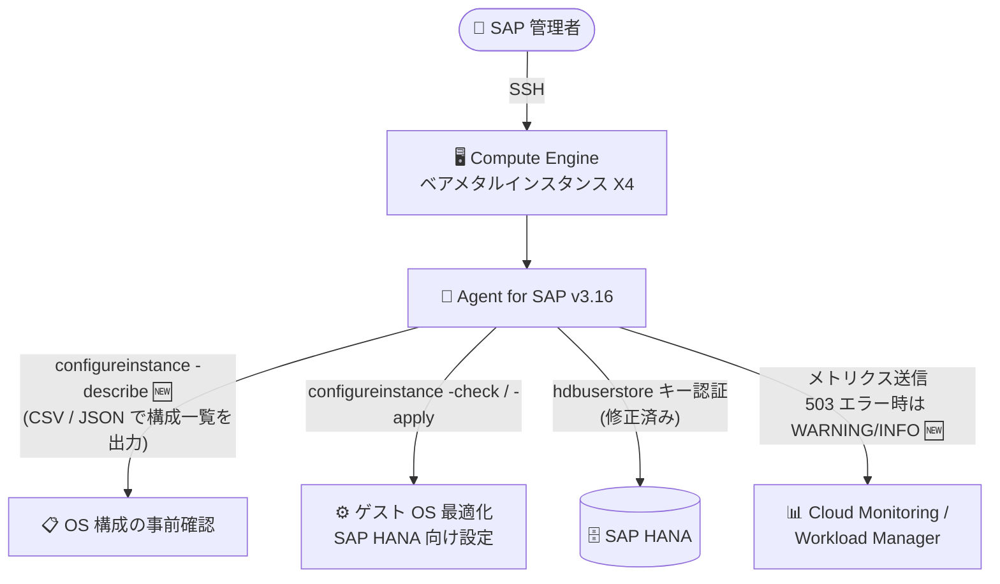

# SAP on Google Cloud: Google Cloud's Agent for SAP バージョン 3.16 GA

**リリース日**: 2026-11-09

**サービス**: SAP on Google Cloud (Google Cloud's Agent for SAP)

**機能**: Agent for SAP バージョン 3.16 (configureinstance コマンド強化、フレームワークレベルの更新)

**ステータス**: GA (一般提供)

📊 [このアップデートのインフォグラフィックを見る](https://takech9203.github.io/google-cloud-news-summary/20261109-sap-agent-3-16-ga.html)

## 概要

Google Cloud's Agent for SAP のバージョン 3.16 が一般提供 (GA) となりました。Agent for SAP は、Google Cloud 上で稼働する SAP ワークロード (SAP HANA、SAP NetWeaver など) の監視、Workload Manager 評価メトリクスの収集、SAP HANA のバックアップ・リカバリなどを担う統合エージェントです。

バージョン 3.16 の中心となるのは、Compute Engine ベアメタルインスタンス (X4 など) のゲスト OS を SAP HANA 向けに最適化する `configureinstance` コマンドの強化です。新たに `-describe` オプションが追加され、ベアメタルインスタンスに適用されるすべての OS 構成を CSV または JSON 形式で出力・確認できるようになりました。あわせて、X4 インスタンス向けの OS 構成内容そのものも更新されています。

また、フレームワークレベルの更新として、Google API との通信における一時的な HTTP 503 エラーのハンドリング改善 (ログ重大度の適正化) と、セキュアユーザーストア (`hdbuserstore`) キーを使用した SAP HANA 認証時のモニタリングメトリクス収集の不具合修正が含まれています。SAP Basis 管理者や SAP システム管理者にとって、運用の透明性と安定性が向上するアップデートです。

**アップデート前の課題**

- `configureinstance` コマンドでは `-check` (構成チェック) と `-apply` (適用) が中心で、ベアメタルインスタンスに適用される OS 構成の全体像を一覧形式 (CSV / JSON) で事前に確認する手段がなかった
- Workload Manager 評価メトリクスの送信やエージェントステータス報告の際、Google API 側の一時的な HTTP 503 エラーが `ERROR` レベルでログに記録され、実際には自動回復する一過性の事象でもアラートやログ監視のノイズになりやすかった
- セキュアユーザーストア (`hdbuserstore`) キーで SAP HANA に認証している環境で、SAP HANA モニタリングメトリクスの収集に不具合があった

**アップデート後の改善**

- `configureinstance -describe` オプションにより、ベアメタルインスタンスに適用対象となるすべての OS 構成を CSV または JSON で出力し、適用前にレビューできるようになった
- 一時的な HTTP 503 エラーのハンドリングが改善され、失敗の種類に応じてログ重大度が `ERROR` から `WARNING` または `INFO` に引き下げられ、ログ監視のノイズが削減された
- `hdbuserstore` キーを使用する SAP HANA 認証環境でのモニタリングメトリクス収集の不具合が修正された
- X4 インスタンス向けの OS 構成が更新され、エージェント更新後に `-check` / `-apply` を再実行することで最新の最適化を適用できる

## アーキテクチャ図



バージョン 3.16 では、`-describe` オプションによる OS 構成の事前確認フローが追加され、Google API への送信時の一時エラーのログ重大度が適正化されました。

## サービスアップデートの詳細

### 主要機能

1. **`configureinstance` コマンドの `-describe` オプション追加**
   - ベアメタルインスタンスに適用されるすべての OS 構成を CSV または JSON 形式で出力できる
   - SAP HANA ワークロードに必要な設定を適用前にプレビュー・監査でき、変更管理プロセスへの組み込みが容易になる
   - X4 インスタンス向けの OS 構成も更新されており、エージェント更新後は `configureinstance -check` と `configureinstance -apply` の再実行が推奨される

2. **フレームワークレベルの更新 (HTTP 503 エラーハンドリング改善)**
   - Workload Manager 評価メトリクスの送信およびエージェントステータス報告における、Google API との通信時の一時的な HTTP 503 エラーの処理が改善された
   - 一時的な失敗のログ重大度が、失敗の種類に応じて `ERROR` から `WARNING` または `INFO` に引き下げられた
   - ログベースのアラートや監視における誤検知 (ノイズ) の削減につながる

3. **SAP HANA モニタリングメトリクス収集の修正**
   - セキュアユーザーストア (`hdbuserstore`) キーを使用して SAP HANA に認証する構成で、メトリクス収集の不具合が修正された
   - パスワードを構成ファイルに直接記載せず `hdbuserstore` で安全に認証情報を管理する環境でも、安定したメトリクス収集が可能になった

## 技術仕様

### configureinstance コマンドの主なオプション

| オプション | 説明 |
|------|------|
| `-describe` | 🆕 ベアメタルインスタンスに適用されるすべての OS 構成を CSV または JSON で出力 (v3.16) |
| `-check` | OS が SAP HANA ワークロード向けに最適に構成されているかをチェック |
| `-apply` | 必要な OS 構成を適用 (TCP 輻輳制御の BBR 設定などを含む) |

### バージョン 3.16 の更新内容サマリー

| カテゴリ | 更新内容 |
|------|------|
| ベアメタルインスタンスのゲスト OS 構成 | `-describe` オプション追加、X4 向け OS 構成の更新 |
| エージェントフレームワーク / Workload Manager 評価メトリクス収集 | 一時的な HTTP 503 エラーのハンドリング改善、ログ重大度の適正化 (`ERROR` → `WARNING` / `INFO`) |
| SAP HANA モニタリングメトリクス収集 | `hdbuserstore` キー認証時のメトリクス収集の不具合修正 |

## 設定方法

### 前提条件

1. SAP ワークロードが稼働する Compute Engine インスタンス (ベアメタル機能を使う場合は X4 などのベアメタルマシンタイプ) または Bare Metal Solution サーバー
2. Google Cloud's Agent for SAP がインストール済みであること (最新バージョンへの更新を推奨)

### 手順

#### ステップ 1: エージェントをバージョン 3.16 に更新

```bash
# エージェントのバージョン確認
sudo /usr/bin/google_cloud_sap_agent version
```

OS のパッケージマネージャー (zypper / yum など) でエージェントを最新バージョンに更新します。詳細は [エージェントの更新手順](https://docs.cloud.google.com/sap/docs/agent-for-sap/latest/operations) を参照してください。

#### ステップ 2: OS 構成の一覧を事前確認 (新機能)

```bash
# ベアメタルインスタンスに適用される OS 構成を出力
sudo /usr/bin/google_cloud_sap_agent configureinstance -describe
```

CSV または JSON 形式で、SAP HANA ワークロードに必要なすべての OS 構成を確認できます。

#### ステップ 3: 構成チェックと適用

```bash
# 現在の OS 構成が最適かチェック
sudo /usr/bin/google_cloud_sap_agent configureinstance -check

# 必要な構成を適用
sudo /usr/bin/google_cloud_sap_agent configureinstance -apply
```

X4 向けの OS 構成が更新されているため、バージョン 3.16 への更新後は `-check` / `-apply` の再実行が推奨されます。適用後は、ゲスト OS またはインスタンスの再起動が必要です。

## メリット

### ビジネス面

- **変更管理・監査対応の強化**: `-describe` による構成一覧の出力 (CSV / JSON) で、OS 変更内容を事前にレビュー・記録でき、エンタープライズの変更管理プロセスに組み込みやすい
- **運用コストの削減**: 一過性の 503 エラーが `ERROR` としてログに残らなくなり、不要なインシデント対応やアラートトリアージの工数を削減できる

### 技術面

- **構成の透明性向上**: ベアメタルインスタンスに適用される OS 設定の全体像を機械可読な形式で取得でき、IaC ツールとの整合性確認にも活用できる
- **セキュアな認証構成での安定運用**: `hdbuserstore` キー認証環境でのメトリクス収集が修正され、パスワードを構成ファイルに記載しないセキュアな運用と監視を両立できる

## デメリット・制約事項

### 考慮すべき点

- `configureinstance` コマンドは Compute Engine ベアメタルインスタンス (X4 など) のゲスト OS 構成を対象とした機能である
- Terraform や Ansible などの IaC ツールで SAP HANA ワークロードをデプロイしている場合、IaC のステート管理が `configureinstance` による構成変更を上書きしないよう注意が必要
- `configureinstance -apply` の適用後は、ゲスト OS またはインスタンスの再起動が必要
- X4 向け OS 構成が更新されているため、3.16 への更新だけでは最適化は反映されず、`-check` / `-apply` の再実行が必要

## ユースケース

### ユースケース 1: X4 ベアメタルインスタンス上の SAP HANA の OS 構成監査

**シナリオ**: 金融機関が X4 インスタンス上で SAP HANA を運用しており、OS 設定の変更は事前レビューと記録が必須の変更管理プロセスを採用している。

**実装例**:
```bash
# 適用対象の OS 構成を JSON で出力し、変更管理チケットに添付
sudo /usr/bin/google_cloud_sap_agent configureinstance -describe

# レビュー承認後に適用
sudo /usr/bin/google_cloud_sap_agent configureinstance -apply
```

**効果**: 適用前に構成内容の全体像を確認・記録でき、監査証跡の確保と安全な変更適用を両立できる。

### ユースケース 2: hdbuserstore を使用したセキュアな SAP HANA 監視

**シナリオ**: セキュリティポリシーにより、SAP HANA の認証情報を構成ファイルに平文で記載できず、`hdbuserstore` キーで管理している。これまでメトリクス収集に不具合があり監視の信頼性に課題があった。

**効果**: バージョン 3.16 への更新により、`hdbuserstore` キー認証のままで SAP HANA モニタリングメトリクスを安定して収集でき、セキュリティ要件と可観測性を両立できる。

## 料金

Agent for SAP が収集したメトリクスの取り込みには、Cloud Monitoring の料金が適用される場合があります。詳細は料金ページを参照してください。

- [Cloud Monitoring の料金](https://cloud.google.com/stackdriver/pricing)

## 関連サービス・機能

- **Compute Engine (ベアメタルインスタンス / X4)**: `configureinstance` コマンドの対象。SAP HANA の大規模ワークロード向けマシンタイプ
- **Workload Manager**: エージェントが収集する評価メトリクスを使用して SAP システムをベストプラクティスに照らして評価。3.16 でメトリクス送信時のエラーハンドリングが改善
- **Cloud Monitoring**: SAP HANA モニタリングメトリクスや Process Monitoring メトリクスの可視化先
- **Cloud Logging**: エージェントのログ出力先。3.16 で一時的エラーのログ重大度が適正化

## 参考リンク

- 📊 [インフォグラフィック](https://takech9203.github.io/google-cloud-news-summary/20261109-sap-agent-3-16-ga.html)
- [公式リリースノート](https://docs.cloud.google.com/release-notes#November_09_2026)
- [What's new with Google Cloud's Agent for SAP](https://docs.cloud.google.com/sap/docs/agent-for-sap/whats-new)
- [Configure guest OS on Compute Engine bare metal instances](https://docs.cloud.google.com/sap/docs/agent-for-sap/latest/configure-bare-metal-instances)
- [エージェントの構成コマンド](https://docs.cloud.google.com/sap/docs/agent-for-sap/latest/config-commands)

## まとめ

Agent for SAP 3.16 は、`-describe` オプションによる OS 構成の事前確認、一時的な API エラーのログ重大度適正化、`hdbuserstore` 認証環境でのメトリクス収集修正など、SAP 運用の透明性と安定性を高める実務的なアップデートです。特に X4 ベアメタルインスタンスで SAP HANA を運用しているチームは、3.16 への更新後に `configureinstance -check` / `-apply` を再実行して最新の OS 最適化を適用することを推奨します。

---

**タグ**: #SAP #AgentForSAP #SAPHANA #ComputeEngine #ベアメタル #WorkloadManager #GA
