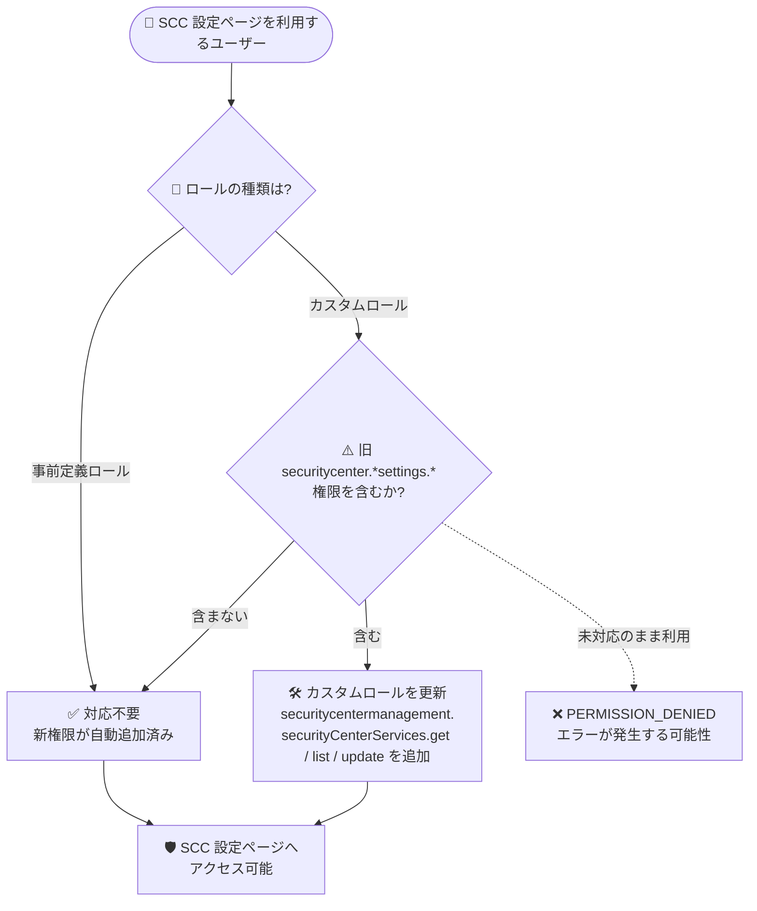

# Security Command Center: 事前定義ロールの変更とカスタムロール移行

**リリース日**: 2026-11-09

**サービス**: Security Command Center

**機能**: 事前定義 IAM ロールの変更 (securitycentermanagement 権限への移行)

**ステータス**: GA (2026 年 11 月 9 日より適用)

📊 [このアップデートのインフォグラフィックを見る](https://takech9203.github.io/google-cloud-news-summary/20261109-security-command-center-predefined-roles-migration.html)

## 概要

Security Command Center (SCC) の事前定義 IAM ロールが変更されました。2026 年 11 月 9 日以降、SCC の「設定 (Settings)」ページで実行する操作には、従来の `securitycenter.*settings.*` 系の権限に代わり、新しい `securitycentermanagement.securityCenterServices.get` / `list` / `update` 権限が必要になります。

事前定義ロールを使用してアクセス権を付与している場合は、関連する事前定義ロールに新しい権限が自動的に追加されるため、**ユーザー側での対応は不要**です。一方、`securitycenter.eventthreatdetectionsettings.get` などの旧権限を含む **カスタムロールを使用している組織は、新しい権限への手動での移行が必要** です。カスタムロールを更新するまで、そのロールを付与されたユーザーは設定ページの利用時に `PERMISSION_DENIED` エラーが発生する可能性があります。

このアップデートは、SCC のサービス管理系 API が Security Center Management API (`securitycentermanagement.googleapis.com`) に整理・統合されてきた流れに沿ったもので、組織の IAM 管理者およびセキュリティ運用チームが対象です。

**アップデート前の課題**

- SCC の設定ページへのアクセス制御は、Container Threat Detection、Event Threat Detection、Security Health Analytics など検出サービスごとに分かれた多数の `securitycenter.*settings.*` 権限で管理されており、権限体系が複雑だった
- カスタムロールの設計時に、検出サービスごとに get / update / calculate といった細かい権限を個別に列挙する必要があった
- 検出サービスの設定管理の権限が `securitycenter` と `securitycentermanagement` の 2 つの権限体系に分散していた

**アップデート後の改善**

- 設定ページの操作に必要な権限が `securitycentermanagement.securityCenterServices.get` / `list` / `update` の 3 つに集約され、権限体系がシンプルになった
- 事前定義ロール (例: `roles/securityposture.admin`、`roles/securityposture.postureDeployer`、`roles/writer`、`roles/editor`) には新権限が自動的に追加され、事前定義ロール利用者は対応不要になった
- 旧権限から新権限への対応表が公式ドキュメントで提供され、カスタムロールの移行手順が明確になった

## アーキテクチャ図



2026 年 11 月 9 日以降の SCC 設定ページのアクセス制御フローです。事前定義ロール利用者は対応不要ですが、旧権限を含むカスタムロールは新しい `securitycentermanagement` 権限への更新が必要です。

## サービスアップデートの詳細

### 主要機能

1. **設定ページの必要権限の変更**
   - 2026 年 11 月 9 日以降、SCC の設定ページでの操作には以下のいずれかの権限が必要
     - `securitycentermanagement.securityCenterServices.get`
     - `securitycentermanagement.securityCenterServices.list`
     - `securitycentermanagement.securityCenterServices.update`
   - 従来の検出サービスごとの `securitycenter.*settings.*` 権限は、集約された新権限に置き換えられる

2. **事前定義ロールの自動更新**
   - `roles/securityposture.admin` と `roles/securityposture.postureDeployer` には get / list / update の 3 権限すべてが追加
   - 基本ロールの Writer (`roles/writer`) と Editor (`roles/editor`) には `securitycentermanagement.securityCenterServices.update` が追加
   - 事前定義ロールで設定ページへのアクセスを付与している場合、変更は不要

3. **カスタムロールの移行ガイド**
   - 旧権限と新権限の対応表が公式ドキュメント「Migrating custom roles」で提供
   - 移行が完了するまで、該当カスタムロールのユーザーは設定ページで `PERMISSION_DENIED` エラーが発生する可能性がある

### 関連アップデート

同日の Release Notes では、Cloud Run のサービス・ジョブ・ワーカープールのコンテナイメージの脆弱性と露出したシークレットを検出する **Vulnerability Assessment for Cloud Run (Preview)** も発表されています。詳細は既存レポート「[Cloud Run: Vulnerability Assessment (Preview)](./2026-11-08-cloud-run-vulnerability-assessment-preview.md)」を参照してください。

## 技術仕様

### 旧権限と新権限の対応表 (主要なもの)

| 置き換え対象の旧権限 | 新しい権限 |
|------|------|
| `securitycenter.containerthreatdetectionsettings.get` / `.update` | `securitycentermanagement.securityCenterServices.get` / `.update` |
| `securitycenter.eventthreatdetectionsettings.get` / `.update` | `securitycentermanagement.securityCenterServices.get` / `.update` |
| `securitycenter.securityhealthanalyticssettings.get` / `.update` | `securitycentermanagement.securityCenterServices.get` / `.update` |
| `securitycenter.virtualmachinethreatdetectionsettings.get` / `.update` | `securitycentermanagement.securityCenterServices.get` / `.update` |
| `securitycenter.websecurityscannersettings.get` / `.update` | `securitycentermanagement.securityCenterServices.get` / `.update` |
| `securitycenter.integratedvulnerabilityscannersettings.get` / `.update` | `securitycentermanagement.securityCenterServices.get` / `.update` |
| `securitycenter.rapidvulnerabilitydetectionsettings.get` / `.update` | `securitycentermanagement.securityCenterServices.get` / `.update` |
| `securitycenter.organizationsettings.get` | `securitycentermanagement.securityCenterServices.get` |
| `securitycenter.securitycentersettings.get` | `securitycentermanagement.securityCenterServices.get` |
| `securitycenter.*settings.calculate` (各種) | 不要 (`securitycentermanagement.securityCenterServices.get` に置き換え) |
| `securitycenter.securityhealthanalyticscustommodules.*` | 対応する `securitycentermanagement.securityhealthanalyticscustommodules.*` |
| `securitycenter.effectivesecurityhealthanalyticscustommodules.*` | 対応する `securitycentermanagement.effectivesecurityhealthanalyticscustommodules.*` |

### 新権限が自動追加された事前定義ロール

| ロール | 追加された権限 |
|------|------|
| `roles/securityposture.admin` | `securitycentermanagement.securityCenterServices.get` / `.list` / `.update` |
| `roles/securityposture.postureDeployer` | `securitycentermanagement.securityCenterServices.get` / `.list` / `.update` |
| `roles/writer` (Writer) | `securitycentermanagement.securityCenterServices.update` |
| `roles/editor` (Editor) | `securitycentermanagement.securityCenterServices.update` |

## 設定方法

### 前提条件

1. 組織またはプロジェクトでカスタムロールの一覧と定義を確認できる権限 (例: `roles/iam.roleViewer`)
2. カスタムロールを更新する権限 (例: `roles/iam.organizationRoleAdmin` または `roles/iam.roleAdmin`)

### 手順

#### ステップ 1: 旧権限を含むカスタムロールの洗い出し

```bash
# 組織レベルのカスタムロールを一覧表示
gcloud iam roles list --organization=ORGANIZATION_ID

# 各カスタムロールの定義を確認し、securitycenter.*settings.* 権限の有無をチェック
gcloud iam roles describe ROLE_ID --organization=ORGANIZATION_ID
```

旧 `securitycenter.*settings.*` 権限や `securitycenter.securityhealthanalyticscustommodules.*` 権限を含むカスタムロールを特定します。

#### ステップ 2: カスタムロールへ新権限を追加

```bash
# カスタムロールに新しい権限を追加
gcloud iam roles update ROLE_ID \
  --organization=ORGANIZATION_ID \
  --add-permissions=securitycentermanagement.securityCenterServices.get,securitycentermanagement.securityCenterServices.list,securitycentermanagement.securityCenterServices.update
```

対応表に従って必要な権限 (get / list / update) を追加します。移行完了後、不要になった旧権限は段階的に削除できます。

#### ステップ 3: 動作確認

更新したカスタムロールを付与されたユーザーで、SCC の設定ページにアクセスし、`PERMISSION_DENIED` エラーが発生しないことを確認します。

## メリット

### ビジネス面

- **運用負荷の軽減**: 検出サービスごとに分散していた設定系権限が 3 つの権限に集約され、IAM 監査・棚卸しの工数を削減できる
- **最小権限の徹底が容易に**: 設定ページへのアクセスに必要な権限が明確になり、過剰な権限付与を防ぎやすくなる

### 技術面

- **権限体系の一貫性**: SCC サービス管理が Security Center Management API の権限体系に統一され、API・コンソール間で権限管理の整合性が取れる
- **事前定義ロールの自動更新**: 事前定義ロール利用者は追加作業なしで新しい権限体系に移行できる

## デメリット・制約事項

### 制限事項

- 旧権限を含むカスタムロールを更新するまで、該当ユーザーは設定ページで `PERMISSION_DENIED` エラーが発生する可能性がある
- 変更は 2026 年 11 月 9 日からすでに適用されており、猶予期間を前提とした計画的移行はできない (早急な対応が必要)

### 考慮すべき点

- カスタムロールは組織レベル・プロジェクトレベルの両方に存在し得るため、洗い出しの際は両方を確認する
- `*.calculate` 系の権限は新体系では不要となるが、削除前に他の用途で参照されていないか確認する
- Infrastructure as Code (Terraform など) でカスタムロールを管理している場合は、コード側の権限定義も更新する

## ユースケース

### ユースケース 1: セキュリティ運用チーム向けカスタムロールの移行

**シナリオ**: 組織で Event Threat Detection と Security Health Analytics の設定閲覧・変更のみを許可するカスタムロール `sccSettingsOperator` を運用している。2026 年 11 月 9 日以降、担当者が設定ページで `PERMISSION_DENIED` エラーに遭遇した。

**実装例**:
```bash
gcloud iam roles update sccSettingsOperator \
  --organization=123456789 \
  --add-permissions=securitycentermanagement.securityCenterServices.get,securitycentermanagement.securityCenterServices.list,securitycentermanagement.securityCenterServices.update
```

**効果**: カスタムロールに新権限を追加することで、担当者は従来どおり設定ページで検出サービスの有効化・無効化や設定変更を実行できる。

### ユースケース 2: IAM 権限の定期監査での対応確認

**シナリオ**: 四半期ごとの IAM 監査で、SCC 関連のカスタムロールが新権限体系に移行済みかを確認したい。

**効果**: 旧 `securitycenter.*settings.*` 権限の残存をチェック項目に加えることで、移行漏れによるアクセス障害を未然に防ぎ、不要になった旧権限を削除して最小権限を維持できる。

## 料金

この IAM ロール変更自体に追加料金は発生しません。Security Command Center 自体の料金はアクティベーションのティア (Standard / Premium / Enterprise) に依存します。詳細は [Security Command Center の料金ページ](https://cloud.google.com/security-command-center/pricing) を参照してください。

## 利用可能リージョン

IAM ロール・権限の変更はグローバルに適用されます。特定リージョンへの依存はありません。

## 関連サービス・機能

- **Identity and Access Management (IAM)**: 事前定義ロール・カスタムロールの管理基盤。今回の変更はカスタムロールの定義更新作業に直結する
- **Security Center Management API**: SCC の検出サービス (Security Center Services) の設定を管理する API。新権限 `securitycentermanagement.securityCenterServices.*` はこの API の権限体系に属する
- **Security posture service**: `roles/securityposture.admin` / `roles/securityposture.postureDeployer` が今回自動更新された事前定義ロールに含まれる
- **Vulnerability Assessment for Cloud Run (Preview)**: 同日発表された関連アップデート。詳細は[既存レポート](./2026-11-08-cloud-run-vulnerability-assessment-preview.md)を参照

## 参考リンク

- 📊 [インフォグラフィック](https://takech9203.github.io/google-cloud-news-summary/20261109-security-command-center-predefined-roles-migration.html)
- [公式リリースノート](https://docs.cloud.google.com/release-notes#November_09_2026)
- [Migrating custom roles (IAM によるアクセス制御)](https://docs.cloud.google.com/security-command-center/docs/access-control#migration-custom-roles)
- [Security Command Center の IAM ロールと権限](https://docs.cloud.google.com/iam/docs/roles-permissions/securitycenter)
- [料金ページ](https://cloud.google.com/security-command-center/pricing)

## まとめ

Security Command Center の設定ページに必要な権限が `securitycentermanagement.securityCenterServices.*` に集約され、事前定義ロールは自動更新されました。ただし、旧 `securitycenter.*settings.*` 権限を含むカスタムロールを運用している組織は、更新するまで `PERMISSION_DENIED` エラーが発生する可能性があるため、カスタムロールの棚卸しと新権限への移行を早急に実施することを推奨します。

---

**タグ**: #SecurityCommandCenter #IAM #カスタムロール #権限管理 #セキュリティ #移行
