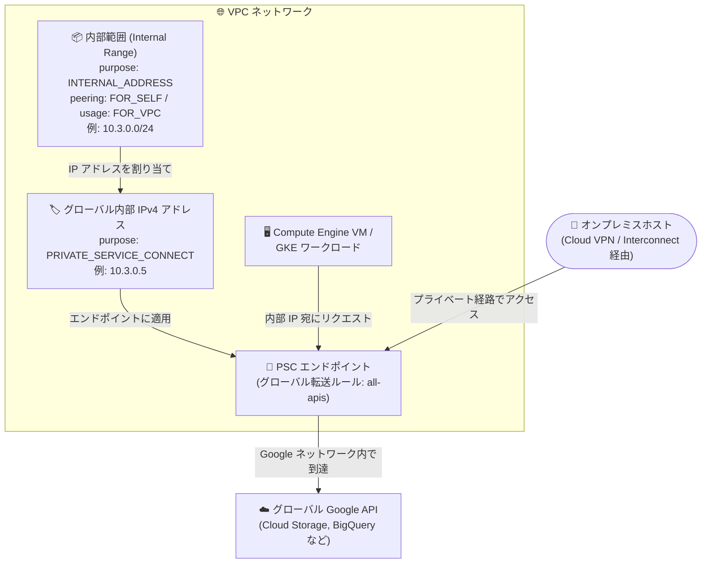

# Virtual Private Cloud: INTERNAL_ADDRESS purpose の内部範囲による Private Service Connect エンドポイント向けグローバル内部 IPv4 アドレス割り当てが GA

**リリース日**: 2026-11-09

**サービス**: Virtual Private Cloud (VPC)

**機能**: INTERNAL_ADDRESS purpose を持つ内部範囲 (Internal Range) による、グローバル Google API 向け Private Service Connect エンドポイント用グローバル内部 IPv4 アドレスの割り当て

**ステータス**: GA (一般提供)

📊 [このアップデートのインフォグラフィックを見る](https://takech9203.github.io/google-cloud-news-summary/20261109-vpc-internal-ranges-psc-endpoints-ga.html)

## 概要

Virtual Private Cloud (VPC) の内部範囲 (Internal Range) 機能において、`INTERNAL_ADDRESS` purpose を指定した内部範囲の作成が一般提供 (GA) になりました。この purpose を持つ内部範囲からは、グローバル Google API にアクセスする Private Service Connect (PSC) エンドポイント用のグローバル内部 IPv4 アドレスを割り当てることができます。

内部範囲は、VPC ネットワーク内で内部 IP アドレスのブロックを予約し、その使用方法を制御できるリソースです。従来の内部範囲はサブネットや子内部範囲の作成 (`VPC_SUBNET` purpose) に使用されていましたが、今回 GA となった `INTERNAL_ADDRESS` purpose により、PSC エンドポイント専用の IP アドレスプールを事前に予約し、そこから個別のグローバル内部 IPv4 アドレスを払い出す運用が可能になります。

このアップデートは、VPC Network Peering、Shared VPC、Cloud VPN、Cloud Interconnect などで複雑化したネットワークトポロジにおいて、IP アドレス管理 (IPAM) を体系的に行いたいネットワーク管理者や、`storage.googleapis.com` などの Google API へのアクセスをプライベート経路に統制したい企業に有用です。

**アップデート前の課題**

- PSC エンドポイント (グローバル Google API 向け) の IP アドレスは個別に指定する必要があり、組織的な IP アドレスプールとして事前予約・管理する標準的な仕組みがなかった
- PSC エンドポイントの IP アドレスは、サブネット範囲や静的ルート、自動モード VPC の範囲 (10.128.0.0/9) などと重複できないという厳格な要件があり、重複しない IP の選定と維持を手動で管理する必要があった
- 既存の内部範囲 (Internal Range) 内の IP アドレスは PSC エンドポイントに使用できず、内部範囲による IPAM と PSC エンドポイントの IP 管理が分断されていた

**アップデート後の改善**

- `INTERNAL_ADDRESS` purpose の内部範囲を作成することで、PSC エンドポイント専用の CIDR ブロックを事前に予約し、そこからグローバル内部 IPv4 アドレスを割り当てられるようになった
- `gcloud compute addresses create` で `--internal-range` を指定すると、範囲内から IP アドレスを自動割り当てできる (特定の IP を指定することも可能)
- この種類の内部範囲は既存のサブネットやルートと重複する場合は作成できないため、PSC エンドポイントの IP 要件を満たす範囲を仕組みとして担保できる
- GA に伴い、本番環境でのサポート対象として安心して利用できるようになった

## アーキテクチャ図



`INTERNAL_ADDRESS` purpose の内部範囲から PSC エンドポイント用のグローバル内部 IPv4 アドレスを払い出し、VPC 内や接続されたオンプレミスからグローバル Google API へプライベートにアクセスする構成です。

## サービスアップデートの詳細

### 主要機能

1. **INTERNAL_ADDRESS purpose の内部範囲**
   - 内部範囲の purpose として、従来の `VPC_SUBNET` (デフォルト。サブネットや子内部範囲の作成用) に加えて `INTERNAL_ADDRESS` が GA で利用可能
   - `INTERNAL_ADDRESS` purpose の内部範囲は、グローバル Google API 向け PSC エンドポイント用のグローバル内部 IPv4 アドレスの予約にのみ使用できる
   - purpose は内部範囲の作成後に変更できない

2. **内部範囲からの IP アドレス自動割り当て**
   - `gcloud compute addresses create` コマンドの `--internal-range` フラグで内部範囲を参照すると、範囲内から IP アドレスが自動的に割り当てられる
   - `--addresses` フラグで範囲内の特定 IP アドレスを指定することも可能
   - API では `globalAddresses.insert` の `ipCollection` フィールドで内部範囲を指定する

3. **コンソール・gcloud・API の各インターフェースに対応**
   - Google Cloud コンソールでは purpose type を「Internal addresses」、peering type を「For self」、usage type を「For VPC」に設定して作成
   - gcloud では `gcloud network-connectivity internal-ranges create` に `--purpose=INTERNAL_ADDRESS` を指定
   - Network Connectivity API の `projects.locations.internalRanges.create` メソッドでも作成可能

## 技術仕様

### INTERNAL_ADDRESS purpose の内部範囲の仕様

| 項目 | 詳細 |
|------|------|
| purpose | `INTERNAL_ADDRESS` (作成後に変更不可) |
| peering type | `FOR_SELF` 必須 (作成した VPC ネットワーク内でのみ使用可能) |
| usage type | `FOR_VPC` 必須 |
| IP バージョン | IPv4 CIDR ブロックのみ対応 (IPv6 は非対応) |
| 重複 (overlaps) | 既存のサブネットやルートと重複する範囲は作成不可 (`overlaps` フィールド・`--overlaps` フラグは使用不可) |
| 子リソース | この内部範囲内にサブネットや子内部範囲は作成できない |
| 割り当て対象 | グローバル Google API 向け PSC エンドポイントのグローバル内部 IPv4 アドレスのみ |

### PSC エンドポイントの IP アドレス要件 (抜粋)

- 単一の IPv4 アドレスであること (RFC 1918 / 非 RFC 1918 どちらも可)
- VPC ネットワークおよびピアリング接続されたネットワークのサブネット範囲 (プライマリ / セカンダリ) 内でないこと
- ローカル VPC またはピアリング先が自動モード VPC の場合、自動モード IP 範囲 (10.128.0.0/9) 内でないこと
- 内部範囲内の IP は使用不可。ただし、**同じ VPC ネットワーク内の PSC エンドポイント用内部範囲 (INTERNAL_ADDRESS purpose) から予約する場合は使用可能** (今回の GA 機能)
- 割り当てた IP アドレスはプロジェクトのグローバル内部 IP アドレスのクォータにカウントされる

## 設定方法

### 前提条件

1. VPC ネットワークが存在すること
2. エンドポイントの作成・管理には Compute Network Admin (`roles/compute.networkAdmin`) ロールが必要
3. 内部範囲から IP を割り当てるには `networkconnectivity.internalRanges.get` / `networkconnectivity.internalRanges.list` 権限が必要
4. PSC エンドポイントの IP アドレス要件を満たす CIDR 範囲を選定すること

### 手順

#### ステップ 1: INTERNAL_ADDRESS purpose の内部範囲を作成する

```bash
gcloud network-connectivity internal-ranges create RANGE_NAME \
  --ip-cidr-range=CIDR_RANGE \
  --network=NETWORK_NAME \
  --description="DESCRIPTION" \
  --peering=FOR_SELF \
  --usage=FOR_VPC \
  --purpose=INTERNAL_ADDRESS
```

PSC エンドポイント用の内部範囲を予約します。`--overlaps` フラグは `INTERNAL_ADDRESS` purpose と併用できません。

#### ステップ 2: 内部範囲からグローバル内部 IPv4 アドレスを予約する

```bash
gcloud compute addresses create ADDRESS_NAME \
  --global \
  --network=NETWORK_NAME \
  --purpose=PRIVATE_SERVICE_CONNECT \
  --internal-range=https://networkconnectivity.googleapis.com/v1/projects/PROJECT_ID/locations/global/internalRanges/RANGE_NAME
```

内部範囲から IP アドレスが自動的に割り当てられます。特定の IP を使いたい場合は `--addresses` フラグで範囲内のアドレスを指定します。

#### ステップ 3: PSC エンドポイントを作成し、動作を確認する

```bash
# グローバル Google API 向け PSC エンドポイント (転送ルール) を作成
gcloud compute forwarding-rules create ENDPOINT_NAME \
  --global \
  --network=NETWORK_NAME \
  --address=ADDRESS_NAME \
  --target-google-apis-bundle=all-apis

# VPC 内の VM からエンドポイントの動作を確認 (HTTP 204 が返れば成功)
curl -v ENDPOINT_IP/generate_204
```

予約したグローバル内部 IPv4 アドレスをターゲット `all-apis` のエンドポイントに適用します。

## メリット

### ビジネス面

- **IP アドレスガバナンスの強化**: PSC エンドポイント用の IP アドレスをチーム・組織単位で事前予約したプールから払い出せるため、大規模環境での IP 管理の統制が向上する
- **本番利用の安心感**: GA となったことで、エンタープライズの本番ネットワーク設計に正式に組み込める

### 技術面

- **IP 重複事故の防止**: `INTERNAL_ADDRESS` purpose の内部範囲は既存のサブネットやルートと重複して作成できないため、PSC エンドポイントの IP 要件違反を仕組みで防げる
- **自動割り当てによる運用簡素化**: `--internal-range` 指定により範囲内から IP を自動割り当てでき、個別 IP の手動採番が不要になる
- **IPAM の一元化**: サブネット用の内部範囲 (`VPC_SUBNET`) と PSC エンドポイント用の内部範囲 (`INTERNAL_ADDRESS`) を同じ Internal Range リソースで管理できる

## デメリット・制約事項

### 制限事項

- IPv4 CIDR ブロックのみ対応しており、IPv6 は使用できない
- peering type は `FOR_SELF`、usage type は `FOR_VPC` に限定される (ピアリング先 VPC への共有は不可)
- 既存のサブネットやルートと重複する範囲では作成できず、`overlaps` の指定もできない
- この内部範囲内にサブネットや子内部範囲を作成することはできない
- purpose は作成後に変更できない

### 考慮すべき点

- 割り当てた IP アドレスはプロジェクトのグローバル内部 IP アドレスのクォータにカウントされる
- Shared VPC 構成では、サービスプロジェクトからホストプロジェクトのグローバル内部アドレスリソースを予約することはできないため、転送ルールとアドレスリソースは同一プロジェクトに作成することが推奨される
- PSC エンドポイント数は「PSC Google APIs Forwarding Rules per VPC Network」クォータで制御される
- 組織ポリシー制約 `constraints/compute.disablePrivateServiceConnectCreationForConsumers` によりエンドポイント作成が制限されている場合がある

## ユースケース

### ユースケース 1: 大規模組織での PSC エンドポイント用 IP プールの標準化

**シナリオ**: 多数のプロジェクト・VPC を運用する企業で、Cloud Storage や BigQuery などの Google API へのアクセスを PSC エンドポイント経由に統一したい。各チームが個別に IP を採番すると、サブネットやオンプレミス範囲との重複リスクがある。

**実装例**:
```bash
# ネットワーク管理者が PSC エンドポイント専用レンジを予約
gcloud network-connectivity internal-ranges create psc-endpoint-pool \
  --ip-cidr-range=10.200.0.0/24 \
  --network=prod-vpc \
  --peering=FOR_SELF \
  --usage=FOR_VPC \
  --purpose=INTERNAL_ADDRESS

# 各用途のエンドポイント IP をプールから自動割り当て
gcloud compute addresses create psc-storage-ip \
  --global \
  --network=prod-vpc \
  --purpose=PRIVATE_SERVICE_CONNECT \
  --internal-range=https://networkconnectivity.googleapis.com/v1/projects/my-project/locations/global/internalRanges/psc-endpoint-pool
```

**効果**: PSC エンドポイント用 IP が専用プールから一元的に払い出され、サブネットやルートとの重複が仕組みで防止される。IP 設計ドキュメントと実環境の乖離も起きにくくなる。

### ユースケース 2: ハイブリッド環境からの Google API プライベートアクセス

**シナリオ**: オンプレミスから Cloud VPN / Cloud Interconnect 経由で Google API にアクセスする際、オンプレミスの経路設計と整合した IP レンジを PSC エンドポイントに割り当てたい。

**効果**: オンプレミスに広報する経路と整合する CIDR ブロックを `INTERNAL_ADDRESS` purpose の内部範囲として予約しておくことで、エンドポイント追加時も既存の経路設計を崩さずにプライベートアクセスを拡張できる。

## 料金

内部範囲 (Internal Range) リソース自体の追加料金に関する記載はリリースノートにありません。Private Service Connect エンドポイント (グローバル Google API 向け転送ルール) の料金は VPC の料金ページを参照してください。

- [VPC 料金ページ (Private Service Connect)](https://cloud.google.com/vpc/pricing#psc-forwarding-rule-apis)

## 利用可能リージョン

内部範囲はグローバルリソース (`locations/global`) として作成され、割り当てられる IP アドレスもグローバル内部 IPv4 アドレスです。リージョン別の提供制限に関する記載はありません。

## 関連サービス・機能

- **Private Service Connect**: 本機能で予約した IP アドレスを使用して、グローバル Google API (all-apis / vpc-sc バンドル) へのプライベートエンドポイントを作成する
- **Network Connectivity API**: 内部範囲リソース (`internalRanges`) の作成・管理に使用する API
- **Cloud VPN / Cloud Interconnect**: オンプレミスホストから PSC エンドポイント経由で Google API にアクセスする際の接続経路
- **VPC Network Peering / Shared VPC**: 複雑なトポロジにおける IP アドレス管理で内部範囲が活用される。ただし `INTERNAL_ADDRESS` purpose の範囲は `FOR_SELF` のため親 VPC 内でのみ使用可能
- **Cloud DNS / Service Directory**: PSC エンドポイントに `*.p.googleapis.com` などの DNS 名を割り当てる際に使用

## 参考リンク

- 📊 [インフォグラフィック](https://takech9203.github.io/google-cloud-news-summary/20261109-vpc-internal-ranges-psc-endpoints-ga.html)
- [公式リリースノート](https://docs.cloud.google.com/release-notes#November_09_2026)
- [内部範囲の概要 (Internal ranges overview)](https://docs.cloud.google.com/vpc/docs/internal-ranges)
- [内部範囲の作成と使用](https://docs.cloud.google.com/vpc/docs/create-use-internal-ranges)
- [エンドポイントを介したグローバル Google API へのアクセスについて](https://docs.cloud.google.com/vpc/docs/about-accessing-google-apis-endpoints)
- [グローバル Google API 向け Private Service Connect の構成](https://docs.cloud.google.com/vpc/docs/configure-private-service-connect-apis)
- [料金ページ](https://cloud.google.com/vpc/pricing#psc-forwarding-rule-apis)

## まとめ

`INTERNAL_ADDRESS` purpose の内部範囲の GA により、グローバル Google API 向け PSC エンドポイントの IP アドレスを専用プールから体系的に予約・払い出しできるようになりました。PSC エンドポイントの厳格な IP 要件 (サブネット・ルートとの非重複など) を仕組みで担保できるため、大規模環境やハイブリッド環境で PSC を利用している組織は、エンドポイント用 IP の採番運用を本機能ベースに移行することを検討してください。

---

**タグ**: #VPC #PrivateServiceConnect #InternalRanges #ネットワーク #IPAM #GA
