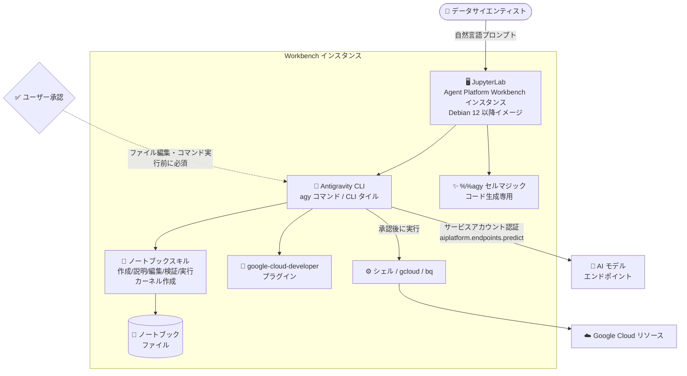

# Agent Platform Workbench: Antigravity CLI サポート (Preview)

**リリース日**: 2026-11-10

**サービス**: Agent Platform Workbench (Gemini Enterprise Agent Platform)

**機能**: Antigravity CLI in Agent Platform Workbench instances

**ステータス**: Preview

📊 [このアップデートのインフォグラフィックを見る](https://takech9203.github.io/google-cloud-news-summary/20261110-agent-platform-workbench-antigravity-cli-preview.html)

## 概要

Gemini Enterprise Agent Platform Workbench インスタンスで、**Antigravity CLI** が Preview として利用可能になりました。Antigravity CLI は、ターミナルで動作する AI エージェント「Google Antigravity」のターミナル向けインターフェースであり、Debian 12 (`workbench-instances-2603`) 以降のイメージを使用する Workbench インスタンスで利用できます。新規インスタンスではデフォルトで有効化されます。

Workbench の JupyterLab 環境内のターミナルから自然言語で指示するだけで、ノートブックの作成・説明・編集・検証・実行、必要なパッケージを含む Jupyter カーネルの作成、`gcloud` や `bq` などの Google Cloud コマンドやシェルコマンドの実行が可能になります。さらに、Python ノートブックのセルで `%%agy` セルマジックを使うと、自然言語の説明からセルのコードを生成できます。

対象ユーザーは、Agent Platform Workbench を利用するデータアナリスト、データサイエンティスト、データ開発者です。Antigravity CLI はファイルの編集やコマンドの実行前に必ずユーザーの承認を求める設計となっており、プロンプトインジェクション対策として承認スキップオプションは Workbench 上では無効化されています。

**アップデート前の課題**

- Workbench 上でノートブックの作成・編集・デバッグ・実行をすべて手動で行う必要があり、定型的な作業 (カーネル作成、ノートブック検証など) に時間がかかっていた
- `gcloud` や `bq` などのコマンドは構文を調べながら手で組み立てる必要があった
- ターミナルで動作するエージェント型 AI 支援としては Gemini CLI が提供されていたが、Google Antigravity のターミナルサーフェスは Workbench で利用できなかった

**アップデート後の改善**

- 自然言語の指示だけで、ノートブックの作成・説明・編集・検証・実行や Jupyter カーネルの作成が可能になった (Workbench 専用のノートブックスキルが付属)
- `google-cloud-developer` プラグインが同梱され、gcloud コマンドのガイダンス、認証の支援、Google Cloud ドキュメント参照、Cloud Logging / Cloud Monitoring / Agent Platform などのスキルが利用可能になった
- `%%agy` セルマジックにより、ノートブックセル内で説明文からコードを生成できるようになった
- 新規インスタンスではデフォルトで有効のため、追加セットアップなしで利用を開始できる

## アーキテクチャ図



Antigravity CLI は Workbench インスタンス内の JupyterLab ターミナルで動作し、ノートブックスキルと Google Cloud プラグインを使ってタスクを遂行します。ファイル編集やコマンド実行はユーザーの承認を経てから行われ、モデル呼び出しはインスタンスのサービスアカウント権限で実行されます。

## サービスアップデートの詳細

### 主要機能

1. **ノートブックスキル (Workbench 専用追加機能)**
   - Notebook targeter: JupyterLab で開いているノートブックを特定し、「このノートブック」という指示を解釈
   - Notebook explainer: ノートブックのセルとテキスト出力を要約
   - Notebook modifier: 対象セルのみを変更し、JupyterLab が使用するフォーマットを維持したままセルを追加・編集
   - Notebook validator: ノートブックの妥当性を検証 (壊れたノートブックの修復は実行前に確認)
   - Notebook creator: インスタンスで利用可能なカーネルを使ったノートブックを作成
   - Notebook executor: インスタンスのカーネル上でノートブックを実行して出力を保存 (失敗セルを特定)
   - Kernel creator: 指定したパッケージを含む Python 環境と Jupyter カーネルを作成

2. **google-cloud-developer プラグイン**
   - Antigravity プラグインマーケットプレイス由来のプラグインを同梱
   - gcloud コマンドのガイダンス、認証の支援、Google Cloud ドキュメントの参照が可能
   - Cloud Logging、Cloud Monitoring、Agent Platform などのプロダクト向けスキルを提供
   - プロンプト内でスキルやプラグインを明示的に指名する必要はなく、必要に応じて自動的に使用される

3. **`%%agy` セルマジック**
   - Python ノートブックの新しいセルの 1 行目に `%%agy` と入力し、続く行に欲しいコードの説明を記述してセルを実行すると、下に新しいセルとしてコードが追加される
   - コード生成専用に設計されており、承認を必要とするアクション (シェルコマンド実行など) は自動的に拒否される
   - Antigravity CLI が有効な間はいつでも利用可能

4. **承認ベースの安全設計**
   - デフォルトでファイル編集、シェルコマンド実行、URL フェッチなどのアクション前に必ず承認を要求
   - ノートブックやスクリプト、Web ページに隠された指示によるプロンプトインジェクションへの防御として機能
   - Workbench インスタンス上では承認プロンプトをスキップするオプションは無効化されている

## 技術仕様

### 利用要件

| 項目 | 詳細 |
|------|------|
| 対応イメージ | Debian 12 (`workbench-instances-2603`) 以降 (Debian 11 の `workbench-instances` イメージには非対応) |
| デフォルト設定 | 新規インスタンスでは有効 (メタデータ未指定時は `enable-antigravity: true` が自動設定) |
| 有効化/無効化 | インスタンスメタデータ `enable-antigravity` を `true` / `false` に設定し、インスタンスを停止・起動 |
| 起動方法 | JupyterLab Launcher の「Antigravity CLI」タイル、または任意のターミナルで `agy` コマンド |
| 必要な IAM ロール (ユーザー) | Agent Platform User (`roles/aiplatform.user`) |
| 必要な IAM ロール (サービスアカウント) | Agent Platform User (`roles/aiplatform.user`) — `aiplatform.endpoints.predict` 権限が必要 |
| 実行権限 | インスタンスでアクティブな認証情報 (デフォルトはインスタンスのサービスアカウント) で動作 |
| バージョン | インスタンスイメージに含まれるバージョンに固定 (自己更新不可、更新にはイメージアップグレードが必要) |

### 管理者によるアクセス制御

| 制御方法 | 効果 |
|----------|------|
| メタデータ `enable-antigravity: false` | 次回起動時に CLI タイル、ノートブックスキル、プラグイン、`%%agy` セルマジックを削除 (`agy` コマンド自体は残る) |
| 組織ポリシーによるモデル制限 | 組織・フォルダ・プロジェクトレベルで特定モデルの使用を制限 (Model Garden のモデルアクセス制御) |
| `aiplatform.endpoints.predict` を付与しない | 特定の ID によるモデルエンドポイント推論を遮断 |

## 設定方法

### 前提条件

1. Debian 12 (`workbench-instances-2603`) 以降のイメージを使用する Agent Platform Workbench インスタンス
2. ユーザーとインスタンスのサービスアカウントの両方に `roles/aiplatform.user` が付与されていること

### 手順

#### ステップ 1: Antigravity CLI を起動する

```bash
# JupyterLab の任意のターミナルで実行
agy
```

または Google Cloud コンソールの「Instances」ページからインスタンスの「Open JupyterLab」をクリックし、File > New launcher > Other セクションの「Antigravity CLI」タイルをクリックします。

#### ステップ 2: プロンプトを入力する

```text
Create a notebook that loads bigquery-public-data.ml_datasets.census_adult_income
into a pandas DataFrame, and then run it.
```

Antigravity CLI がファイル編集やコマンド実行を提案した際は、内容を確認して承認または拒否します。

#### ステップ 3: (任意) インスタンスで無効化する

```bash
# enable-antigravity メタデータを false に設定し、インスタンスを再起動
gcloud workbench instances update INSTANCE_NAME \
  --location=LOCATION \
  --metadata=enable-antigravity=false
```

設定はインスタンスの次回起動時に適用されます。

## メリット

### ビジネス面

- **生産性の向上**: ノートブックの作成・検証・実行やカーネル構築といった定型作業を自然言語で自動化でき、データ分析・モデル開発の反復サイクルを短縮できる
- **追加セットアップ不要**: 新規インスタンスではデフォルトで有効のため、チームへの展開コストが低い
- **ガバナンスの担保**: メタデータ、組織ポリシー、IAM 権限の 3 層でアクセスを制御でき、企業の統制要件に対応できる

### 技術面

- **Workbench に最適化されたスキル**: 汎用エージェントではなく、JupyterLab のノートブックフォーマットを維持する専用スキル群が付属するため、ノートブックが壊れにくい
- **承認ベースの安全性**: すべての編集・コマンド実行が承認制で、プロンプトインジェクションによる意図しない操作 (外部へのデータ送信など) を実行前に確認・阻止できる
- **権限の最小化**: CLI はインスタンス環境の権限内でのみ動作し、ユーザーやサービスアカウントに権限がないリソースにはアクセスできない

## デメリット・制約事項

### 制限事項

- CLI のみの提供で、グラフィカルなチャットインターフェースや高度なエディタ内ツールは含まれない
- Antigravity CLI はノートブックファイルをディスク上で直接変更するため、ノートブックエディタの Undo (Ctrl+Z) では取り消せない (自然言語で「Undo your last change」と指示することは可能)
- JupyterLab で開いているファイルも直接変更するため、未保存の変更がある場合は事前に保存が必要
- CLI のバージョンはインスタンスイメージに固定され、自己更新できない (新バージョンはイメージアップグレードが必要)
- `%%agy` セルマジックはコード生成専用で、承認が必要なアクション (シェルコマンド実行など) は自動拒否される

### 考慮すべき点

- Preview 機能のため、Pre-GA Offerings Terms が適用され、サポートが限定される場合がある
- CLI はインスタンスでアクティブな認証情報で動作するため、`gcloud auth login` などで別の ID を認証するとその権限で動作する点に注意
- 生成 AI の出力は正しく見えても誤りを含む可能性があるため、生成されたコードは実行前にレビューすることが推奨される
- 既存インスタンスで利用するには Debian 12 以降のイメージへのアップグレードが必要

## ユースケース

### ユースケース 1: 自然言語によるノートブック作成と実行

**シナリオ**: データアナリストが BigQuery の公開データセットを使った探索的分析を素早く始めたい。

**実装例**:
```text
agy

> "Create a notebook that loads bigquery-public-data.ml_datasets.census_adult_income
   into a pandas DataFrame, and then run it."
> "Add a cell to this notebook that plots the distribution of the 'age' column."
```

**効果**: ノートブックの雛形作成、データロード、可視化コードの追加、実行までを自然言語で完結でき、分析開始までの時間を大幅に短縮できる。

### ユースケース 2: `%%agy` セルマジックによるセルコード生成

**シナリオ**: ノートブック作業中に、特定の処理のコードをすぐに書き起こしたい。

**実装例**:
```python
%%agy
age 列の分布をヒストグラムで描画し、平均値に縦線を引くコード
```

**効果**: ターミナルに切り替えることなく、ノートブック内で説明からコードセルを生成できる。生成されたコードはレビューしてから実行できる。

### ユースケース 3: 専用カーネル環境の自動構築

**シナリオ**: 時系列予測プロジェクト用に、必要なパッケージを揃えた専用カーネルを用意したい。

**実装例**:
```text
> "Create a kernel named 'forecast' with pandas and prophet."
```

**効果**: Python 環境の作成、パッケージインストール、Jupyter カーネル登録という一連の手作業が自然言語の 1 指示で完了する。

## 料金

Antigravity CLI 自体の個別料金は Release Notes およびドキュメントに明記されていません。Agent Platform Workbench インスタンスの料金は、Compute Engine / Cloud Storage と同等のコンピュート・ストレージ料金に加え、管理手数料が適用される体系です。また、Antigravity CLI のモデル呼び出しには `aiplatform.endpoints.predict` 権限が必要であり、モデル利用に応じた課金が発生する可能性があります。詳細は料金ページを確認してください。

- [Agent Platform Workbench の料金](https://cloud.google.com/vertex-ai/pricing#notebooks)

## 利用可能リージョン

リージョン固有の制限は Release Notes およびドキュメントに明記されていません。Debian 12 (`workbench-instances-2603`) 以降のイメージを使用する Agent Platform Workbench インスタンスで利用できます。

## 関連サービス・機能

- **Google Antigravity**: Antigravity CLI の提供元となる AI エージェント。Antigravity CLI はそのターミナルサーフェスにあたる ([antigravity.google](https://antigravity.google/))
- **Gemini CLI in Agent Platform Workbench**: 同じく Workbench で利用できるターミナルベースの AI エージェント。必要な IAM ロール (`roles/aiplatform.user`) は共通
- **Cloud Logging / Cloud Monitoring**: 同梱の google-cloud-developer プラグインがこれらのプロダクト向けスキルを提供
- **BigQuery**: `bq` コマンドや自然言語プロンプトでのクエリ実行に対応し、データ分析ワークフローと連携
- **IAM / 組織ポリシー**: `roles/aiplatform.user` の付与や Model Garden のモデルアクセス制御により、CLI の利用を統制

## 参考リンク

- 📊 [インフォグラフィック](https://takech9203.github.io/google-cloud-news-summary/20261110-agent-platform-workbench-antigravity-cli-preview.html)
- [公式リリースノート](https://docs.cloud.google.com/release-notes#November_10_2026)
- [ドキュメント: Use the Antigravity CLI](https://docs.cloud.google.com/gemini-enterprise-agent-platform/notebooks/workbench/instances/antigravity-cli)
- [ドキュメント: Manage features through metadata](https://docs.cloud.google.com/gemini-enterprise-agent-platform/notebooks/workbench/instances/manage-metadata)
- [Google Antigravity](https://antigravity.google/)
- [料金ページ](https://cloud.google.com/vertex-ai/pricing#notebooks)

## まとめ

Agent Platform Workbench への Antigravity CLI の統合により、ノートブック作業と Google Cloud 操作を自然言語で行えるエージェント環境が、新規インスタンスでデフォルト有効の形で提供されました。承認ベースの安全設計とノートブック専用スキルが特徴で、データサイエンスチームの生産性向上が期待できます。Debian 12 以降のイメージが前提となるため、既存インスタンスを利用中のチームはイメージアップグレードの計画と、組織のガバナンス要件に応じたメタデータ・IAM・組織ポリシーによる制御方針の検討をおすすめします。

---

**タグ**: Agent Platform Workbench, Antigravity CLI, Google Antigravity, AI エージェント, JupyterLab, ノートブック, Preview, Gemini Enterprise Agent Platform
