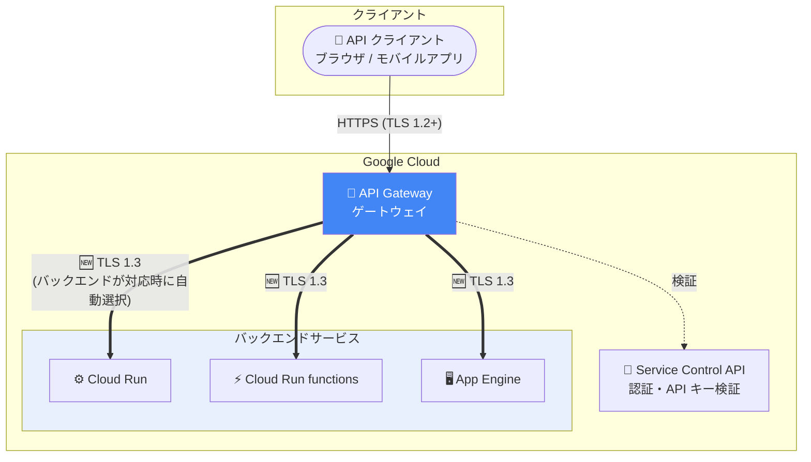

# API Gateway: バックエンド接続における TLS 1.3 サポート

**リリース日**: 2026-11-10

**サービス**: API Gateway

**機能**: バックエンドサービスへの接続での TLS 1.3 有効化

**ステータス**: Feature (GA)

📊 [このアップデートのインフォグラフィックを見る](https://takech9203.github.io/google-cloud-news-summary/20261110-api-gateway-tls-1-3-backend-connections.html)

## 概要

2026 年 11 月 10 日、Google Cloud は API Gateway のゲートウェイからバックエンドサービスへの接続において TLS 1.3 を有効化したことを発表しました。バックエンドが TLS 1.3 をサポートしている場合、ゲートウェイは自動的に TLS 1.3 を使用して接続します。ユーザー側での設定変更は不要で、TLS バージョンのネゴシエーションはゲートウェイとバックエンド間で自動的に行われます。

API Gateway は、Cloud Run、Cloud Run functions、App Engine などのバックエンドサービスに対して、一貫した REST API による安全なアクセスを提供するフルマネージドの API 管理サービスです。今回のアップデートにより、クライアントからゲートウェイまでの区間だけでなく、ゲートウェイからバックエンドまでの区間でも最新の TLS プロトコル (TLS 1.3 / RFC 8446) による暗号化通信が利用できるようになり、エンドツーエンドでの通信セキュリティが強化されます。

TLS 1.3 は TLS 1.2 と比較して、ハンドシェイクのラウンドトリップ削減 (2-RTT から 1-RTT) による接続確立の高速化、Forward Secrecy (前方秘匿性) の必須化、旧式で脆弱な暗号スイートの廃止といった利点があります。API を介したバックエンド通信のセキュリティ要件・コンプライアンス要件が厳しいエンタープライズユーザーにとって重要な改善です。

**アップデート前の課題**

- ゲートウェイからバックエンドサービスへの接続では TLS 1.3 が使用されず、バックエンドが TLS 1.3 をサポートしていても旧バージョンの TLS で接続されていた
- フロントエンド (クライアント → ゲートウェイ) 側は 2025 年 7 月のアップデートで TLS 1.2 以上が強制されるようになった一方、バックエンド側の接続では TLS 1.3 の恩恵 (高速なハンドシェイク、強化された暗号スイート) を受けられなかった
- 組織のセキュリティポリシーで TLS 1.3 の利用が推奨・要求される場合に、ゲートウェイとバックエンド間の区間が対応できていなかった

**アップデート後の改善**

- バックエンドが TLS 1.3 をサポートしている場合、ゲートウェイは自動的に TLS 1.3 で接続するようになった
- ユーザー側の設定変更やデプロイのやり直しは不要で、既存のゲートウェイにも適用される
- TLS 1.3 の 1-RTT ハンドシェイクにより、バックエンドへの新規接続確立時のレイテンシ削減が期待できる
- クライアント → ゲートウェイ → バックエンドの全区間で最新の TLS プロトコルを利用でき、エンドツーエンドのセキュリティ水準が向上した

## アーキテクチャ図



クライアントからの API リクエストは API Gateway で認証・検証された後、バックエンドサービスへ転送されます。今回のアップデートにより、ゲートウェイからバックエンドへの接続 (太線部分) で、バックエンドが TLS 1.3 をサポートしていれば自動的に TLS 1.3 が使用されます。

## サービスアップデートの詳細

### 主要機能

1. **バックエンド接続での TLS 1.3 の自動ネゴシエーション**
   - API Gateway のゲートウェイからバックエンドサービスへの接続で TLS 1.3 が有効化された
   - バックエンドが TLS 1.3 をサポートしている場合、ゲートウェイは TLS 1.3 を使用する
   - バックエンドが TLS 1.3 に未対応の場合は、従来どおりサポートされる TLS バージョンにフォールバックする

2. **設定不要での適用**
   - ユーザー側での OpenAPI 仕様 (`x-google-backend`) や API Config の変更は不要
   - Cloud Run、Cloud Run functions、App Engine など Google マネージドのバックエンドは TLS 1.3 に対応しており、自動的に恩恵を受けられる

3. **フロントエンド側の TLS 強化との組み合わせ**
   - 2025 年 7 月のアップデートでクライアント → ゲートウェイ間は TLS 1.2 以上が強制済み
   - 今回のバックエンド側の TLS 1.3 対応により、通信経路全体でモダンな TLS 構成が実現された

## 技術仕様

### TLS 1.2 と TLS 1.3 の比較

| 項目 | TLS 1.2 | TLS 1.3 |
|------|---------|---------|
| ハンドシェイク | 2-RTT | 1-RTT (接続確立が高速) |
| Forward Secrecy | オプション | 必須 (一時的な鍵交換のみ) |
| 旧式暗号スイート (RSA 鍵交換、CBC モードなど) | 利用可能 | 廃止 |
| ハンドシェイクの暗号化 | 平文部分が多い | 証明書を含む大部分を暗号化 |
| 規格 | RFC 5246 | RFC 8446 |

### API Gateway のエンドポイント構成

| エンドポイント | 役割 | 今回の変更 |
|---------------|------|-----------|
| API エンドポイント | クライアントが API を利用するための公開エンドポイント | 変更なし (TLS 1.2+ を強制済み) |
| バックエンドエンドポイント | API がバックエンドサービスに接続するためのエンドポイント | 🆕 TLS 1.3 が有効化 |

## 設定方法

### 前提条件

1. API Gateway でゲートウェイがデプロイ済みであること
2. バックエンドサービス (Cloud Run、Cloud Run functions、App Engine、または外部 HTTPS サービス) が稼働していること

### 手順

このアップデートは自動的に適用されるため、ユーザー側の設定作業は不要です。バックエンドが TLS 1.3 をサポートしていれば、ゲートウェイは自動的に TLS 1.3 で接続します。

#### 参考: 自前のバックエンドで TLS 1.3 の対応状況を確認する

```bash
# バックエンドサーバーが TLS 1.3 をサポートしているか確認
openssl s_client -connect YOUR_BACKEND_HOST:443 -tls1_3 </dev/null 2>/dev/null \
  | grep -E "Protocol|Cipher"
```

`Protocol  : TLSv1.3` が表示されれば、バックエンドは TLS 1.3 に対応しており、ゲートウェイからの接続で TLS 1.3 が使用されます。

#### 参考: 既存のゲートウェイ構成の確認

```bash
# ゲートウェイの一覧を確認
gcloud api-gateway gateways list

# API Config の詳細 (バックエンド設定) を確認
gcloud api-gateway api-configs describe CONFIG_ID --api=API_ID
```

## メリット

### ビジネス面

- **コンプライアンス対応の強化**: 最新 TLS プロトコルの利用を求めるセキュリティポリシーや業界規制 (金融、医療など) への準拠が容易になる
- **運用負荷ゼロでのセキュリティ向上**: 設定変更やダウンタイムなしで、既存の API 基盤のセキュリティ水準が向上する

### 技術面

- **接続確立の高速化**: TLS 1.3 の 1-RTT ハンドシェイクにより、ゲートウェイからバックエンドへの新規接続時のレイテンシが削減される
- **Forward Secrecy の必須化**: 万一秘密鍵が漏洩しても過去の通信内容は復号できず、長期的なデータ保護が強化される
- **脆弱な暗号スイートの排除**: TLS 1.3 では RSA 鍵交換や CBC モードなど既知の攻撃対象となった方式が廃止されている

## デメリット・制約事項

### 制限事項

- TLS 1.3 が使用されるのはバックエンドが TLS 1.3 をサポートしている場合のみ。未対応のバックエンドへの接続は従来の TLS バージョンが使用される
- TLS バージョンを明示的に固定・指定するユーザー向け設定は提供されていない (自動ネゴシエーション)

### 考慮すべき点

- 自前で運用する外部バックエンド (オンプレミスや VM 上のサービス) で TLS 1.3 の恩恵を受けるには、バックエンド側のミドルウェア (nginx、Envoy など) が TLS 1.3 に対応している必要がある
- バックエンド側で TLS バージョンに依存した監視・検査 (ミドルボックスによる TLS インスペクションなど) を行っている場合は、TLS 1.3 への移行による影響を確認する

## ユースケース

### ユースケース 1: 金融系 API 基盤でのエンドツーエンド TLS 強化

**シナリオ**: 金融機関が API Gateway + Cloud Run で外部公開 API を運用しており、社内セキュリティ基準で通信経路全体における TLS 1.3 の利用が推奨されている。

**効果**: Cloud Run は TLS 1.3 に対応しているため、追加作業なしでゲートウェイ → バックエンド間が TLS 1.3 となり、クライアント → ゲートウェイ間 (TLS 1.2+) と合わせて監査要件を満たしやすくなる。

### ユースケース 2: 低レイテンシが求められるモバイル向け API

**シナリオ**: モバイルアプリ向けの API で、トラフィックの増減によりゲートウェイからバックエンドへの新規接続が頻繁に発生する。

**効果**: TLS 1.3 の 1-RTT ハンドシェイクにより接続確立のオーバーヘッドが削減され、コールドスタートやスケールアウト時のバックエンド接続レイテンシの改善が期待できる。

## 料金

今回のアップデートによる追加料金はありません。API Gateway の料金は API 呼び出し数に基づく従量課金です。

### 料金例 (API 呼び出し)

| 月間 API 呼び出し数 (課金アカウントごと) | 100 万回あたりの料金 |
|------------------------------------------|---------------------|
| 0〜200 万回 | $0.00 (無料) |
| 200 万〜10 億回 | $3.00 |
| 10 億回超 | $1.50 |

詳細は [API Gateway 料金ページ](https://cloud.google.com/api-gateway/pricing) を参照してください。

## 関連サービス・機能

- **Cloud Run / Cloud Run functions / App Engine**: API Gateway の代表的なバックエンド。Google マネージドサービスとして TLS 1.3 に対応しており、本アップデートの恩恵を自動的に受けられる
- **Service Control API**: API キー検証・認証・ロギングなどの API 管理ルールをランタイムで適用するコンポーネント
- **Cloud Load Balancing / GKE Gateway**: 同様にバックエンド TLS (BackendTLSPolicy) による暗号化・検証をサポートしており、L7 ロードバランサー経由の構成での代替・補完となる
- **Apigee**: より高度な API 管理 (ポリシー、アナリティクス、収益化) が必要な場合の上位サービス。TargetEndpoint 単位で TLS を細かく構成できる

## 参考リンク

- 📊 [インフォグラフィック](https://takech9203.github.io/google-cloud-news-summary/20261110-api-gateway-tls-1-3-backend-connections.html)
- [公式リリースノート](https://docs.cloud.google.com/release-notes#November_10_2026)
- [API Gateway アーキテクチャ](https://docs.cloud.google.com/api-gateway/docs/architecture-overview)
- [API Gateway について](https://docs.cloud.google.com/api-gateway/docs/about-api-gateway)
- [API Gateway リリースノート](https://docs.cloud.google.com/api-gateway/docs/release-notes)
- [料金ページ](https://cloud.google.com/api-gateway/pricing)

## まとめ

API Gateway のバックエンド接続で TLS 1.3 が有効化され、クライアントからバックエンドまでの通信経路全体でモダンな TLS 構成が実現しました。設定変更は不要で自動的に適用されるため、ユーザー側の対応は基本的に不要ですが、自前で運用する外部バックエンドがある場合は TLS 1.3 対応状況を確認し、未対応であればミドルウェアの更新を検討することを推奨します。

---

**タグ**: `API Gateway`, `TLS 1.3`, `セキュリティ`, `ネットワーク`, `暗号化`, `バックエンド`
