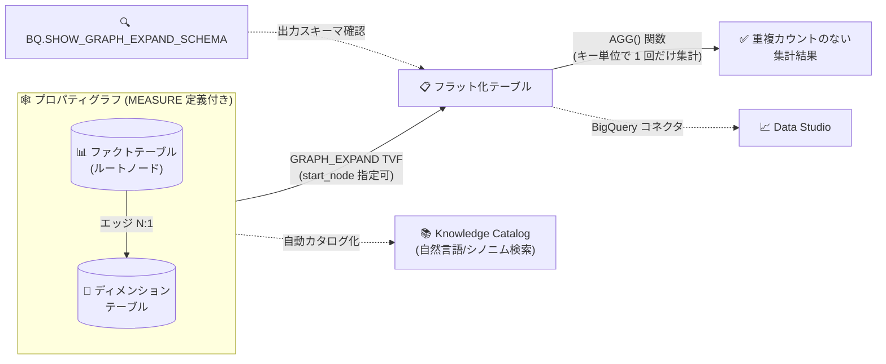

# BigQuery: グラフメジャーと GRAPH_EXPAND が GA、生成 AI 関数で gemini-4-carbon をサポート

**リリース日**: 2026-11-10

**サービス**: BigQuery

**機能**: グラフメジャー / GRAPH_EXPAND TVF の一般提供開始、生成 AI 関数での gemini-4-carbon モデルサポート

**ステータス**: GA (一般提供)

📊 [このアップデートのインフォグラフィックを見る](https://takech9203.github.io/google-cloud-news-summary/20261110-bigquery-graph-measures-gemini-4-carbon.html)

## 概要

BigQuery Graph の「メジャー (measure)」機能と `GRAPH_EXPAND` テーブル値関数 (TVF) が一般提供 (GA) になりました。メジャーは、プロパティグラフのノード/エッジテーブルの `PROPERTIES` 句内で `MEASURE` キーワードを使って定義する集計プロパティで、集計をそのテーブルのキーにロックすることで、結合によって行が重複する状況でも「重複カウント (overcounting)」を起こさずに複雑な集計を実行できます。メジャーを利用するには、`GRAPH_EXPAND` TVF でグラフをフラットなリレーショナルテーブルに変換し、`AGG` 関数でメジャーを集計します。今回の GA では、`GRAPH_EXPAND` の複数ファクトテーブル対応、出力スキーマを確認する `BQ.SHOW_GRAPH_EXPAND_SCHEMA` システムプロシージャ、ラベル/プロパティの `OPTIONS` 句での extensions (自然言語クエリ向けカスタムメタデータ) の定義もあわせて利用可能になりました。さらに、メジャーとグラフは BigQuery コネクタ経由で Data Studio から利用でき、Knowledge Catalog に自動カタログ化されて自然言語やドメインシノニムで検索できます。

同日、BigQuery の生成 AI 関数が Google の最新フロンティアモデルである **gemini-4-carbon** をサポートしました (GA)。SQL から `AI.GENERATE` などの生成 AI 関数を通じて、より高度な推論能力を持つモデルをデータ分析パイプラインに組み込めます。

主な対象ユーザーは、ディメンショナルモデル (スタースキーマ/スノーフレークスキーマ) 上でセマンティックレイヤーを構築するデータエンジニア/アナリティクスエンジニア、および SQL ベースで LLM を活用するデータアナリストです。

**アップデート前の課題**

- ファクトテーブルとディメンションテーブルを結合すると行が重複 (ファンアウト) し、`SUM` や `COUNT` などの集計で重複カウントが発生するため、サブクエリや `COUNT(DISTINCT ...)` などで集計粒度を手動で管理する必要があった
- 集計ロジック (ビジネスメトリクス定義) をクエリごとに記述する必要があり、定義の一貫性を保つのが難しかった
- グラフに複数のルートノードテーブル (ファクトテーブル) がある場合の展開に対応していなかった
- `GRAPH_EXPAND` が返すテーブルのスキーマを、実際に関数を呼び出さずに確認する手段がなかった

**アップデート後の改善**

- メジャーがテーブルの `KEY` を基準に集計を定義するため、結合で行が重複しても `AGG` 関数で常に正しい集計結果が得られるようになった (GA)
- 集計関数呼び出し、集計関数内の式・条件ロジック、条件付き DISTINCT カウント、集計関数外のスカラー演算、`AGG` でラップした派生メジャーなど、複雑なメジャー式を一元的に定義できるようになった
- `GRAPH_EXPAND` が複数ファクトテーブルに対応し、`start_node` 引数でトラバースするサブグラフを選択できるようになった
- `BQ.SHOW_GRAPH_EXPAND_SCHEMA` で出力スキーマ (列名、型、メジャー判定、description/synonyms) を事前に確認できるようになった
- ラベル/プロパティの `OPTIONS` 句で extensions (文字列ペアのカスタムメタデータ) を定義でき、自然言語クエリインターフェースの精度向上に活用できるようになった
- メジャーとグラフが Knowledge Catalog に自動カタログ化され、自然言語やドメインシノニムで検索可能になった
- BigQuery の生成 AI 関数で gemini-4-carbon モデルが利用可能になった (GA)

## アーキテクチャ図



メジャーを定義したプロパティグラフを `GRAPH_EXPAND` TVF でフラットなテーブルに展開し、`AGG` 関数でキー単位に正確な集計を行うデータフローです。グラフとメジャーは Knowledge Catalog に自動カタログ化され、Data Studio からも利用できます。

## サービスアップデートの詳細

### 主要機能

1. **グラフメジャー (GA)**
   - ノード/エッジテーブルの `PROPERTIES` 句内で `MEASURE(集計式) AS 名前` として定義する集計プロパティ
   - 集計はテーブルの `KEY` を基準に定義されるため、結合で行が重複しても正しく集計される
   - サポートする集計関数: `SUM`、`AVG`、`COUNT`、`MIN`、`MAX`、`AGG` (派生メジャー用)。`AGG` 以外は `DISTINCT` キーワードをサポート
   - メジャー式には、集計関数内の式・条件ロジック、条件付き DISTINCT カウント、集計関数外のスカラー演算、同一要素テーブル上のメジャーを `AGG` でラップした組み合わせ (派生メジャー) を含められる

2. **GRAPH_EXPAND TVF (GA)**
   - `GRAPH_EXPAND(graph_name [, start_node => 'NodeName'] [, flatten_results => TRUE|FALSE])` の構文で、グラフをリレーショナルテーブルとしてクエリ
   - ルートノードテーブルから一連の `LEFT JOIN` でフラット化テーブルを生成。デフォルト (`flatten_results => TRUE`) では `<要素>_<プロパティ>` 形式の列名で出力
   - `flatten_results => FALSE` でルートノードのプロパティをトップレベル列、隣接テーブルをネストした `STRUCT` 列として返す階層出力も可能
   - **複数ファクトテーブル対応**: グラフに複数のルートノードテーブルがある場合、`start_node` 引数で展開するサブグラフを指定。複数の `GRAPH_EXPAND` 呼び出しを共有ディメンションで JOIN しても、各メジャーはそれぞれの粒度で正確に集計される

3. **BQ.SHOW_GRAPH_EXPAND_SCHEMA システムプロシージャ**
   - `CALL BQ.SHOW_GRAPH_EXPAND_SCHEMA(graph_name [, start_node [, flatten_results]], output_schema)` で、`GRAPH_EXPAND` を実際に実行せずに出力スキーマを JSON で取得
   - 各列の名前、型、モードに加え、メジャーには `"is_measure": true`、プロパティに定義された description や synonyms も含まれる

4. **OPTIONS 句での extensions (カスタムメタデータ)**
   - ラベルやプロパティ (メジャー定義含む) の `OPTIONS()` 句で `description`、`synonyms`、`extensions` を定義可能
   - `extensions` は文字列ペアの配列 (`ARRAY<STRUCT<STRING, STRING>>`) で、`[('currency', 'USD')]` のような単位・フォーマットルールなどのカスタムメタデータを表現
   - これらは自然言語クエリインターフェースのコンテキスト提供と発見性向上に使われ、GQL クエリの結果には影響しない

5. **エコシステム統合**
   - メジャーとグラフは BigQuery コネクタ経由で Data Studio からサポート
   - Knowledge Catalog に自動カタログ化され、自然言語やドメインシノニムで検索可能

6. **生成 AI 関数での gemini-4-carbon サポート (GA)**
   - BigQuery の生成 AI 関数 (`AI.GENERATE` など) で、Google のフロンティアモデル gemini-4-carbon が利用可能に
   - gemini-4-carbon はコーディング、金融、法務、サイバーセキュリティ、科学などの複雑なタスク向けモデルで、入出力合計 1,048,576 トークンの統一上限、設定可能な思考レベル (LOW/MEDIUM/HIGH)、暗黙的コンテキストキャッシュなどを特徴とする (Gemini Enterprise Agent Platform 側でも同日 GA)

## 技術仕様

### GRAPH_EXPAND の引数

| 引数 | 型 | 説明 |
|------|------|------|
| `graph_name` | STRING | グラフ名 (`'[project_id.]dataset.graph'` 形式) |
| `start_node` | STRING (省略可) | トラバースを開始するノードテーブル名。複数のルートノードテーブルを持つグラフでは必須 |
| `flatten_results` | BOOL (省略可、デフォルト TRUE) | TRUE: 全プロパティを `<要素>_<プロパティ>` 形式のトップレベル列にフラット化 / FALSE: ルートノードはトップレベル列、隣接テーブルは STRUCT 列 |

### 入力グラフの制約

| 項目 | 詳細 |
|------|------|
| ルートノードテーブル | `start_node` を指定しない場合、スキーマ関係グラフにおいて単一のルートノードテーブル (他のすべての隣接ノードと多対一の関係) が必要 |
| 多対多 (M:N) 関係 | 中間ジャンクションテーブルを単独のエッジテーブルとしてモデル化すると関係が曖昧 (N:1 でも 1:1 でもない) になり無視される。ジャンクションテーブルをノードテーブルに昇格させ、各ディメンションへの N:1 エッジを定義する |
| メジャーの参照 | メジャー列は直接 SELECT できず、必ず `AGG()` 関数でラップする。GQL クエリからはメジャープロパティを参照できない |
| キャッシュ | 基になるグラフを変更しても `GRAPH_EXPAND` を呼び出すクエリのキャッシュ結果は無効化されないため、正確な出力にはキャッシュ取得の無効化が必要 |
| エディション | GQL クエリの実行には、オンデマンド料金または Enterprise / Enterprise Plus エディションの予約が必要 |

### メジャー定義とクエリの例

```sql
-- メジャー付きプロパティグラフの定義 (抜粋)
CREATE OR REPLACE PROPERTY GRAPH university.SchoolGraph
  NODE TABLES (
    university.College KEY(college_id) PROPERTIES(college_id, college_name),
    university.Department KEY(dept_id)
      PROPERTIES(dept_id, dept_name, college_id, budget,
                 MEASURE(SUM(budget)) AS total_budget),
    university.Course KEY(course_id)
      PROPERTIES(course_id, course_name, credits, dept_id,
                 MEASURE(COUNT(course_id)) AS course_count)
  )
  EDGE TABLES (
    university.Department AS CollegeDept
      SOURCE KEY (college_id) REFERENCES College (college_id)
      DESTINATION KEY (dept_id) REFERENCES Department (dept_id),
    university.Course AS DeptCourse
      SOURCE KEY (dept_id) REFERENCES Department (dept_id)
      DESTINATION KEY (course_id) REFERENCES Course (course_id)
  );

-- GRAPH_EXPAND + AGG で重複カウントなしに集計
SELECT
  College_college_name,
  AGG(Department_total_budget) AS college_budget,
  AGG(Course_course_count) AS total_courses
FROM GRAPH_EXPAND("university.SchoolGraph")
GROUP BY College_college_name;
```

学部 (Department) が複数のコース (Course) と結合されて行が重複しても、`AGG(Department_total_budget)` は予算をキー単位で 1 回だけ集計します。

### 出力スキーマの確認

```sql
DECLARE result_schema STRING DEFAULT '';
CALL BQ.SHOW_GRAPH_EXPAND_SCHEMA('university.SchoolGraph', result_schema);
SELECT result_schema;
-- 出力例: {"fields":[{"name":"Department_total_budget","type":"FLOAT",
--          "mode":"NULLABLE","is_measure":true}, ...]}
```

## 設定方法

### 前提条件

1. BigQuery でプロパティグラフ (`CREATE PROPERTY GRAPH`) を作成できる権限とデータセットがあること
2. GQL クエリの実行には、オンデマンド料金または Enterprise / Enterprise Plus エディションの予約を使用していること
3. (gemini-4-carbon 利用時) 生成 AI 関数の利用要件 (Vertex AI / Gemini Enterprise Agent Platform との接続など) を満たしていること

### 手順

#### ステップ 1: メジャー付きプロパティグラフを定義する

```sql
CREATE OR REPLACE PROPERTY GRAPH mydataset.MyGraph
  NODE TABLES (
    mydataset.Orders KEY(order_id)
      PROPERTIES(order_id, customer_id, amount,
                 MEASURE(SUM(amount)) AS total_amount,
                 MEASURE(COUNT(DISTINCT customer_id)) AS unique_customers),
    mydataset.Customers KEY(customer_id) PROPERTIES(customer_id, region)
  )
  EDGE TABLES (
    mydataset.Orders AS OrderCustomer
      SOURCE KEY (order_id) REFERENCES Orders (order_id)
      DESTINATION KEY (customer_id) REFERENCES Customers (customer_id)
  );
```

ファクトテーブル (Orders) をルートノードとし、`MEASURE` キーワードで集計プロパティを定義します。

#### ステップ 2: スキーマを確認してクエリする

```sql
-- 出力スキーマを確認
DECLARE schema STRING;
CALL BQ.SHOW_GRAPH_EXPAND_SCHEMA('mydataset.MyGraph', schema);
SELECT schema;

-- メジャーをクエリ
SELECT
  Customers_region,
  AGG(Orders_total_amount) AS region_revenue,
  AGG(Orders_unique_customers) AS region_customers
FROM GRAPH_EXPAND("mydataset.MyGraph")
GROUP BY Customers_region;
```

`BQ.SHOW_GRAPH_EXPAND_SCHEMA` で列構成を確認したうえで、`GRAPH_EXPAND` + `AGG` でメジャーを集計します。

## メリット

### ビジネス面

- **メトリクス定義の一元化**: 収益やユニークカスタマー数などのビジネスメトリクスをグラフスキーマ上で一度定義すれば、どのクエリからも一貫した定義で利用でき、セマンティックレイヤーとして機能する
- **自然言語分析との親和性**: description / synonyms / extensions のメタデータと Knowledge Catalog への自動カタログ化により、自然言語によるデータ検索・クエリの精度と発見性が向上する
- **BI ツールからの利用**: Data Studio の BigQuery コネクタからメジャーとグラフを直接利用でき、BI レイヤーでの重複カウント事故を防げる

### 技術面

- **重複カウントの構造的防止**: 集計がテーブルの KEY にロックされるため、ファンアウトする JOIN でもサブクエリや DISTINCT の手作業なしで正確な集計が保証される
- **複数ファクトテーブルの正確な分析**: `start_node` で各サブグラフを展開して共有ディメンションで JOIN しても、各メジャーはそれぞれの粒度 (grain) で干渉なく集計される
- **スキーマの事前検証**: `BQ.SHOW_GRAPH_EXPAND_SCHEMA` により、クエリを実行せずに列名・型・メジャー判定を CI/CD やツールから検証できる
- **最新モデルの SQL 統合**: gemini-4-carbon を生成 AI 関数から直接呼び出せるため、ETL パイプラインの外に出ることなく高度な LLM 処理を実行できる

## デメリット・制約事項

### 制限事項

- メジャープロパティは GQL クエリから直接参照できず、`GRAPH_EXPAND` + `AGG()` 経由でのみ利用できる
- `start_node` を指定しない場合、グラフは単一のルートノードテーブルを持つ必要がある。多対多関係はジャンクションテーブルをノードに昇格させてモデル化する必要がある
- すべてのエッジが無視されるグラフでは `GRAPH_EXPAND` / `BQ.SHOW_GRAPH_EXPAND_SCHEMA` はエラーになる
- `flatten_results => FALSE` は、要素テーブルのプロパティ名が隣接要素テーブル名と重複する場合には使用できない
- 一部の BigQuery エディションで作成された予約ではこの機能を利用できない場合がある

### 考慮すべき点

- 基になるグラフの変更ではクエリキャッシュが無効化されないため、`GRAPH_EXPAND` を呼び出すクエリではキャッシュ結果の取得を無効化することが推奨される
- ルートノードテーブルから到達できないデータは出力に含まれない (例: コースを持たない学部は結果から除外される)。未マッチ行の扱いは、メジャー式をインラインで書くかプロパティ経由で書くかで変わるため、意図に合わせて選択する
- gemini-4-carbon は高度な推論 (思考トークン) を行うモデルであり、大量行に対する生成 AI 関数の適用ではトークン消費とコストに注意が必要

## ユースケース

### ユースケース 1: スタースキーマ上のセマンティックレイヤー構築

**シナリオ**: 売上ファクトテーブルと顧客・商品・地域のディメンションテーブルを持つ組織が、「総売上」「ユニーク顧客数」などのメトリクス定義を全社で統一したい。

**実装例**:
```sql
-- ファクトテーブルにメジャーを定義し、GRAPH_EXPAND で任意のディメンション軸で集計
SELECT Region_region_name, AGG(Sales_total_revenue) AS revenue
FROM GRAPH_EXPAND("sales.SalesGraph")
GROUP BY Region_region_name;
```

**効果**: メトリクス定義がグラフスキーマに一元化され、どの軸で集計しても重複カウントのない一貫した数値が得られる。Knowledge Catalog 経由で自然言語検索も可能になる。

### ユースケース 2: 複数ファクトテーブルの横断分析

**シナリオ**: 大学のデータ基盤で、コース数 (Course ファクト) と教員給与総額 (Instructor ファクト) を、共有ディメンション (Department / College) を軸にまとめて分析したい。

**実装例**:
```sql
SELECT
  C.College_college_name,
  AGG(C.Course_course_count) AS total_courses,
  AGG(I.Instructor_total_salary) AS total_faculty_salary
FROM GRAPH_EXPAND("university.SchoolGraphMultiRoot", start_node => "Course") AS C
INNER JOIN GRAPH_EXPAND("university.SchoolGraphMultiRoot", start_node => "Instructor") AS I
  ON C.Department_dept_id = I.Department_dept_id
GROUP BY C.College_college_name;
```

**効果**: 異なる粒度のファクトテーブルを JOIN しても、各メジャーがそれぞれの粒度で正確に集計され、手作業のサブクエリ分解が不要になる。

### ユースケース 3: gemini-4-carbon による高度なデータ分析

**シナリオ**: 法務・金融ドメインの長文ドキュメントを格納したテーブルに対し、SQL から高度な推論を伴う要約・分類を行いたい。

**効果**: 生成 AI 関数のモデルとして gemini-4-carbon を指定することで、複雑な実世界タスクに強いフロンティアモデルの推論能力を、データを BigQuery から移動させずに活用できる。

## 料金

- **グラフ / GQL クエリ**: GQL クエリの実行には、オンデマンド料金 (スキャン量ベース) または Enterprise / Enterprise Plus エディションの予約 (スロットベース) が必要です。グラフの基になるテーブルのストレージ課金は 1 回のみで、同一テーブル上に複数のグラフモデルを作成しても追加のストレージ料金は発生しません。
- **生成 AI 関数**: クエリ実行に使用するコンピュートリソースへの課金に加え、リモートモデルが Gemini Enterprise Agent Platform のモデルを呼び出すため、Agent Platform 側の料金 (gemini-4-carbon のトークン課金) も発生します。

詳細は [BigQuery の料金ページ](https://cloud.google.com/bigquery/pricing) および [BigQuery ML の料金](https://cloud.google.com/bigquery/pricing#bigquery-ml-pricing) を参照してください。

## 利用可能リージョン

公式ドキュメントにリージョン別の提供状況の明記はありません。生成 AI 関数のモデル別サポートロケーションは [BigQuery のロケーション](https://docs.cloud.google.com/bigquery/docs/locations#bqml-loc) を参照してください (Agent Platform のモデルはマルチリージョンエンドポイントのみをサポートします)。

## 関連サービス・機能

- **Knowledge Catalog**: メジャーとグラフが自動カタログ化され、自然言語やドメインシノニムで検索可能
- **Data Studio**: BigQuery コネクタ経由でメジャーとグラフを利用可能
- **Spanner Graph**: 同じ GQL (ISO/IEC 39075) ベースのグラフクエリを提供するオペレーショナルデータベース側の対応機能
- **Gemini Enterprise Agent Platform**: 生成 AI 関数が呼び出すモデル (gemini-4-carbon は同日 GA) の提供基盤
- **BigQuery editions / Reservations**: GQL クエリ実行の前提となる課金・キャパシティ管理

## 参考リンク

- 📊 [インフォグラフィック](https://takech9203.github.io/google-cloud-news-summary/20261110-bigquery-graph-measures-gemini-4-carbon.html)
- [公式リリースノート](https://docs.cloud.google.com/release-notes#November_10_2026)
- [Work with measures (グラフメジャー)](https://docs.cloud.google.com/bigquery/docs/graph-measures)
- [GRAPH_EXPAND TVF リファレンス](https://docs.cloud.google.com/bigquery/docs/reference/standard-sql/graph-sql-queries#graph_expand)
- [BQ.SHOW_GRAPH_EXPAND_SCHEMA システムプロシージャ](https://docs.cloud.google.com/bigquery/docs/reference/system-procedures#bqshow_graph_expand_schema)
- [グラフスキーマの概要 (OPTIONS / extensions)](https://docs.cloud.google.com/bigquery/docs/graph-schema-overview)
- [BigQuery Graph の概要](https://docs.cloud.google.com/bigquery/docs/graph-overview)
- [生成 AI の概要 (BigQuery)](https://docs.cloud.google.com/bigquery/docs/generative-ai-overview)
- [料金ページ](https://cloud.google.com/bigquery/pricing)

## まとめ

グラフメジャーと GRAPH_EXPAND の GA により、BigQuery 上で重複カウントのない正確なメトリクス定義をスキーマレベルで一元管理する、セマンティックレイヤー的なアプローチが本番利用可能になりました。スタースキーマや複数ファクトテーブルを扱うデータ基盤では、既存の集計クエリをメジャー定義へ移行することで、集計事故の防止と自然言語分析への対応を同時に進められます。あわせて生成 AI 関数で gemini-4-carbon が利用可能になったため、SQL ベースの高度な LLM 活用もあわせて検討することをおすすめします。

---

**タグ**: BigQuery, Graph, GQL, GRAPH_EXPAND, Measures, Semantic Layer, Knowledge Catalog, Generative AI, Gemini 4 Carbon, GA
