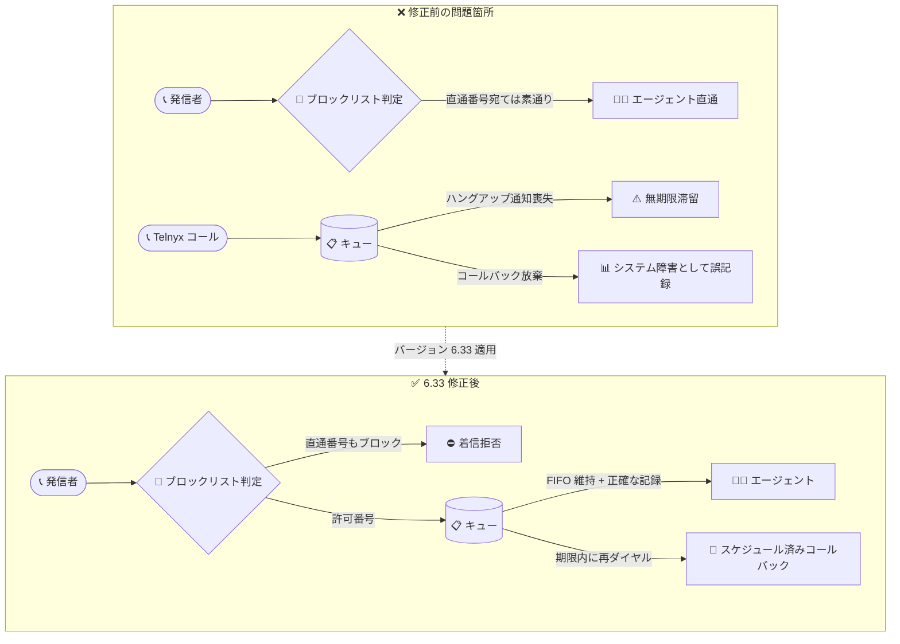

# Google Cloud Contact Center as a Service (CCaaS): バージョン 6.33 プレリリースノート (多数の不具合修正)

**リリース日**: 2026-11-10

**サービス**: Google Cloud Contact Center as a Service (CCaaS) / Contact Center AI Platform (CCAI Platform)

**機能**: バージョン 6.33 プレリリースノート (Fixed: 不具合修正)

**ステータス**: Announcement + Fixed (プレリリース)

📊 [このアップデートのインフォグラフィックを見る](https://takech9203.github.io/google-cloud-news-summary/20261110-ccaas-6-33-prerelease-fixes.html)

## 概要

Google Cloud Contact Center as a Service (CCaaS、旧称 Contact Center AI Platform / CCAI Platform) の次期バージョン 6.33 のプレリリースノートが公開されました。プレリリースノートは、次のバージョンで提供が見込まれる変更内容を事前に告知するもので、実際のリリース時には記載どおりの内容になることが期待されます。各インスタンスへの適用タイミングは、顧客が選択しているデプロイメントスケジュールに依存します。

今回の 6.33 は新機能の追加ではなく、**14 件の不具合修正 (Fixed)** に特化したリリースです。修正内容は、インバウンドブロックリスト、Telnyx 経由のコールのキュー滞留、コールバックコールの記録と FIFO 優先順位、エージェントデスクトップやポータルのパフォーマンスなど、コンタクトセンター運用の信頼性に直結する広範な領域をカバーしています。

コンタクトセンターの管理者・スーパーバイザー・運用チームにとって、呼損 (コールロス) やレポーティングの不正確さ、エージェント体験の低下につながっていた既知の問題が解消されるため、運用品質と KPI 計測の正確性の両面で重要なアップデートです。

**アップデート前の課題**

このアップデート以前には、以下の不具合が存在していました。

- インバウンドブロックリストに登録した番号からの着信が、直通番号 (ダイレクトライン) 宛てのコールではブロックされなかった
- 高負荷時にハングアップ通知が失われると、Telnyx 経由のコールがキューに無期限に滞留した
- キュー待機中に放棄されたコールバックコールが、エンドユーザーによる切断ではなく「システム障害」として誤記録され、キューグループ間の移動時に FIFO (先入れ先出し) の優先順位が維持されなかった
- コールアダプタがハングアップ直後に誤って再ダイヤルし、参加者ステータスの失敗や必須ディスポジションパネルの早期クローズが発生した
- 接続タイムアウト時に自動応答コールが同一エージェントへの無限再オファーループに陥り、オーバーキャパシティ時のデフレクション (振り分け) が発動しなかった
- スケジュール済みコールバックの再ダイヤルが最大猶予期限を過ぎて実行され、約束した時刻より遅れて顧客に架電されることがあった
- 音声コールのラップアップ終了時にアクティブなチャットが残っていると、エージェントの「次のステータス」が早期にクリアされ Agent Monitoring に表示されなかった
- Manager API の calls エンドポイントに対する期間無制限のクエリがタイムアウトを引き起こした
- 休日設定の読み込みやエージェントデスクトップでの通話終了時に、非効率なデータベース参照による大幅なシステム遅延が発生した

**アップデート後の改善**

バージョン 6.33 のリリースにより、以下が改善される見込みです。

- 直通番号宛ての着信でもインバウンドブロックリストが正しく適用され、迷惑電話対策が全着信経路で機能する
- ハングアップ通知が失われても Telnyx コールがキューに滞留せず、キュー統計と待ち時間の正確性が保たれる
- 放棄されたコールバックコールが「エンドユーザーによる切断」として正しく記録され、FIFO 優先順位も維持されるため、レポーティングと公平な待ち行列処理が改善される
- 自動応答コールの無限再オファーループが解消され、オーバーキャパシティデフレクションが設計どおりに動作する
- スケジュール済みコールバックが最大猶予期限内に実行され、顧客への約束時刻が守られる
- 休日設定の読み込み・通話終了・エージェント通話履歴取得のパフォーマンスが改善され、システムの安定性が向上する

## アーキテクチャ図



バージョン 6.33 で修正される主要な問題 (直通番号のブロックリスト素通り、キュー滞留、コールバックの誤記録) と、修正後の正常なコールフローを Before/After で示しています。

## サービスアップデートの詳細

### 主要な修正内容

1. **着信制御・テレフォニーの修正**
   - インバウンドブロックリストの番号が直通番号 (ダイレクトライン) への着信でブロックされない問題を修正
   - 高負荷時にハングアップ通知が失われた場合に Telnyx コールがキューに無期限に滞留する問題を修正
   - コールアダプタがハングアップ直後に誤って再ダイヤルし、参加者ステータスの失敗と必須ディスポジションパネルの早期クローズを引き起こす問題を修正

2. **コールバック・キューイングの修正**
   - キュー待機中に放棄されたコールバックコールが「システム障害」として誤記録される問題と、キューグループ間移動時に FIFO 優先順位が維持されない問題を修正
   - 自動応答コールが接続タイムアウト時に同一エージェントへ無限に再オファーされ、オーバーキャパシティデフレクションが発動しない問題を修正
   - スケジュール済みコールバックの再ダイヤルが最大猶予期限 (maximum deferral deadline) を超過して実行される問題を修正

3. **エージェント体験・ポータルの修正**
   - 音声コールのラップアップ終了時にアクティブなチャットが残っていると、エージェントの「次のステータス」が早期クリアされ Agent Monitoring に表示されない問題を修正
   - ポータル言語がカナダフランス語 (fr_CA) の場合に Agents ページのログアウト確認ダイアログが英語で表示される問題を修正
   - Agents ビューのチームフィルタが古いデータレコードにより無関係なチームのエージェントを表示する問題を修正

4. **仮想エージェント・CRM 連携の修正**
   - 転送ターンが会話終了を兼ねる場合に、仮想エージェント間のチャット転送が失敗する問題を修正
   - 仮想エージェントチャット中に `{ACCOUNT_ID}` プレースホルダが空文字列に解決され、CRM API リクエストが失敗する問題を修正

5. **API・パフォーマンスの修正**
   - Manager API の calls エンドポイントに対する期間無制限の大規模クエリがタイムアウトする問題を修正 (**このエンドポイントへのリクエストには期間指定が必須になる**)
   - 休日設定の読み込みやエージェントデスクトップでの通話終了時の、非効率なデータベース参照による大幅な遅延を修正
   - エージェント通話履歴の取得による深刻なパフォーマンス遅延とシステム不安定性を修正

## 技術仕様

### 修正対象の領域とユーザーへの影響

| 修正領域 | 修正件数 | 主な影響を受けるユーザー |
|------|------|------|
| 着信制御・テレフォニー (ブロックリスト、Telnyx、コールアダプタ) | 3 件 | 管理者、エージェント |
| コールバック・キューイング (FIFO、オーバーキャパシティ、スケジュール) | 3 件 | 管理者、スーパーバイザー、エンドユーザー |
| エージェント体験・ポータル UI (ステータス、ローカライズ、フィルタ) | 3 件 | エージェント、スーパーバイザー |
| 仮想エージェント・CRM 連携 | 2 件 | 仮想エージェント開発者、CRM 管理者 |
| API・パフォーマンス | 3 件 | API 利用者、運用チーム |

### プレリリースノートの位置づけ

| 項目 | 詳細 |
|------|------|
| リリース形態 | プレリリースノート (次期バージョンの事前告知) |
| バージョン | 6.33 |
| 適用タイミング | 正式リリース後、各インスタンスのデプロイメントスケジュールに従って適用 |
| 必要な作業 | 基本的に不要 (自動適用)。Manager API 利用者のみ後述の確認を推奨 |

## メリット

### ビジネス面

- **迷惑電話対策の一貫性**: ブロックリストが直通番号を含むすべての着信経路で機能するため、スパム・ハラスメント電話からエージェントを保護できる
- **顧客との約束の遵守**: スケジュール済みコールバックが期限内に実行されるため、「指定時刻に折り返す」という顧客への約束が守られ、CX が向上する
- **KPI・レポーティングの正確性**: 放棄コールバックが正しく「エンドユーザー切断」として記録されるため、放棄率やシステム障害率などの KPI を正確に計測できる

### 技術面

- **キューの健全性向上**: ハングアップ通知喪失時の Telnyx コール滞留が解消され、キュー統計・推定待ち時間 (EWT) の信頼性が向上する
- **オーバーキャパシティ制御の正常化**: 無限再オファーループの解消により、過負荷時のデフレクション (コールバック提案や振り分け) が設計どおりに発動する
- **システム全体のパフォーマンス改善**: 休日設定・通話終了・通話履歴取得に関する非効率なデータベース参照が解消され、高負荷時の安定性が向上する

## デメリット・制約事項

### 制限事項

- プレリリースノートであり、正式リリース時に内容が変わる可能性がある (リリースノートにも「リリース時にはここに示すとおりになる見込み」と明記)
- 各インスタンスへの適用タイミングは選択しているデプロイメントスケジュールに依存するため、即時にはすべての環境で修正が有効にならない

### 考慮すべき点

- **破壊的変更の可能性**: Manager API の calls エンドポイントは、タイムアウト対策として**期間 (date range) の指定が必須**になる。期間無制限のクエリを発行している既存のインテグレーションやスクリプトは、6.33 適用後に失敗する可能性があるため、事前に期間指定を追加しておくことを推奨
- 放棄コールバックの記録方法が変わる (システム障害 → エンドユーザー切断) ため、6.33 適用前後でレポート指標の傾向が変化する可能性がある。KPI のトレンド分析時には適用日を考慮すること

## ユースケース

### ユースケース 1: Manager API を利用したレポーティング基盤の事前対応

**シナリオ**: BI ツールやデータウェアハウスへ通話データを取り込むため、Manager API の calls エンドポイントを定期実行しているが、全期間を対象としたクエリを発行している。

**実装例**:
```
# 変更前 (6.33 適用後は失敗する可能性)
GET /manager/api/v1/calls

# 変更後 (期間を必ず指定する)
GET /manager/api/v1/calls?start_date=2026-11-01&end_date=2026-11-07
```

**効果**: 6.33 適用後もデータ取り込みが中断せず、クエリのタイムアウトも回避できる。

### ユースケース 2: 直通番号を運用するコンタクトセンターの迷惑電話対策

**シナリオ**: VIP 顧客向けにエージェント直通番号を提供しているが、ブロックリスト登録済みの番号から直通番号経由で着信してしまい、エージェントが対応を強いられていた。

**効果**: 6.33 適用後は直通番号への着信にもブロックリストが適用されるため、追加設定なしで全経路の迷惑電話対策が機能する。ブロックリストは CCAI Platform ポータルの Settings > Consumer Management > Phone Number Blocklist で管理する。

### ユースケース 3: コールバック放棄率の正確な計測

**シナリオ**: スーパーバイザーがコールバックの放棄率とシステム障害率をダッシュボードで監視しているが、放棄コールバックがシステム障害として計上され、障害率が実態より高く見えていた。

**効果**: 放棄コールバックが「エンドユーザー切断」として正しく分類され、システム障害の真の発生率を把握できる。FIFO 優先順位の維持により、キューグループ間を移動するコールバックの待ち時間の公平性も確保される。

## 料金

今回のアップデートは不具合修正であり、料金への影響はありません。参考として、CCaaS (CCAI Platform) のインスタンスは月次課金で、インスタンスに割り当てられた以下のいずれかの課金モデルに基づきます。

- **Concurrent agents**: 月間の同時サインインエージェント数の最大値
- **Named agents**: 月間にエージェントロールを持ったユーザー数の最大値
- **Minutes used**: エージェントロールのユーザーがサインインしていた分数

テレフォニー料金は従量課金です。詳細は [CCAI Platform の利用開始ドキュメント](https://docs.cloud.google.com/contact-center/ccai-platform/docs/get-started) を参照してください。

## 利用可能リージョン

CCaaS (CCAI Platform) が利用可能な国と Google Cloud リージョンは、[ロケーションページ](https://docs.cloud.google.com/contact-center/ccai-platform/docs/localities) を参照してください。

## 関連サービス・機能

- **Dialogflow CX (仮想エージェント)**: 仮想エージェント間チャット転送や `{ACCOUNT_ID}` プレースホルダの修正は、Dialogflow ベースの仮想エージェント運用に直接関係する
- **Agent Assist**: エージェントデスクトップのパフォーマンス改善により、Agent Assist を併用するエージェント体験も安定する
- **CRM 連携 (Salesforce など)**: `{ACCOUNT_ID}` プレースホルダ修正により、仮想エージェントチャット中の CRM API リクエスト失敗が解消される
- **Telnyx (テレフォニープロバイダ)**: 高負荷時のハングアップ通知喪失によるキュー滞留の修正は、Telnyx をテレフォニーに利用する環境に関係する

## 参考リンク

- 📊 [インフォグラフィック](https://takech9203.github.io/google-cloud-news-summary/20261110-ccaas-6-33-prerelease-fixes.html)
- [公式リリースノート (Google Cloud 全体)](https://docs.cloud.google.com/release-notes#November_10_2026)
- [CCaaS (CCAI Platform) リリースノート](https://docs.cloud.google.com/contact-center/ccai-platform/docs/release-notes)
- [電話番号のブロックリスト](https://docs.cloud.google.com/contact-center/ccai-platform/docs/block-phone-numbers)
- [通話設定 (直通番号・コールバック管理)](https://docs.cloud.google.com/contact-center/ccai-platform/docs/call-settings)
- [デプロイメントスケジュール](https://docs.cloud.google.com/contact-center/ccai-platform/docs/deployment-schedules)
- [CCAI Platform ドキュメント](https://docs.cloud.google.com/contact-center/ccai-platform/docs)

## まとめ

CCaaS バージョン 6.33 は、ブロックリスト、キューイング、コールバック、パフォーマンスにわたる 14 件の不具合を修正する信頼性重視のリリースです。基本的に利用者側の作業は不要ですが、Manager API の calls エンドポイントを期間指定なしで呼び出しているインテグレーションは適用後に失敗する可能性があるため、事前に期間指定 (bounded date range) を追加しておくことを推奨します。また、放棄コールバックの記録方法が変わるため、KPI レポートのトレンド分析では適用日を考慮してください。

---

**タグ**: CCaaS, Contact Center AI Platform, CCAI Platform, コンタクトセンター, 不具合修正, プレリリース, コールバック, ブロックリスト, Telnyx, Manager API
