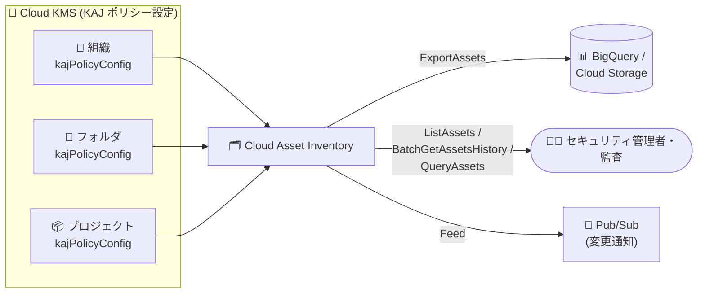

# Cloud Asset Inventory: Cloud KMS KajPolicyConfig リソースタイプのサポート

**リリース日**: 2026-11-10

**サービス**: Cloud Asset Inventory

**機能**: Cloud KMS `cloudkms.googleapis.com/KajPolicyConfig` リソースタイプの対応

**ステータス**: 一般提供 (GA)

📊 [このアップデートのインフォグラフィックを見る](https://takech9203.github.io/google-cloud-news-summary/20261110-cloud-asset-inventory-kms-kajpolicyconfig.html)

## 概要

Cloud Asset Inventory で、Cloud Key Management Service (Cloud KMS) の新しいリソースタイプ `cloudkms.googleapis.com/KajPolicyConfig` が、ExportAssets、ListAssets、BatchGetAssetsHistory、QueryAssets、Feed の各 API を通じて一般公開されました。これにより、組織・フォルダ・プロジェクトに設定されたデフォルト Key Access Justifications (KAJ) ポリシー設定を、他の Google Cloud リソースと同様に一元的に棚卸し・監査・監視できるようになります。

KajPolicyConfig は、Key Access Justifications のデフォルトポリシーを組織・フォルダ・プロジェクト単位で定義するリソースです。KAJ は、Google が顧客の暗号鍵にアクセスする際の理由 (justification) を可視化し、許可する理由コードをポリシーで制御する機能で、Assured Workloads と組み合わせてコンプライアンス要件の厳しいワークロードで利用されます。デフォルト KAJ ポリシーは、そのリソース配下で新規作成される Cloud KMS 鍵に自動適用されます。

このアップデートの主な対象ユーザーは、規制業種 (金融、公共など) で Assured Workloads や KAJ を利用し、組織全体の鍵アクセス制御ポリシーの設定状況を監査・追跡する必要があるセキュリティ管理者やコンプライアンス担当者です。

**アップデート前の課題**

- Cloud Asset Inventory で KajPolicyConfig を取得できず、組織・フォルダ・プロジェクトごとのデフォルト KAJ ポリシー設定状況を棚卸しするには、Cloud KMS API (`getKajPolicyConfig`) や `gcloud beta kms kaj-config describe` をリソースごとに個別に呼び出す必要があった
- デフォルト KAJ ポリシーの設定変更履歴を時系列で追跡する標準的な手段がなかった
- KAJ ポリシー設定の変更をリアルタイムに検知して通知する仕組みを独自に構築する必要があった

**アップデート後の改善**

- ExportAssets により、組織配下のすべての KajPolicyConfig を BigQuery や Cloud Storage に一括エクスポートして棚卸し・分析できるようになった
- BatchGetAssetsHistory により、KajPolicyConfig の変更履歴 (最大 35 日間) を取得し、ポリシー変更の監査証跡として活用できるようになった
- Feed (Pub/Sub 連携) により、デフォルト KAJ ポリシーの作成・変更をほぼリアルタイムに検知して通知・自動対応できるようになった
- QueryAssets により、BigQuery SQL 構文で KajPolicyConfig を直接クエリできるようになった

## アーキテクチャ図



組織・フォルダ・プロジェクトに設定されたデフォルト KAJ ポリシー (KajPolicyConfig) のメタデータを Cloud Asset Inventory が収集し、エクスポート・一覧取得・履歴照会・SQL クエリ・変更通知の各 API から利用できるようになります。

## サービスアップデートの詳細

### 主要機能

1. **対応 API**
   - [ExportAssets](https://docs.cloud.google.com/asset-inventory/docs/reference/rest/v1/TopLevel/exportAssets): 指定時点の KajPolicyConfig メタデータを BigQuery / Cloud Storage へ一括エクスポート
   - [ListAssets](https://docs.cloud.google.com/asset-inventory/docs/list-assets): プロジェクト・フォルダ・組織スコープでの一覧取得
   - [BatchGetAssetsHistory](https://docs.cloud.google.com/asset-inventory/docs/reference/rest/v1/TopLevel/batchGetAssetsHistory): 変更履歴の取得 (最大 35 日間)
   - [QueryAssets](https://docs.cloud.google.com/asset-inventory/docs/query-assets-with-sql): BigQuery SQL 構文によるクエリ
   - [Feed](https://docs.cloud.google.com/asset-inventory/docs/monitor-asset-changes): Pub/Sub 経由での変更監視

2. **KajPolicyConfig リソースとは**
   - 組織 (`organizations/{ORG}/kajPolicyConfig`)、フォルダ (`folders/{FOLDER}/kajPolicyConfig`)、プロジェクト (`projects/{PROJECT}/kajPolicyConfig`) 単位で設定するデフォルト Key Access Justifications ポリシー
   - `defaultKeyAccessJustificationPolicy.allowedAccessReasons` に許可する理由コード (例: `CUSTOMER_INITIATED_ACCESS`、`GOOGLE_INITIATED_SYSTEM_OPERATION`) を定義
   - デフォルトポリシーは、そのリソース配下で新規作成される Cloud KMS 鍵に自動適用される (既存鍵には適用されない)

3. **既存の Cloud KMS 対応リソースタイプとの統合**
   - Cloud Asset Inventory はすでに `CryptoKey`、`CryptoKeyVersion`、`KeyRing`、`AutokeyConfig`、`EkmConfig` などの Cloud KMS リソースタイプに対応しており、KajPolicyConfig の追加により鍵管理関連の構成を包括的に棚卸しできる

## 技術仕様

### リソースタイプの仕様

| 項目 | 詳細 |
|------|------|
| アセットタイプ | `cloudkms.googleapis.com/KajPolicyConfig` |
| 提供サービス | Cloud Key Management Service (cloudkms.googleapis.com) |
| 対応 API | ExportAssets、ListAssets、BatchGetAssetsHistory、QueryAssets、Feed |
| 非対応 API | 分析 (Analysis) API ([公式アセットタイプ一覧](https://docs.cloud.google.com/asset-inventory/docs/asset-types)に「Not available in the analysis APIs」と記載) |
| 設定可能なスコープ | 組織 / フォルダ / プロジェクト |
| 変更履歴の保持期間 | 最大 35 日間 (Cloud Asset Inventory 共通仕様) |

### KajPolicyConfig のデータ構造例

```json
{
  "name": "organizations/ORGANIZATION_ID/kajPolicyConfig",
  "defaultKeyAccessJustificationPolicy": {
    "defaultPolicyAvailable": true,
    "allowedAccessReasons": [
      "CUSTOMER_INITIATED_ACCESS",
      "GOOGLE_INITIATED_SYSTEM_OPERATION"
    ]
  }
}
```

## 設定方法

### 前提条件

1. Cloud Asset API (`cloudasset.googleapis.com`) が有効化されていること
2. 対象スコープに対する Cloud Asset Inventory の閲覧権限 (例: `roles/cloudasset.viewer`) があること
3. デフォルト KAJ ポリシー自体の管理には `roles/cloudkms.keyAccessJustificationsPolicyConfigAdmin` ロールが必要 (公式ドキュメントによると、デフォルト KAJ ポリシーの設定は Assured Workloads の Japan Regions コントロールパッケージに登録されたフォルダ内の Cloud KMS 鍵が対象)

### 手順

#### ステップ 1: KajPolicyConfig の一覧を取得する

```bash
gcloud asset list \
  --organization=ORGANIZATION_ID \
  --asset-types="cloudkms.googleapis.com/KajPolicyConfig" \
  --content-type=resource
```

組織配下に設定されているデフォルト KAJ ポリシー設定を一覧表示します。

#### ステップ 2: BigQuery にエクスポートして分析する

```bash
gcloud asset export \
  --organization=ORGANIZATION_ID \
  --asset-types="cloudkms.googleapis.com/KajPolicyConfig" \
  --content-type=resource \
  --bigquery-table="projects/PROJECT_ID/datasets/DATASET_ID/tables/kaj_policy_configs" \
  --output-bigquery-force
```

エクスポート後、BigQuery で `allowedAccessReasons` の内容を SQL で検証し、組織のポリシー基準から逸脱した設定を検出できます。

#### ステップ 3: Feed で変更を監視する

```bash
gcloud asset feeds create kaj-policy-feed \
  --organization=ORGANIZATION_ID \
  --asset-types="cloudkms.googleapis.com/KajPolicyConfig" \
  --content-type=resource \
  --pubsub-topic="projects/PROJECT_ID/topics/kaj-policy-changes"
```

デフォルト KAJ ポリシーの作成・変更時に Pub/Sub へ通知が送信され、Cloud Functions などで自動検証・アラートを実装できます。

## メリット

### ビジネス面

- **コンプライアンス監査の効率化**: 規制対応で求められる「鍵アクセス制御ポリシーの設定状況」を組織横断で一括棚卸しでき、監査対応の工数を削減できる
- **ガバナンス強化**: デフォルト KAJ ポリシーの変更を履歴・通知として追跡でき、意図しないポリシー緩和を早期に検出できる

### 技術面

- **一元管理**: Cloud KMS API を個別に呼び出すスクリプトが不要になり、他のアセットと同じ Cloud Asset Inventory のワークフロー (エクスポート、SQL クエリ、Feed) に統合できる
- **変更履歴の標準取得**: BatchGetAssetsHistory で最大 35 日間の変更履歴を取得でき、独自の履歴管理基盤が不要になる

## デメリット・制約事項

### 制限事項

- 分析 (Analysis) API では KajPolicyConfig は利用できない (公式アセットタイプ一覧に記載)
- 今回のリリースノートに記載された対応 API は ExportAssets / ListAssets / BatchGetAssetsHistory / QueryAssets / Feed であり、Search API は含まれていない
- Cloud Asset Inventory の変更履歴の保持期間は最大 35 日間

### 考慮すべき点

- Cloud Asset Inventory はリアルタイムクエリ用途には設計されていないため、最新のポリシー値を厳密に確認する場合は Cloud KMS API (`getKajPolicyConfig`) を直接呼び出す
- デフォルト KAJ ポリシーは新規作成鍵にのみ適用され、既存鍵には適用されないため、既存鍵の KAJ ポリシーは鍵単位で確認する必要がある

## ユースケース

### ユースケース 1: 組織全体のデフォルト KAJ ポリシー監査

**シナリオ**: 金融機関が、全プロジェクト・フォルダのデフォルト KAJ ポリシーが社内基準 (許可する理由コードのホワイトリスト) に準拠しているかを四半期ごとに監査する。

**実装例**:
```bash
# 組織全体の KajPolicyConfig を BigQuery にエクスポートし、
# allowedAccessReasons が基準外の設定を SQL で抽出
gcloud asset export \
  --organization=ORGANIZATION_ID \
  --asset-types="cloudkms.googleapis.com/KajPolicyConfig" \
  --content-type=resource \
  --bigquery-table="projects/audit-prj/datasets/audit/tables/kaj_configs"
```

**効果**: 手動でのリソースごとの API 呼び出しが不要になり、監査作業を定期ジョブとして自動化できる。

### ユースケース 2: KAJ ポリシー変更のリアルタイム検知

**シナリオ**: セキュリティ運用チームが、デフォルト KAJ ポリシーの変更 (許可理由コードの追加など) を即時に検知し、承認済みの変更かどうかを検証したい。

**効果**: Feed + Pub/Sub により変更イベントを自動受信し、未承認の変更に対するアラートや自動ロールバックのワークフローを構築できる。

## 料金

Cloud Asset Inventory の料金の詳細は公式の料金ページを参照してください。なお、エクスポート先の BigQuery / Cloud Storage や Feed で使用する Pub/Sub には各サービスの料金が適用されます。

- [Cloud Asset Inventory 料金ページ](https://docs.cloud.google.com/asset-inventory/pricing)

## 関連サービス・機能

- **Cloud KMS**: KajPolicyConfig を提供するサービス。CryptoKey、KeyRing、AutokeyConfig などの他の KMS リソースタイプもすでに Cloud Asset Inventory でサポートされている
- **Key Access Justifications (KAJ)**: Google による鍵アクセスの理由を可視化・制御する機能。KajPolicyConfig はそのデフォルトポリシー設定
- **Assured Workloads**: デフォルト KAJ ポリシーの設定は Assured Workloads (Japan Regions コントロールパッケージ) に登録されたフォルダの Cloud KMS 鍵が対象
- **BigQuery / Cloud Storage**: ExportAssets のエクスポート先として利用
- **Pub/Sub**: Feed によるアセット変更通知の配信先として利用

## 参考リンク

- 📊 [インフォグラフィック](https://takech9203.github.io/google-cloud-news-summary/20261110-cloud-asset-inventory-kms-kajpolicyconfig.html)
- [公式リリースノート (2026-11-10)](https://docs.cloud.google.com/release-notes#November_10_2026)
- [Cloud Asset Inventory: サポートされているアセットタイプ](https://docs.cloud.google.com/asset-inventory/docs/asset-types)
- [KeyAccessJustificationsPolicyConfig API リファレンス](https://docs.cloud.google.com/kms/docs/reference/rest/v1/KeyAccessJustificationsPolicyConfig)
- [デフォルト Key Access Justifications ポリシーの設定](https://docs.cloud.google.com/assured-workloads/key-access-justifications/docs/set-default-policy)
- [Cloud Asset Inventory の概要](https://docs.cloud.google.com/asset-inventory/docs/asset-inventory-overview)
- [料金ページ](https://docs.cloud.google.com/asset-inventory/pricing)

## まとめ

Cloud Asset Inventory が Cloud KMS の KajPolicyConfig に対応したことで、組織・フォルダ・プロジェクトに設定されたデフォルト Key Access Justifications ポリシーを、棚卸し・履歴追跡・変更監視の標準ワークフローに組み込めるようになりました。Assured Workloads や KAJ を利用する規制業種の組織は、ExportAssets による定期棚卸しと Feed による変更監視を組み合わせ、鍵アクセスガバナンスの自動化を検討することを推奨します。

---

**タグ**: Cloud Asset Inventory, Cloud KMS, Key Access Justifications, Assured Workloads, セキュリティ, コンプライアンス, ガバナンス
