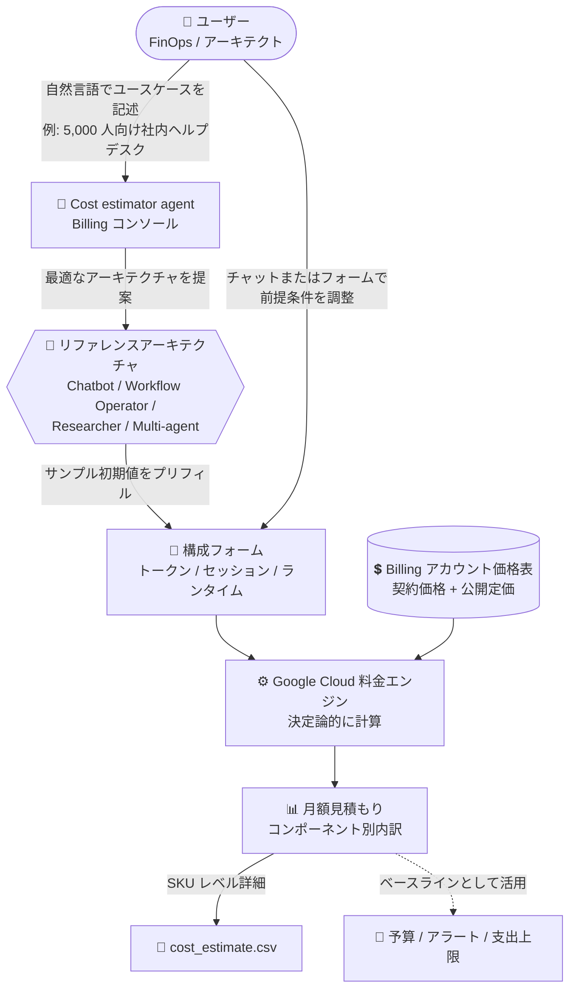

# Cloud Billing: Cost estimator agent (コスト見積もりエージェント) Preview

**リリース日**: 2026-11-10

**サービス**: Cloud Billing

**機能**: Cost estimator agent による AI エージェントのコスト見積もり

**ステータス**: Preview

📊 [このアップデートのインフォグラフィックを見る](https://takech9203.github.io/google-cloud-news-summary/20261110-cloud-billing-cost-estimator-agent-preview.html)

## 概要

Cloud Billing に、Google Cloud コンソールの Billing セクション内で直接コスト見積もりを行える新機能が追加されました。第一弾として、**Cost estimator agent (コスト見積もりエージェント)** が Preview で利用可能になり、Gemini Enterprise Agent Platform で構築する AI エージェントのコストを、リファレンスアーキテクチャに基づいて高レベルで見積もることができます。

AI エージェントのコスト見積もりは、従来のクラウドインフラのサイジングとは異なります。固定の VM シェイプやストレージ階層を選ぶのではなく、(1) トークン使用量 (入出力トークン数、コンテキストキャッシュによる削減)、(2) エージェントのデプロイパターンごとの挙動 (オーケストレーターがサブエージェントやツールを呼び出す頻度)、(3) 支援インフラ (検索グラウンディング、マネージドランタイム、セッションストレージ、Model Armor、評価、オブザーバビリティ) の 3 領域を考慮する必要があります。Cost estimator agent は、自然言語でビジネスニーズを記述するだけで、これらをまとめてモデル化し、月額の想定支出を算出します。

見積もり額の計算自体は Google Cloud の料金エンジンが決定論的に実行し、利用者の Cloud Billing アカウントの価格表 (契約 SKU 価格・割引、契約外は公開定価) を適用します。AI が SKU 価格を推測したり合計を計算したりすることはありません。エージェント構築前に予算・支出上限・財務承認の根拠となる具体的なベースラインを得たい FinOps 担当者、アーキテクト、エージェント開発者が主な対象ユーザーです。

**アップデート前の課題**

- AI エージェントのコストはトークン数、キャッシュ率、ツール呼び出し頻度、グラウンディング、ランタイムなど多数の変動要素に依存し、従来の Pricing Calculator だけでは SKU を 1 つずつ特定して積み上げる必要があった
- エージェント構築前に、どのコンポーネント (ランタイム、セッション、Model Armor、オブザーバビリティなど) が課金対象になるかを把握するのが難しかった
- 見積もりに契約価格 (割引) を反映するには、価格表を参照しながら手計算する必要があった

**アップデート後の改善**

- 自然言語でユースケースを記述するだけで、4 種類のリファレンスアーキテクチャから最適なものが提案され、トークン数・セッション数・ランタイムのサンプル初期値が自動入力される
- 見積もりには自身の Cloud Billing アカウントの価格表 (契約 SKU 価格と割引) が自動適用され、契約外 SKU は公開定価で計算される
- 月額合計・コンポーネント別内訳に加え、SKU レベルの詳細を含む CSV をエクスポートでき、予算設定や財務承認にそのまま活用できる

## アーキテクチャ図



ユーザーが自然言語で記述したユースケースをエージェントがリファレンスアーキテクチャにマッピングし、調整済みの前提条件を料金エンジンが Billing アカウントの価格表で決定論的に計算する見積もりフローです。

## サービスアップデートの詳細

### 主要機能

1. **自然言語によるコストモデリング**
   - 「5,000 人の社内ユーザーをサポートする人事ヘルプデスクエージェントのコストを見積もりたい」のような自由記述プロンプト、またはスターター プロンプトから開始できる
   - SKU のリストではなくビジネスニーズから出発し、エージェントがユースケースを 4 つのリファレンスアーキテクチャのいずれかにマッチングして、含まれるコンポーネントを説明したうえで確認を求める

2. **リファレンスアーキテクチャに基づくプリフィル**
   - 確認後、コア構成フォームが読み込まれ、トークン数・セッション数・ランタイムなどのサンプル開始値とプロンプト内の数値が自動入力される
   - トラフィックドライバー (ユーザー数、セッション数、ターン数、ツール呼び出し数) やコンポーネント詳細 (モデル、トークン数、キャッシュ率、検索ティア) をフォーム直接編集またはチャットで調整できる

3. **Billing アカウント価格表による決定論的な計算**
   - 見積もりは Google Cloud の料金エンジンが Cloud Billing アカウントの価格表を使って決定論的に計算し、契約 SKU 価格・割引を適用、契約外 SKU は公開定価を使用する
   - AI エージェントが SKU 価格を推測したり、合計を独自に計算したりすることはない

4. **SKU レベルの CSV エクスポート**
   - 「Generate estimate」で月額見積もり合計とコンポーネント別内訳が表示され、`cost_estimate.csv` をダウンロードできる
   - CSV にはコンポーネント/アイテム、プロダクト、表示名、SKU ID、リージョン、使用量単位、ベースコスト、定価コスト、見積もりコスト、通貨が含まれる

### サンプルエージェントアーキテクチャ (4 種類)

| サンプルアーキテクチャ | 典型的なユースケース |
|------|------|
| Conversational Chatbot | Gemini モデル、プロンプトキャッシュ、検索グラウンディング、Agent Runtime、トレーシングを使うマルチターンの顧客/社内ヘルプデスクアシスタント |
| Workflow Operator | マルチステップのツール呼び出し、API 統合、決定論的ワークフロー、バックオフィス連携を実行するタスク自動化エージェント |
| Autonomous Researcher | メインのオーケストレーターと専門サブエージェント、エンタープライズ検索を連携させるディープリサーチ/統合エージェント |
| Multi-agent Orchestrator | 中央の推論オーケストレーターと複数の専門サブエージェント、大量のツール/API 実行、エンタープライズ検索グラウンディング、E2E オブザーバビリティを連携させる複合システム |

## 技術仕様

### 見積もり対象のプロダクト領域と調整可能なパラメータ

| プロダクト領域 | 含まれるコンポーネント | 調整可能な主なパラメータ |
|------|------|------|
| Agent Platform | オーケストレーター、サブエージェント、Agent Runtime、Agent Sessions、Agent Gateway、Model Armor、Agent evals | Gemini モデル選択、入出力トークン数、入力トークンのキャッシュ率、グラウンディング率 (Google 検索 / Enterprise Web / Google マップ)、Runtime vCPU/RAM 時間、セッション read/write と GiB ストレージ、Agent Gateway リクエスト数、Model Armor スキャン率、評価実行回数とトークン量 |
| Agent Search (旧 Vertex AI Search) | Agent Search | 月間検索リクエスト数 |
| Google Cloud オペレーションスイート | Cloud Trace、Cloud Logging、Cloud Monitoring | Trace スパン数、Logging ストレージ (GiB)、Monitoring 指標量 (MiB) |

### 必要な権限

Cost estimator agent へのアクセスと見積もり生成には、Cloud Billing アカウントに対する権限が必要です。

| 方法 | 内容 |
|------|------|
| 事前定義ロール | Billing Account Viewer (`roles/billing.viewer`) または Billing Account Administrator (`roles/billing.admin`) |
| カスタムロール (契約価格を参照する場合) | `billing.accounts.get`、`billing.accounts.getIamPolicy`、`billing.accounts.getSpendingInformation`、`billing.billingAccountPrice.get`、`billing.billingAccountPrices.list`、`billing.billingAccountServices.get/list`、`billing.billingAccountSkuGroupSkus.get/list`、`billing.billingAccountSkuGroups.get/list`、`billing.billingAccountSkus.get/list` |

## 設定方法

### 前提条件

1. Cloud Billing アカウントに対して Billing Account Viewer または Billing Account Administrator (相当のカスタムロール) が付与されていること
2. 見積もり対象が Gemini Enterprise Agent Platform で構築するエージェントであること (その他のサービスは Pricing Calculator を使用)

### 手順

#### ステップ 1: Cost estimator agent にアクセス

1. Google Cloud コンソールで **Billing の Overview** ページに移動
2. 対象の Cloud Billing アカウントを選択
3. Billing ナビゲーションメニューの **Cost optimization** セクションで **Cost estimation** を選択

#### ステップ 2: エージェントを記述して見積もりを生成

1. カスタムプロンプト (例: 「5,000 人の社内ユーザーをサポートする人事ヘルプデスクエージェントのコストを見積もって」) またはスターター プロンプトを入力
2. エージェントが提案するサンプルアーキテクチャを確認・承認
3. プリフィルされた構成フォームのトラフィック入力とコンポーネント詳細を、想定使用量に合わせて編集 (フォーム直接編集またはチャットで指示)
4. **Generate estimate** をクリックして月額見積もりと内訳を取得し、必要に応じて **Download CSV** で SKU レベルの詳細をダウンロード

## メリット

### ビジネス面

- **構築前の財務承認が容易に**: エージェントを構築する前に具体的な月額ベースラインを提示でき、支出上限の設定、Cloud Billing の予算・アラート作成、プロジェクトクォータの割り当て、ローンチの財務承認に活用できる
- **契約価格を反映した現実的な見積もり**: 自社の Billing アカウントの契約 SKU 価格と割引が自動適用されるため、公開定価ベースの概算より実態に近い計画が立てられる
- **CSV による説明責任**: SKU レベルの内訳付き CSV をエクスポートでき、財務部門への説明や社内レビューの根拠資料として使える

### 技術面

- **AI エージェント特有のコスト構造をカバー**: トークン、キャッシュ率、ツール呼び出し、グラウンディング、ランタイム、Model Armor、オブザーバビリティまで、エージェントワークロードの課金要素を網羅的にモデル化できる
- **決定論的な価格計算**: 価格計算は料金エンジンが実行し、LLM が価格を推測しないため、見積もりの数値に再現性と信頼性がある
- **リファレンスアーキテクチャによる設計ガイド**: 4 つのサンプルアーキテクチャが課金対象コンポーネントの全体像を示すため、アーキテクチャ検討の出発点としても有用

## デメリット・制約事項

### 制限事項

- Preview 段階であり、Pre-GA Offerings Terms が適用される (サポートが限定される可能性がある)
- 現時点の見積もり対象は Gemini Enterprise Agent Platform で構築するエージェント (組み込みの Agent Search (旧 Vertex AI Search) と Google Cloud Observability コンポーネントを含む) のみ
- BigQuery、Cloud SQL、GKE、Cloud Storage など他の Google Cloud サービスの見積もりには、引き続き Google Cloud Pricing Calculator を使用する必要がある

### 考慮すべき点

- 見積もりはあくまで計画用の非拘束的な予測であり、固定の月額価格や支出上限を保証するものではない。実際の課金は 100% 従量制 (メーター計測) で、プロンプトが長くなる、推論ループやツールリトライが増える、キャッシュヒット率が下がる、トラフィックが想定を超えるなどの要因でコストは見積もりを上回り得る
- プリフィルされる初期値はあくまでサンプルのプレースホルダーであり、実際の想定使用量に合わせた調整が前提
- 見積もりを出した後は、Cloud Billing の予算・アラートや支出上限を併せて設定し、実際の消費を継続的に監視することが推奨される

## ユースケース

### ユースケース 1: 社内ヘルプデスクエージェントのローンチ前予算策定

**シナリオ**: 人事部門が 5,000 人の社内ユーザー向けヘルプデスクエージェントを Gemini Enterprise Agent Platform で構築する計画があり、ローンチ前に財務部門の承認を得る必要がある。

**実装例**:
```
プロンプト例:
"Help me estimate the cost of an HR department helpdesk agent
 that can support 5,000 internal users."

→ Conversational Chatbot アーキテクチャが提案される
→ ユーザー数・セッション数・キャッシュ率を実態に合わせて調整
→ Generate estimate → cost_estimate.csv を財務承認資料に添付
```

**効果**: SKU レベルの内訳を含む契約価格ベースの月額見積もりを短時間で作成でき、予算・アラートの初期値設定と財務承認プロセスを迅速化できる。

### ユースケース 2: マルチエージェントシステムのコスト感度分析

**シナリオ**: 中央オーケストレーターと複数のサブエージェントで構成するリサーチエージェントを設計中で、モデル選択 (Flash か Pro か) やキャッシュ率がコストに与える影響を事前に把握したい。

**効果**: Multi-agent Orchestrator / Autonomous Researcher アーキテクチャをベースに、モデル、トークン数、キャッシュ率、グラウンディング率などのパラメータをチャットで変えながら複数パターンの見積もりを比較でき、コスト効率の高い設計判断ができる。

## 料金

Cost estimator agent は Google Cloud コンソールの Billing セクション内の機能として提供されます。生成される見積もり額は、利用者の Cloud Billing アカウントの価格表 (契約 SKU 価格・割引、契約外 SKU は公開定価) に基づいて計算されます。

見積もりは非拘束的な計画用の予測であり、実際の請求は従量制の実測使用量のみに基づきます。Agent Platform 関連の個別料金は [Google Cloud Pricing Calculator](https://cloud.google.com/products/calculator) および各サービスの料金ページを参照してください。

## 関連サービス・機能

- **Google Cloud Pricing Calculator**: AI エージェント以外の幅広い Google Cloud サービス (BigQuery、Cloud SQL、GKE、Cloud Storage など) のコスト見積もりに使用する補完ツール
- **Gemini Enterprise Agent Platform**: 見積もり対象のエージェント構築プラットフォーム。Agent Runtime、Agent Sessions、Agent Gateway、Model Armor、Agent evals などのコンポーネントが見積もりに含まれる
- **Agent Search (旧 Vertex AI Search)**: エージェントの検索グラウンディングを担うコンポーネントで、月間検索リクエスト数ベースで見積もりに含まれる
- **Google Cloud Observability**: Cloud Trace / Cloud Logging / Cloud Monitoring のエージェント関連使用量も見積もり対象
- **Cloud Billing 予算・アラート / 支出上限**: 見積もり結果をベースラインとして予算、アラート、支出上限を設定する運用が推奨される
- **AI Cost Summary Agent**: Billing Overview ページで Gemini API / Vertex AI など AI 関連の「実績」支出を分析するエージェント。構築前の見積もり (Cost estimator agent) と構築後の実績分析 (AI Cost Summary Agent) で補完関係にある

## 参考リンク

- 📊 [インフォグラフィック](https://takech9203.github.io/google-cloud-news-summary/20261110-cloud-billing-cost-estimator-agent-preview.html)
- [公式リリースノート](https://docs.cloud.google.com/release-notes#November_10_2026)
- [ドキュメント: Estimate costs (Cost estimator agent / Pricing calculator)](https://docs.cloud.google.com/billing/docs/how-to/estimate-costs)
- [Gemini Enterprise Agent Platform](https://docs.cloud.google.com/gemini-enterprise-agent-platform)
- [Google Cloud Pricing Calculator](https://cloud.google.com/products/calculator)
- [Cloud Billing アクセス制御](https://docs.cloud.google.com/billing/docs/how-to/billing-access)

## まとめ

Cost estimator agent は、トークンやキャッシュ率など従来のインフラサイジングとは異なる AI エージェント特有のコスト構造を、自然言語ベースで契約価格に基づいてモデル化できる、FinOps と AI 開発をつなぐ新しいツールです。Gemini Enterprise Agent Platform でのエージェント構築を計画しているチームは、設計初期段階でこのエージェントを使ってコストベースラインを作成し、予算・アラート・支出上限の設定と財務承認プロセスに組み込むことを推奨します。Preview 段階のため、見積もりは非拘束的な計画値である点に留意し、デプロイ後は実測使用量の監視と併用してください。

---

**タグ**: Cloud Billing, FinOps, Cost Management, AI Agents, Gemini Enterprise Agent Platform, Cost Estimation, Preview
