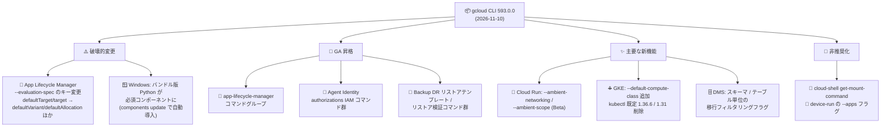

# Cloud SDK: gcloud CLI 593.0.0 リリース (破壊的変更とマルチサービスアップデート)

**リリース日**: 2026-11-10

**サービス**: Cloud SDK (gcloud CLI)

**機能**: バージョン 593.0.0 リリース

**ステータス**: GA (一部機能は Alpha / Beta)

📊 [このアップデートのインフォグラフィックを見る](https://takech9203.github.io/google-cloud-news-summary/20261110-cloud-sdk-593-0-0.html)

## 概要

2026 年 11 月 10 日、Google Cloud CLI (gcloud) のバージョン 593.0.0 がリリースされた。本リリースには 2 件の **破壊的変更 (Breaking Changes)** が含まれる。1 つは App Lifecycle Manager の `--evaluation-spec` フラグのスキーマ変更 (非推奨の `defaultTarget` / `target` キーから `defaultVariant` / `defaultAllocation` / `variantId` / `allocationId` への移行)、もう 1 つは Windows (x86 / x86_64) における **バンドル版 Python の必須コンポーネント化** である。Windows 環境で `gcloud components update` を実行すると、バンドル版 Python が未インストールの場合は自動的にインストールされる。

機能追加の面でも幅広いサービスにわたる更新が含まれる。代表的なものとして、**App Lifecycle Manager コマンドグループの GA 昇格**、Agent Identity の認可 IAM コマンド群の GA 昇格と Cross-App Access (XAA) 認証プロバイダ設定フラグの追加、Cloud Backup DR のリストアテンプレート / リストア検証関連コマンド群の GA 昇格、GKE のクラスタ操作改善 (デフォルト kubectl 1.36.6 化、kubectl 1.31 の削除、ノードプールなしクラスタ向けエラーメッセージ改善)、Cloud Run のアンビエントネットワーキングフラグ (Beta) などがある。また、`gcloud cloud-shell get-mount-command` と Device Run の `--apps` フラグが非推奨化された。

本レポートは、gcloud CLI を日常的に利用する開発者、CI/CD パイプラインの管理者、および各サービスの運用担当者を対象に、593.0.0 の変更点を整理する。

**アップデート前の課題**

- App Lifecycle Manager の `--evaluation-spec` では非推奨の `defaultTarget` / `target` キーが使われており、API 側の `defaultVariant` / `defaultAllocation` 命名と不整合があった
- Windows 版 gcloud ではバンドル版 Python のインストールが任意であり、システム Python のバージョンや構成に依存して動作が不安定になるケースがあった
- Agent Identity の認可リソースに対する IAM ポリシー操作コマンドは GA 提供されていなかった
- Cloud Backup DR のリストアテンプレート / リストア検証プラン関連のコマンド群は GA 提供されていなかった
- GKE でノードプールを持たないクラスタに対して `upgrade` / `resize` / `describe` などを実行すると、不適切な提案や分かりにくいエラーが返っていた
- `gcloud storage rsync` が Windows 上でファイルソート順の不具合により、変更のないファイルを再コピー・削除することがあった
- Database Migration Service の移行ジョブ作成時に、スキーマ / テーブル単位のフィルタリングを CLI から指定できなかった

**アップデート後の改善**

- `--evaluation-spec` が `defaultVariant` / `defaultAllocation` / `variantId` / `allocationId` の新スキーマに統一され、App Lifecycle Manager コマンドグループ自体も GA に昇格した
- Windows (x86 / x86_64) でバンドル版 Python が必須コンポーネントとなり、`gcloud components update` / `install` が不足時に自動インストールするため、Python 環境差異による問題が解消される
- Agent Identity の `auth-providers authorizations` に対する get/set-iam-policy、add/remove-iam-policy-binding、test-iam-permissions が GA となり、XAA / Connector Reference 認証プロバイダ設定用の多数のフラグが追加された
- Cloud Backup DR の `restore-templates`、`restore-template-executions`、`restore-verification-plans`、`restore-verification-plan-associations` が GA に昇格した
- GKE のノードプールなしクラスタに対する各コマンドが明確なエラーや正しい表示 (`NUM_NODES` 列に 0) を返すようになった
- `gcloud storage rsync` の Windows における再コピー / 誤削除の不具合が修正された
- Database Migration に `--schemas-filter` / `--tables-filter` / `--excluded-schemas-filter` / `--excluded-tables-filter` が追加され、オブジェクト単位の移行フィルタリングが可能になった

## アーキテクチャ図



593.0.0 リリースの変更点を「破壊的変更」「GA 昇格」「主要な新機能」「非推奨化」の 4 カテゴリに整理した全体像。App Lifecycle Manager の `--evaluation-spec` を利用するスクリプトと Windows 環境の gcloud 利用者は破壊的変更の確認が最優先となる。

## サービスアップデートの詳細

### 破壊的変更 (Breaking Changes)

1. **App Lifecycle Manager: `--evaluation-spec` フラグのスキーマ変更**
   - `gcloud beta app-lifecycle-manager flags create` および `gcloud beta app-lifecycle-manager flags update` の `--evaluation-spec` フラグが、非推奨の `defaultTarget` / `target` キーに代わり、`defaultVariant`、`defaultAllocation`、`variantId`、`allocationId` を使用するようになった
   - 既存のスクリプトや IaC で `--evaluation-spec='{"defaultTarget": "..."}'` のような JSON を渡している場合は、新しいキー名への書き換えが必要
   - デフォルトのバリアントを直接指定する場合は `defaultVariant`、パーセンテージベースのアロケーションを既定にする場合は `defaultAllocation` を使用する。ルール (`rules`) 内のターゲット指定も `variantId` / `allocationId` に変わる

2. **Google Cloud CLI: Windows でバンドル版 Python が必須コンポーネントに**
   - Windows (x86 および x86_64) において、バンドル版 Python が必須コンポーネントとなった
   - `gcloud components update` および `gcloud components install` は、バンドル版 Python が未インストールの場合に自動的にインストールする
   - 従来はインストーラで「Install Bundled Python」のチェックを外してシステム Python を利用する構成が可能だったが、今後は 593.0.0 への更新時にバンドル版 Python が導入される。ディスク使用量やイメージサイズを厳密に管理している Windows 環境 (CI ランナーのイメージ等) では、追加されるコンポーネントを考慮する必要がある

### 非推奨化

- **Cloud Shell**: `gcloud cloud-shell get-mount-command` が非推奨となった。将来のリリースで削除される予定
- **Device Run**: `gcloud beta device-run sessions submit instrumentation` の `--apps` フラグが非推奨となった。代わりに新設の `--target-app` (テスト対象アプリ)、`--pre-target-apps` / `--post-target-apps` (前後にインストールするアプリ) を使用する

### GA 昇格

1. **App Lifecycle Manager**: `gcloud app-lifecycle-manager` コマンドグループが GA に昇格。あわせて `unit-kinds create` / `update` に `--application-template-component`、`--application-template-component-revision`、`--composite-ref-application-template`、`--composite-ref-revision` フラグが追加された (Beta)
2. **Agent Identity**: `gcloud agent-identity auth-providers authorizations` の `get-iam-policy` / `set-iam-policy` / `add-iam-policy-binding` / `remove-iam-policy-binding` / `test-iam-permissions` が GA に昇格
3. **Cloud Backup DR**: `restore-templates`、`restore-template-executions`、`restore-verification-plans`、`restore-verification-plan-associations` の各コマンドグループが GA に昇格。リストアの検証計画をコマンドラインから本番運用できるようになった
4. **Cloud Workstations**: `configs create` / `update` の `--disk-provisioned-iops` と `--disk-provisioned-throughput` フラグが GA に昇格
5. **Compute Engine**: `--svsm-config` フラグ (instances create / bulk create / create-with-container / instance-templates create)、`reservations update` の `--require-specific-reservation`、`url-maps invalidate-cdn-cache` の `--content-type` / `--http-status` / `--backend-service` / `--backend-bucket` フラグが GA に昇格
6. **Looker**: `instances create` / `update` の `--workforce-auth-enabled` と `--google-auth-enabled` フラグが GA に昇格
7. **Network Connectivity**: `hubs create` / `update` の `--export-psc-published-services-and-regional-google-apis` と `--export-psc-global-google-apis` フラグが GA に昇格

### 主要な新機能・変更点 (サービス別)

1. **Agent Identity: Cross-App Access (XAA) / Connector Reference 対応**
   - `auth-providers create` / `update` に `--xaa-auth-provider-id-token-input-jag`、`--xaa-auth-provider-client-secret-id`、`--xaa-auth-provider-client-assertion-jwt-id`、`--xaa-auth-provider-custom-issuer`、`--connector-reference-auth-provider` など 10 個のフラグが追加され、Cross-App Access と Connector Reference 認証プロバイダを CLI から構成できるようになった

2. **コンテナ / サーバーレス系の更新**
   - **Cloud Run**: `gcloud beta run deploy` / `services update` / `multi-region-services update` に `--[no-]ambient-networking` と `--ambient-scope` フラグが追加され、アンビエントネットワーキングの有効化とスコープ (リージョナル (既定) / グローバル) の選択が可能になった (Beta)
   - **Kubernetes Engine**: `clusters create` / `update` に `--default-compute-class` フラグを追加。デフォルト kubectl を 1.35.9 から 1.36.6 に更新し、延長サポート終了に伴い kubectl 1.31 を削除 (同梱バージョン: 1.32.13 / 1.33.13 / 1.34.13 / 1.35.10 / 1.36.6 / 1.37.2)。ノードプールなしクラスタに対する `upgrade` / `resize` / `update --enable-autoscaling` が明確なエラーを返すようになり、`NUM_NODES` 列も空欄ではなく 0 を表示。IPv6 専用クラスタで `--no-enable-ip-alias` が警告付きで無視されるよう修正
   - **GKE Hub**: `rolloutsequences create` / `update` に `--auto-rollout-scope` と `--ignored-clusters-selector` を追加。`memberships register` に `--read-only` フラグが追加され、クラスタへの変更や Connect Agent のインストールを行わない READ_ONLY メンバーシップとして非 GKE クラスタを登録可能に

3. **データベース系の更新**
   - **AlloyDB**: `instances create` / `create-secondary` / `update` に `--[no-]enable-psc-auto-dns` と `--[no-]enable-psc-auto-connection-policy` を追加し、PSC 自動接続の DNS レコードとサービス接続ポリシーの自動作成を制御可能に
   - **Cloud Spanner**: `gcloud alpha spanner databases wait-for-reencryption` を追加。CMEK のバックグラウンド再暗号化の完了を待機できる。`databases update` は `--kms-keys` / `--clear-kms-keys` 使用時に再暗号化完了を待つよう案内を表示
   - **Cloud Memorystore**: `beta memorystore instances create` の `--endpoints` フラグに `ipVersion` キーを追加し、IPv6 の PSC 自動作成エンドポイントに対応
   - **Database Migration**: `migration-jobs create` / `update` に `--schemas-filter`、`--tables-filter`、`--excluded-schemas-filter`、`--excluded-tables-filter` を追加し、スキーマ / テーブル単位の移行対象の選択・除外に対応
   - **Oracle Database**: Exadata / Exascale VM クラスタの Workload Identity Connector を管理する `enable-identity-connector` / `disable-identity-connector` コマンドと、作成時にオプトアウトする `--identity-connector-disabled` フラグを追加
   - **Cloud Bigtable**: CVE-2026-81870 対応のため go.opentelemetry.io/otel/sdk 1.45.0 でリビルド。cbt-emulator も go 1.26.9 でリビルド

4. **BigQuery の更新**
   - Python UDF の DDL 作成・置換時に `bq query` 出力へビルドステータスのガイダンスメッセージを追加。`bq show --routine` にも Python UDF のビルドステータス列を追加
   - `bq mk` / `bq update` の `--reservation_assignment` に `--condition_expression` / `--condition_title` / `--condition_description` フラグを追加
   - **削除**: 非推奨だった `--multi_region_auxiliary` フラグを `bq mk --reservation` / `bq mk --capacity_commitment` から削除し、出力から `multiRegionAuxiliary` 列も削除 (使用しているスクリプトは修正が必要)
   - リージョナルエンドポイント (`--api`) 指定時にディスカバリドキュメントの読み込みに失敗・クラッシュする問題を修正。同梱 PyYAML を Python 3 ライブラリ直接パッケージ化に変更し、Python 2 互換シムを削除

5. **セキュリティ / IAM 系の更新**
   - **Cloud IAM**: `workload-identity-pools create-cred-config` に `--actor-token-field-name` / `--actor-token-type` フラグを追加し、`--credential-source-file` と `--credential-cert-path` の併用に対応。証明書バインドされた OAuth 2.0 トークン交換とアクタートークン委任が可能に
   - **Model Armor**: `templates create` / `update` に `--filter-version-selector` / `--filter-version-selector-alias` フラグを追加
   - **Cloud KMS**: `kms locations list` のデフォルト表出力に `HSM_SINGLE_TENANT_AVAILABLE` 列を追加
   - **Secure Source Manager**: `repos create` / `update` に `--enable-vulnerability-scanning` 引数を追加

6. **運用・その他の更新**
   - **Audit Manager**: `audit-reports generate` / `audit-scopes generate` / `audit-schedules create` に `--parameter-overrides` フラグを追加し、パラメータ化されたクラウドコントロールの上書きに対応
   - **Cluster Director**: クラスタ構成のエクスポート / インポートコマンド (`clusters export` / `import`) を追加。`--update-slurm-node-sets` で `startupScript` / `labels` / `bootDisk` が無視される不具合を修正。MIG オーケストレーション設定用フラグ群が Beta に昇格
   - **Compute Engine**: `backend-services create` の `--service-lb-policy` がリージョナルバックエンドサービスに対応。`url-maps invalidate-cdn-cache` の `--host` がワイルドカードホスト名 (`*.example.com`) に対応
   - **Network Services**: ExpressLink リソースを管理する `gcloud beta network-services express-links` を追加
   - **Network Management**: `connectivity-tests` に `--source-datastream-private-connection` フラグを追加
   - **Service Health**: プロジェクト配下のアセット影響を一覧・参照する `gcloud beta service-health impacts` コマンドグループを追加
   - **Cloud Storage**: Windows の `gcloud storage rsync` で、不正なファイルソートにより未変更ファイルが再コピー・削除される問題を修正
   - **BigLake**: `beta biglake iceberg catalogs create` / `update` に `--snowflake-user-identity-federation-role` を追加し、Snowflake フェデレーテッドカタログのユーザー ID フェデレーションに対応
   - **Eventarc**: イベントフィルタのないトリガーの一覧表示で `triggers list` が失敗する問題を修正
   - **Config Connector**: バージョン 1.160.0 に更新

## 技術仕様

### 破壊的変更の影響範囲

| 項目 | 変更前 | 変更後 (593.0.0) |
|------|--------|------------------|
| App Lifecycle Manager `--evaluation-spec` のキー | `defaultTarget` / `target` (非推奨) | `defaultVariant` / `defaultAllocation` / `variantId` / `allocationId` |
| Windows のバンドル版 Python | 任意コンポーネント (システム Python 利用可) | 必須コンポーネント (`components update` / `install` が自動導入) |
| BigQuery `--multi_region_auxiliary` フラグ | 非推奨ながら利用可能 | 削除 (出力列 `multiRegionAuxiliary` も削除) |
| GKE 同梱 kubectl | 既定 1.35.9、1.31 を同梱 | 既定 1.36.6、1.31 を削除 |
| Device Run `--apps` フラグ | 利用可能 | 非推奨 (`--target-app` 等へ移行) |
| `gcloud cloud-shell get-mount-command` | 利用可能 | 非推奨 (将来削除予定) |

### App Lifecycle Manager `--evaluation-spec` の新旧比較

| 用途 | 旧スキーマ (非推奨) | 新スキーマ (593.0.0) |
|------|---------------------|----------------------|
| デフォルトのバリアント指定 | `{"defaultTarget": "Disabled"}` | `{"defaultVariant": "Disabled"}` |
| デフォルトのアロケーション指定 | `{"defaultTarget": "p10"}` | `{"defaultAllocation": "p10"}` |
| ルールのターゲット指定 | `"rules": [{..., "target": "Enabled"}]` | `"rules": [{..., "variantId": "Enabled"}]` (アロケーション参照は `allocationId`) |

## 設定方法

### 前提条件

1. gcloud CLI がインストールされていること (`gcloud components update` で 593.0.0 に更新可能)
2. App Lifecycle Manager の機能フラグを利用している場合は、`--evaluation-spec` の JSON を新スキーマへ更新すること

### 手順

#### ステップ 1: gcloud CLI を 593.0.0 に更新

```bash
gcloud components update
gcloud version
```

バージョンが `Google Cloud SDK 593.0.0` になっていることを確認する。Windows 環境では、この更新時にバンドル版 Python が未インストールであれば自動的にインストールされる。

#### ステップ 2: App Lifecycle Manager のフラグ定義を新スキーマへ移行 (破壊的変更対応)

```bash
# 旧: --evaluation-spec='{"defaultTarget": "Disabled"}'
# 新: defaultVariant を使用する
gcloud beta app-lifecycle-manager flags update my-feature-flag \
  --location=global \
  --evaluation-spec='{"defaultVariant": "Disabled"}'

# パーセンテージアロケーションを既定にする場合は defaultAllocation を使用する
gcloud beta app-lifecycle-manager flags update enhanced-search \
  --location=global \
  --evaluation-spec='{
    "allocations": [{
      "id": "percentage-rollout",
      "randomizedOn": "userID",
      "slots": [
        {"variant": "enabled", "weight": 10},
        {"variant": "disabled", "weight": 90}
      ]
    }],
    "defaultAllocation": "percentage-rollout"
  }'
```

CI/CD やスクリプトに埋め込まれた `defaultTarget` / `target` キーを検索し、新キーへ一括で書き換える。

#### ステップ 3: Database Migration のオブジェクトフィルタリング (新機能の例)

```bash
# 特定スキーマのみを移行対象にし、一部テーブルを除外する
gcloud database-migration migration-jobs create my-migration-job \
  --region=asia-northeast1 \
  --source=SOURCE_CONNECTION_PROFILE \
  --destination=DEST_CONNECTION_PROFILE \
  --type=CONTINUOUS \
  --schemas-filter=sales,inventory \
  --excluded-tables-filter=sales.audit_log
```

#### ステップ 4: 非 GKE クラスタの READ_ONLY フリート登録 (新機能の例)

```bash
# クラスタへの変更や Connect Agent のインストールを行わずにフリートへ登録
gcloud container fleet memberships register my-external-cluster \
  --context=MY_KUBECONFIG_CONTEXT \
  --read-only
```

## メリット

### ビジネス面

- **リストア検証の本番運用**: Cloud Backup DR のリストアテンプレート / リストア検証プラン関連コマンドの GA 昇格により、DR 訓練やリストア検証を CLI ベースで定常運用に組み込める
- **移行コストの削減**: Database Migration のスキーマ / テーブル単位フィルタリングにより、必要なオブジェクトのみを移行対象にでき、移行時間とリスクを低減できる

### 技術面

- **Python 環境の安定化**: Windows でバンドル版 Python が必須となることで、システム Python のバージョン差異に起因する gcloud の動作問題が解消される
- **フラグ評価スキーマの整合性**: App Lifecycle Manager の `--evaluation-spec` が API のリソースモデル (`defaultVariant` / `defaultAllocation`) と一致し、バリアントとアロケーションの参照が明確になった
- **運用エラーの明確化**: GKE のノードプールなしクラスタに対する各コマンドが明確なエラーを返すようになり、Autopilot 的な構成やノードプール削除後の誤操作を早期に検知できる
- **不具合修正**: `gcloud storage rsync` (Windows) の再コピー / 誤削除、Eventarc トリガー一覧の失敗、BigQuery リージョナルエンドポイントのクラッシュなど、運用に影響する問題が解消された

## デメリット・制約事項

### 制限事項

- App Lifecycle Manager の flags コマンドは引き続き `gcloud beta` での提供 (コマンドグループ本体は GA 昇格)
- Cloud Run のアンビエントネットワーキングフラグは Beta コンポーネント (`gcloud beta run`) での提供
- `gcloud alpha spanner databases wait-for-reencryption` は Alpha 段階の提供

### 考慮すべき点

- `--evaluation-spec` に旧キー (`defaultTarget` / `target`) を渡しているスクリプト・IaC は 593.0.0 で動作しなくなる可能性があるため、更新前に必ず書き換える
- Windows の CI ランナーやゴールデンイメージで gcloud を利用している場合、593.0.0 への更新でバンドル版 Python が自動インストールされ、ディスク使用量が増加する点に留意する
- BigQuery の `--multi_region_auxiliary` フラグや出力列 `multiRegionAuxiliary` をパースしているスクリプトは修正が必要
- GKE で kubectl 1.31 を明示的に利用している場合は、gcloud 同梱版が削除されたため代替手段 (別途バイナリの取得など) を検討する
- `gcloud cloud-shell get-mount-command` と Device Run の `--apps` フラグは将来削除されるため、早めの移行が望ましい

## ユースケース

### ユースケース 1: App Lifecycle Manager フラグ定義の移行監査

**シナリオ**: 機能フラグの作成・更新を CI/CD パイプラインの `gcloud beta app-lifecycle-manager flags` コマンドで管理しており、旧スキーマの `defaultTarget` を利用している。

**実装例**:
```bash
# リポジトリ内の旧キー使用箇所を洗い出す
grep -rnE '"(defaultTarget|target)"\s*:' ci/ infra/ scripts/

# defaultTarget がバリアント ID を指す場合 → defaultVariant へ
# defaultTarget がアロケーション ID を指す場合 → defaultAllocation へ
# rules 内の target → variantId (または allocationId) へ書き換える
```

**効果**: 593.0.0 への更新に伴うフラグ管理パイプラインの破損を未然に防止できる。

### ユースケース 2: Windows CI ランナーの 593.0.0 対応確認

**シナリオ**: Windows ベースのビルドエージェントで gcloud を利用しており、イメージサイズとインストールコンポーネントを厳密に管理している。

**効果**: バンドル版 Python の必須化により Python 環境の再現性が向上する一方、イメージサイズが増加するため、`gcloud components update` 後のイメージを事前検証してから展開することで、エージェントの安定稼働を維持できる。

### ユースケース 3: Backup DR リストア検証の定常運用

**シナリオ**: 月次の DR 訓練で、バックアップからのリストアが正しく機能するかを検証したい。

**実装例**:
```bash
# リストアテンプレートと検証プランの管理 (GA)
gcloud backup-dr restore-templates list --location=asia-northeast1
gcloud backup-dr restore-verification-plans list --location=asia-northeast1
```

**効果**: GA 昇格によりリストア検証のワークフローをスクリプト化して定常運用に組み込め、復旧可能性の継続的な担保ができる。

## 料金

gcloud CLI (Cloud SDK) 自体は無料で利用できる。本リリースで追加された各フラグ・コマンドの利用料金は、対象となる各サービス (Cloud Run、GKE、AlloyDB、Backup DR、Database Migration など) の料金体系に従う。

- [Google Cloud の料金](https://cloud.google.com/pricing)

## 利用可能リージョン

gcloud CLI はクライアントツールのためリージョンの制約はない。各機能の利用可能リージョンは対象サービスのドキュメントを参照。

## 関連サービス・機能

- **App Lifecycle Manager**: 機能フラグ (feature flags) と段階的ロールアウトを管理するサービス。`--evaluation-spec` の新スキーマはバリアント / アロケーションのリソースモデルに対応する
- **Agent Identity**: AI エージェントの認証・認可基盤。Cross-App Access (XAA) 認証プロバイダ設定が CLI から可能になった
- **Cloud Backup DR**: バックアップと DR の統合管理サービス。リストアテンプレートと検証プランが GA 化
- **Private Service Connect (PSC)**: AlloyDB / Memorystore の新フラグが対象とするプライベート接続方式
- **Database Migration Service (DMS)**: 新しいフィルタリングフラグによりスキーマ / テーブル単位の移行制御が可能
- **GKE フリート (GKE Hub)**: `--read-only` メンバーシップにより非 GKE クラスタの可視化のみの登録が可能

## 参考リンク

- 📊 [インフォグラフィック](https://takech9203.github.io/google-cloud-news-summary/20261110-cloud-sdk-593-0-0.html)
- [公式リリースノート (Cloud SDK)](https://cloud.google.com/sdk/docs/release-notes)
- [公式リリースノート (Google Cloud 全体 2026-11-10)](https://docs.cloud.google.com/release-notes#November_10_2026)
- [App Lifecycle Manager: 機能フラグの概要](https://docs.cloud.google.com/app-lifecycle-manager/flags/flags-overview)
- [App Lifecycle Manager: 機能フラグのアロケーション](https://docs.cloud.google.com/app-lifecycle-manager/flags/flags-experimentation)
- [gcloud CLI のインストール (Windows / バンドル版 Python)](https://docs.cloud.google.com/sdk/docs/install-sdk)
- [gcloud CLI コンポーネントの管理](https://docs.cloud.google.com/sdk/docs/components)
- [gcloud CLI リリースノート購読 (Google グループ)](https://groups.google.com/forum/#!forum/google-cloud-sdk-announce)

## まとめ

gcloud CLI 593.0.0 は、App Lifecycle Manager の `--evaluation-spec` スキーマ変更と Windows におけるバンドル版 Python の必須化という 2 つの破壊的変更を含むリリースである。まずは機能フラグ管理スクリプトの旧キー (`defaultTarget` / `target`) の棚卸しと、Windows CI 環境での更新検証を推奨する。あわせて、App Lifecycle Manager / Agent Identity / Backup DR リストア検証の GA 昇格や、DMS のオブジェクトフィルタリングなど、運用を強化する新機能の評価も価値がある。

---

**タグ**: Cloud SDK, gcloud CLI, Breaking Changes, App Lifecycle Manager, Agent Identity, Cloud Backup DR, GKE, Cloud Run, AlloyDB, Database Migration, BigQuery, Windows
