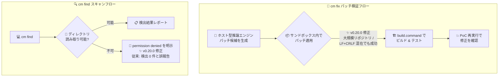

# Gemini Enterprise Agent Platform: CodeMender v0.20.0 アップデート

**リリース日**: 2026-11-10

**サービス**: Gemini Enterprise Agent Platform (CodeMender)

**機能**: CodeMender v0.20.0 - パッチ適用とスキャンエラーハンドリングのバグ修正

**ステータス**: Fixed / バグ修正 (CodeMender 自体は Preview)

📊 [このアップデートのインフォグラフィックを見る](https://takech9203.github.io/google-cloud-news-summary/20261110-codemender-v0-20-0.html)

## 概要

Gemini Enterprise Agent Platform の AI コードセキュリティエージェント「CodeMender」の v0.20.0 がリリースされた。CodeMender は、コードベースの脆弱性をスキャン (`cm find`)、検証 (`cm verify`)、修正 (`cm fix`) する自律型エージェントであり、推論はクラウド側のホスト型エンジン、パッチの適用・ビルド・テストはローカルサンドボックス内で行う実行モデルを採用している。

v0.20.0 は 2 件のバグ修正を含むリリースである。1 つ目は `cm fix` のパッチ検証 (validation) 中のパッチ適用に関する修正で、大規模リポジトリや LF と CRLF の改行コードが混在するプロジェクトにおいてパッチ適用が失敗する問題が解消された。2 つ目はスキャンのエラーハンドリングに関する修正で、読み取り不可のディレクトリをスキャンした際に、権限拒否 (permission denied) エラーを正しく表面化するようになり、従来のように「検出 0 件」として誤って報告されることがなくなった。

対象ユーザーは、CodeMender を利用してコードベースのセキュリティスキャン・脆弱性修正を行う開発チーム、特に大規模リポジトリや Windows/Linux 混在環境 (改行コード混在) のコードベースを扱うチーム、および CI/CD パイプラインでスキャン結果をゲート条件として利用している DevSecOps チームである。

**アップデート前の課題**

- 大規模リポジトリに対して `cm fix` を実行すると、検証ステップでのパッチ適用が失敗することがあった
- LF と CRLF の改行コードが混在するプロジェクト (Windows と Linux の混在開発環境などで発生しやすい) で、生成されたパッチの適用が失敗することがあった
- 読み取り権限のないディレクトリをスキャンした場合、権限拒否エラーが表面化されず「検出 0 件」と報告されるため、実際にはスキャンされていないのに「脆弱性なし」と誤認するリスクがあった

**アップデート後の改善**

- 大規模リポジトリおよび LF/CRLF 混在プロジェクトでも、検証中のパッチ適用が正しく動作するようになった
- 読み取り不可ディレクトリのスキャン時に権限拒否エラーが明示的に報告されるようになり、スキャン結果の信頼性 (「0 件 = 本当に検出なし」) が担保されるようになった

## アーキテクチャ図



`cm fix` の検証フローではサンドボックス内でのパッチ適用が大規模リポジトリ・改行コード混在環境でも失敗しなくなり、`cm find` では読み取り不可ディレクトリに対して権限拒否エラーが正しく表面化されるようになった。

## サービスアップデートの詳細

### 主要機能 (バグ修正)

1. **パッチ適用失敗の修正 (大規模リポジトリ / LF+CRLF 混在)**
   - `cm fix` はパッチ候補をクラウド側で生成した後、ローカルサンドボックス内のソースコードのコピーにパッチを適用し、ビルド・テスト・PoC 再実行による検証を行う
   - このパッチ適用ステップが、大規模リポジトリや LF と CRLF の改行コードが混在するプロジェクトで失敗する問題が修正された
   - クロスプラットフォーム開発 (Windows + Linux) や歴史の長いモノレポなど、改行コードが統一されていないコードベースでの修正ワークフローが安定する

2. **スキャンエラーハンドリングの修正 (権限拒否エラーの表面化)**
   - 読み取り不可 (unreadable) のディレクトリをスキャンした際、従来は「検出 0 件」として報告されていた
   - v0.20.0 からは permission denied エラーが適切に表面化され、スキャンが実際には行われていないことをユーザーが認識できるようになった
   - 「検出 0 件」という結果を「脆弱性なし」と誤解するサイレント障害 (silent failure) を防止する

## 技術仕様

### 修正の影響範囲

| 項目 | 詳細 |
|------|------|
| 対象バージョン | CodeMender CLI v0.20.0 |
| 修正 1 の対象コマンド | `cm fix` (検証中のパッチ適用) |
| 修正 1 の対象環境 | 大規模リポジトリ、LF と CRLF の改行コードが混在するプロジェクト |
| 修正 2 の対象コマンド | スキャン (`cm find`) のエラーハンドリング |
| 修正 2 の動作変更 | 読み取り不可ディレクトリで「検出 0 件」→ permission denied エラーを明示 |

### cm fix のパッチ検証ステップ (参考)

`cm fix FINDING_ID` 実行時、CodeMender は以下の検証を行う。今回の修正はこのうちパッチ適用ステップの信頼性を改善するものである。

| ステップ | 内容 |
|----------|------|
| 1. パッチ生成 | クラウド側のホスト型推論エンジンがパッチ候補を生成 |
| 2. パッチ適用 | ローカルサンドボックス内のソースコードのコピーにパッチを適用 (✨ v0.20.0 で修正) |
| 3. ビルド & テスト | 設定済みの `build.command` を実行し、ビルドとユニットテストの通過を確認 |
| 4. PoC 再実行 | 検証済みの PoC エクスプロイトを再実行し、脆弱性が悪用不能になったことを確認 |

## 設定方法

### 前提条件

1. CodeMender へのアクセス権を持つ Google Cloud プロジェクト (CodeMender は限定された顧客向けの Preview)
2. CodeMender CLI のインストールと Application Default Credentials (ADC) の設定

### 手順

#### ステップ 1: CLI を最新バージョンに更新

```bash
cm update
```

v0.20.0 に更新することで、パッチ適用とスキャンエラーハンドリングの修正が適用される。

#### ステップ 2: スキャン結果の確認方法を見直す

```bash
# スキャン実行
cm find .

# 検出 0 件の場合でも、permission denied エラーが出力されていないか確認する
```

v0.20.0 以降は、読み取り不可ディレクトリがあると permission denied エラーが明示される。CI/CD パイプラインでスキャン結果をゲート条件にしている場合は、エラー出力のハンドリングを確認しておくとよい。

#### ステップ 3: 大規模リポジトリ・改行コード混在プロジェクトで cm fix を再試行

```bash
cm fix FINDING_ID
```

以前のバージョンで検証中のパッチ適用に失敗していた場合、v0.20.0 で再試行する。

## メリット

### ビジネス面

- **スキャン結果の信頼性向上**: 「検出 0 件」が「本当に脆弱性なし」を意味するようになり、権限不足によるスキャン漏れを「安全」と誤認するリスクが解消される。コンプライアンス監査やセキュリティレポートの根拠としての信頼性が高まる
- **修正ワークフローの適用範囲拡大**: 大規模リポジトリや改行コード混在のレガシーコードベースでも `cm fix` による自動修正が利用でき、手動パッチ作業の削減効果を広げられる

### 技術面

- **クロスプラットフォーム環境への対応**: Windows (CRLF) と Linux (LF) の混在開発チームのリポジトリでも、パッチ検証ステップが安定して動作する
- **サイレント障害の防止**: 権限エラーが明示されることで、CI/CD パイプラインでのスキャン失敗検知 (fail-fast) が可能になり、誤った「グリーン」シグナルを防げる

## デメリット・制約事項

### 制限事項

- CodeMender は Preview であり、限定された顧客のみ利用可能
- Pre-GA Offerings Terms が適用され、サポートが限定される場合がある

### 考慮すべき点

- v0.20.0 以降、従来「検出 0 件 (正常終了)」として扱われていた読み取り不可ディレクトリのスキャンがエラーとして表面化されるため、CI/CD パイプラインの挙動が変わる可能性がある。スキャン対象ディレクトリの権限を事前に確認するか、エラー時のハンドリングをパイプラインに組み込むことを推奨
- 改行コード混在はパッチ適用以外でもトラブルの温床になりやすいため、`.gitattributes` などでの改行コード統一も並行して検討する価値がある

## ユースケース

### ユースケース 1: Windows/Linux 混在チームのモノレポでの自動修正

**シナリオ**: Windows と Linux の開発者が混在するチームの大規模モノレポでは、ファイルごとに LF と CRLF が混在しており、以前のバージョンでは `cm fix` の検証中にパッチ適用が失敗することがあった。

**実装例**:
```bash
# CLI を v0.20.0 以降に更新
cm update

# 以前失敗していた finding に対して修正を再試行
cm fix FINDING_ID

# 適用されたパッチを確認してステージング
cm vcs diff
cm vcs stage
```

**効果**: 改行コード混在プロジェクトでもパッチ適用 → ビルド & テスト → PoC 再実行の検証パイプラインが完走し、検証済みパッチをワークスペースに適用できる。

### ユースケース 2: CI/CD パイプラインでのスキャン漏れ検知

**シナリオ**: 夜間の定期スキャンで一部のディレクトリに読み取り権限がなく、実際にはスキャンされていないにもかかわらず「検出 0 件」のレポートが生成されていた。

**効果**: v0.20.0 では permission denied エラーが明示されるため、スキャン対象の権限不備を即座に検知でき、スキャンカバレッジの欠落を「脆弱性なし」と誤認することがなくなる。

## 料金

CodeMender の利用はセッションのトークン使用量に基づいて課金される。今回のバグ修正による料金体系の変更はない。詳細は Gemini Enterprise Agent Platform の料金ページを参照。

- [Gemini Enterprise Agent Platform 料金](https://cloud.google.com/vertex-ai/pricing)

## 利用可能リージョン

CodeMender はグローバルに利用可能 (限定された顧客向けの Preview)。

## 関連サービス・機能

- **Gemini Enterprise Agent Platform (Interactions API)**: CodeMender のホスト型推論エンジンとローカル CLI 間の通信に使用される API 基盤
- **Cloud Build / GitHub Actions**: CodeMender の CI/CD 統合先。スキャンエラーの表面化により、パイプラインでのスキャン漏れ検知が可能になる
- **Wiz (AI Threat Defense)**: Google AI Threat Defense の一部として、Wiz が CodeMender を呼び出して脆弱性の優先順位付けと修正をオーケストレーションする

## 参考リンク

- 📊 [インフォグラフィック](https://takech9203.github.io/google-cloud-news-summary/20261110-codemender-v0-20-0.html)
- [公式リリースノート](https://docs.cloud.google.com/release-notes#November_10_2026)
- [CodeMender ドキュメント](https://docs.cloud.google.com/gemini-enterprise-agent-platform/agents/codemender)
- [脆弱性の修正とパッチ適用 (cm fix)](https://docs.cloud.google.com/gemini-enterprise-agent-platform/agents/codemender/fix-and-patch)
- [スキャンモード (cm find)](https://docs.cloud.google.com/gemini-enterprise-agent-platform/agents/codemender/find-modes)

## まとめ

CodeMender v0.20.0 は、大規模リポジトリ・改行コード混在環境でのパッチ適用失敗と、権限不足ディレクトリのスキャンが「検出 0 件」と誤報告される問題を修正した、実運用上の信頼性を高めるバグ修正リリースである。特に後者はスキャン結果を「脆弱性なし」の根拠として扱うチームにとって重要な修正であり、`cm update` での早期アップデートと、CI/CD でのエラーハンドリングの見直しを推奨する。

---

**タグ**: #GeminiEnterpriseAgentPlatform #CodeMender #セキュリティ #AIエージェント #バグ修正 #CICD #DevSecOps
