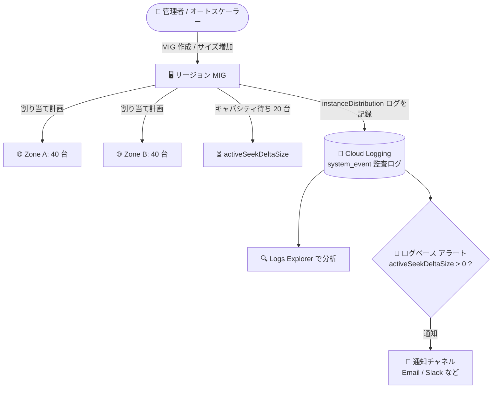

# Compute Engine: リージョン MIG のインスタンス分散ログ (Instance Distribution Logs)

**リリース日**: 2026-11-10

**サービス**: Compute Engine

**機能**: リージョン マネージド インスタンス グループ (MIG) のインスタンス分散ログ

**ステータス**: GA (一般提供)

📊 [このアップデートのインフォグラフィックを見る](https://takech9203.github.io/google-cloud-news-summary/20261110-compute-engine-mig-instance-distribution-logs.html)

## 概要

Compute Engine のリージョン マネージド インスタンス グループ (MIG) で、ゾーンやマシンタイプをまたいだ「計画されたインスタンス割り当て (planned instance allocations)」を確認できる **インスタンス分散ログ (instance distribution logs)** が利用可能になりました。リージョン MIG を新規作成したとき、またはターゲットサイズを増加させたときに、Compute Engine が割り当て計画のスナップショットを Cloud Logging のシステムイベント監査ログとして記録します。

このログには、ゾーンごとの割り当て数 (`zonalDistribution`)、インスタンス フレキシビリティ使用時のマシンタイプごとの割り当て数 (`instanceSelections`)、そして **キャパシティ待ちのインスタンス数 (`activeSeekDeltaSize`)** が含まれます。これにより、MIG がどのゾーン・どのマシンタイプにインスタンスを配置しようとしたか、何台がリソース不足で待機しているかを定量的に把握できます。

対象ユーザーは、リージョン MIG で高可用性構成やインスタンス フレキシビリティ (複数マシンタイプのフォールバック) を運用するインフラ管理者・SRE です。ログベースのアラートポリシーと組み合わせることで、キャパシティ不足によるスケールアウト遅延を即座に検知できます。

**アップデート前の課題**

- リージョン MIG がスケールアウト時にどのゾーン・マシンタイプへインスタンスを割り当てる計画なのか、構造化された形で確認する手段がなかった
- キャパシティ不足で何台のインスタンスが作成待ちになっているかを直接知る方法がなく、`ZONE_RESOURCE_POOL_EXHAUSTED` などの個別の作成エラーログから推測する必要があった
- インスタンス フレキシビリティでは、キャパシティチェックの段階でスキップされた上位優先マシンタイプにはエラーログが残らず、フォールバックの発生を把握しにくかった
- 既存のインスタンス分散モニタリング ダッシュボードはプロビジョニング済みインスタンスの観測が目的で、割り当て計画やキャパシティ制約の検知には使えなかった

**アップデート後の改善**

- MIG の作成・サイズ増加のたびに、ゾーン別・マシンタイプ別の計画割り当て数が構造化ログとして Cloud Logging に自動記録されるようになった
- `activeSeekDeltaSize` フィールドでキャパシティ待ちのインスタンス数を直接確認できるようになった
- `activeSeekDeltaSize > 0` を条件とするログベース アラートを設定し、キャパシティ不足を自動検知・通知できるようになった
- 優先マシンタイプの `allocatedSize: 0` から、フォールバックが発生したことをエラーログなしで確認できるようになった

## アーキテクチャ図



リージョン MIG の作成またはターゲットサイズ増加時に、ゾーン・マシンタイプごとの計画割り当てとキャパシティ待ち台数が Cloud Logging に記録され、Logs Explorer での分析やログベース アラートによる通知に利用できます。

## サービスアップデートの詳細

### 主要機能

1. **ゾーン・マシンタイプごとの計画割り当ての記録**
   - `protoPayload.metadata.details.data.zonalDistribution` にゾーンごとの割り当て数 (`allocatedSize`) を記録
   - インスタンス フレキシビリティ使用時は `instanceSelections` に選択の優先順位 (`rank`) とマシンタイプごとの割り当て数を記録
   - 「割り当て済み (allocated)」は MIG がキャパシティを確保して作成を計画した状態を指し、作成の成功を保証するものではない

2. **キャパシティ待ちインスタンス数の可視化**
   - `data.activeSeekDeltaSize` フィールドで、キャパシティ不足により作成待ちになっているインスタンス数を確認可能 (0 の場合は省略)
   - 例: ターゲットサイズを 0 → 100 に増加した際、80 台 (c2-standard-4 が 20 台、n2d-standard-4 が 60 台を us-central1-b / us-central1-c に 40 台ずつ) を割り当て、残り 20 台が `activeSeekDeltaSize: 20` として待機

3. **ログベース アラートによるキャパシティ不足の検知**
   - `activeSeekDeltaSize > 0` を条件とするクエリでログベース アラートポリシーを作成し、キャパシティ待ちの発生時に通知を受け取れる
   - Cloud Monitoring の通知チャネル (Email、Slack、PagerDuty など) と連携可能

## 技術仕様

### ログの記録条件と記録先

| 項目 | 詳細 |
|------|------|
| 記録タイミング | リージョン MIG の作成時、またはターゲットサイズの増加時のみ |
| 記録されないケース | サイズ減少、修復 (repair)、再作成 (recreate)、更新 (update) |
| 対象 | リージョン MIG のみ (ゾーン MIG は対象外) |
| ログの種類 | システムイベント監査ログ (`cloudaudit.googleapis.com%2Fsystem_event`) |
| メソッド名 | `compute.instanceGroupManagers.instanceDistribution` |
| スナップショットの性質 | 記録時点の計画の 1 回限りのスナップショット。後から更新されない |
| 制限 | `EVEN` シェイプかつオートスケーリングなしの MIG はサイズ関連フィールド (`oldSize`、`newSize`、`deltaSize`、`targetShape`) のみ記録され、分散の詳細は含まれない |

### 主要なログフィールド (`protoPayload.metadata.details`)

| フィールド | 説明 |
|------|------|
| `data.oldSize` / `data.newSize` / `data.deltaSize` | 変更前後のターゲットサイズと増分 |
| `data.targetShape` | MIG のターゲット分散シェイプ (例: `BALANCED`) |
| `data.activeSeekDeltaSize` | キャパシティ待ちのインスタンス数 (0 の場合は省略) |
| `data.instanceSelections` | 選択ごとの `rank` と、`machineType`・`allocatedSize` を含む `machineSelections` (インスタンス フレキシビリティ使用時のみ) |
| `data.zonalDistribution` | ゾーンごとの `allocatedSize` |
| `message` | 人が読めるサマリー (割り当て 0 の選択・ゾーンは省略されるため、全体は構造化データを参照) |

## 設定方法

### 前提条件

1. リージョン MIG を使用していること (ゾーン MIG は対象外)
2. ログの閲覧に必要な IAM 権限 (例: `roles/logging.viewer`) があること

### 手順

#### ステップ 1: Logs Explorer でインスタンス分散ログを確認する

```
logName="projects/PROJECT_ID/logs/cloudaudit.googleapis.com%2Fsystem_event"
protoPayload.methodName="compute.instanceGroupManagers.instanceDistribution"
```

特定の MIG に絞る場合は `resource.labels.instance_group_manager_name="MIG_NAME"` を追加します。Google Cloud コンソールでは、[インスタンス グループ] ページで対象 MIG を開き、[モニタリング] タブ → [ログ] から `instanceDistribution` でフィルタして確認することもできます。

#### ステップ 2: gcloud でキャパシティ待ちの発生を検索する

```bash
gcloud logging read '
  logName="projects/PROJECT_ID/logs/cloudaudit.googleapis.com%2Fsystem_event"
  AND protoPayload.methodName="compute.instanceGroupManagers.instanceDistribution"
  AND protoPayload.metadata.details.data.activeSeekDeltaSize > 0
' --freshness=1d
```

過去 1 日分のログから、キャパシティ待ちが発生したサイズ変更を抽出します。

#### ステップ 3: ログベース アラートを設定する

Logs Explorer で上記の `activeSeekDeltaSize > 0` 条件のクエリを実行・検証したうえで、ログベースのアラートポリシーを作成します。通知チャネルを設定すると、キャパシティ待ちが発生した時点で通知を受け取れます。

## メリット

### ビジネス面

- **キャパシティリスクの早期検知**: スケールアウトがキャパシティ不足で滞留した場合に即座にアラートを受け取れるため、サービス容量不足によるユーザー影響を未然に防ぎやすくなる
- **キャパシティ計画の改善**: どのゾーン・マシンタイプで割り当てが 0 になったかの履歴から、マシンタイプの追加やゾーンの拡大、予約 (Reservation) の検討材料を得られる

### 技術面

- **構造化データによる自動化**: `activeSeekDeltaSize` や `zonalDistribution` が構造化フィールドとして取得できるため、ログベース アラートや分析パイプラインへの組み込みが容易
- **フォールバック動作の可視化**: 作成エラーが記録されない「スキップされた上位優先マシンタイプ」も、`allocatedSize: 0` として計画段階の判断を確認できる
- **追加エージェント不要**: Compute Engine が自動でシステムイベント監査ログに記録するため、Ops Agent などの導入や設定は不要

## デメリット・制約事項

### 制限事項

- ログが記録されるのは MIG の作成時とターゲットサイズの増加時のみで、サイズ減少・修復・再作成・更新では記録されない
- リージョン MIG のみが対象で、ゾーン MIG では利用できない
- `EVEN` シェイプかつオートスケーリングなしの MIG では、サイズ関連フィールドのみでゾーン・マシンタイプの分散詳細は記録されない

### 考慮すべき点

- ログは記録時点の「計画」のスナップショットであり、後から更新されない。実際の作成成否はインスタンスの作成エラーや `instanceStatus` で別途確認する必要がある
- `message` フィールドのサマリーには割り当て 0 の選択・ゾーンが表示されないため、評価されたすべての選択肢を確認するには構造化データ (`protoPayload.metadata.details.data`) を参照する
- 実行中インスタンスの実際の分散状況を見るには、既存の「GCE MIG Instance Distribution Monitoring」ダッシュボード (Cloud Monitoring) を併用する

## ユースケース

### ユースケース 1: スケールアウト時のキャパシティ不足の自動検知

**シナリオ**: EC サイトのセール開催時にオートスケーラーがリージョン MIG を急拡大するが、特定ゾーンのキャパシティ不足で必要台数に届かないことがある。

**実装例**:
```
logName="projects/PROJECT_ID/logs/cloudaudit.googleapis.com%2Fsystem_event"
protoPayload.methodName="compute.instanceGroupManagers.instanceDistribution"
protoPayload.metadata.details.data.activeSeekDeltaSize > 0
```
このクエリでログベース アラートポリシーを作成し、通知チャネルに Slack を設定する。

**効果**: キャパシティ待ちが発生した瞬間に通知を受け取り、マシンタイプの追加・ゾーンの拡大・予約の利用などの対処を迅速に開始できる。

### ユースケース 2: インスタンス フレキシビリティのフォールバック分析

**シナリオ**: コスト最適化のために複数マシンタイプ (c2-standard-4 を優先、n2d-standard-4 をフォールバック) を設定したリージョン MIG で、どの程度フォールバックが発生しているかを定期的にレビューしたい。

**効果**: `instanceSelections` の `rank` と `allocatedSize` の履歴から、優先マシンタイプの取得率を定量評価でき、優先順位の見直しや予約の検討につなげられる。

## 料金

インスタンス分散ログはシステムイベント監査ログ (`cloudaudit.googleapis.com%2Fsystem_event`) として記録されます。システムイベント監査ログはデフォルトで `_Required` ログバケットにルーティングされ、`_Required` バケットのログにはストレージ課金が発生しません (保持期間 400 日固定)。

ログベースのアラートポリシーなど Cloud Monitoring / Cloud Logging の利用料金の詳細は、[Google Cloud Observability の料金ページ](https://cloud.google.com/products/observability/pricing) を参照してください。

## 利用可能リージョン

リリースノートに個別のリージョン制限の記載はありません。リージョン MIG を利用できるすべてのリージョンで記録されます。

## 関連サービス・機能

- **Cloud Logging**: インスタンス分散ログの記録先。Logs Explorer での検索・分析、ログベース アラートの作成に使用
- **Cloud Monitoring**: 実行中インスタンスの分散状況を可視化する「GCE MIG Instance Distribution Monitoring」ダッシュボードを提供。本ログ (計画) とダッシュボード (実績) を組み合わせて利用
- **インスタンス フレキシビリティ (Instance Flexibility)**: 複数マシンタイプのフォールバックを設定する MIG 機能。本ログでフォールバックの発生状況を確認可能
- **Compute Engine 予約 (Reservations)**: キャパシティ待ちが頻発する場合の対策として、ゾーンリソースの事前予約を検討

## 参考リンク

- 📊 [インフォグラフィック](https://takech9203.github.io/google-cloud-news-summary/20261110-compute-engine-mig-instance-distribution-logs.html)
- [公式リリースノート](https://docs.cloud.google.com/release-notes#November_10_2026)
- [View instance distribution logs (ドキュメント)](https://docs.cloud.google.com/compute/docs/instance-groups/view-instance-distribution-logs)
- [Monitor instance distribution in MIGs (ドキュメント)](https://docs.cloud.google.com/compute/docs/instance-groups/monitor-instance-distribution)
- [Regional MIGs (ドキュメント)](https://docs.cloud.google.com/compute/docs/instance-groups/regional-migs)
- [Google Cloud Observability の料金ページ](https://cloud.google.com/products/observability/pricing)

## まとめ

リージョン MIG のスケールアウト時における「どこに・何台・どのマシンタイプで」配置する計画と、キャパシティ待ち台数が Cloud Logging で確認可能になり、キャパシティ起因の容量不足をログベース アラートで自動検知できるようになりました。リージョン MIG で高可用性構成やインスタンス フレキシビリティを運用しているチームは、`activeSeekDeltaSize > 0` を条件としたアラートポリシーの設定をまず検討することを推奨します。

---

**タグ**: #ComputeEngine #MIG #CloudLogging #CloudMonitoring #可用性 #キャパシティ管理
