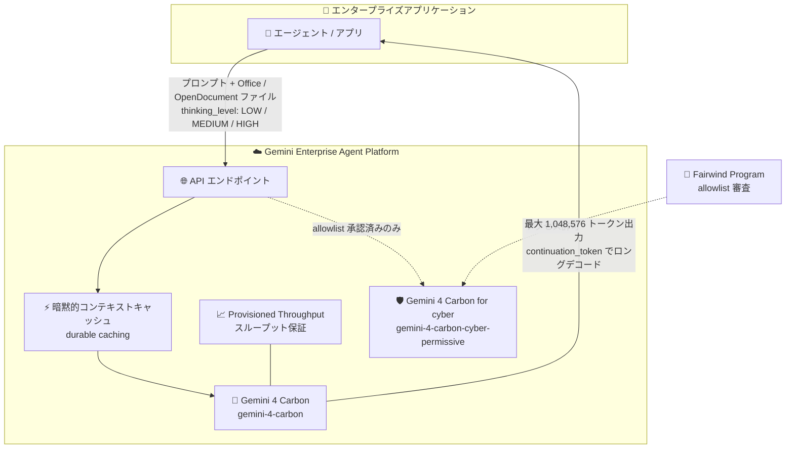

# Gemini Enterprise Agent Platform: Gemini 4 Carbon / Gemini 4 Carbon for cyber が一般提供 (GA) に

**リリース日**: 2026-11-10

**サービス**: Gemini Enterprise Agent Platform

**機能**: Gemini 4 Carbon (`gemini-4-carbon`) および Gemini 4 Carbon for cyber (`gemini-4-carbon-cyber-permissive`) の一般提供開始

**ステータス**: GA (一般提供)

📊 [このアップデートのインフォグラフィックを見る](https://takech9203.github.io/google-cloud-news-summary/20261110-gemini-4-carbon-ga.html)

## 概要

Gemini Enterprise Agent Platform において、Google の最上位推論モデル **Gemini 4 Carbon** (`gemini-4-carbon`) と、防御的サイバーセキュリティ向けバリアント **Gemini 4 Carbon for cyber** (`gemini-4-carbon-cyber-permissive`) が一般提供 (GA) になりました。

Gemini 4 Carbon は、コーディング、金融、法務、サイバーセキュリティ、科学といった複雑な実世界タスク向けに設計された Google のフロンティアモデルです。難しい問題に対しては、思考トークン (thinking tokens) を多く費やして仮説の検証やエッジケースの確認を行ってから回答を生成します。入力と出力を合わせて 1,048,576 トークンという統合されたトークン上限、`continuation_token` による最大 1,048,576 トークンのロングデコード、3 段階の思考レベル (`LOW` / `MEDIUM` / `HIGH`)、durable caching 対応の暗黙的コンテキストキャッシュ、Microsoft Office / OpenDocument ファイル入力、Provisioned Throughput サポートを備えています。

Gemini 4 Carbon for cyber は、脆弱性調査やパッチ生成などの防御的サイバーセキュリティユースケース向けのバリアントで、[Fairwind Program](https://deepmind.google/fairwind-program/) の許可リスト (allowlist) によるアクセス制御の下で提供されます。長時間のエージェントワークフローを本番運用したい企業や、セキュリティ運用に AI を組み込みたい組織が主な対象ユーザーです。

**アップデート前の課題**

- Gemini 4 Carbon は GA 前であり、企業が SLA を前提とした本番ワークロードに最上位推論モデルを採用することが難しかった
- 従来の Gemini モデルでは、同期レスポンスの出力が 64K トークン程度で頭打ちになり、長大なコード生成や証明・レポートの一括生成には出力の分割や独自の継続処理が必要だった
- 防御的サイバーセキュリティ用途 (脆弱性発見、エクスプロイト検証、パッチ生成など) では、汎用モデルの安全性フィルタが過剰に働くことがあり、専用のモデル提供形態がなかった

**アップデート後の改善**

- `gemini-4-carbon` が GA となり、Provisioned Throughput によるスループット保証付きで本番エージェントワークロードに利用できるようになった
- 入出力合計 1,048,576 トークンの統合ウィンドウと `continuation_token` によるロングデコードで、最大 1M トークン規模の長い出力を生成できるようになった
- 思考レベル (`LOW` / `MEDIUM` / `HIGH`) で品質・レイテンシ・トークン消費のバランスをワークロードごとに調整できるようになった
- durable caching を含む暗黙的コンテキストキャッシュにより、繰り返し参照されるプロンプト部分のコストとレイテンシを自動的に削減できるようになった
- Microsoft Office (Word / Excel / PowerPoint) と OpenDocument 形式のファイルを直接入力できるようになり、ドキュメント処理パイプラインの前処理が簡素化された
- 防御的サイバーセキュリティ専用バリアント `gemini-4-carbon-cyber-permissive` が Fairwind Program の allowlist 経由で利用可能になった

## アーキテクチャ図



エンタープライズアプリケーションは Gemini Enterprise Agent Platform のエンドポイント経由で Gemini 4 Carbon を呼び出し、暗黙的キャッシュと Provisioned Throughput を活用して長時間のエージェントワークフローを実行します。サイバーセキュリティ向けバリアントは Fairwind Program の allowlist 承認が必要です。

## サービスアップデートの詳細

### 主要機能

1. **統合 1M トークンウィンドウとロングデコード**
   - 入力・思考・出力トークンが 1 つの 1,048,576 トークンウィンドウを共有する
   - `continuation_token` を使用して、最大 1,048,576 トークン (入力トークン分を除く) までの長い出力を生成できる
   - 長大なコードベースの生成、詳細な技術文書、数学的証明など、従来は分割が必要だった出力を一括生成できる

2. **設定可能な思考レベル (Thinking Levels)**
   - `LOW` / `MEDIUM` / `HIGH` の 3 段階で推論の深さを制御できる
   - デフォルトは `MEDIUM` で、複雑なコードやエージェントユースケースを含むほとんどのタスクに推奨される
   - `HIGH` は難度の高い数学・科学・コーディングタスク向けで、ロングデコードとの組み合わせに適している

3. **暗黙的コンテキストキャッシュ (durable caching 対応)**
   - 暗黙的キャッシュがデフォルトで有効になり、キャッシュヒット時にコストとレイテンシが削減される
   - durable caching により、キャッシュの持続性が強化されている
   - Provisioned Throughput でもキャッシュヒット時にバーンダウンレートの割引が適用される

4. **Microsoft Office / OpenDocument ファイル入力**
   - Word、Excel、PowerPoint などの Microsoft Office 形式と OpenDocument 形式のファイルを直接入力できる
   - PDF 変換などの前処理なしに、業務ドキュメントをマルチモーダル入力として処理できる

5. **Provisioned Throughput サポート**
   - 固定料金でスループットを予約でき、オンデマンドリクエストより優先的に処理される
   - 本番エージェントワークロードで安定したレイテンシとスループットを確保できる

6. **Gemini 4 Carbon for cyber (`gemini-4-carbon-cyber-permissive`)**
   - 脆弱性発見、リバースエンジニアリング、パッチ生成などの防御的サイバーセキュリティユースケース向けバリアント
   - [Fairwind Program](https://deepmind.google/fairwind-program/) の allowlist による申請・承認制で提供される

## 技術仕様

### モデル仕様

| 項目 | 詳細 |
|------|------|
| モデル ID | `gemini-4-carbon` / `gemini-4-carbon-cyber-permissive` |
| ステータス | GA (cyber バリアントは allowlist 制) |
| コンテキストウィンドウ | 入力・思考・出力共有で 1,048,576 トークン |
| ロングデコード | `continuation_token` により最大 1,048,576 トークンの出力 |
| 思考レベル | `LOW` / `MEDIUM` / `HIGH` (デフォルト: `MEDIUM`) |
| コンテキストキャッシュ | 暗黙的キャッシュ (durable caching 対応)。明示的キャッシュ (`cachedContents`) は非サポート |
| ファイル入力 | Microsoft Office、OpenDocument 形式に対応 |
| 消費オプション | Pay-as-you-go、Provisioned Throughput |
| サンプリングパラメータ | `temperature` / `top_p` / `top_k` は指定しても無視される |

### 思考レベルの使い分け

| 思考レベル | トークン消費 | 適したタスク |
|-----------|-------------|-------------|
| `LOW` | 最小、低レイテンシ | 単純なタスク、コスト重視の処理、軽い分析・文章作成 |
| `MEDIUM` (デフォルト) | バランス型 | 複雑なコードやエージェントユースケースを含むほとんどのタスク |
| `HIGH` | 最大、初回トークンまで最も遅い | 高難度の数学・科学、最難関のコード・エージェントタスク。ロングデコードとの併用に最適 |

### リクエスト例

```json
{
  "model": "gemini-4-carbon",
  "contents": [
    {
      "role": "user",
      "parts": [
        { "text": "この決済処理パイプラインをリトライ時の競合状態について分析し、トランザクションロックを安全に書き直してください。" }
      ]
    }
  ],
  "generationConfig": {
    "thinkingConfig": {
      "thinkingLevel": "MEDIUM"
    },
    "maxOutputTokens": 65536
  }
}
```

## 設定方法

### 前提条件

1. Google Cloud プロジェクトで Gemini Enterprise Agent Platform (Vertex AI) API が有効化されていること
2. 呼び出し元に適切な IAM 権限 (例: Vertex AI ユーザーロール) が付与されていること
3. Gemini 4 Carbon for cyber を利用する場合は、Google 担当チームへの連絡または [Fairwind Program](https://deepmind.google/fairwind-program/) 経由での申請により allowlist に登録されていること

### 手順

#### ステップ 1: モデル ID を指定してリクエストを送信

```bash
curl -X POST \
  -H "Authorization: Bearer $(gcloud auth print-access-token)" \
  -H "Content-Type: application/json" \
  "https://aiplatform.googleapis.com/v1/projects/PROJECT_ID/locations/global/publishers/google/models/gemini-4-carbon:generateContent" \
  -d '{
    "contents": [{
      "role": "user",
      "parts": [{"text": "複雑なリポジトリのルートコーズ分析を実行してください。"}]
    }],
    "generationConfig": {
      "thinkingConfig": {"thinkingLevel": "MEDIUM"}
    }
  }'
```

既存の Gemini 4 Argon からの移行は、モデル ID を `gemini-4-carbon` に変更するだけでリクエストスキーマの変更は不要です。

#### ステップ 2: ワークロードに合わせて思考レベルを調整

3 つの思考レベル (`LOW` / `MEDIUM` / `HIGH`) すべてで評価を実行し、品質基準を満たす最も低いレベルを選択します。Carbon は従来モデルより思考に多くのトークンを使うため、`maxOutputTokens` を明示的に設定している既存アプリでは 32,768 以上への引き上げが推奨されます。

#### ステップ 3: (必要に応じて) Provisioned Throughput を購入

本番ワークロードで安定したスループットが必要な場合は、プロジェクト・リージョン・モデル・バージョンの組み合わせに対して Provisioned Throughput を購入します。詳細は [Provisioned Throughput のドキュメント](https://docs.cloud.google.com/gemini-enterprise-agent-platform/models/provisioned-throughput)を参照してください。

## メリット

### ビジネス面

- **本番採用の判断が容易に**: GA 化により SLA の対象となり、エンタープライズの本番エージェントワークロードに最上位推論モデルを安心して採用できる
- **幅広い業務ドメインに対応**: コーディングだけでなく、金融、法務、サイバーセキュリティ、科学といった専門領域の複雑なタスクを単一モデルでカバーできる
- **コスト最適化の選択肢**: 思考レベルの調整と暗黙的キャッシュにより、品質要件に応じたコストコントロールが可能

### 技術面

- **深い検証ループ**: ビルドと検証を繰り返すエージェントワークフローで、根本原因の特定とテストに対する修正検証をモデル自身が実行できる
- **長大な出力の一括生成**: `continuation_token` によるロングデコードで、クライアント側の分割・結合ロジックなしに最大 1M トークンの出力を取得できる
- **ドキュメント処理の簡素化**: Office / OpenDocument ファイルの直接入力により、変換前処理のパイプラインを削減できる

## デメリット・制約事項

### 制限事項

- Gemini 4 Carbon for cyber (`gemini-4-carbon-cyber-permissive`) は allowlist 制であり、Fairwind Program への申請と承認が必要
- 明示的コンテキストキャッシュ (`cachedContents` / `caches.create`) は Gemini 4 Carbon では非サポート (暗黙的キャッシュへの移行が必要)
- `temperature`、`top_p`、`top_k` などのサンプリングパラメータは指定しても無視される

### 考慮すべき点

- Carbon は Gemini 4 Argon より 1 ターンあたりの思考トークン消費とレイテンシが大きい。インタラクティブなコーディングや日常的な機能開発など速度重視のタスクでは Argon の継続利用が推奨される
- 思考トークンも出力トークンとして課金されるため、思考レベル `HIGH` の多用はコストに直結する。評価を通じて必要最小限のレベルを選定すべき
- 難しいプロンプトでは応答に数分かかる場合があるため、HTTP クライアントのタイムアウト設定を十分に長くする (またはバックグラウンド実行を使う) 必要がある

## ユースケース

### ユースケース 1: 大規模リポジトリの根本原因デバッグと自動修正

**シナリオ**: 複雑なマイクロサービス群で発生した障害について、エージェントがログとコードベースを解析し、根本原因を特定してテストで検証済みの修正パッチを生成する。

**実装例**:
```python
response = client.models.generate_content(
    model="gemini-4-carbon",
    contents=[repo_context, failure_logs, "根本原因を特定し、テストに合格する修正を提案してください。"],
    config=GenerateContentConfig(
        thinking_config=ThinkingConfig(thinking_level="HIGH"),
    ),
)
```

**効果**: Carbon の深い検証ループにより、仮説の探索・検証・エッジケース確認を経た精度の高い修正案が得られ、手動デバッグの工数を大幅に削減できる。

### ユースケース 2: 金融・法務ドキュメントのマルチモーダル分析

**シナリオ**: 契約書 (Word)、財務モデル (Excel)、提案資料 (PowerPoint) を前処理なしで直接入力し、根拠の明示を伴う分析レポートを生成する。

**効果**: Office / OpenDocument ファイルの直接入力と、ソースへの強いグラウンディング (根拠のない主張の削減) により、密度の高い業務ドキュメントに対する正確な知識ワークを自動化できる。

### ユースケース 3: 防御的サイバーセキュリティ運用 (cyber バリアント)

**シナリオ**: セキュリティチームが `gemini-4-carbon-cyber-permissive` を用いて、脆弱性発見、エクスプロイト検証、根本原因のパッチ生成といった防御的ワークフローを実行する。

**効果**: 汎用モデルでは扱いが難しいセキュリティ専門タスクを、allowlist で統制された環境下で安全に自動化できる。

## 料金

Gemini Enterprise Agent Platform での正式な料金は[生成 AI 料金ページ](https://cloud.google.com/gemini-enterprise-agent-platform/generative-ai/pricing)を参照してください。消費オプションとして Pay-as-you-go と Provisioned Throughput (固定額のスループット予約) が利用できます。

参考として、Gemini API (Google AI Studio) 側では Gemini 4 Carbon に 2026 年 11 月 30 日までの導入価格が設定されています。

### 料金例 (Gemini API 側の公表値)

| 項目 | 導入価格 (〜2026-11-30) | 2026-12-01 以降 |
|--------|-----------------|-----------------|
| 入力トークン | $2.00 / 100 万トークン | $4.00 / 100 万トークン |
| キャッシュ済み入力トークン (暗黙的キャッシュで 95% 割引) | $0.10 / 100 万トークン | $0.20 / 100 万トークン |
| 出力トークン (思考トークンを含む) | $10.00 / 100 万トークン | $20.00 / 100 万トークン |

思考トークンを含むモデルが処理したすべてのトークンが課金対象となる点に注意してください。

## 利用可能リージョン

Gemini Enterprise Agent Platform でのリージョン別の提供状況は、公式の [Deployments and endpoints (Locations)](https://docs.cloud.google.com/gemini-enterprise-agent-platform/resources/locations) ページを参照してください。

## 関連サービス・機能

- **Gemini 4 Argon (`gemini-4-argon`)**: 同じ 1M 統合コンテキストウィンドウとトークン単価を持つ効率重視のフロンティアモデル。Carbon より高速・低トークン消費で、インタラクティブなコーディングや日常タスク向け
- **Provisioned Throughput**: プロジェクト・リージョン・モデル単位でスループットを予約し、オンデマンドより優先処理する消費オプション。キャッシュヒット時はバーンダウンレートが割引される
- **コンテキストキャッシュ**: 暗黙的キャッシュでプロンプトの共通プレフィックスを自動キャッシュし、コストとレイテンシを削減
- **CodeMender**: Gemini Enterprise Agent Platform のセキュリティエージェント。cyber 系モデルと組み合わせた脆弱性修正に利用される
- **Cloud Monitoring**: `aiplatform.googleapis.com/PublisherModel` リソースのメトリクスで Provisioned Throughput の使用状況 (dedicated / spillover / shared) を監視可能

## 参考リンク

- 📊 [インフォグラフィック](https://takech9203.github.io/google-cloud-news-summary/20261110-gemini-4-carbon-ga.html)
- [公式リリースノート](https://docs.cloud.google.com/release-notes#November_10_2026)
- [What's new in Gemini 4 Carbon (Gemini API)](https://aistudio.google.com/docs/whats-new-gemini-4-carbon)
- [Gemini Enterprise Agent Platform - Locations](https://docs.cloud.google.com/gemini-enterprise-agent-platform/resources/locations)
- [Provisioned Throughput ドキュメント](https://docs.cloud.google.com/gemini-enterprise-agent-platform/models/provisioned-throughput)
- [Fairwind Program (cyber バリアントの申請)](https://deepmind.google/fairwind-program/)
- [料金ページ](https://cloud.google.com/gemini-enterprise-agent-platform/generative-ai/pricing)

## まとめ

Google の最上位推論モデル Gemini 4 Carbon が GA となり、1M トークンの統合ウィンドウ、ロングデコード、思考レベル制御、Provisioned Throughput を備えた本番グレードのエージェント基盤が整いました。複雑なデバッグ、専門領域の知識ワーク、防御的セキュリティ運用を検討しているチームは、まず `MEDIUM` 思考レベルで既存ワークロードを評価し、Argon との使い分け (速度重視は Argon、推論深度重視は Carbon) を設計することを推奨します。cyber バリアントの利用には Fairwind Program への早めの申請が必要です。

---

**タグ**: Gemini Enterprise Agent Platform, Gemini 4 Carbon, 生成 AI, LLM, GA, サイバーセキュリティ, Provisioned Throughput, エージェント
