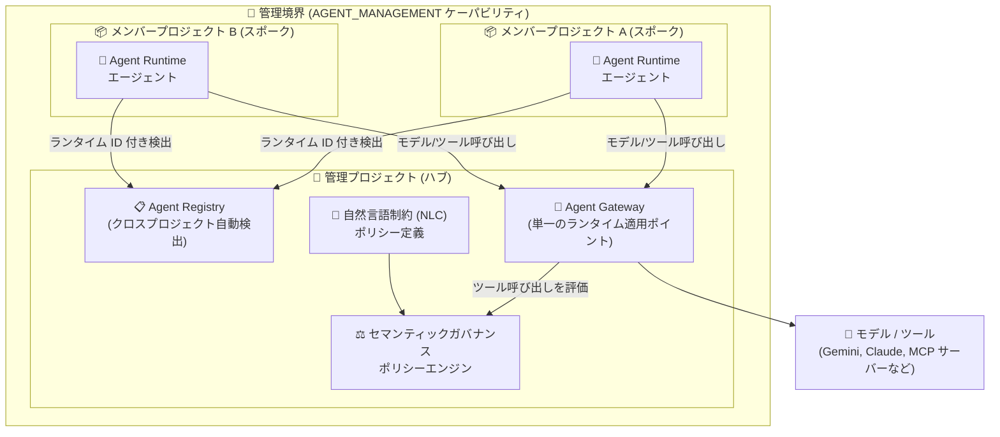

# Gemini Enterprise Agent Platform: セマンティックガバナンスポリシーのクロスプロジェクトガバナンス

**リリース日**: 2026-11-10

**サービス**: Gemini Enterprise Agent Platform

**機能**: セマンティックガバナンスポリシーのクロスプロジェクト (ハブ & スポーク) ガバナンス

**ステータス**: Feature (前提となるクロスプロジェクト管理境界は Preview)

📊 [このアップデートのインフォグラフィックを見る](https://takech9203.github.io/google-cloud-news-summary/20261110-gemini-enterprise-agent-platform-cross-project-semantic-governance.html)

## 概要

Gemini Enterprise Agent Platform のセマンティックガバナンスポリシーが、マルチプロジェクト (ハブ & スポーク) アーキテクチャに対応しました。複数の Google Cloud プロジェクトに分散してデプロイされた AI エージェントを、中央の管理プロジェクト (ハブ) から一元的に統制できるようになります。

仕組みとしては、Resource Manager で `AGENT_MANAGEMENT` ケーパビリティを持つ管理境界 (management boundary) を構成すると、中央管理プロジェクトの Agent Registry がすべてのメンバープロジェクトのエージェントを、ランタイム ID (`principal://...` 形式の RuntimeIdentity) を保持したまま自動検出します。その上で、管理プロジェクトに単一の Agent Gateway とセマンティックガバナンスポリシーエンジンをプロビジョニングすれば、メンバープロジェクトのエージェントに対するポリシーの作成と適用を集中管理できます。

セマンティックガバナンスポリシーは、自然言語制約 (NLC: Natural Language Constraints) で記述したビジネスルールに基づき、エージェントが提案するツール呼び出しをユーザー意図・会話履歴と照合して許可/拒否を判定するランタイム統制レイヤーです。今回のアップデートにより、組織内で各チームがそれぞれのプロジェクトにエージェントをデプロイしながら、ガバナンスチームが中央からポリシーを一元管理するエンタープライズ構成が実現可能になりました。

**アップデート前の課題**

- セマンティックガバナンスポリシーは単一プロジェクト内での統制が前提で、プロジェクトごとに Agent Gateway とポリシーエンジンをプロビジョニングする必要があった
- 複数プロジェクトに分散したエージェントに同じビジネスルールを適用するには、各プロジェクトで同一ポリシーを重複して作成・保守する必要があった
- プロジェクト横断でのエージェントの可視化・発見には、各プロジェクトを個別に照会する必要があった

**アップデート後の改善**

- 管理プロジェクトに単一の Agent Gateway とポリシーエンジンを置くだけで、管理境界内の全メンバープロジェクトのエージェントを統制可能になった
- 管理プロジェクトで作成したポリシーが、その Agent Gateway にバインドされたメンバープロジェクトのエージェントすべてに適用され、メンバープロジェクト側でのエンジンのプロビジョニングやポリシー作成が不要になった
- Agent Registry の自動検出により、メンバープロジェクトのエージェントがランタイム ID を保持したまま中央レジストリに集約され、プロジェクト横断の一覧・検索 (クエリロールアップ) が可能になった

## アーキテクチャ図



中央の管理プロジェクト (ハブ) に配置した Agent Registry・Agent Gateway・ポリシーエンジンが、各メンバープロジェクト (スポーク) のエージェントを自動検出し、すべてのモデル/ツール呼び出しを単一のポリシー適用ポイントで統制するハブ & スポーク構成です。

## サービスアップデートの詳細

### 主要機能

1. **管理境界によるクロスプロジェクト自動検出**
   - Resource Manager の `BoundaryConfig` / `Boundary` / `CapabilityConfig` リソースで管理境界を構成し、`AGENT_MANAGEMENT` (gcloud では `agent-management`) ケーパビリティを有効化する
   - 管理プロジェクトの Agent Registry が、全メンバープロジェクトの Agent Runtime エージェント (Reasoning Engine)、Cloud Run サービス、GKE デプロイメントなどを自動検出し、ランタイム ID (`principal://...`) を保持したまま集約する
   - `CapabilityConfig` 作成時に管理プロジェクトで `agentregistry.googleapis.com` が自動的に有効化される

2. **単一 Agent Gateway + ポリシーエンジンによる集中統制**
   - 管理プロジェクトに Agent Gateway とセマンティックガバナンスポリシーエンジンを 1 セットだけプロビジョニングすれば、同一リージョン内のメンバープロジェクトのエージェントをまとめて統制できる
   - ポリシーエンジンは自プロジェクトで作成されたポリシーのみを評価するため、管理プロジェクトで定義したポリシーが、管理プロジェクトのゲートウェイにバインドされた全メンバープロジェクトのエージェントに適用される
   - メンバープロジェクト側でのポリシーエンジンのプロビジョニングやポリシー作成は不要

3. **ランタイムでのセマンティック評価 (従来機能の拡張)**
   - Agent Gateway がエージェント ⇔ モデル間、エージェント ⇔ ツール間の通信をインターセプトし、モデルが提案したツール呼び出しをポリシーエンジン (PDP) に送信する
   - ポリシーエンジンはユーザー意図・会話履歴・自然言語制約に照らしてセマンティック分析を行い、ALLOW / DENY の判定を下す
   - 判定結果は Cloud Logging に構造化ログ (verdict、rationale、token_usage) として記録され、Cloud Trace によるリクエストトレースにも対応

## 技術仕様

### クロスプロジェクトガバナンスの構成要素

| 項目 | 詳細 |
|------|------|
| 管理境界 | Resource Manager の `BoundaryConfig` + `Boundary` + `CapabilityConfig` (組織またはフォルダに設定) |
| 必要ケーパビリティ | `AGENT_MANAGEMENT` (gcloud: `agent-management`) |
| 管理プロジェクト | 自己管理 (`--management-project` 指定) または Google 管理 (自動作成、ID プレフィックス `google-mpf` / `google-mpo`) |
| 境界のメンバーシップ | タグフィルタなしなら親配下の全子プロジェクト。タグキー (例: `env=prod`) で複数境界に分割可能。1 プロジェクトは親ごとに最大 1 境界 |
| エージェントのデプロイ要件 | `identity_type=AGENT_IDENTITY` かつ `agent_to_anywhere_config.agent_gateway` に管理プロジェクトのゲートウェイを指定 (両フィールドはイミュータブルのため既存エージェントは再デプロイが必要) |
| メンバープロジェクトに必要な権限 | 各メンバープロジェクトの Agent Runtime サービスエージェントに、管理プロジェクト上で `networkservices.agentGateways.get` と `networkservices.operations.get` を付与 |
| リージョン制約 | 管理プロジェクトとメンバープロジェクトのエージェントは同一リージョンであること |
| ポリシー制約 | 制約は自然言語で最大 5,000 文字、拒否メッセージは最大 1,000 文字 |

### 対応モデルプロバイダとリクエストパス

| API | リクエストパス |
|------|------|
| Gemini Developer API / Gemini Enterprise Agent Platform 上の Gemini モデル | `:generateContent` |
| Anthropic Messages API | `/v1/messages` |
| Gemini Enterprise Agent Platform 上の Claude モデル | `:rawPredict` |
| OpenAI Chat Completions API、Mistral AI API、OpenAI 互換エンドポイント (vLLM 等の自己ホスト含む) | `/chat/completions` |

**注意**: ポリシーエンジンはストリーミングレスポンス (`:streamGenerateContent`、`"stream": true` など) をサポートしません。ストリーミングレスポンス内のツール呼び出しはブロックされない可能性があるため、エージェントは非ストリーミングでモデルを呼び出す必要があります。

## 設定方法

### 前提条件

1. 管理プロジェクトで必要な API を有効化する (`aiplatform.googleapis.com`、`agentregistry.googleapis.com`、`networkservices.googleapis.com`、`networksecurity.googleapis.com`、`compute.googleapis.com`、`dns.googleapis.com`)
2. 管理プロジェクトに Agent Gateway をセットアップ済みであること (サービス ID と必要な IAM ロールを含む)
3. Google 管理バインディングを使う場合、Gemini Enterprise Agent Platform サービスアカウント (P4SA) に `roles/compute.networkAdmin` と `roles/dns.admin` を付与

### 手順

#### ステップ 1: 管理境界を構成する

組織またはフォルダに `AGENT_MANAGEMENT` ケーパビリティ付きの管理境界 (`Boundary` + `CapabilityConfig`) を構成し、中央ガバナンスプロジェクトを管理プロジェクト、エージェントワークロードのプロジェクトをメンバープロジェクトとして指定します。これにより管理プロジェクトの Agent Registry が、全メンバープロジェクトの Agent Runtime エージェントをランタイム ID を保持したまま自動検出します。

#### ステップ 2: クロスプロジェクトのゲートウェイアクセスを付与する

管理プロジェクトで、各メンバープロジェクトの Agent Runtime サービスエージェントに `networkservices.agentGateways.get` と `networkservices.operations.get` を付与します (カスタムロール `ar_agw_cross_project_sa` の利用例がドキュメントに記載)。

#### ステップ 3: メンバープロジェクトのエージェントを中央ゲートウェイにバインドする

各メンバープロジェクトのエージェントを `identity_type=AGENT_IDENTITY` でデプロイし、`agent_to_anywhere_config.agent_gateway` に管理プロジェクトの Agent Gateway リソースを指定します。

```text
projects/MANAGEMENT_PROJECT_ID/locations/LOCATION/agentGateways/GATEWAY_NAME
```

#### ステップ 4: 管理プロジェクトでポリシーエンジンをプロビジョニングしポリシーを作成する

管理プロジェクトでセマンティックガバナンスポリシーエンジンをプロビジョニング (通常 2〜3 分、最大 20 分) し、Agent Gateway に接続した上で、自然言語制約によるポリシーを作成します。

```bash
# ポリシーエンジンのプロビジョニング (Google 管理バインディングの例)
gcloud beta ai semantic-governance-policy-engine update \
  --location=LOCATION \
  --project=MANAGEMENT_PROJECT_ID \
  --gateway-config="name='GATEWAY_NAME',network=NETWORK_NAME,subnetwork=SUBNETWORK_NAME,dns-zone-name=DNS_NAME"

# ポリシーの作成は Google Cloud コンソールの
# [Semantic governance policies] ページ、または
# gcloud beta ai semantic-governance-policies create で実施
```

**ベストプラクティス**: ポリシーエンジンの LLM は誤判定の可能性があるため、本番適用前にドライランモードを有効にし、Logs Explorer で判定結果 (`logName="projects/PROJECT_ID/logs/semantic-governance-policy"`) を確認してから適用することが推奨されています。

## メリット

### ビジネス面

- **ガバナンスの一元化**: 調達ルールや金額上限などのビジネスルールを管理プロジェクトで一度定義すれば、組織内の全エージェントに一貫して適用でき、コンプライアンス統制が容易になる
- **チームの自律性と統制の両立**: 各チームは自分のメンバープロジェクトで自由にエージェントを開発・デプロイしつつ、ガバナンスチームは他プロジェクトへの直接アクセスなしに統一的な可視性と統制を維持できる (マルチテナント分離)
- **運用コストの削減**: プロジェクトごとのポリシーエンジン運用・ポリシーの重複管理が不要になり、ポリシー変更もコード再デプロイなしに自然言語で即時反映できる

### 技術面

- **自動検出とランタイム ID の保持**: Agent Registry がメンバープロジェクトのエージェントを attested RuntimeIdentity (`principal://...`) 付きで自動検出するため、ID ベースの統制がプロジェクト境界を越えて機能する
- **単一の適用ポイント**: Agent Gateway がモデル/ツール呼び出しの単一インターセプトポイントとなり、ユーザー意図との整合性検証、コンテキストポイズニング対策、不正アクション (rogue action) の防止を集中実施できる
- **可観測性**: 判定ごとの verdict・rationale・トークン消費量が Cloud Logging に記録され、Cloud Trace でリクエスト単位のレイテンシとポリシー適用を追跡可能。トポロジーグラフでクロスプロジェクトのエージェント関係と VPC Service Controls 境界の遵守も可視化できる

## デメリット・制約事項

### 制限事項

- クロスプロジェクト管理境界 (Agent Registry の boundaries) は Preview 段階であり、Pre-GA 利用規約が適用される
- 管理プロジェクトとメンバープロジェクトのエージェントは同一リージョンに存在する必要がある
- ポリシーエンジンの対応リージョンは限定的 (Americas: `us-central1`、`us-east1`、`us-east4`、`us-west1` / Europe: `europe-southwest1`、`europe-west1`、`europe-west4`、`europe-west8`)
- ストリーミングレスポンス非対応。ストリーミングで返されたツール呼び出しはブロックされない可能性がある
- `identity_type` と `agent_gateway_config` はイミュータブルのため、要件を満たさない既存エージェントはパッチ適用ではなく再デプロイが必要
- 1 プロジェクトは親フォルダ/組織ごとに最大 1 つの境界にしか所属できない

### 考慮すべき点

- ポリシーエンジンの判定は LLM に基づくため誤判定の可能性があり、ドライランモードでの事前検証が推奨される
- ポリシーの制約やパラメータは拒否時の理由 (rationale) としてエンドユーザーに表示され得るため、機密情報を制約文に含めない
- セマンティックガバナンスポリシーは IAM・レート制限・Model Armor などの既存セキュリティ機構を置き換えるものではなく、補完するレイヤーとして設計する必要がある
- ポリシー評価のたびにポリシーエンジン側の LLM トークンを消費する (消費量は Cloud Logging で確認可能)

## ユースケース

### ユースケース 1: 組織全体のエージェント支出統制

**シナリオ**: 複数の部門がそれぞれのプロジェクトで調達・経費精算エージェントを運用しており、全社共通の承認ルール (「1,000 ドルを超える発注は承認確認なしに実行しない」など) を一貫して適用したい。

**実装例**:
```text
管理プロジェクトのセマンティックガバナンスポリシー (自然言語制約):
- 「金額が 1,000 ドルを超える発注ツールの呼び出しは、
   会話内で承認者の確認が明示されていない限り拒否する」
対象: 全エージェント (Apply constraints to all tools)
```

**効果**: 各部門のプロジェクトにポリシーを個別配布することなく、中央の 1 つのポリシーで全部門のエージェントの発注アクションを統制できる。ルール変更時もエージェントの再デプロイは不要。

### ユースケース 2: マルチテナント型エージェントプラットフォームの運営

**シナリオ**: プラットフォームチームが社内向けのエージェント基盤を提供し、各開発チームは自チームのメンバープロジェクトでエージェントを開発・デプロイする。プラットフォームチームは他チームのプロジェクトへ直接アクセスせずに、全エージェントのインベントリ管理とガードレール適用を行いたい。

**効果**: Agent Registry のクエリロールアップで全エージェントを一元的に検索・可視化しつつ、単一の Agent Gateway + ポリシーエンジンでコンテキストポイズニングや不正アクションを一括防御できる。チームごとの分離 (メンバープロジェクト間の相互アクセス不要) も維持される。

## 料金

今回のアップデートに固有の料金情報は公式ドキュメントで確認できませんでした。なお、セマンティックガバナンスポリシーエンジンは評価のたびに LLM トークンを消費し、その正確なトークン消費量 (`token_usage`) が Cloud Logging にターンごとに記録されるため、コストの予測に利用できます。詳細は以下を参照してください。

- [Semantic governance policy overview](https://docs.cloud.google.com/gemini-enterprise-agent-platform/govern/policies/semantic-governance-overview)
- [Gemini Enterprise Agent Platform の料金ページ](https://cloud.google.com/vertex-ai/pricing)

## 利用可能リージョン

セマンティックガバナンスポリシーエンジンおよびポリシーは以下のリージョンで利用可能です (管理プロジェクトとメンバープロジェクトのエージェントは同一リージョンである必要があります)。

| 地域 | リージョン |
|------|-----------|
| Americas | `us-central1`、`us-east1`、`us-east4`、`us-west1` |
| Europe | `europe-southwest1`、`europe-west1`、`europe-west4`、`europe-west8` |

## 関連サービス・機能

- **Agent Registry**: 管理境界内のエージェント・MCP サーバー・ツールを自動検出し、管理プロジェクトへ集約 (クエリロールアップ) する。今回のクロスプロジェクトガバナンスの基盤
- **Agent Gateway**: エージェント ⇔ モデル/ツール間通信のランタイム適用ポイント。ポリシーエンジンの判定に基づきツール呼び出しを許可/除去する
- **Resource Manager (管理境界とケーパビリティ)**: `BoundaryConfig` / `Boundary` / `CapabilityConfig` リソースでプロジェクトのグルーピングと `AGENT_MANAGEMENT` ケーパビリティの有効化を行う
- **Cloud Logging / Cloud Trace**: ポリシー判定の構造化ログ (verdict、rationale、トークン消費) とリクエストトレースによる可観測性を提供
- **Model Armor / IAM / VPC Service Controls**: セマンティックガバナンスポリシーと組み合わせる多層防御 (プロンプトスキャン、アクセス制御、ネットワーク境界) を構成する

## 参考リンク

- 📊 [インフォグラフィック](https://takech9203.github.io/google-cloud-news-summary/20261110-gemini-enterprise-agent-platform-cross-project-semantic-governance.html)
- [公式リリースノート](https://docs.cloud.google.com/release-notes#November_10_2026)
- [Govern agents across multiple projects (設定手順)](https://docs.cloud.google.com/gemini-enterprise-agent-platform/govern/policies/configure-semantic-governance#cross-project-governance)
- [Semantic governance policy overview](https://docs.cloud.google.com/gemini-enterprise-agent-platform/govern/policies/semantic-governance-overview)
- [Cross-project boundaries (Agent Registry)](https://docs.cloud.google.com/agent-registry/boundaries-and-topology)
- [Management boundaries and capabilities overview (Resource Manager)](https://docs.cloud.google.com/resource-manager/docs/boundaries-and-capabilities-overview)

## まとめ

今回のアップデートにより、セマンティックガバナンスポリシーが単一プロジェクトの枠を越え、ハブ & スポーク型のエンタープライズアーキテクチャで組織全体の AI エージェントを一元統制できるようになりました。複数チーム・複数プロジェクトでエージェントを運用する組織は、Resource Manager の管理境界と `AGENT_MANAGEMENT` ケーパビリティの構成を検討し、まずドライランモードでポリシー判定を検証した上で中央集権型ガバナンスへの移行を進めることを推奨します。

---

**タグ**: Gemini Enterprise Agent Platform, Semantic Governance, Agent Registry, Agent Gateway, AI エージェント, ガバナンス, マルチプロジェクト, ハブ & スポーク, Resource Manager
