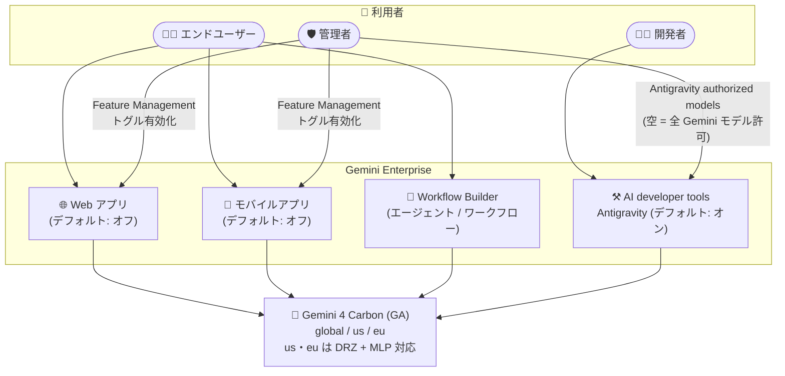

# Gemini Enterprise: Gemini 4 Carbon が Web アプリ・モバイルアプリ・Workflow Builder・AI developer tools で利用可能に

**リリース日**: 2026-11-10

**サービス**: Gemini Enterprise

**機能**: Gemini 4 Carbon の Gemini Enterprise 各サーフェス (Web アプリ / モバイルアプリ / Workflow Builder / AI developer tools) での一般提供

**ステータス**: GA (一般提供)

📊 [このアップデートのインフォグラフィックを見る](https://takech9203.github.io/google-cloud-news-summary/20261110-gemini-enterprise-gemini-4-carbon-availability.html)

## 概要

Google の最新フロンティアモデル **Gemini 4 Carbon** が、Gemini Enterprise の主要なユーザー向けサーフェスである **Web アプリ**、**モバイルアプリ**、**Workflow Builder**、**AI developer tools (Antigravity アプリ / Antigravity CLI / IDE 向け Antigravity)** で一般提供 (GA) になりました。同日に Gemini Enterprise Agent Platform (API 経由) でも Gemini 4 Carbon が GA になっており ([別レポート](./2026-11-10-gemini-4-carbon-ga.md) 参照)、本アップデートはそのモデルをエンドユーザー・開発者が Gemini Enterprise の各アプリケーションから直接利用できるようにするものです。

ロケーションは `global`、`us`、`eu` のマルチリージョンでサポートされ、`us` と `eu` では保存データのデータレジデンシー (at-rest DRZ) と ML 処理 (MLP) のリージョン内処理が保証されます。コンプライアンス要件により米国または EU 域内でのデータ処理が求められる企業でも、最新フロンティアモデルを利用できる点が重要です。

利用開始の方法はサーフェスごとに異なります。Web アプリ / モバイルアプリでは**デフォルトでオフ**であり、管理者が Feature Management でトグルを有効化する必要があります。一方、AI developer tools では「Antigravity authorized models」がデフォルト選択 (空のリスト = 全 Gemini モデル許可) の場合、ライセンスユーザーに対して**デフォルトで有効**になります (カスタムモデルリストを構成している組織では管理者による手動追加が必要)。

**アップデート前の課題**

- Gemini Enterprise の Web アプリ / モバイルアプリのモデルセレクタでは Gemini 3 系 (Gemini 3.8 Flash、Gemini 3.1 Pro など) や Gemini 2.5 Pro が中心で、Gemini 4 世代のフロンティアモデルをエンドユーザーが選択できなかった
- Workflow Builder のエージェント / ワークフローで最新フロンティアモデルを推論エンジンとして指定できず、複雑な多段推論を要するエージェントの品質に上限があった
- Antigravity などの AI developer tools でも Gemini 4 Carbon を利用できず、大規模コーディングタスクに最新モデルを適用できなかった
- 最新モデルは `global` ロケーションのみで提供されることが多く、データレジデンシー要件を持つ組織は利用をためらう必要があった

**アップデート後の改善**

- Web アプリ / モバイルアプリのモデルセレクタで Gemini 4 Carbon を選択可能になり、エンドユーザーが日常業務の対話で最新フロンティアモデルを利用できるようになった
- Workflow Builder のエージェント / ワークフローのモデルとして Gemini 4 Carbon を指定できるようになり、複雑なオーケストレーションの推論品質を向上できるようになった
- AI developer tools ではデフォルトモデル選択が有効な組織なら追加設定なしで Gemini 4 Carbon が利用可能になった
- `us` / `eu` マルチリージョンで at-rest DRZ と MLP がサポートされ、データレジデンシー要件のある組織でも GA モデルとして利用できるようになった

## アーキテクチャ図



Gemini Enterprise の 4 つのサーフェスがすべて Gemini 4 Carbon を呼び出せるようになり、管理者は Web / モバイルアプリでは Feature Management のトグル、AI developer tools では Antigravity authorized models 設定で利用可否を制御します。

## サービスアップデートの詳細

### 主要機能

1. **Web アプリ / モバイルアプリでの提供 (デフォルトはオフ)**
   - モデルセレクタから Gemini 4 Carbon を選択可能 (モデルセレクタ自体の有効化が前提)
   - `global`、`us`、`eu` でトグルはデフォルトオフ。管理者が Feature Management タブの「Gemini model availability」セクションで有効化する
   - サポート外の in-country リージョンでは、警告ダイアログを確認して `global` エンドポイントにトラフィックをルーティングする構成も可能

2. **Workflow Builder での提供**
   - チャットエージェントやワークフローの Gemini Agent ノードのモデルとして Gemini 4 Carbon を指定可能
   - Workflow Builder の Gemini Agent ノードは Gemini 3.0 以降のモデルをサポートしており、Gemini 4 Carbon はその最上位選択肢となる
   - 複雑な多段推論・複数ドキュメント統合を要するエージェントに適する

3. **AI developer tools (Antigravity) での提供 (デフォルトで有効)**
   - Antigravity アプリ、Antigravity CLI、IDE 向け Antigravity で利用可能
   - 「Antigravity authorized models」が空 (デフォルト選択) の場合、ライセンスユーザーに自動的に提供される
   - 組織がカスタムモデルリスト (許可リスト) を構成している場合は、管理者が Gemini 4 Carbon を手動で選択に追加する必要がある

4. **データレジデンシー対応**
   - `global`、`us`、`eu` マルチリージョンでサポート
   - `us` / `eu` では at-rest DRZ (保存データのデータレジデンシー) と MLP (ML 処理のリージョン内実行) の両方をサポート

### モデル自体の特長 (参考: Gemini Enterprise Agent Platform での GA)

| 項目 | 詳細 |
|------|------|
| モデル ID | `gemini-4-carbon` |
| 位置付け | コーディング、金融、法務、サイバーセキュリティ、科学など複雑な実タスク向けフロンティアモデル |
| トークン上限 | 入出力統合で 1,048,576 トークン (`continuation_token` による長尺デコード対応) |
| Thinking レベル | LOW / MEDIUM / HIGH の構成可能な思考レベル |
| コンテキストキャッシュ | 暗黙的キャッシュ + 永続キャッシュ |
| ファイル入力 | Microsoft Office / OpenDocument 形式に対応 |

## 技術仕様

### サーフェス別の提供形態

| サーフェス | デフォルト状態 | 有効化方法 |
|-----------|---------------|-----------|
| Web アプリ | オフ (`global` / `us` / `eu`) | Feature Management タブ → Gemini model availability → Gemini 4 Carbon トグルをオン |
| モバイルアプリ | オフ | Web アプリと同じトグル設定に従う |
| Workflow Builder | 利用可能 | エージェント / ワークフローのモデル設定で選択 |
| AI developer tools | 有効 (デフォルト選択時) | Antigravity authorized models が空なら自動有効。カスタムリストの場合は手動追加 |

### ロケーションとデータレジデンシー

| ロケーション | 提供 | at-rest DRZ | MLP |
|-------------|------|-------------|-----|
| `global` | 対応 | - | - |
| `us` マルチリージョン | 対応 | 対応 | 対応 |
| `eu` マルチリージョン | 対応 | 対応 | 対応 |
| in-country リージョン (ca, asia-northeast1, in, sg, europe-west2 など) | 非対応 (警告ダイアログ確認のうえ `global` へのルーティングで利用可) | - | - |

## 設定方法

### 前提条件

1. Gemini Enterprise Admin ロール (`roles/discoveryengine.agentspaceAdmin`) を保有していること
2. Web アプリでモデルを選択させる場合、Feature Management タブで「Enable model selector」トグルがオンになっていること
3. AI developer tools を使用する場合、プロジェクトが適格な Cloud Billing アカウントにリンクされ、Discovery Engine API と Business AI Code API が有効であること

### 手順

#### ステップ 1: Web アプリ / モバイルアプリで Gemini 4 Carbon を有効化

```text
1. Google Cloud コンソールで「Gemini Enterprise」ページに移動
2. 構成するアプリ名をクリック
3. [Configurations] → [Feature Management] タブをクリック
4. [Gemini model availability] セクションに移動
5. [Gemini 4 Carbon] トグルをオンにする
   - アプリのリージョンで未サポートのモデルを有効化する場合は、
     global エンドポイントへのルーティングに関する警告ダイアログを確認
   - 組織ポリシー (resource locations) で global が制限されている場合、
     未サポートモデルのトグルは無効化される
6. [Save] をクリック (数分で反映)
```

#### ステップ 2: AI developer tools (Antigravity) のモデル可用性を確認・構成

```text
1. Google Cloud コンソールで「Gemini Enterprise」に移動
2. [Settings] → [AI developer tools] タブを選択
3. [Model availability] セクションで [Edit] をクリック
4. [Antigravity authorized models] フィールドを確認:
   - 空のまま → すべてのサポート対象 Gemini モデル (Gemini 4 Carbon を含む) を許可
   - カスタムリスト → Gemini 4 Carbon を明示的に選択に追加
5. [Save] をクリック
```

#### ステップ 3: Workflow Builder でモデルを指定

```text
1. Gemini Enterprise Web アプリで [+ Create agent] → [Chat agent] を選択
2. エージェントノードの設定パネルで [Model] に Gemini 4 Carbon を選択
3. [Preview] タブで動作を確認し、[Create] / [Publish] で公開
```

## メリット

### ビジネス面

- **最新フロンティアモデルの全社展開**: コーディング・金融・法務・サイバーセキュリティ・科学などの複雑なタスクに対応するモデルを、エンドユーザーの日常業務 (Web / モバイル)、ノーコードのエージェント構築 (Workflow Builder)、開発作業 (Antigravity) まで一貫して展開できる
- **コンプライアンス対応**: `us` / `eu` マルチリージョンで DRZ と MLP をサポートするため、規制業種でも GA モデルとして採用しやすい
- **ライセンス内利用**: Gemini モデルの利用は組織のエディション (Standard / Plus など) のプール済みシートクレジットから消費され、サードパーティモデルのような従量課金の個別有効化は不要

### 技術面

- **1M トークンの統合入出力**: 大規模なドキュメント群やコードベースを扱うエージェント・ワークフローを単一モデルで構築できる
- **Thinking レベルの構成**: LOW / MEDIUM / HIGH の思考レベルにより、レイテンシと推論品質のバランスを調整可能
- **管理者による集中制御**: Feature Management と Antigravity authorized models により、組織のポリシーに沿ったモデル展開を一元管理できる

## デメリット・制約事項

### 制限事項

- Web アプリ / モバイルアプリでは**デフォルトでオフ**のため、管理者が明示的に有効化しない限りユーザーは利用できない
- in-country リージョン (ca、asia-northeast1 (日本)、in、sg、europe-west2 など) では直接サポートされず、利用するには警告ダイアログを確認して `global` エンドポイントにルーティングする必要がある (その場合、当該リクエストはリージョン内処理の対象外)
- プロジェクトの resource locations 組織ポリシーで `global` が制限されている場合、アプリのリージョンで未サポートのモデルは有効化できない
- AI developer tools でカスタムモデルリストを構成している組織では、新規リリースモデルは自動では利用可能にならず、管理者の手動追加が必要

### 考慮すべき点

- Gemini Enterprise (アプリ側) でモデルを有効化しても Gemini Enterprise Agent Platform の組織ポリシーは上書きされないため、両プラットフォームで許可モデルを整合させる必要がある
- フロンティアモデルはシートクレジットの消費が大きくなる可能性があるため、クォータと pay-as-you-go 超過利用の設定 (月次支出上限など) を確認することが推奨される
- 日常的な低レイテンシ用途には Flash 系モデル、複雑な多段推論には Gemini 4 Carbon と、ユースケースに応じた使い分けが望ましい

## ユースケース

### ユースケース 1: 規制業種でのデータレジデンシー準拠の AI アシスタント展開

**シナリオ**: EU の金融機関が、顧客データを EU 域内で処理する要件のもと、全社員に最新モデルベースの AI アシスタントを提供したい。

**実装例**:
```text
1. Gemini Enterprise アプリを eu マルチリージョンで構成
2. Feature Management で Gemini 4 Carbon トグルをオン
3. ユーザーは Web / モバイルアプリのモデルセレクタで Gemini 4 Carbon を選択
→ at-rest DRZ と MLP が eu 域内で保証された状態で最新モデルを利用
```

**効果**: データレジデンシー要件を満たしつつ、法務・金融ドメインに強いフロンティアモデルを全社員に展開できる。

### ユースケース 2: Workflow Builder による高度な業務エージェントの構築

**シナリオ**: 複数の社内データソース (Google Drive、Jira など) を横断し、多段の条件分岐と人間の承認を含む契約レビューワークフローを構築したい。

**効果**: Gemini Agent ノードのモデルに Gemini 4 Carbon を指定することで、長大な契約文書の読解と多段推論の品質が向上し、1M トークンの入出力上限により大量のドキュメントを一括処理できる。

### ユースケース 3: Antigravity での大規模コードベース開発

**シナリオ**: 開発チームが Antigravity (IDE / CLI) で大規模リポジトリのリファクタリングや実装を AI に委任したい。

**効果**: デフォルトモデル選択が有効なら追加設定なしで Gemini 4 Carbon が利用可能。長いコンテキストと構成可能な Thinking レベルにより、複雑なコーディングタスクの精度を高められる。

## 料金

Gemini Enterprise での Gemini モデルの利用は、組織のエディション (Standard / Plus / Pay-as-you-go など) に紐づくプール済みシートクレジットから消費されます。サードパーティモデルと異なり、Gemini 4 Carbon の利用に個別の従量課金の有効化は不要ですが、クォータ超過時の pay-as-you-go 設定や月次支出上限の構成が推奨されます。

詳細は以下を参照してください。

- [Quotas and pay-as-you-go usage](https://docs.cloud.google.com/gemini/enterprise/docs/quotas-and-pay-as-you-go-usage)
- [Gemini Enterprise の料金](https://cloud.google.com/gemini/enterprise/pricing)

## 利用可能リージョン

- **提供ロケーション**: `global`、`us` マルチリージョン、`eu` マルチリージョン
- **データレジデンシー**: `us` / `eu` で at-rest DRZ と MLP をサポート
- **in-country リージョン**: 直接サポートなし (警告ダイアログ確認のうえ `global` エンドポイントへのルーティングで利用可)

詳細は [Data residency for Gemini Enterprise](https://docs.cloud.google.com/gemini/enterprise/docs/locations) を参照。

## 関連サービス・機能

- **Gemini Enterprise Agent Platform**: 同日に Gemini 4 Carbon (`gemini-4-carbon`) と Gemini 4 Carbon for cyber が API として GA。本アップデートはそのモデルをアプリケーションサーフェスに展開するもの ([関連レポート](./2026-11-10-gemini-4-carbon-ga.md))
- **Google Antigravity**: Gemini Enterprise の AI developer tools として提供されるエージェント型開発環境。Antigravity authorized models 設定でモデル可用性を制御
- **Workflow Builder**: ノーコード / ローコードでチャットエージェントとワークフローを構築するプラットフォーム。Gemini Agent ノードのモデルとして Gemini 4 Carbon を指定可能
- **Cloud Billing**: AI developer tools の利用やクォータ超過分の pay-as-you-go 課金、月次支出上限の設定に使用

## 参考リンク

- 📊 [インフォグラフィック](https://takech9203.github.io/google-cloud-news-summary/20261110-gemini-enterprise-gemini-4-carbon-availability.html)
- [公式リリースノート](https://docs.cloud.google.com/release-notes#November_10_2026)
- [Data residency for Gemini Enterprise](https://docs.cloud.google.com/gemini/enterprise/docs/locations)
- [Manage features on the web app](https://docs.cloud.google.com/gemini/enterprise/docs/manage-web-app-features)
- [Workflow Builder](https://docs.cloud.google.com/gemini/enterprise/docs/workflow-builder)
- [Configure AI developer tools settings](https://docs.cloud.google.com/gemini/enterprise/docs/ai-developer-tools-settings)
- [Quotas and pay-as-you-go usage](https://docs.cloud.google.com/gemini/enterprise/docs/quotas-and-pay-as-you-go-usage)

## まとめ

Gemini 4 Carbon が Gemini Enterprise の Web アプリ、モバイルアプリ、Workflow Builder、AI developer tools で GA となり、エンドユーザーから開発者まで最新フロンティアモデルを統一的に利用できるようになりました。`us` / `eu` マルチリージョンでのデータレジデンシーと ML 処理のサポートにより、規制要件のある組織でも採用しやすくなっています。Web / モバイルアプリではデフォルトでオフのため、管理者はまず Feature Management でトグルを有効化し、AI developer tools でカスタムモデルリストを運用している場合は Gemini 4 Carbon を許可リストに追加することを推奨します。

---

**タグ**: Gemini Enterprise, Gemini 4 Carbon, GA, 生成 AI, Workflow Builder, Antigravity, AI developer tools, データレジデンシー
