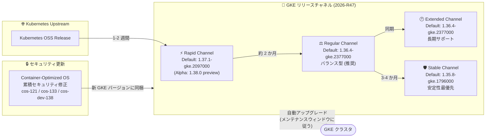

# Google Kubernetes Engine: 2026-R47 リリースチャネル バージョンアップデートとセキュリティ更新

**リリース日**: 2026-11-10

**サービス**: Google Kubernetes Engine

**機能**: 2026-R47 Version Updates & Security Updates across All Release Channels

**ステータス**: GA (Generally Available)

📊 [このアップデートのインフォグラフィックを見る](https://takech9203.github.io/google-cloud-news-summary/20261110-gke-version-updates-2026-r47.html)

## 概要

Google Kubernetes Engine (GKE) の全リリースチャネル (Rapid、Regular、Stable、Extended、No channel) において、2026-R47 バージョンアップデートが実施された。各チャネルのデフォルトバージョンが更新され、新規利用可能バージョンの追加、旧バージョンの非推奨化・削除、自動アップグレードターゲットの更新が行われた。

今回のアップデートでは、Rapid チャネルで Kubernetes 1.37.1 (1.37.1-gke.2097000) が新規クラスタ作成時のデフォルトとなり、最新パッチの 1.37.2 系も利用可能になった。Regular および Extended チャネルでは 1.36.4-gke.2377000 がデフォルトに、Stable チャネルでは 1.35.8-gke.1796000 がデフォルトに設定された。また、Rapid チャネルでは次期マイナーバージョンを先行検証できる Alpha バージョン 1.38.0-gke.4814000+preview が GKE Alpha クラスタ向けに提供開始された。

セキュリティ面では、更新された Container-Optimized OS (COS) イメージを使用する新しい GKE バージョンが含まれる。これらのイメージは累積的であり、前回の GKE リリース以降にリリースされたすべての COS バージョンのセキュリティ修正を取り込んでいる。リリースチャネルに登録されたクラスタは、メンテナンスポリシーに従って自動的に新バージョンへアップグレードされるため、最新のセキュリティパッチが継続的に適用される。

**アップデート前の課題**

- 以前のデフォルトバージョンでは、最新のセキュリティ修正やバグフィックスが含まれていなかった
- Container-Optimized OS イメージに既知の脆弱性に対する修正が反映されていないバージョンが残存していた
- 自動アップグレードターゲットが旧バージョンを指していたため、クラスタが最新のパッチを自動的に受け取れなかった

**アップデート後の改善**

- 各チャネルのデフォルトバージョンが最新のパッチレベルに更新され、新規クラスタ作成時に最新バージョンが適用される
- 更新された Container-Optimized OS イメージにより、前回リリース以降の累積的なセキュリティ修正が適用される
- 自動アップグレードターゲットが更新され、既存クラスタも順次新しいマイナー/パッチバージョンにアップグレードされる
- Rapid チャネルで Alpha バージョン 1.38.0 が利用可能になり、次期マイナーバージョンの早期検証が可能になった

## アーキテクチャ図



この図は、Kubernetes のアップストリームリリースから GKE の各リリースチャネルへのバージョン伝搬フローと、更新された Container-Optimized OS イメージが新しい GKE バージョンに取り込まれ、自動アップグレードを通じてクラスタへ適用される流れを示している。

## サービスアップデートの詳細

### 主要機能

1. **Rapid チャネルのバージョン更新**
   - デフォルトバージョンが 1.37.1-gke.2097000 に更新
   - 新規利用可能バージョン: 1.34.12-gke.1698000、1.35.9-gke.1673000、1.36.5-gke.2262000、1.37.2-gke.1042000
   - Alpha バージョン 1.38.0-gke.4814000+preview が GKE Alpha クラスタ向けに提供開始
   - 1.34.12-gke.1363000、1.35.8-gke.2308000、1.36.5-gke.1259000、1.37.1-gke.3020000 などが非推奨化 (90 日以内またはサポート終了時に削除)

2. **Regular チャネルのバージョン更新**
   - デフォルトバージョンが 1.36.4-gke.2377000 に更新
   - 1.34.12-gke.1153000、1.36.4-gke.2326000 が非推奨化、1.34.12-gke.1011000、1.36.4-gke.2046003 が削除
   - 自動アップグレードターゲット: 1.33 系クラスタは 1.34.12-gke.1209000 へのマイナーアップグレード対象

3. **Stable チャネルのバージョン更新**
   - デフォルトバージョンが 1.35.8-gke.1796000 に更新
   - 1.34.11 系、1.35.8-gke.1626001、1.36.4 系の複数パッチが非推奨化
   - 自動アップグレードターゲット: 1.33 → 1.34.12-gke.1011000、1.34 → 1.35.8-gke.1796000 のマイナーアップグレードが設定

4. **Extended チャネルのバージョン更新**
   - デフォルトバージョンが 1.36.4-gke.2377000 に更新
   - 新規利用可能バージョン: 1.32.13-gke.2788000、1.32.13-gke.3004000、1.33.13-gke.2074000、1.33.13-gke.2339000
   - 長期サポートが必要な環境向けに 1.32 系・1.33 系の最新パッチを継続提供
   - 自動アップグレードターゲット: 1.31 系クラスタは 1.32.13-gke.2701000 へのマイナーアップグレード対象

5. **No channel (非推奨) のバージョン更新**
   - デフォルトバージョンが 1.36.4-gke.2377000 に更新
   - 新規利用可能バージョン: 1.34.12-gke.1698000、1.35.9-gke.1673000、1.36.5-gke.2262000、1.37.2-gke.1042000
   - ノードバージョンとして 1.32.13-gke.3004000、1.33.13-gke.2339000 なども追加
   - No channel 構成自体は非推奨であり、2027 年 6 月 14 日に削除予定。リリースチャネルへの移行が推奨される

6. **セキュリティ更新 (Container-Optimized OS)**
   - 更新された Container-Optimized OS イメージを使用する新しい GKE バージョンを含む
   - イメージは累積的で、前回の GKE リリース以降にリリースされたすべての COS バージョンのセキュリティ修正を取り込む
   - 解決された個別の脆弱性は各 COS イメージの Security release notes で確認可能

## 技術仕様

### チャネル別デフォルトバージョン一覧 (2026-R47)

| チャネル | デフォルトバージョン | 主な新規利用可能バージョン | 推奨用途 |
|---------|---------------------|---------------------------|---------|
| Rapid | 1.37.1-gke.2097000 | 1.37.2-gke.1042000 (Alpha: 1.38.0-gke.4814000+preview) | 本番前検証、新機能の早期評価 |
| Regular | 1.36.4-gke.2377000 | - (既存バージョンの整理のみ) | 一般的な本番ワークロード (推奨) |
| Stable | 1.35.8-gke.1796000 | - (既存バージョンの整理のみ) | 高安定性が求められる本番環境 |
| Extended | 1.36.4-gke.2377000 | 1.32.13-gke.3004000、1.33.13-gke.2339000 ほか | 長期サポートが必要な環境 |
| No channel (非推奨) | 1.36.4-gke.2377000 | 1.37.2-gke.1042000 ほか | 非推奨 (2027-06-14 削除予定) |

### チャネル別自動アップグレードターゲット

| チャネル | マイナーバージョンアップグレード | パッチバージョンアップグレード |
|---------|--------------------------------|------------------------------|
| Rapid | 1.33 → 1.34.12-gke.1539000<br>1.34 → 1.35.9-gke.1505000<br>1.35 → 1.36.5-gke.1982000 | 1.34 → 1.34.12-gke.1539000<br>1.35 → 1.35.9-gke.1505000<br>1.36 → 1.36.5-gke.1982000<br>1.37 → 1.37.1-gke.2097000 |
| Regular | 1.33 → 1.34.12-gke.1209000 | 1.34 → 1.34.12-gke.1209000<br>1.36 → 1.36.4-gke.2377000 |
| Stable | 1.33 → 1.34.12-gke.1011000<br>1.34 → 1.35.8-gke.1796000 | 1.34 → 1.34.12-gke.1011000<br>1.35 → 1.35.8-gke.1796000<br>1.36 → 1.36.4-gke.2046003 |
| Extended | 1.31 → 1.32.13-gke.2701000 | 1.32 → 1.32.13-gke.2701000<br>1.33 → 1.33.13-gke.1952000<br>1.34 → 1.34.12-gke.1209000<br>1.36 → 1.36.4-gke.2377000 |
| No channel | 1.33 → 1.34.12-gke.1209000<br>1.34 → 1.35.8-gke.1796000 | 1.34 → 1.34.12-gke.1209000<br>1.35 → 1.35.8-gke.1796000<br>1.36 → 1.36.4-gke.2377000 |

マイナーバージョンアップグレードは、メンテナンス除外や非推奨 API の使用など、アップグレードを妨げる要因がない場合に適用される。パッチバージョンアップグレードは、マイナーバージョンアップグレードが利用できない場合、またはクラスタにアップグレードを妨げる要因がある場合に適用される。

### セキュリティ更新: Container-Optimized OS イメージ

| GKE バージョン | Container-Optimized OS バージョン |
|---------------|----------------------------------|
| 1.32.13-gke.3004000 | cos-121-18867-652-12 |
| 1.37.2-gke.1042000 | cos-133-19999-44-170 |
| 1.38.0-gke.4814000+preview | cos-dev-138-20162-0-0 |

各イメージで解決された脆弱性の詳細は、それぞれの Container-Optimized OS の Security release notes を参照のこと。

### リリースチャネルの特性比較

| 特性 | Rapid | Regular | Extended | Stable |
|------|-------|---------|----------|--------|
| 新マイナーバージョン提供時期 | OSS GA から 1-2 週間 | Rapid から約 2 か月後 | Regular と同期 | Regular から 3-4 か月後 |
| GKE SLA 対象 | 対象外 | 対象 | 対象 | 対象 |
| 推奨環境 | 開発/検証 | 本番 (推奨) | 長期安定本番 | 高安定性本番 |
| マイナーバージョン保持期間 | 標準 | 標準 | 最長 | 標準 |

## 設定方法

### 前提条件

1. Google Cloud プロジェクトで GKE API が有効化されていること
2. gcloud CLI がインストールされ、認証が完了していること
3. Kubernetes Engine Cluster Admin 以上の IAM 権限を持つこと

### 手順

#### ステップ 1: 現在のクラスタバージョンとチャネルを確認

```bash
gcloud container clusters list \
    --project PROJECT_ID \
    --format="table(name,location,currentMasterVersion,releaseChannel.channel)"
```

現在のクラスタが使用しているバージョンとリリースチャネルを確認する。

#### ステップ 2: 利用可能なバージョンを確認

```bash
gcloud container get-server-config \
    --location LOCATION \
    --format="yaml(channels)"
```

リリースチャネルごとのデフォルトバージョンと利用可能バージョンの一覧を表示する。ロールアウトは複数日かけて全ゾーンに展開されるため、リリースノート公開時点では一部のゾーンで新バージョンが未提供の場合がある。

#### ステップ 3: 手動でバージョンをアップグレードする場合

```bash
# コントロールプレーンのアップグレード
gcloud container clusters upgrade CLUSTER_NAME \
    --location LOCATION \
    --master \
    --cluster-version VERSION

# ノードプールのアップグレード
gcloud container clusters upgrade CLUSTER_NAME \
    --location LOCATION \
    --node-pool NODE_POOL_NAME \
    --cluster-version VERSION
```

手動アップグレードを行う場合は、コントロールプレーンを先にアップグレードし、その後ノードプールをアップグレードする。

#### ステップ 4: セキュリティパッチを早期適用したい場合 (accelerated patch auto-upgrades)

```bash
gcloud container clusters update CLUSTER_NAME \
    --location LOCATION \
    --patch-update accelerated
```

パッチバージョンが自動アップグレードターゲットに設定される前に、利用可能になった時点で自動アップグレードを受け取れる。セキュリティパッチを可能な限り早く適用したい場合に有効。

## メリット

### ビジネス面

- **セキュリティリスクの低減**: 累積的な Container-Optimized OS のセキュリティ修正を含む新バージョンが提供され、既知の脆弱性に対するリスクが迅速に低減される
- **運用負荷の軽減**: リリースチャネルに登録されたクラスタは自動的にアップグレードされるため、手動でのバージョン管理作業が不要になる
- **段階的なバージョン採用**: チャネルごとの段階的なバージョン提供により、新バージョンを検証環境で先行評価し、本番環境への影響を最小化できる

### 技術面

- **Kubernetes 1.38 の早期検証**: Rapid チャネルの Alpha バージョン 1.38.0-gke.4814000+preview により、次期マイナーバージョンの新機能や API 変更を GKE Alpha クラスタで先行検証できる
- **幅広いバージョン選択肢**: Extended チャネルでは 1.32 系・1.33 系の最新パッチが追加され、長期サポートが必要なワークロードでもセキュリティ修正を受け取れる
- **パッチバージョンの早期利用**: 新しいパッチバージョンは自動アップグレードターゲットになる少なくとも 1 週間前に利用可能になるため、手動アップグレードや accelerated patch auto-upgrades で先行適用が可能

## デメリット・制約事項

### 制限事項

- Rapid チャネルのバージョンは GKE SLA の対象外であり、本番環境での使用は推奨されない
- Alpha バージョン 1.38.0-gke.4814000+preview は GKE Alpha クラスタ専用であり、通常のクラスタでは使用できない
- ロールアウトはリリースノート公開時点で進行中であり、全 Google Cloud ゾーンへの展開完了まで複数日かかる場合がある
- 非推奨化されたバージョン (deprecated) は 90 日以内、またはサポート終了日のいずれか早い方で削除される

### 考慮すべき点

- No channel (リリースチャネル未登録) 構成は非推奨であり、2027 年 6 月 14 日に削除される予定。該当クラスタはリリースチャネルへの移行計画を策定すること
- マイナーバージョンのアップグレードでは Kubernetes API の非推奨化や削除が含まれる場合があり、ワークロードの互換性確認が必要 (非推奨 API を使用しているクラスタは自動アップグレードが一時停止される)
- メンテナンスウィンドウとメンテナンス除外を適切に設定し、ビジネスクリティカルな時間帯での自動アップグレードを回避すること
- 非推奨化されたバージョンを使用中のクラスタは、削除前に新しいパッチバージョンへのアップグレードを計画すること

## ユースケース

### ユースケース 1: Kubernetes 1.38 Alpha の先行検証

**シナリオ**: プラットフォームチームが次期 Kubernetes 1.38 の新機能や API 変更を事前に検証し、本番導入前に互換性課題を洗い出したい場合。Rapid チャネルの GKE Alpha クラスタで Alpha バージョンを使用する。

**実装例**:
```bash
# Alpha クラスタを 1.38.0 preview で作成
gcloud container clusters create alpha-test-cluster \
    --location us-central1 \
    --enable-kubernetes-alpha \
    --release-channel rapid \
    --cluster-version 1.38.0-gke.4814000+preview
```

**効果**: GKE で 1.38 系が一般提供される前に、アルファ機能ゲートを含む次期バージョンの挙動を検証でき、マイナーバージョンアップグレードに向けた準備期間を確保できる。

### ユースケース 2: セキュリティパッチの迅速な適用

**シナリオ**: セキュリティ要件が厳しい環境で、Container-Optimized OS のセキュリティ修正を含む新バージョン (例: 1.37.2-gke.1042000) を、自動アップグレードターゲットになる前に適用したい場合。

**実装例**:
```bash
# accelerated patch auto-upgrades を有効化
gcloud container clusters update prod-cluster \
    --location us-central1 \
    --patch-update accelerated
```

**効果**: パッチバージョンが利用可能になった時点で自動アップグレードが実行され、COS イメージの累積的なセキュリティ修正が通常よりも早く適用される。

### ユースケース 3: Extended チャネルによる長期バージョン保持とパッチ適用の両立

**シナリオ**: 規制要件によりマイナーバージョンアップグレードに社内監査プロセスが必要な環境で、1.32 系・1.33 系を長期維持しつつ、最新のセキュリティパッチ (1.32.13-gke.3004000 など) は適用したい場合。

**効果**: Extended チャネルのマイナーバージョン長期サポートを活用して監査プロセスに十分な時間を確保しながら、パッチレベルのセキュリティ修正は自動的に適用され、クラスタの安全性が維持される。

## 料金

GKE のリリースチャネルおよびバージョンアップデートに関する追加料金は発生しない。バージョンアップデートとセキュリティ更新は GKE サービスの標準機能として提供される。

### GKE クラスタ管理費用

| モード | クラスタ管理料金 |
|--------|-----------------|
| GKE Standard | $0.10/クラスタ/時間 |
| GKE Autopilot | クラスタ管理料金 $0.10/クラスタ/時間 + Pod リソースに対する課金 |
| GKE Enterprise | Enterprise ライセンス料金に含まれる |

最新の料金は [GKE 料金ページ](https://cloud.google.com/kubernetes-engine/pricing) を参照のこと。

## 利用可能リージョン

GKE のリリースチャネルバージョンアップデートは、GKE が利用可能なすべてのリージョンおよびゾーンに適用される。ただし、ロールアウトはリリースノート公開時点で進行中であり、全ゾーンへの展開完了まで複数日かかる場合がある。

## 関連サービス・機能

- **GKE リリースチャネル**: クラスタのバージョン管理ポリシーを定義する機能。Rapid、Regular、Extended、Stable の 4 つのチャネルから選択可能
- **Container-Optimized OS**: GKE ノードのデフォルト OS イメージ。Google が管理するセキュリティ強化済みの OS で、今回のセキュリティ更新の対象
- **GKE メンテナンスウィンドウと除外**: 自動アップグレードの実行時間帯を制御する機能。ビジネスクリティカルな時間帯を避けてアップグレードをスケジュール可能
- **GKE クラスタ通知**: バージョンの更新やアップグレードイベントに関する通知を Pub/Sub 経由で受信できる機能
- **GKE Alpha クラスタ**: Kubernetes のアルファ機能ゲートと Alpha API を有効化した検証用クラスタ。Rapid チャネルの Alpha パッチバージョンを利用可能

## 参考リンク

- 📊 [インフォグラフィック](https://takech9203.github.io/google-cloud-news-summary/20261110-gke-version-updates-2026-r47.html)
- [公式リリースノート (Google Cloud)](https://docs.cloud.google.com/release-notes#November_10_2026)
- [GKE リリースノート (November 10, 2026)](https://cloud.google.com/kubernetes-engine/docs/release-notes#November_10_2026)
- [GKE リリースチャネルの概要](https://docs.cloud.google.com/kubernetes-engine/docs/concepts/release-channels)
- [GKE リリーススケジュール](https://docs.cloud.google.com/kubernetes-engine/docs/release-schedule)
- [GKE クラスタのアップグレード](https://docs.cloud.google.com/kubernetes-engine/docs/how-to/upgrading-a-cluster)
- [メンテナンスウィンドウと除外の設定](https://docs.cloud.google.com/kubernetes-engine/docs/concepts/maintenance-windows-and-exclusions)
- [Container-Optimized OS リリースノート](https://cloud.google.com/container-optimized-os/docs/release-notes)
- [GKE 料金ページ](https://cloud.google.com/kubernetes-engine/pricing)

## まとめ

2026-R47 バージョンアップデートにより、GKE の全リリースチャネルでデフォルトバージョンと自動アップグレードターゲットが更新され、累積的な Container-Optimized OS のセキュリティ修正を含む新バージョンが提供された。Rapid チャネルでは 1.37.1 がデフォルトとなり、Alpha バージョン 1.38.0 preview による次期バージョンの先行検証も可能になった。自動アップグレードターゲットが更新されているため、メンテナンスウィンドウの設定を確認し、特に 1.33 系以前を使用中のクラスタはマイナーバージョンアップグレードに備えたワークロードの互換性テストを実施することを推奨する。また、No channel 構成のクラスタは 2027 年 6 月の削除に向けてリリースチャネルへの移行を計画すべきである。

---

**タグ**: #GoogleKubernetesEngine #GKE #ReleaseChannels #VersionUpdate #SecurityUpdate #Kubernetes #ContainerOptimizedOS #AutoUpgrade #Rapid #Regular #Extended #Stable #ClusterManagement
