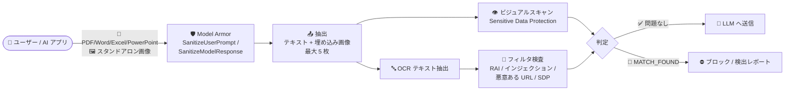

# Model Armor: 画像スクリーニングが GA (ドキュメント埋め込み画像の抽出・スクリーニング対応)

**リリース日**: 2026-11-10

**サービス**: Model Armor

**機能**: 画像スクリーニング (スタンドアロン画像および PDF/Word/Excel/PowerPoint 埋め込み画像の検査)

**ステータス**: GA (一般提供)

📊 [このアップデートのインフォグラフィックを見る](https://takech9203.github.io/google-cloud-news-summary/20261110-model-armor-image-screening-ga.html)

## 概要

Google Cloud の生成 AI セキュリティサービスである Model Armor の画像スクリーニング機能が一般提供 (GA) になりました。スタンドアロン画像に加え、サポート対象のリッチテキストドキュメント (PDF、Word、Excel、PowerPoint) に埋め込まれた画像を自動的に抽出してスクリーニングできます。あわせて画像スクリーニングの課金が開始され、処理した画像を画像サイズに基づいてトークンに換算する、テキストと統一されたトークンベースの料金体系が適用されます。

画像スクリーニングは 2 つの手法を組み合わせています。1 つは高度な Sensitive Data Protection フィルタによるビジュアルスキャンで、画像内の機微なオブジェクトや被写体を検出します。もう 1 つは OCR (光学文字認識) によるテキスト抽出で、抽出したテキストを責任ある AI の安全性カテゴリ、プロンプトインジェクション / ジェイルブレイク検出、悪意のある URL 検出、Sensitive Data Protection の各フィルタで検査します。

生成 AI アプリケーションにドキュメントをアップロードさせる企業にとって、画像に埋め込まれたプロンプトインジェクションや機密情報の混入は、テキストのみの検査では見逃されるリスクでした。本アップデートにより、ドキュメント内のテキストと画像の両方を単一のサニタイズ処理でカバーできるようになり、マルチモーダルな AI ワークロードのセキュリティ境界を強化できます。

**アップデート前の課題**

- 画像内に埋め込まれたテキスト (プロンプトインジェクションの指示や機密情報など) は、テキストのみのスクリーニングでは検出できなかった
- ドキュメント (PDF、Word、Excel、PowerPoint) のスクリーニングはテキスト抽出が中心で、埋め込み画像に潜むリスクはカバーされていなかった
- 画像スクリーニングの正式な料金体系が確定しておらず、本番導入時のコスト見積もりが難しかった

**アップデート後の改善**

- リッチテキストドキュメントから埋め込み画像 (最大 5 枚) を自動抽出し、ビジュアルスキャンと OCR の両方でスクリーニングできるようになった
- `MODALITY_TEXT` と `MODALITY_IMAGE` の両方を有効化することで、ドキュメントのテキストと埋め込み画像を 1 回のリクエストで検査できるようになった
- 画像をサイズに基づいてトークンに換算する統一的な料金体系が確定し、テキストトークンと同一レート・同一の無料枠でコストを予測できるようになった

## アーキテクチャ図



Model Armor がドキュメントからテキストと埋め込み画像を抽出し、ビジュアルスキャンと OCR の 2 系統でフィルタ検査を行うデータフローです。問題がなければ LLM に渡し、違反検出時はブロックまたは検出結果を返します。

## サービスアップデートの詳細

### 主要機能

1. **ドキュメント埋め込み画像の抽出とスクリーニング (GA)**
   - テンプレートで画像モダリティ (`MODALITY_IMAGE`) を有効にすると、PDF (`PDF`)、Word (`WORD_DOCUMENT`)、Excel (`EXCEL_DOCUMENT`)、PowerPoint (`POWERPOINT_DOCUMENT`) のサニタイズ時に、ドキュメント内の埋め込み画像を最大 5 枚まで自動抽出してスクリーニング
   - `MODALITY_TEXT` と `MODALITY_IMAGE` の両方を有効にすると、ドキュメントのテキストと埋め込み画像の両方を検査

2. **2 系統の画像検査手法**
   - **ビジュアルスキャン**: 高度な Sensitive Data Protection フィルタを使用し、画像内の機微なオブジェクトや被写体 (オブジェクト infoType、画像コンテキスト infoType) を検出
   - **OCR**: 画像からテキストを抽出し、責任ある AI の安全性カテゴリ、プロンプトインジェクション / ジェイルブレイク検出、悪意のある URL、Sensitive Data Protection infoType の各フィルタで検査

3. **画像サイズベースのトークン課金の開始**
   - 処理した画像を「5,000 トークン + 1 MB あたり 1,000 トークン (サイズは MB 単位で切り上げ)」の式でトークンに換算
   - 画像トークンはテキストトークンと同一レートで課金され、同じトークン使用量・ティア枠にカウントされる
   - OCR で抽出したテキストは画像トークンに含まれ、別途テキストトークンとして課金されない

## 技術仕様

### 仕様と制限

| 項目 | 詳細 |
|------|------|
| 対応スタンドアロン画像形式 | JPEG、PNG、BMP |
| 対応ドキュメント形式 | PDF、Word (DOCX など)、Excel (XLSX など)、PowerPoint (PPTX など) |
| スタンドアロン画像のサイズ上限 | 1 画像あたり 4 MB |
| ドキュメントの上限 | ファイル全体で 4 MB 以下、埋め込み画像は最大 5 枚 |
| 上限超過時の動作 | ファイル全体のスキャンをスキップ (`EXECUTION_SKIPPED` / `NO_MATCH_FOUND` を返却、課金なし) |
| スタンドアロン画像の検査 | 1 リクエストにつき 1 画像 (複数画像、テキスト + 画像の同時送信は非対応) |
| ストリーミング | ストリーミングメソッドはテキストのみ対応 (画像・ファイル非対応) |
| 対応インテグレーション | Model Armor REST API の直接呼び出し、Gemini Enterprise 統合 |
| 利用可能ロケーション | `us` および `eu` マルチリージョンのみ |

### テンプレート設定 (モダリティの指定)

REST API では `templateMetadata.modalities` フィールドでスキャン対象のモダリティを指定します。

```json
{
  "templateMetadata": {
    "modalities": ["MODALITY_IMAGE", "MODALITY_TEXT"]
  }
}
```

- `MODALITY_TEXT` のみ: テキスト文字列とドキュメント内テキストをスキャン (埋め込み画像は無視)
- `MODALITY_IMAGE` のみ: スタンドアロン画像とドキュメント内の埋め込み画像をスキャン (ドキュメントの平文テキストは無視)
- 両方指定: テキストと画像の両方をスキャン
- 未指定 / 空の場合: テキストのみスキャン (従来どおり)

## 設定方法

### 前提条件

1. Model Armor API が有効化されたプロジェクトがあること
2. 画像スクリーニングをサポートするロケーション (`us` または `eu` マルチリージョン) にテンプレートを作成すること
3. リッチテキストドキュメントの埋め込み画像を検査する場合、Sensitive Data Protection の de-identify テンプレートを構成しないこと (inspect テンプレートのみ構成する)

### 手順

#### ステップ 1: 画像モダリティを有効にしたテンプレートを作成

```bash
export TEMPLATE_CONFIG='{
  "filterConfig": {
    "raiSettings": {
      "raiFilters": [
        { "filterType": "HATE_SPEECH", "confidenceLevel": "MEDIUM_AND_ABOVE" },
        { "filterType": "SEXUALLY_EXPLICIT", "confidenceLevel": "MEDIUM_AND_ABOVE" }
      ]
    },
    "piAndJailbreakFilterSettings": {
      "filterEnforcement": "ENABLED",
      "confidenceLevel": "HIGH"
    },
    "maliciousUriFilterSettings": { "filterEnforcement": "ENABLED" }
  },
  "templateMetadata": {
    "modalities": ["MODALITY_IMAGE", "MODALITY_TEXT"]
  }
}'

curl -X POST \
  -d "$TEMPLATE_CONFIG" \
  -H "Content-Type: application/json" \
  -H "Authorization: Bearer $(gcloud auth print-access-token)" \
  "https://modelarmor.LOCATION.rep.googleapis.com/v1/projects/PROJECT_ID/locations/LOCATION/templates?template_id=TEMPLATE_ID"
```

`LOCATION` には画像スクリーニングをサポートする `us` または `eu` を指定します。Google Cloud コンソールでは、テンプレート作成時の「Select modality」でテキスト / 画像 / 両方を選択できます (非対応リージョンを選択するとモダリティ選択は無効化されます)。

#### ステップ 2: ドキュメントや画像を含むプロンプトをサニタイズ

ファイルベースのプロンプトとして PDF などのドキュメントを `SanitizeUserPrompt` / `SanitizeModelResponse` に送信します。画像モダリティが有効な場合、埋め込み画像が自動的に抽出・検査されます。

```bash
# ファイルベースのプロンプト送信の例 (概念)
# byteItem の byteDataType に PDF / WORD_DOCUMENT / EXCEL_DOCUMENT /
# POWERPOINT_DOCUMENT または IMAGE を指定して送信する
# 詳細: https://docs.cloud.google.com/model-armor/sanitize-prompts-responses#file-prompts
```

レスポンスで `MATCH_FOUND` が返された場合はブロックや再処理を行い、上限超過などでスキャンがスキップされた場合は `EXECUTION_SKIPPED` と `NO_MATCH_FOUND` が返されます。

## メリット

### ビジネス面

- **マルチモーダルな攻撃面のカバー**: 画像に埋め込まれたプロンプトインジェクションや機密情報の混入といった、テキスト検査では見逃されていたリスクを低減し、生成 AI アプリの安全な社内展開を後押しする
- **予測可能なコスト**: 画像サイズに基づく明確なトークン換算式とテキストと共通の無料枠 (月 200 万トークン) により、導入前にコストを見積もれる

### 技術面

- **単一リクエストでの一括検査**: テキストと画像の両モダリティを有効にすれば、ドキュメント 1 件のサニタイズでテキストと埋め込み画像の両方を検査でき、アプリ側での画像抽出処理が不要
- **OCR とビジュアルスキャンの併用**: 画像内テキストへのフィルタ適用 (インジェクション検出、悪意ある URL、SDP) と、視覚的な機微オブジェクト検出の両方を 1 つの機能で実現

## デメリット・制約事項

### 制限事項

- 画像スクリーニングは `us` と `eu` のマルチリージョンでのみ利用可能。非対応エンドポイントに画像を送ると `invocationResult` が `FAILURE` になる
- ドキュメントは合計 4 MB 以下・埋め込み画像 5 枚以下が条件。超過するとファイル全体のスキャンがスキップされる (部分スキャンは行われない)
- スタンドアロン画像は 1 リクエスト 1 枚のみで、テキストと画像を組み合わせたスタンドアロンプロンプトは非対応
- ストリーミングメソッド (`StreamSanitizeUserPrompt` など) は画像・ファイルに非対応
- 画像モダリティ有効時のリッチテキストドキュメントでは、Sensitive Data Protection の de-identify (秘匿化) は非対応 (inspect テンプレートのみ使用可能)

### 考慮すべき点

- 入力が初期検証を通過した場合、フィルタが `EXECUTION_SKIPPED` を返しても (例: 4 MB 以下だが解析できない画像ペイロード) トークンは課金される
- 非画像ファイル (ZIP、CSV など) を `byteDataType: IMAGE` で送信すると、フィルタがスキップされてもスタンドアロン画像のトークン計算で課金される
- データレジデンシー準拠を無効化しても、画像モダリティは `us` / `eu` マルチリージョンに制限されたまま
- 課金対象のモダリティはテンプレート設定に依存する。`MODALITY_IMAGE` のみの場合はドキュメントテキストは課金されず、両方有効の場合はテキストトークンと画像トークンの合計が課金される

## ユースケース

### ユースケース 1: 社内ドキュメント QA ボットへのアップロードファイル検査

**シナリオ**: 従業員が PDF や PowerPoint をアップロードして要約・質問応答を行う社内 AI アシスタントで、資料内のスクリーンショットや図版に含まれる機密情報 (個人情報、認証情報) やインジェクション指示を LLM に渡す前に検出したい。

**実装例**:
```json
{
  "templateMetadata": {
    "modalities": ["MODALITY_IMAGE", "MODALITY_TEXT"]
  },
  "filterConfig": {
    "piAndJailbreakFilterSettings": {
      "filterEnforcement": "ENABLED",
      "confidenceLevel": "HIGH"
    },
    "sdpSettings": { "basicConfig": { "filterEnforcement": "ENABLED" } }
  }
}
```

**効果**: ドキュメントのテキストと埋め込み画像の両方を 1 回のサニタイズで検査し、画像経由の機密情報漏えいや間接プロンプトインジェクションをブロックできる。

### ユースケース 2: 画像入力対応チャットボットの安全性確保

**シナリオ**: ユーザーがスクリーンショットや写真 (JPEG/PNG/BMP) をアップロードできるマルチモーダルチャットボットで、画像内に書き込まれたジェイルブレイク指示や悪意のある URL を検出したい。

**効果**: OCR で画像内テキストを抽出してプロンプトインジェクション / 悪意ある URL フィルタを適用し、ビジュアルスキャンで機微な被写体も検出することで、画像をベクタとした攻撃を入口で遮断できる。

## 料金

Model Armor はテキスト・スタンドアロン画像・リッチテキストドキュメントにまたがる統一トークンベースの料金体系を採用しており、画像トークンはテキストトークンと同一レートで課金されます。スタンドアロン版の場合、月 200 万トークンまで無料、超過分は 100 万トークンあたり $0.10 です (SCC Premium / Enterprise サブスクリプションには月 30 億トークンが含まれます)。

**画像のトークン換算式**:

```
1 画像あたりのトークン数 = 5,000 + (1,000 × 画像サイズ [MB、切り上げ])
```

- OCR で抽出されたテキストは画像トークンに含まれ、別途課金されない
- 初期検証前に拒否・スキップされた入力 (空入力、サイズ・画像数の上限超過など) は課金されない
- リッチテキストドキュメントは有効なモダリティに応じて課金される (テキストのみ / 画像のみ / 両方の合計)

### 料金例 (画像 1 枚あたりのトークン換算)

| 画像サイズ | 計算上のサイズ | トークン計算 | 合計トークン |
|-----------|---------------|-------------|-------------|
| 500 KB | 1 MB | 5,000 + (1 × 1,000) | 6,000 トークン |
| 1.9 MB | 2 MB | 5,000 + (2 × 1,000) | 7,000 トークン |
| 4 MB | 4 MB | 5,000 + (4 × 1,000) | 9,000 トークン |

参考: 無料枠 (200 万トークン/月) は 6,000 トークン換算の画像で約 333 枚分に相当します。

## 利用可能リージョン

画像スクリーニングは以下のマルチリージョンでのみ利用可能です。

| マルチリージョン | 説明 |
|-----------------|------|
| `us` | 米国内のデータセンター |
| `eu` | EU 内のデータセンター |

その他のリージョン (東京 `asia-northeast1` を含む) では画像スクリーニングは現時点で非対応です。最新の対応状況は [Supported features by region](https://docs.cloud.google.com/model-armor/feature-availability-by-region#supported-by-region) を参照してください。

## 関連サービス・機能

- **Sensitive Data Protection**: 画像のビジュアルスキャン (オブジェクト / 画像コンテキスト infoType) と OCR テキストの機密データ検出に使用される基盤サービス
- **Security Command Center**: Model Armor は SCC Premium / Enterprise の一部としても利用でき、サブスクリプションにトークン枠が含まれる
- **Gemini Enterprise**: REST API 直接呼び出しに加え、画像・ドキュメントスクリーニングに対応する唯一のインテグレーション
- **Cloud Logging**: サニタイズ操作のログ記録 (テンプレートの `log_sanitize_operations` で有効化) により検出イベントを監査可能

## 参考リンク

- 📊 [インフォグラフィック](https://takech9203.github.io/google-cloud-news-summary/20261110-model-armor-image-screening-ga.html)
- [公式リリースノート](https://docs.cloud.google.com/release-notes#November_10_2026)
- [ドキュメント: Screen images](https://docs.cloud.google.com/model-armor/screen-images)
- [ドキュメント: Model Armor overview (Pricing / Tokens)](https://docs.cloud.google.com/model-armor/overview#pricing)
- [ドキュメント: Token calculation and pricing for images](https://docs.cloud.google.com/model-armor/screen-images#tokens)
- [ドキュメント: Supported features by region](https://docs.cloud.google.com/model-armor/feature-availability-by-region)
- [料金ページ](https://cloud.google.com/security/products/model-armor#pricing)

## まとめ

Model Armor の画像スクリーニング GA により、生成 AI アプリケーションに入力されるドキュメントの埋め込み画像まで含めた一貫したセキュリティ検査が可能になりました。画像をベクタとしたプロンプトインジェクションや機密情報漏えいへの対策として、ドキュメントアップロード機能を持つ AI アプリではテンプレートに `MODALITY_IMAGE` の追加を検討することを推奨します。導入時は `us` / `eu` マルチリージョン限定である点と、画像サイズベースのトークン課金 (1 画像あたり 5,000 トークン + 1 MB ごとに 1,000 トークン) を踏まえてコストを試算してください。

---

**タグ**: #ModelArmor #セキュリティ #生成AI #画像スクリーニング #GA #SensitiveDataProtection #プロンプトインジェクション
