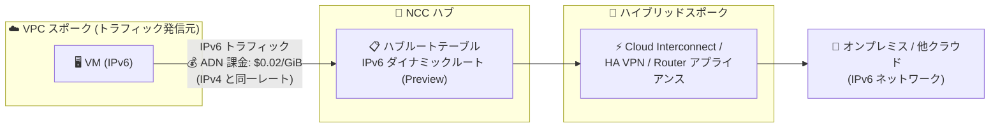

# Network Connectivity Center: IPv6 ダイナミックルートトラフィックへの ADN 課金適用

**リリース日**: 2026-11-10

**サービス**: Network Connectivity Center

**機能**: IPv6 ダイナミックルート (Preview) トラフィックへの Advanced Data Networking (ADN) 課金

**ステータス**: Fixed (料金に関する変更)

📊 [このアップデートのインフォグラフィックを見る](https://takech9203.github.io/google-cloud-news-summary/20261110-network-connectivity-center-ipv6-adn-pricing.html)

## 概要

Google Cloud は、Network Connectivity Center (NCC) において、VPC スポークからハイブリッドスポークへ送信される IPv6 ダイナミックルート (Preview) のトラフィックに対し、IPv4 トラフィックと同じレートで Advanced Data Networking (ADN) 課金を適用することを発表しました。これは「Fixed」として公開された料金・課金に関する変更であり、これまで課金対象外だった IPv6 トラフィックの取り扱いが IPv4 と統一されます。

ADN は、スポークからハブを経由して送信されるトラフィックに対して課金されるデータ処理料金です。NCC では 2025 年 1 月に VPC スポークとハイブリッドスポーク間のルート交換が GA となり、その際に VPC スポーク発でハイブリッドスポークを経由して出ていく IPv4 トラフィックに ADN が課金されることが明示されていました。今回の変更により、Preview 段階の IPv6 ダイナミックルート経由のトラフィックも同一の課金体系に組み込まれます。

NCC の VPC スポークとハイブリッドスポーク (Cloud Interconnect、Cloud VPN、Router アプライアンス) を組み合わせて IPv6 でオンプレミスや他クラウドと接続している、または接続を計画しているユーザーは、コスト見積もりにこの課金を反映する必要があります。

**アップデート前の課題**

- IPv6 ダイナミックルート (Preview) 経由で VPC スポークからハイブリッドスポークへ送信されるトラフィックは、IPv4 トラフィックと異なり ADN 課金の対象として明示されていなかった
- IPv4 と IPv6 で課金の扱いが異なるため、デュアルスタック構成でのコスト見積もりに不整合が生じる可能性があった

**アップデート後の改善**

- IPv6 ダイナミックルートトラフィックが IPv4 と同じレート ($0.02/GiB) で ADN 課金されるようになり、プロトコルによらず課金体系が統一された
- IPv4/IPv6 デュアルスタック構成でも単一の料金モデルでコストを予測できるようになった

## アーキテクチャ図

VPC スポーク内の VM から、NCC ハブが保持する IPv6 ダイナミックルートを経由してハイブリッドスポーク (オンプレミス等) へ送信されるトラフィックに、IPv4 と同じレートで ADN 課金が適用されます。課金はトラフィックを発信した VPC スポークのプロジェクトに計上されます。

## サービスアップデートの詳細

### 主要機能

1. **IPv6 ダイナミックルートトラフィックへの ADN 課金適用**
   - VPC スポークからハイブリッドスポークへ送信される IPv6 ダイナミックルート (Preview) のトラフィックが ADN 課金対象になる
   - レートは IPv4 トラフィックと同一 ($0.02/GiB)

2. **課金の帰属**
   - ADN 課金はトラフィックを発信したスポークのプロジェクトに計上される
   - 同一 VPC ネットワーク内のトラフィックには ADN は課金されない

3. **ハイブリッドスポーク発トラフィックの扱い**
   - ハイブリッドスポーク (Cloud Interconnect、Cloud VPN、Router アプライアンス) を発信元とするトラフィックの ADN 課金は現時点で免除 (waived) されている

### 背景: NCC の IPv6 ダイナミックルートサポート

VPC スポークは、ハイブリッドスポークがハブにエクスポートした IPv4 および IPv6 (Preview) のダイナミックルートをインポートできます。これにより、VPC スポーク内のリソースが IPv6 でオンプレミスや他クラウドのネットワークと通信できます。2026 年 8 月 31 日には、ハイブリッドスポーク向けの IPv6 ダイナミックルートのインポート/エクスポートフィルタ (`ALL_IPV6_RANGES` キーワードなど) も Preview で提供開始されています。

## 技術仕様

### 課金の適用条件

| 項目 | 詳細 |
|------|------|
| 対象トラフィック | VPC スポーク発、ハイブリッドスポーク宛の IPv6 ダイナミックルート (Preview) トラフィック |
| 課金レート | IPv4 トラフィックと同一 ($0.02/GiB) |
| 課金先 | トラフィックを発信したスポークのプロジェクト |
| 課金対象外 | 同一 VPC ネットワーク内のトラフィック、ハイブリッドスポーク発のトラフィック (現時点で免除) |
| 機能ステータス | IPv6 ダイナミックルート自体は Preview |

## メリット

### ビジネス面

- **課金体系の一貫性**: IPv4 と IPv6 でレートが統一され、デュアルスタック環境のコスト構造がシンプルになる
- **コスト予測の容易化**: IPv6 移行を計画する際も、既存の IPv4 トラフィックの実績値からコストを見積もれる

### 技術面

- **プロトコル中立な設計判断**: 課金差を理由に IPv4/IPv6 の選択を歪める必要がなく、技術要件に基づいてアドレスファミリーを選択できる
- **GA への布石**: Preview 機能に正式な課金体系が整備されることは、本番利用に向けた機能成熟の指標となる

## デメリット・制約事項

### 制限事項

- IPv6 ダイナミックルートのサポート自体は引き続き Preview であり、SLA の対象外
- ADN トラフィックは VPC 境界を越える大規模フロー (約 20 Kbps 超) のみが計上され、小規模フローは現在計上されない既知の問題がある (2023 年 11 月 16 日のリリースノートに記載)

### 考慮すべき点

- これまで IPv6 ダイナミックルート経由のトラフィックに課金が発生していなかった環境では、**今後の請求額が増加する**可能性があるため、Billing レポートでの確認を推奨
- ADN に加えて、スポーク時間課金 (ハイブリッドスポーク $0.075/時間、VPC スポーク $0.10/時間) やサイト間データ転送料金も別途発生する

## ユースケース

### ユースケース 1: IPv6 デュアルスタックのハイブリッド接続コスト見積もり

**シナリオ**: VPC スポークに接続されたワークロードが、Cloud Interconnect (ハイブリッドスポーク) 経由でオンプレミスの IPv6 ネットワークへ月間 5 TiB のデータを送信する。

**効果**: 5 TiB (5,120 GiB) × $0.02/GiB = **月額 $102.40** の ADN 課金が VPC スポークのプロジェクトに発生する。IPv4 で同量を送信する場合と同額のため、プロトコル移行によるコスト変動はない。

### ユースケース 2: IPv6 移行プロジェクトの予算策定

**シナリオ**: IPv4 から IPv6 への段階的移行を進める企業が、NCC 経由のハイブリッド通信コストを予算化する。

**効果**: IPv4/IPv6 で課金レートが同一のため、既存の IPv4 トラフィック実績をそのまま IPv6 移行後のコスト予測に転用でき、予算策定が簡素化される。

## 料金

NCC の主な料金体系は以下のとおりです (USD)。

| 項目 | 料金 |
|------|------|
| ハブ | 無料 |
| スポーク時間 (Cloud Interconnect / Cloud VPN / Router アプライアンススポーク) | $0.075/時間 |
| スポーク時間 (VPC / プロデューサー VPC スポーク) | $0.10/時間 |
| Advanced Data Networking (ADN) | $0.02/GiB (IPv4 / IPv6 共通) |

- ADN はスポークからハブを経由して送信されるすべてのトラフィックに適用され、発信元スポークのプロジェクトに課金される
- VPN スポーク 3 つと Cloud Interconnect スポーク 3 つまでは、スポーク時間課金が免除される
- ハイブリッドスポーク発のトラフィックの ADN 課金は現時点で免除されている

### 料金例

| 使用量 (VPC スポーク → ハイブリッドスポーク、IPv6) | 月額料金 (概算) |
|--------|-----------------|
| 1 TiB (1,024 GiB) | $20.48 |
| 5 TiB (5,120 GiB) | $102.40 |
| 10 TiB (10,240 GiB) | $204.80 |

詳細は [Network Connectivity Center の料金ページ](https://docs.cloud.google.com/network-connectivity/docs/network-connectivity-center/pricing) を参照してください。

## 関連サービス・機能

- **Cloud Interconnect**: ハイブリッドスポークとして NCC ハブに接続し、オンプレミスとの IPv6 (Preview) ダイナミックルート交換を実現する
- **Cloud VPN (HA VPN)**: IPv4/IPv6 (Preview) のサイト間・サイト-クラウド接続を提供するハイブリッドスポークの一種
- **Cloud Router**: BGP により IPv6 ダイナミックルートを学習・広報し、NCC ハブへのルートエクスポートを担う
- **Cloud Billing**: ADN 課金の内訳確認と予算アラートの設定に使用

## 参考リンク

- 📊 [インフォグラフィック](https://takech9203.github.io/google-cloud-news-summary/20261110-network-connectivity-center-ipv6-adn-pricing.html)
- [公式リリースノート](https://docs.cloud.google.com/release-notes#November_10_2026)
- [Network Connectivity Center リリースノート](https://docs.cloud.google.com/network-connectivity/docs/network-connectivity-center/release-notes)
- [VPC スポークの概要](https://docs.cloud.google.com/network-connectivity/docs/network-connectivity-center/concepts/vpc-spokes-overview)
- [VPC スポークとのダイナミックルート交換](https://docs.cloud.google.com/network-connectivity/docs/network-connectivity-center/concepts/dynamic-route-exchange-with-vpc-spokes)
- [料金ページ](https://docs.cloud.google.com/network-connectivity/docs/network-connectivity-center/pricing)

## まとめ

今回の変更により、NCC の VPC スポークからハイブリッドスポークへ送信される IPv6 ダイナミックルート (Preview) トラフィックが、IPv4 と同一レート ($0.02/GiB) の ADN 課金対象となりました。IPv6 で NCC のハイブリッド接続を利用中・計画中の場合は、トラフィック量を把握したうえでコスト見積もりと Billing レポートの確認を行うことを推奨します。

---

**タグ**: Network Connectivity Center, NCC, IPv6, Advanced Data Networking, ADN, 料金, ハイブリッド接続, VPC スポーク, Preview
