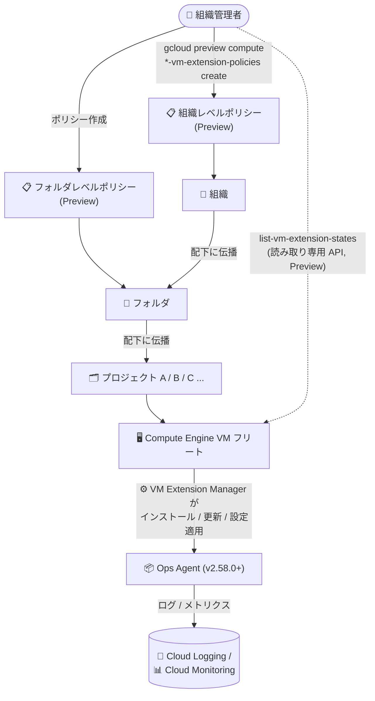

# Cloud Logging / Cloud Monitoring: Ops Agent 向け VM Extension Manager 拡張ポリシーがフォルダ / 組織レベルに対応 (Preview)

**リリース日**: 2026-11-10

**サービス**: Cloud Logging / Cloud Monitoring (Google Cloud Observability)

**機能**: VM Extension Manager 拡張ポリシーのフォルダ / 組織レベル対応と、拡張機能ステータス照会用の読み取り専用 API

**ステータス**: Preview (プレビュー)

📊 [このアップデートのインフォグラフィックを見る](https://takech9203.github.io/google-cloud-news-summary/20261110-ops-agent-vm-extension-manager-folder-org-policies-preview.html)

## 概要

Ops Agent 向けの VM Extension Manager 拡張ポリシー (extension policies) が、従来のプロジェクトレベルに加えて、フォルダレベルおよび組織レベルでも作成できるようになりました (Preview)。拡張ポリシーは、Ops Agent のゾーン単位 / グローバルのインストール、バージョンアップグレード、設定管理を宣言的に行う仕組みで、2026 年 8 月にプロジェクトレベルで GA になっています。今回のアップデートにより、フォルダや組織の配下にあるすべてのプロジェクト・VM に対して、1 つのポリシーで Ops Agent の導入と管理を強制できるようになりました。本アナウンスは Cloud Logging と Cloud Monitoring の両方の Release Notes に掲載されています。

あわせて、インストール済み VM 拡張機能の詳細とステータスを照会するための読み取り専用 API (list / get) が Preview として提供されました。各 VM に接続することなく、インストールされた拡張機能のアクティブなバージョン、適用状態 (enforcement state)、ヘルスステータス、適用元ポリシー (policyId) を確認できます。

多数のプロジェクトを運用する組織では、可観測性エージェントの導入標準をプロジェクトごとに個別設定する必要がありましたが、今回の対応により組織全体のガバナンスとして「全 VM に Ops Agent を導入する」といったベースラインを一元的に適用できるようになります。

**アップデート前の課題**

- 拡張ポリシーはプロジェクトレベルでのみ定義でき、多数のプロジェクトを持つ組織では、プロジェクトごとにポリシーを作成・維持する必要があった
- 組織全体やフォルダ単位で「Ops Agent 導入を必須とする」ようなベースラインを、VM Extension Manager の仕組みだけで強制することができなかった
- ポリシーによってインストールされた拡張機能の実行状態 (バージョン、設定、ヘルス) を確認するための標準的な API がなく、個々の VM に接続するなどの確認作業が必要だった

**アップデート後の改善**

- フォルダレベル / 組織レベルの拡張ポリシー (Preview) により、配下のすべてのプロジェクト・VM に対して Ops Agent のインストール、バージョン管理、設定管理を一元的に適用できるようになった
- 組織のセキュリティ / 可観測性ベースラインとして、プロジェクトに個別介入することなくフリート全体でエージェント構成を標準化できるようになった
- 読み取り専用の extension-state API (list / get、Preview) により、VM に接続せずに各拡張機能のアクティブバージョン、適用状態、ヘルスステータス、適用元ポリシー (policyId) を確認でき、予期しない拡張機能のインストールや障害のトラブルシューティングが容易になった

## アーキテクチャ図



組織 / フォルダレベルで定義した拡張ポリシーが配下のすべてのプロジェクトと VM に評価・適用され、VM Extension Manager が Ops Agent を管理する流れと、読み取り専用 API によるステータス照会を示しています。

## サービスアップデートの詳細

### 主要機能

1. **フォルダ / 組織レベルの拡張ポリシー (Preview)**
   - プロジェクトレベル (GA) に加えて、フォルダレベル・組織レベルでゾーンポリシー / グローバルポリシーを定義可能
   - フォルダレベルのポリシーはフォルダ配下のすべてのプロジェクトと VM、組織レベルのポリシーは組織配下のすべてのプロジェクトと VM に対して評価される
   - 想定ユースケース: フリート全体でのポリシー強制 (Ops Agent の必須展開)、組織のセキュリティベースライン適用、本番環境や事業部門単位での環境標準化

2. **ゾーン / グローバルのインストール、バージョン管理、設定管理**
   - 1 つ以上のゾーンの全 VM、グローバルの全 VM、ラベルで絞り込んだ VM サブセットへの Ops Agent インストールをフォルダ / 組織スコープで実行可能
   - 「常に最新バージョンへ自動更新」または「特定バージョンへのピン留め」をポリシーで宣言的に管理
   - カスタム設定 (YAML) をポリシーに添付して対象 VM 全体へ一括適用。エージェントの手動再起動は不要

3. **拡張機能の詳細 / ステータス照会用の読み取り専用 API (Preview)**
   - インスタンス単位の extension-state list / get メソッドで、インストール済み拡張機能のランタイムステータスを VM に接続せずに照会
   - 返却情報: 拡張機能名、アクティブなバージョン、適用状態 (例: `INSTALLED`)、ヘルスステータス (例: `RUNNING`)、適用元ポリシーの識別子 (policyId)
   - 複数ポリシーが同一 VM に適用された場合の「最終的に有効な構成」の確認や、予期しない拡張機能・障害のトラブルシューティングに利用

## 技術仕様

### リソース階層スコープの比較

| スコープ | 定義レベル | ポリシー評価 | ステータス |
|------|------|------|------|
| プロジェクトレベル | Google Cloud プロジェクト | 単一プロジェクト内の VM に対して評価 | GA |
| フォルダレベル | Google Cloud フォルダ | フォルダ配下のすべてのプロジェクトと VM に対して評価 | Preview |
| 組織レベル | Google Cloud 組織 | 組織配下のすべてのプロジェクトと VM に対して評価 | Preview |

### その他の仕様

| 項目 | 詳細 |
|------|------|
| 対象エージェント | Ops Agent 2.58.0 以降 (拡張ポリシーでインストールされたもののみ管理対象) |
| 管理対象外 | 他の手段でインストールされた Ops Agent、レガシーの Monitoring agent / Logging agent |
| 使用 API | Compute Engine API (VM Extension Manager が使用) |
| ポリシー管理の IAM ロール (プロジェクト) | `roles/compute.vmExtensionPolicyAdmin` |
| ポリシー管理の IAM ロール (フォルダ、Preview) | `roles/compute.folderVmExtensionPolicyAdmin` (`compute.folderVmExtensionPolicies.*` 権限を含む) |
| ステータス照会に必要な権限 | `compute.instances.listVmExtensionStates`、`compute.instances.getVmExtensionState` (`roles/compute.viewer` などに含まれる) |
| 設定ファイルの配置先 | Linux: `/etc/google-cloud-ops-agent/config.yaml`、Windows: `C:\Program Files\Google\Cloud Operations\Ops Agent\config\config.yaml` |

## 設定方法

### 前提条件

1. VM Extension Manager が使用する Compute Engine API を有効化する
2. フォルダ / 組織レベルのポリシー管理に必要な IAM ロール (フォルダの場合は `roles/compute.folderVmExtensionPolicyAdmin` など) を付与する
3. Ops Agent がログ / メトリクスを書き込めるよう、VM のサービスアカウントに `roles/logging.logWriter` と `roles/monitoring.metricWriter` を付与する

### 手順

#### ステップ 1: フォルダ / 組織レベルのゾーンポリシーを作成する

```bash
# フォルダレベルのゾーンポリシー
gcloud preview compute zone-vm-extension-policies create POLICY_NAME \
  --folder=folders/FOLDER_ID \
  --zone=ZONE \
  --extensions=ops-agent

# 組織レベルの場合は --folder を --organization=organizations/ORGANIZATION_ID に置き換える
```

プロジェクトレベル (GA) の `gcloud compute zone-vm-extension-policies create --project=PROJECT_ID` に対し、フォルダ / 組織レベルでは `gcloud preview` コマンドグループを使用し、`--folder` または `--organization` を指定します。`--version` を省略すると最新バージョンのインストールと自動更新が行われます。

#### ステップ 2: フォルダ / 組織レベルのグローバルポリシーを作成する (カスタム設定付き)

```bash
gcloud preview compute global-vm-extension-policies create POLICY_NAME \
  --organization=organizations/ORGANIZATION_ID \
  --extensions=ops-agent \
  --rollout-predefined-plan=slow_rollout \
  --config-from-file=ops-agent="OPS_AGENT_CONFIG_PATH"
```

`--config-from-file` で Ops Agent の YAML 設定ファイルを添付すると、対象 VM へ設定が一括適用されます。設定はポリシーと一緒に保存されるため、パスワードなどの機密情報は含めないでください。設定を変更する場合はファイル編集ではなく `gcloud preview compute global-vm-extension-policies update` を使用します (更新リクエストは完全置換として扱われます)。

#### ステップ 3: 読み取り専用 API で拡張機能のステータスを確認する

```bash
gcloud beta compute instances list-vm-extension-states INSTANCE_NAME \
  --zone=ZONE \
  --project=PROJECT_ID
```

出力例:

```
EXTENSION_NAME  ENFORCEMENT_STATE  HEALTH_STATUS
ops-agent       INSTALLED          RUNNING
```

各拡張機能の名前、適用状態、ヘルスステータスが返され、詳細には有効な設定や適用元ポリシー (policyId) が含まれます。

## メリット

### ビジネス面

- **組織全体のガバナンス強化**: 可観測性エージェントの導入を組織 / フォルダ単位のポリシーとして強制でき、コンプライアンスと監視カバレッジのベースラインを維持できる
- **運用コスト削減**: プロジェクトごとのポリシー作成・維持が不要になり、プロジェクト数が多い組織ほど管理工数を削減できる

### 技術面

- **宣言的なフリート管理の階層化**: 既存の Google Cloud リソース階層 (組織 → フォルダ → プロジェクト) に沿ってエージェント管理ポリシーを配置でき、環境 (本番 / 開発) や事業部門単位の標準化が容易
- **可視性の向上**: 読み取り専用 API により、VM に SSH 接続することなく拡張機能のバージョン・ヘルス・適用元ポリシーを確認でき、トラブルシューティングが迅速化

## デメリット・制約事項

### 制限事項

- フォルダ / 組織レベルのポリシーと読み取り専用 API はいずれも Preview であり、Pre-GA Offerings Terms が適用される (サポートが限定される可能性がある)
- VM Extension Manager が管理できるのは、拡張ポリシーによってインストールされた Ops Agent 2.58.0 以降のみ。他の手段でインストールされたエージェントやレガシーエージェントは管理・照会の対象外
- 拡張ポリシーに添付した設定はポリシーと一緒に保存されるため、機密情報 (パスワードなど) を設定に含めてはならない

### 考慮すべき点

- フォルダ / 組織レベルの操作には `gcloud preview` コマンドグループが必要で、プロジェクトレベル (GA) とコマンド体系が異なる
- 複数のポリシーが同一 VM に適用される場合、Ops Agent 拡張に対して有効になるポリシーは優先度に基づき 1 つのみ。階層をまたいだポリシー設計時は、extension-state API で最終的に有効な構成を確認するのが望ましい
- gcloud によるポリシー更新は完全置換のため、省略した任意項目はデフォルト値に戻る点に注意が必要

## ユースケース

### ユースケース 1: 組織全体での Ops Agent 必須化

**シナリオ**: 数百のプロジェクトを持つ企業が、監視・ログ収集のベースラインとして全 Compute Engine VM への Ops Agent 導入を義務付けたい。

**実装例**:
```bash
gcloud preview compute global-vm-extension-policies create org-ops-agent-baseline \
  --organization=organizations/123456789012 \
  --extensions=ops-agent \
  --rollout-predefined-plan=slow_rollout
```

**効果**: 組織配下のすべてのプロジェクトの VM (新規作成分を含む) に Ops Agent が自動導入され、プロジェクトチームの作業なしに監視カバレッジ 100% を維持できる。

### ユースケース 2: 本番フォルダ単位でのバージョン固定と標準設定の配布

**シナリオ**: 本番環境のプロジェクト群を集約したフォルダに対して、検証済みの Ops Agent バージョンと標準のログ収集設定 (config.yaml) を一括適用したい。

**効果**: フォルダレベルのポリシーでバージョンピン留めとカスタム設定を宣言するだけで、本番プロジェクト全体のエージェント構成が統一され、意図しないバージョン更新による障害リスクを低減できる。

### ユースケース 3: API によるフリートのエージェント健全性監査

**シナリオ**: 運用チームが、ポリシーで導入した Ops Agent が各 VM で正常稼働しているか、どのポリシーが有効になっているかを定期監査したい。

**効果**: `list-vm-extension-states` を自動化スクリプトに組み込むことで、VM に接続せずに全フリートのエージェントのバージョン・ヘルス・適用元ポリシーを収集し、異常 (停止中のエージェント、予期しないポリシー適用) を早期検出できる。

## 料金

VM Extension Manager の拡張ポリシー機能自体に関する個別の料金情報は、今回確認した公式ドキュメントには記載されていません。なお、Ops Agent が収集するログとメトリクスの取り込みには、通常どおり Cloud Logging / Cloud Monitoring の料金が適用されます。詳細は [Google Cloud Observability の料金ページ](https://cloud.google.com/stackdriver/pricing) を参照してください。

## 関連サービス・機能

- **Compute Engine (VM Extension Manager)**: 拡張ポリシーの基盤サービス。2026-11-09 には Compute Engine 側でも組織 / フォルダレベルの VM 拡張ポリシーが Preview として発表されており、今回のアップデートはその Ops Agent への適用にあたる
- **Cloud Logging / Cloud Monitoring**: Ops Agent が収集したログとメトリクスの送信先。エージェントの導入標準化により監視カバレッジが向上する
- **IAM (Resource Hierarchy)**: フォルダ / 組織レベルのポリシー管理には階層に応じた専用ロール (例: `roles/compute.folderVmExtensionPolicyAdmin`) が必要
- **VM Manager (OS Config)**: 従来エージェント導入の自動化に使われてきたエージェントポリシーの仕組み。VM Extension Manager はゲストエージェントのプラグインとして拡張機能を管理する後継的アプローチ

## 参考リンク

- 📊 [インフォグラフィック](https://takech9203.github.io/google-cloud-news-summary/20261110-ops-agent-vm-extension-manager-folder-org-policies-preview.html)
- [公式リリースノート (2026-11-10)](https://docs.cloud.google.com/release-notes#November_10_2026)
- [VM Extension Manager policies for the Ops Agent](https://docs.cloud.google.com/monitoring/agent/ops-agent/agent-vmem-policies)
- [Install the Ops Agent by using extension policies](https://docs.cloud.google.com/monitoring/agent/ops-agent/install-agent-vmem-policies)
- [View extension details and status (Ops Agent)](https://docs.cloud.google.com/monitoring/agent/ops-agent/view-agent-vmem-extension-state)
- [View VM extension details and status (Compute Engine)](https://docs.cloud.google.com/compute/docs/vm-extensions/view-vm-extension-details)
- [料金ページ (Google Cloud Observability)](https://cloud.google.com/stackdriver/pricing)

## まとめ

Ops Agent の VM Extension Manager 拡張ポリシーがフォルダ / 組織レベルに対応したことで、可観測性エージェントの導入・バージョン・設定の標準化を、組織のリソース階層全体に対して宣言的に強制できるようになりました。あわせて提供された読み取り専用の extension-state API により、フリート全体のエージェント状態の可視化も容易になります。多数のプロジェクトを運用する組織は、Preview の制約を理解した上で、組織 / フォルダレベルのベースラインポリシーの検証を開始することをおすすめします。

---

**タグ**: #CloudLogging #CloudMonitoring #OpsAgent #VMExtensionManager #ComputeEngine #Preview #Observability #FleetManagement
