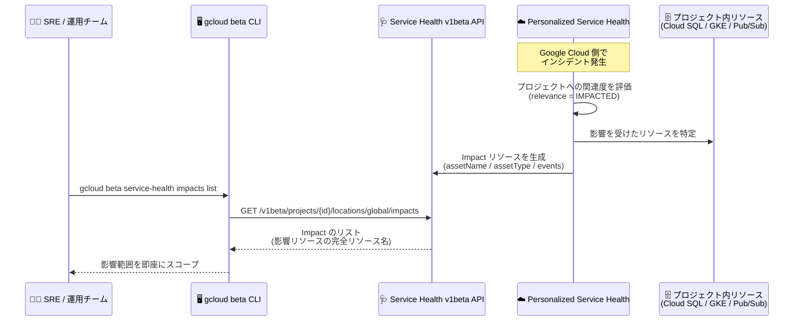

# Personalized Service Health: リソースレベル影響の特定 (Preview)

**リリース日**: 2026-11-10

**サービス**: Personalized Service Health

**機能**: リソースレベル影響 (Resource-level impact) のサポート

**ステータス**: Preview

📊 [このアップデートのインフォグラフィックを見る](https://takech9203.github.io/google-cloud-news-summary/20261110-service-health-resource-level-impact-preview.html)

## 概要

Personalized Service Health が、対応プロダクトを対象に **リソースレベル影響 (resource-level impact)** を Preview でサポートしました。Service Health v1beta API (`projects.locations.impacts`) と gcloud beta CLI (`gcloud beta service-health impacts`) を通じて利用できます。

これまで Personalized Service Health は、Google Cloud 側の障害 (インシデント) がプロジェクトに影響しているかどうかを「関連度 (Relevance)」 (Impacted / Related / Partially Related など) というプロジェクト単位の粒度で提供してきました。今回のアップデートにより、イベントの関連度が `IMPACTED` (影響が確認済み) の場合に、**プロジェクト内のどのリソースが影響を受けているか** (例: 特定の Cloud SQL インスタンス、GKE クラスタ、Pub/Sub トピック) を、完全リソース名 (`assetName`) と Cloud Asset Inventory のリソースタイプ (`assetType`) で特定できるようになりました。

インシデント対応を行う SRE・運用チームにとって、「Google 側の障害が自社のどのワークロードに波及しているか」を即座にスコープできるため、影響調査の初動時間を大幅に短縮できるアップデートです。

**アップデート前の課題**

- 以前は、Service Health のイベントは「プロジェクトが影響を受けている (`IMPACTED`)」というプロジェクト単位・プロダクト単位・ロケーション単位の情報までしか提供されず、どの個別リソースが影響を受けているかは特定できなかった
- 障害発生時、影響を受けたリソースの特定には、Cloud Monitoring のメトリクスやアプリケーションのエラーログを手動で突き合わせる調査作業が必要だった
- 大規模プロジェクトでは、同一プロダクト (例: Cloud SQL) の多数のインスタンスのうちどれが影響範囲かを切り分けるのに時間がかかっていた

**アップデート後の改善**

- イベントの関連度が `IMPACTED` の場合、影響を受けた個別リソースが `Impact` リソースとして API から取得可能になった (`assetName` で完全リソース名、`assetType` でリソースタイプを返却)
- `gcloud beta service-health impacts list` / `describe` コマンドで、CLI からも影響リソースを一覧・詳細取得できるようになった
- `--filter` フラグにより、特定イベントに紐づくリソースや特定リソースタイプ (例: `sqladmin.googleapis.com/Instance`) のみに絞り込んだクエリが可能になった

## アーキテクチャ図



Google 側のインシデント発生時に Personalized Service Health が影響リソースを `Impact` リソースとして生成し、運用チームが v1beta API または gcloud beta CLI でプロジェクト内の影響リソースを即座に特定するフローです。

## サービスアップデートの詳細

### 主要機能

1. **Impact リソースによる影響リソースの表現**
   - 影響を受けた各リソースは `projects/{PROJECT_ID}/locations/global/impacts/{IMPACT_ID}` という `Impact` リソースで表現される
   - `events`: 紐づくプロジェクトレベルの Service Health イベント名 (1 つ以上)
   - `asset.assetName`: 影響リソースの完全リソース名 (例: `//cloudsql.googleapis.com/projects/123456789/instances/my-db-instance`)
   - `asset.assetType`: Cloud Asset Inventory のリソースタイプ (例: `sqladmin.googleapis.com/Instance`)
   - `description`: リソースへの影響に関する追加コンテキスト (利用可能な場合)
   - `createTime` / `updateTime`: 影響レコードの作成・更新時刻

2. **v1beta API のエンドポイント**
   - `impacts.list`: プロジェクト内の影響リソースを一覧取得 (`GET /v1beta/projects/{PROJECT_ID}/locations/global/impacts`)
   - `impacts.get`: 特定の `IMPACT_ID` の詳細を取得
   - `filter` パラメータでイベント・リソースタイプ・更新時刻による絞り込みが可能

3. **gcloud beta CLI サポート**
   - `gcloud beta service-health impacts list --project=PROJECT_ID --location=global`
   - `gcloud beta service-health impacts describe IMPACT_ID --project=PROJECT_ID --location=global`
   - 組織レベルでは `gcloud beta service-health organization-impacts list` で、影響を受けたプロジェクト (コンテナアセット) を組織横断で集約可能

4. **プロジェクト影響と組織影響の使い分け**
   - `projects.locations.impacts`: 単一プロジェクトスコープ。イベントの関連度が `IMPACTED` で確認済み、かつプロダクトが対応している場合に非コンテナリソース (個別リソース) を返す
   - `organizations.locations.organizationImpacts`: 組織横断で集約し、非ゼロの関連度 (`PARTIALLY_RELATED` / `RELATED` / `IMPACTED`) を持つコンテナアセット (プロジェクト) を返す

## 技術仕様

### 対応プロダクトとリソースタイプ (Preview)

| Google Cloud プロダクト | リソースタイプ (`asset.assetType`) | 完全リソース名の形式 (`asset.assetName`) |
|------|------|------|
| Cloud SQL | `sqladmin.googleapis.com/Instance` | `//cloudsql.googleapis.com/projects/PROJECT_NUMBER/instances/INSTANCE_ID` |
| GKE | `container.googleapis.com/Cluster`, `container.googleapis.com/NodePool` | `//container.googleapis.com/projects/PROJECT_NUMBER/locations/LOCATION/clusters/CLUSTER_NAME` など |
| Pub/Sub | `pubsub.googleapis.com/Topic`, `pubsub.googleapis.com/Subscription` | `//pubsub.googleapis.com/projects/PROJECT_NUMBER/topics/TOPIC_NAME` など |

### Impact リソースのレスポンス例

```json
{
  "impacts": [
    {
      "name": "projects/my-project/locations/global/impacts/f9a8b7c6-d5e4-4f3a-9b2c-1d0e9f8a7b6c",
      "events": [
        "projects/my-project/locations/global/events/1234567890abcdef"
      ],
      "asset": {
        "assetName": "//cloudsql.googleapis.com/projects/9876543210/instances/prod-orders-db",
        "assetType": "sqladmin.googleapis.com/Instance"
      },
      "description": "Instance experienced elevated connection errors during regional network disruption.",
      "createTime": "2026-10-08T14:12:05.120450Z",
      "updateTime": "2026-10-08T14:12:05.120450Z"
    }
  ]
}
```

### 必要な IAM 権限

| 項目 | 詳細 |
|------|------|
| 必要な権限 | `servicehealth.impacts.list`, `servicehealth.impacts.get` |
| 事前定義ロール | Personalized Service Health Viewer (`roles/servicehealth.viewer`)。基本ロール (`roles/viewer` / `roles/editor` / `roles/owner`) にも含まれる |
| アクセス制限 | イベントは見せたいがリソース名は見せたくない場合、`servicehealth.impacts.*` を除いたカスタムロールを作成する |

## 設定方法

### 前提条件

1. プロジェクトで Service Health API (`servicehealth.googleapis.com`) を **イベント開始の 24 時間以上前に** 有効化しておく (イベント開始後に有効化した場合、過去 90 日分のプロジェクトレベルイベントはバックフィルされるが、リソースレベル影響はバックフィルされない)
2. 操作するプリンシパルに `servicehealth.impacts.list` 権限 (`roles/servicehealth.viewer` に含まれる) が付与されていること

### 手順

#### ステップ 1: Service Health API の有効化と権限付与

```bash
# Service Health API を有効化
gcloud services enable servicehealth.googleapis.com --project=PROJECT_ID

# Service Health Viewer ロールを付与
gcloud projects add-iam-policy-binding PROJECT_ID \
  --member="user:USER_EMAIL" \
  --role="roles/servicehealth.viewer"
```

#### ステップ 2: 影響リソースの一覧取得

```bash
# プロジェクト内の影響リソースを一覧取得
gcloud beta service-health impacts list \
  --project=PROJECT_ID \
  --location=global

# 特定イベントに紐づく影響リソースのみに絞り込み
gcloud beta service-health impacts list \
  --project=PROJECT_ID \
  --location=global \
  --filter="events:projects/PROJECT_ID/locations/global/events/EVENT_ID"
```

REST API を直接呼び出す場合は次のとおりです。

```bash
curl -X GET \
  -H "Authorization: Bearer $(gcloud auth print-access-token)" \
  -H "Content-Type: application/json; charset=utf-8" \
  "https://servicehealth.googleapis.com/v1beta/projects/PROJECT_ID/locations/global/impacts"
```

#### ステップ 3: 特定の影響レコードの詳細取得

```bash
gcloud beta service-health impacts describe IMPACT_ID \
  --project=PROJECT_ID \
  --location=global
```

## メリット

### ビジネス面

- **インシデント対応の初動短縮 (MTTR 改善)**: Google 側障害の影響範囲 (どの DB、どのクラスタか) を即座に特定でき、影響調査から復旧アクションへの移行が速くなる
- **正確なステークホルダー報告**: 影響を受けたリソースを具体的に示せるため、社内外への影響報告の精度が向上する

### 技術面

- **自動化との親和性**: API/CLI で影響リソースの完全リソース名が取得できるため、インシデント対応の Runbook 自動化 (フェイルオーバー、トラフィック切り替えなど) に組み込める
- **Cloud Asset Inventory との整合性**: `assetType` が Cloud Asset Inventory のリソースタイプと一致しており、既存の資産管理・CMDB との突き合わせが容易
- **柔軟なフィルタリング**: イベント、リソースタイプ、更新時刻によるフィルタで必要な影響情報だけを抽出できる

## デメリット・制約事項

### 制限事項

- **Preview 段階**: Pre-GA Offerings Terms の対象であり、サポートが限定される可能性がある。v1beta API と gcloud beta CLI でのみ利用可能
- **対応プロダクトが限定的**: 現時点でリソースレベル影響に対応するのは Cloud SQL、GKE、Pub/Sub の 3 プロダクト
- **API の事前有効化が必須**: イベント開始の 24 時間以上前に Service Health API を有効化していないと Impact レコードを受け取れない (リソースレベル影響は遡及取得不可)
- **空リストになるケース**: 対応外プロダクトの障害や、個別リソースに紐づかないコントロールプレーン/リージョンレベルの障害では、イベントは `relevance: IMPACTED` で表示されるが `impacts.list` は空リストを返す

### 考慮すべき点

- `servicehealth.impacts.*` 権限を持つプリンシパルはプロジェクト全体の影響リソース名 (`assetName`) を閲覧できるため、リソース名を秘匿したい場合は `impacts` 権限を除いたカスタムロールの設計が必要
- Impact レコードはインシデントのライフサイクル中イベントに関連付けられたままになるため、インシデント全体の状態 (`ACTIVE` / `COMPLETED`) はリンクされた Event リソース側で追跡する必要がある

## ユースケース

### ユースケース 1: インシデント発生時の影響スコープの即時特定

**シナリオ**: リージョナルなネットワーク障害のアラートを受けた SRE チームが、本番プロジェクト内の多数の Cloud SQL インスタンスのうち、どれが実際に影響を受けているかを特定したい。

**実装例**:
```bash
# Cloud SQL インスタンスに限定して影響リソースを取得
gcloud beta service-health impacts list \
  --project=prod-project \
  --location=global \
  --filter='asset.assetType="sqladmin.googleapis.com/Instance"'
```

**効果**: メトリクスやログの手動調査なしに影響インスタンスを特定し、レプリカへのフェイルオーバーなどの対処を影響範囲に限定して迅速に実施できる。

### ユースケース 2: インシデント対応の自動化パイプラインへの組み込み

**シナリオ**: Service Health のログベースアラート (Cloud Logging 経由) をトリガーに、影響リソースを自動取得して対応チケットに添付し、GKE クラスタが含まれる場合は代替リージョンへのトラフィック切り替え Runbook を起動したい。

**効果**: `assetName` / `assetType` が構造化データとして取得できるため、人手を介さない影響判定と自動対処 (トラフィック制御、通知の出し分け) が実現できる。

### ユースケース 3: 組織レベルでの影響プロジェクトの横断把握

**シナリオ**: 組織の中央運用チームが、インシデントの影響を受けている可能性のあるプロジェクトを組織横断で把握し、各プロジェクトチームに連絡したい。

**実装例**:
```bash
gcloud beta service-health organization-impacts list \
  --organization=ORGANIZATION_ID \
  --location=global
```

**効果**: 組織レベルでは非ゼロの関連度を持つプロジェクトが集約されるため、影響範囲の全体像を一度の操作で把握できる。

## 料金

Personalized Service Health のリソースレベル影響機能自体に関する個別の料金情報は、今回のリリースノートおよび参照ドキュメントには記載されていません。利用にはプロジェクトで課金が有効になっている必要があります。詳細は [Personalized Service Health のドキュメント](https://docs.cloud.google.com/service-health/docs/overview)を参照してください。

## 利用可能リージョン

Impact リソースのロケーションは `global` です (`projects/{PROJECT_ID}/locations/global/impacts/{IMPACT_ID}`)。プロダクト・ロケーションごとの対応状況は[対応プロダクトとロケーション](https://docs.cloud.google.com/service-health/docs/supported-products-locations#resource-level-impact)を参照してください。

## 関連サービス・機能

- **Cloud Asset Inventory**: `Impact` の `assetType` は Cloud Asset Inventory のリソースタイプ体系を使用しており、資産管理との突き合わせが可能
- **Cloud Logging / Cloud Monitoring**: Service Health イベントはログベースのアラートポリシーで通知可能 (アラートはイベントのリビジョン・状態変化に適用され、個別のリソース影響には適用されない)
- **Cloud SQL / GKE / Pub/Sub**: 現時点でリソースレベル影響に対応する 3 プロダクト
- **Personalized Service Health リモート MCP サーバー**: 自然言語プロンプトでインシデント情報の取得・監査・デバッグ自動化が可能 (2026 年 8 月リリース)。リソースレベル影響と組み合わせた AI 主導のインシデント対応が見込める

## 参考リンク

- 📊 [インフォグラフィック](https://takech9203.github.io/google-cloud-news-summary/20261110-service-health-resource-level-impact-preview.html)
- [公式リリースノート](https://docs.cloud.google.com/release-notes#November_10_2026)
- [Impacted resources (概念ドキュメント)](https://docs.cloud.google.com/service-health/docs/concepts#impacted-resources)
- [List impacted resources in a project](https://docs.cloud.google.com/service-health/docs/project-events#list-impacted-resources)
- [Products supporting resource-level impact (Preview)](https://docs.cloud.google.com/service-health/docs/supported-products-locations#resource-level-impact)
- [Impact リソース (v1beta API リファレンス)](https://docs.cloud.google.com/service-health/docs/reference/rest/v1beta/projects.locations.impacts)
- [gcloud beta service-health impacts list](https://docs.cloud.google.com/sdk/gcloud/reference/beta/service-health/impacts/list)
- [アクセス管理 (影響リソース詳細へのアクセス制御)](https://docs.cloud.google.com/service-health/docs/manage-access)

## まとめ

Personalized Service Health のリソースレベル影響 (Preview) により、Google Cloud 側の障害が「どのプロジェクトか」だけでなく「どのリソースか」まで API/CLI で特定できるようになり、インシデント対応の初動が大きく変わるアップデートです。リソースレベル影響は事後のバックフィルが行われないため、まずは本番プロジェクトで Service Health API を有効化しておくことを強く推奨します。対応プロダクトは現時点で Cloud SQL・GKE・Pub/Sub の 3 つですが、今後の拡大を見据えて Runbook 自動化への組み込みを検討する価値があります。

---

**タグ**: Service Health, Personalized Service Health, Observability, Incident Response, SRE, Preview, v1beta API, gcloud, Cloud SQL, GKE, Pub/Sub
