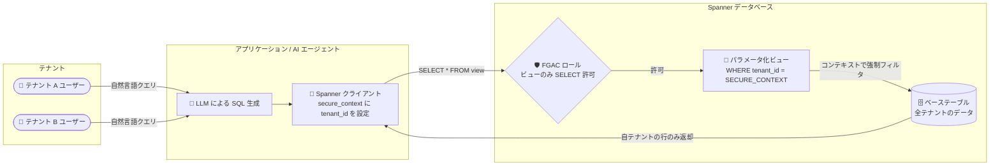

# Spanner: パラメータ化ビュー (Parameterized Views) が GA に

**リリース日**: 2026-11-10

**サービス**: Spanner

**機能**: パラメータ化ビュー (Parameterized Views)

**ステータス**: GA (一般提供)

📊 [このアップデートのインフォグラフィックを見る](https://takech9203.github.io/google-cloud-news-summary/20261110-spanner-parameterized-views-ga.html)

## 概要

Spanner のパラメータ化ビュー (Parameterized Views) が一般提供 (GA) になりました。パラメータ化ビューは、クエリと一緒に渡されるセッションコンテキストパラメータ (ユーザー ID やテナント ID など) に基づいて、データを動的にフィルタリングできる機能です。従来のデータベースビューを拡張し、ビュー定義の中にクエリ実行時のコンテキストパラメータを直接注入できます。

この機能の中核となるのが `SECURE_CONTEXT()` 関数です。アプリケーションはクエリリクエストのセキュアコンテキストにパラメータを設定し、ビューはこの関数を通じてパラメータ値を参照してフィルタリングを行います。コンテキストはクエリ実行時に Spanner がアクセスしますが、クエリ本文やアプリケーションユーザーからは読み取り・改変ができないため、アプリケーションレベルのコンテキストを安全にデータベースへ受け渡せます。

主な対象ユーザーは、マルチテナント SaaS アプリケーションの開発者と、AI エージェントや LLM アプリケーションを構築する開発者です。特に、自然言語から生成された SQL クエリ (信頼できないクエリ) がテナント境界を越えてデータへアクセスすることを、データベース層で強制的に防げる点が大きな価値です。

**アップデート前の課題**

- テナント分離やユーザー単位のデータフィルタリングは、アプリケーション層で WHERE 句を付与して実装する必要があり、生成 SQL やアドホッククエリでフィルタを回避されるリスクがあった
- LLM が生成する SQL クエリは範囲が広くなりがちで、善意のユーザーのクエリでも他テナントの機密データが露出する可能性があった
- IAM に存在しない一時的な認証情報 (アプリケーション独自のユーザー ID やテナント ID) に基づいて、データベース層でアクセス制御を行う標準的な手段がなかった

**アップデート後の改善**

- GA となり、本番ワークロードで `SECURE_CONTEXT()` を使ったパラメータ化ビューを正式に利用できるようになった
- クエリリクエストのセキュアコンテキストでユーザー ID・テナント ID を渡すだけで、ユーザーがどのようにクエリを記述しても返却行がデータベース層で強制的に制限されるようになった
- 細かい粒度のアクセス制御 (FGAC) と定義者権限ビュー (definer's rights view) を組み合わせることで、ベーステーブルへの直接アクセスを遮断し、ビュー経由のみのアクセスを強制できるようになった
- C#、Go、Java、Python などのクライアントライブラリからセキュアコンテキストを設定してクエリを実行できる

## アーキテクチャ図



アプリケーションがセキュアコンテキストにテナント ID を設定してパラメータ化ビューにクエリすると、Spanner がデータベース層でフィルタを強制し、他テナントの行は返却されません。FGAC によりベーステーブルへの直接アクセスも遮断できます。

## サービスアップデートの詳細

### 主要機能

1. **`SECURE_CONTEXT()` 関数によるコンテキスト参照**
   - ビュー定義内で、アプリケーションがクエリリクエストに付与したセキュアパラメータを参照する SQL インターフェース
   - クエリ本文やアプリケーションユーザーはコンテキスト値を読み取り・改変できない
   - 例: `CREATE VIEW MyUserData SQL SECURITY DEFINER AS (SELECT * FROM AllUserData WHERE UserID = CAST(SECURE_CONTEXT('user_id'), INT64));`

2. **定義者権限ビュー (SQL SECURITY DEFINER) との統合**
   - パラメータ化ビューは定義者権限ビューのセキュリティモデルを必須とする
   - ビュー利用者にベーステーブルの権限を与えることなく、フィルタ済みの結果のみを公開できる

3. **FGAC (細かい粒度のアクセス制御) との組み合わせ**
   - データベースロールを作成し、ビューに対する SELECT 権限のみを付与するパターンが推奨されている
   - `public` システムロールにベーステーブルの権限を付与しないことで、ビュー経由のアクセスを強制
   - デフォルトでは、`spanner_secure_context_reader` ロールを持たないデータベースロールがアドホッククエリで `SECURE_CONTEXT()` を直接参照するとエラーになり、パラメータ値の覗き見を防止

4. **クライアントライブラリ対応**
   - C#、Go、Java、Python などのクライアントライブラリで、リクエストオプション (ClientContext / secure_context) にパラメータを設定可能

## 技術仕様

### パラメータ化ビューの動作フロー

| ステップ | 内容 |
|------|------|
| 1. コンテキスト設定 | アプリケーションがクエリリクエストのセキュアコンテキストにユーザー ID・ロールなどを設定 |
| 2. クエリ実行 | 定義者権限ビューに対して標準の SELECT クエリを実行 |
| 3. フィルタ適用 | ビューが WHERE 句内の `SECURE_CONTEXT()` でコンテキスト値に基づき行をフィルタ |
| 4. 結果返却 | Spanner はフィルタに一致した行のみを返却 |

### `SECURE_CONTEXT()` 関数の仕様

| 項目 | 詳細 |
|------|------|
| 引数 | 文字列リテラルのみ |
| 戻り値 | 文字列 (数値比較には `CAST` が必要) |
| 利用可能箇所 | ビュー定義内 (ベストプラクティスは WHERE 句でテーブル・インデックスの先頭キー列をフィルタ) |
| 直接参照の制限 | アドホッククエリでの直接呼び出しは `spanner_secure_context_reader` ロールが必要 |

### クエリ実行例 (Python)

```python
def query_with_user_id(database, user_id: str):
    """セキュアコンテキストパラメータを使ってパラメータ化ビューをクエリする"""
    with database.snapshot() as snapshot:
        results = snapshot.execute_sql(
            "SELECT * FROM MyUserData",
            request_options={
                "client_context": {
                    "secure_context": {"user_id": user_id}
                }
            },
        )
        for row in results:
            print(f"UserID: {row[0]}, UserName: {row[1]}")
```

## 設定方法

### 前提条件

1. Spanner インスタンスとデータベースが作成済みであること
2. ビュー経由のみのアクセスを強制する場合は、FGAC (細かい粒度のアクセス制御) を有効化すること

### 手順

#### ステップ 1: パラメータ化ビューの作成

```sql
CREATE VIEW secure_checked_items
SQL SECURITY DEFINER AS (
  SELECT bag_id, item_timestamp, location
  FROM checked_items t
  WHERE customer_id = CAST(SECURE_CONTEXT('app_end_userid'), INT64)
);
```

`SQL SECURITY DEFINER` (定義者権限) でビューを作成し、WHERE 句で `SECURE_CONTEXT()` の値によるフィルタを定義します。

#### ステップ 2: データベースロールの作成と権限付与

```sql
-- アプリケーションユーザー用のロールを作成
CREATE ROLE pv_user;

-- ビューに対する SELECT 権限のみをロールに付与
GRANT SELECT ON VIEW secure_checked_items TO ROLE pv_user;
```

ベーステーブルへの権限は付与しないことで、ロール経由の直接アクセスは permission denied になります。

#### ステップ 3: アプリケーションからセキュアコンテキスト付きでクエリ

```java
RequestOptions.ClientContext clientContext =
    RequestOptions.ClientContext.newBuilder()
        .putSecureContext("app_end_userid",
            Value.newBuilder().setStringValue(userId).build())
        .build();
try (ResultSet resultSet =
    dbClient.singleUse().executeQuery(
        Statement.of("SELECT * FROM secure_checked_items"),
        Options.clientContext(clientContext))) {
  // 自ユーザーの行のみが返却される
}
```

クライアントライブラリのリクエストオプションでセキュアコンテキストを設定し、ビューに対して標準の SELECT を実行します。

## メリット

### ビジネス面

- **マルチテナント SaaS の安全性向上**: テナント分離をデータベース層で強制でき、アプリケーションのバグや生成 SQL による越境アクセスのリスクを低減できる
- **AI エージェント / LLM アプリケーションの安全な展開**: ユーザーがどのような自然言語クエリ (悪意あるプロンプトを含む) を投げても、返却される行の範囲を個々のユーザーに制限できる

### 技術面

- **アプリケーションコードの簡素化**: WHERE 句の付与をアプリケーション層で管理する必要がなくなり、フィルタロジックをビュー定義に集約できる
- **IAM 外のアイデンティティに対応**: IAM に存在しないアプリケーション独自のユーザー ID・テナント ID や、エンドユーザーに返すべきでない非公開の値に基づくフィルタリングが可能
- **パフォーマンスの最適化**: `SECURE_CONTEXT()` をテーブル・インデックスの先頭キー列の WHERE 句フィルタとして使うと、Spanner がフィルタロジックをストレージ層へ効率的にプッシュダウンする

## デメリット・制約事項

### 制限事項

- `SECURE_CONTEXT()` の引数は文字列リテラルのみ、戻り値は文字列 (数値などとの比較には `CAST` が必要)
- 生成列 (generated columns)、列のデフォルト値式、ユーザー定義関数 (UDF) の内部では `SECURE_CONTEXT()` を使用できない
- セキュリティバリアは含まれない: フィルタは結果返却前に適用されるが、クエリの内部処理中にアクセスされるデータまでは制限されない可能性がある

### 考慮すべき点

- パラメータ化ビューは定義者権限ビュー (SQL SECURITY DEFINER) が必須であり、公開する列・行の設計に注意が必要
- 実効性のあるアクセス制御には FGAC との併用が推奨される (ビューのみに SELECT を付与し、ベーステーブルの権限を遮断する)
- 複数ロールなど構造化されたコンテキストを渡す場合は、JSON 文字列として 1 つのパラメータにシリアライズし、ビュー内で JSON 関数で抽出するのが推奨パターン
- LLM に信頼できないユーザー入力からクエリを生成させる場合は、プロンプトインジェクション対策として Model Armor の併用が推奨されている

## ユースケース

### ユースケース 1: マルチテナント SaaS でのテナントデータ分離

**シナリオ**: 複数テナントのデータを同一テーブルに格納している SaaS アプリケーションで、テナントごとのデータ分離をデータベース層で強制したい。

**実装例**:
```sql
CREATE VIEW tenant_orders
SQL SECURITY DEFINER AS (
  SELECT order_id, order_date, amount
  FROM orders
  WHERE tenant_id = SECURE_CONTEXT('tenant_id')
);

CREATE ROLE tenant_app;
GRANT SELECT ON VIEW tenant_orders TO ROLE tenant_app;
```

**効果**: アプリケーションがリクエストごとにテナント ID をセキュアコンテキストで渡すだけで、クエリの書き方に関係なく自テナントの行のみが返却され、越境アクセスを防げる。

### ユースケース 2: AI エージェント / LLM アプリケーションのクエリ制約

**シナリオ**: 自然言語でデータベースに質問できる AI エージェントを提供するが、LLM が生成する SQL が広範囲のデータへアクセスするリスクを抑えたい。

**効果**: エージェントが生成した SQL はパラメータ化ビュー経由でのみ実行され、悪意あるプロンプトや範囲の広い生成クエリであっても、返却されるのはセキュアコンテキストで指定されたユーザー・テナントの行に限定される。

### ユースケース 3: 一時的・非公開な認証情報によるフィルタリング

**シナリオ**: IAM に存在しないアプリケーション独自のエフェメラルなユーザー ID や、エンドユーザーに開示すべきでない内部値に基づいてデータアクセスを制御したい。

**効果**: セキュアコンテキストはクエリやユーザーから読み取れないため、非公開の値をフィルタ条件として安全に利用できる。

## 料金

パラメータ化ビューは Spanner の機能として提供され、この機能自体に対する追加料金は Release Notes およびドキュメントに記載されていません。Spanner の通常のコンピュート容量・ストレージ・ネットワークの料金が適用されます。詳細は料金ページを参照してください。

- [Spanner の料金](https://cloud.google.com/spanner/pricing)

## 利用可能リージョン

リージョン固有の制限は Release Notes およびドキュメントに記載されていません。Spanner が利用可能なすべての構成で使用できると考えられますが、最新情報は公式ドキュメントを確認してください。

## 関連サービス・機能

- **細かい粒度のアクセス制御 (FGAC)**: データベースロールにビューのみの SELECT 権限を付与し、ベーステーブルへの直接アクセスを遮断する推奨パターンの中核
- **定義者権限ビュー (Definer's Rights Views)**: パラメータ化ビューが必須とするセキュリティモデル。ビュー作成者の権限でクエリが実行される
- **Model Armor**: LLM で信頼できない入力からクエリを生成する場合の、プロンプトインジェクション・ジェイルブレイク対策
- **Spanner JSON / JSONB 関数**: 複数ロールなど構造化コンテキストを JSON で渡し、ビュー内で抽出する際に使用

## 参考リンク

- 📊 [インフォグラフィック](https://takech9203.github.io/google-cloud-news-summary/20261110-spanner-parameterized-views-ga.html)
- [公式リリースノート](https://docs.cloud.google.com/release-notes#November_10_2026)
- [Parameterized views overview](https://docs.cloud.google.com/spanner/docs/parameterized-views)
- [Create a parameterized view](https://docs.cloud.google.com/spanner/docs/create-manage-views#create-parameterized-view)
- [Use parameterized views](https://docs.cloud.google.com/spanner/docs/use-parameterized-views)
- [Fine-grained access control](https://docs.cloud.google.com/spanner/docs/fgac-about)
- [料金ページ](https://cloud.google.com/spanner/pricing)

## まとめ

Spanner のパラメータ化ビューが GA となり、セッションコンテキストに基づく行フィルタリングをデータベース層で強制する仕組みを本番環境で利用できるようになりました。マルチテナント SaaS のテナント分離や、AI エージェント / LLM アプリケーションにおける生成 SQL の安全性確保に直結する機能です。該当するワークロードを運用している場合は、FGAC・定義者権限ビューと組み合わせたアクセスモデルへの移行を検討することを推奨します。

---

**タグ**: Spanner, Parameterized Views, SECURE_CONTEXT, マルチテナント, FGAC, AI エージェント, LLM, セキュリティ, GA
