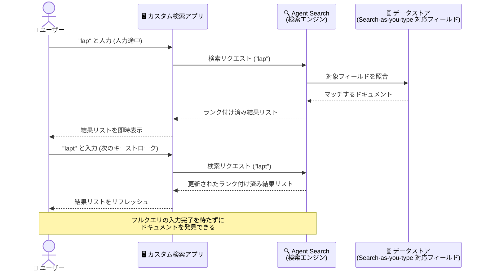

# Vertex AI Search (Agent Search): カスタム検索アプリ向け Search-as-you-type (Public Preview)

**リリース日**: 2026-11-10

**サービス**: Vertex AI Search (Agent Search)

**機能**: カスタム検索アプリにおける Search-as-you-type (入力中検索)

**ステータス**: Public Preview

📊 [このアップデートのインフォグラフィックを見る](https://takech9203.github.io/google-cloud-news-summary/20261110-vertex-ai-search-search-as-you-type-preview.html)

## 概要

Vertex AI Search (Agent Search) のカスタム検索アプリにおいて、**Search-as-you-type (入力中検索)** が Public Preview として利用可能になりました。スキーマのフィールド設定で Search-as-you-type を有効化すると、ユーザーがクエリを入力し終える前に、**キーストロークごとにランク付けされたドキュメントの検索結果リストがリアルタイムで更新**されるようになります。

この機能の最大のポイントは、既存のオートコンプリート (autocomplete) との違いです。オートコンプリートは「クエリ文字列の候補」を提案するのに対し、Search-as-you-type は「マッチするドキュメントそのもの」を返します。これにより、ユーザーは入力の途中でも更新され続ける結果リストをブラウズし、クエリを最後まで入力することなく目的のドキュメントにたどり着くことができます。

E コマースの商品検索、社内ナレッジベース、ドキュメントポータルなど、ユーザーが素早く目的のアイテムに到達することが重要なカスタム検索アプリを構築している開発者にとって、検索体験 (UX) を大きく向上させるアップデートです。

**アップデート前の課題**

- 入力中のユーザー支援はオートコンプリート (クエリ文字列の候補提案) に限られており、ユーザーはクエリを確定 (入力完了) するまで実際の検索結果を確認できなかった
- 目的のドキュメントに到達するには「候補を選択 → 検索実行 → 結果確認」という複数ステップが必要だった
- Google 検索や主要 EC サイトのようなインクリメンタルな検索体験を実現するには、アプリ側で独自に検索 API を連打する実装を自前で設計する必要があった

**アップデート後の改善**

- スキーマのフィールド設定を構成するだけで、キーストロークごとにランク付け済みドキュメントを返す Search-as-you-type が利用可能になった
- ユーザーはクエリ入力の途中で結果リストをブラウズでき、フルクエリを入力せずに目的の結果を発見できるようになった
- クエリ候補を返すオートコンプリートと、ドキュメントを返す Search-as-you-type を目的に応じて使い分けられるようになった

## アーキテクチャ図



ユーザーのキーストロークごとに検索リクエストが実行され、クエリ候補ではなくランク付けされたドキュメントのリストがリアルタイムに更新される流れを示しています。

## サービスアップデートの詳細

### 主要機能

1. **キーストロークごとのドキュメント検索**
   - ユーザーがフルクエリを入力し終える前に、キーストロークごとにランク付けされたドキュメントのセットを更新して返す
   - ユーザーは入力途中でも結果リストをブラウズし、目的の結果をクエリ確定前に発見できる

2. **スキーマフィールド単位での有効化**
   - データストアのスキーマで、Search-as-you-type をサポートするフィールドを設定する方式
   - 既存のフィールド設定 (Searchable、Indexable、Retrievable、Completable など) と同様に、フィールド単位で検索挙動をコントロールできる

3. **オートコンプリートとの明確な棲み分け**
   - オートコンプリート (Completable 設定): クエリ「文字列」の候補を提案
   - Search-as-you-type: マッチする「ドキュメント」を返す
   - 両者は補完関係にあり、組み合わせて検索 UX を設計できる

## 技術仕様

### オートコンプリートとの比較

| 項目 | オートコンプリート | Search-as-you-type (今回のアップデート) |
|------|-------------------|----------------------------------------|
| 返すもの | クエリ文字列の候補 | ランク付けされたドキュメント |
| 更新タイミング | 入力中 | キーストロークごと |
| 設定方法 | フィールドの Completable 設定 | スキーマのフィールド設定 (Search-as-you-type 対応) |
| ユーザー体験 | 候補選択 → 検索実行 → 結果確認 | 入力途中で結果リストを直接ブラウズ |
| 対象アプリ | 検索アプリ全般 | カスタム検索アプリ |
| ステータス | GA | Public Preview |

## 設定方法

### 前提条件

1. Vertex AI Search (Agent Search) のカスタム検索アプリとデータストアが作成済みであること
2. データストアにスキーマが定義されている (または自動検出されている) こと

### 手順

#### ステップ 1: フィールド設定の確認

Google Cloud コンソールの AI Applications からデータストアのスキーマを開き、対象フィールドの設定を確認します。スキーマは API からも取得できます。

```bash
# スキーマ定義の取得例
curl -X GET \
  -H "Authorization: Bearer $(gcloud auth print-access-token)" \
  "https://discoveryengine.googleapis.com/v1/projects/PROJECT_ID/locations/global/collections/default_collection/dataStores/DATA_STORE_ID/schemas/default_schema"
```

#### ステップ 2: Search-as-you-type を有効化するフィールドの設定

公式ドキュメント「[Configure field settings](https://docs.cloud.google.com/generative-ai-app-builder/docs/configure-field-settings)」の手順に従い、Search-as-you-type をサポートさせたいフィールドの設定を更新します。他のフィールド設定と同様、スキーマ更新後は再インデックスの完了を待ってから動作を確認してください。

## メリット

### ビジネス面

- **検索体験の向上によるコンバージョン改善**: ユーザーがフルクエリを入力せずに目的のドキュメント (商品、記事など) に到達できるため、検索の離脱を減らし、目的達成までの時間を短縮できる
- **自前実装コストの削減**: インクリメンタル検索のような体験を、マネージドな検索エンジンのフィールド設定で実現できる

### 技術面

- **キーストロークごとのランキング済み結果**: 単純な前方一致ではなく、Agent Search のランキングが適用されたドキュメントリストが返される
- **フィールド単位の制御**: スキーマ設定でどのフィールドを Search-as-you-type の対象にするかを選択でき、検索品質とインデックスサイズのバランスを調整できる

## デメリット・制約事項

### 制限事項

- Public Preview 段階の機能であり、GA 前に仕様が変更される可能性がある
- 対象はカスタム検索アプリ (custom search apps) であり、スキーマのフィールド設定が前提となる

### 考慮すべき点

- キーストロークごとに検索結果が返される特性上、確定クエリのみを送信する場合と比べて検索リクエスト数が増加しうるため、クエリ課金 (従量課金または configurable pricing の QPM サブスクリプション) への影響を事前に見積もること
- 他のフィールド設定 (Searchable、Prefix matchable など) と同様に、設定変更後は再インデックスが必要になる点を考慮し、検証環境で挙動を確認してから本番適用することが推奨される

## ユースケース

### ユースケース 1: EC サイトの商品検索

**シナリオ**: EC サイトで、ユーザーが「ノートパソコン」と入力し終える前に、「ノート」の時点で関連商品を表示したい。

**実装例**:
```
1. 商品データストアのスキーマで product_name などの
   フィールドに Search-as-you-type を設定
2. フロントエンドの検索ボックスでキーストロークごとに
   検索 API を呼び出し、返却されたドキュメントリストを描画
```

**効果**: ユーザーは入力途中で商品カードのリストを直接ブラウズでき、クエリ確定前に目的の商品ページへ遷移できる。検索完了までの時間短縮と離脱率の低減が期待できる。

### ユースケース 2: 社内ナレッジベースのドキュメント検索

**シナリオ**: 社内ポータルで、従業員が規程やマニュアルを探す際に、タイトルの一部を入力しただけで該当ドキュメントを提示したい。

**効果**: 正式なドキュメント名を正確に覚えていなくても、入力途中に更新される結果リストから目的の文書を発見でき、問い合わせ対応やセルフサービスの効率が向上する。

## 料金

Search-as-you-type 機能自体の追加料金は Release Notes には記載されていません。カスタム検索アプリの検索クエリは、従量課金 (pay-as-you-go) または configurable pricing (サブスクリプション) モデルに基づいて課金されます。キーストロークごとにリクエストが発生する構成ではクエリ数が増加しうるため、詳細は料金ページを確認してください。

- [Vertex AI Search の料金](https://cloud.google.com/generative-ai-app-builder/pricing)

## 利用可能リージョン

公式ドキュメントでの明記は確認できませんでした。最新情報は [Vertex AI Search locations](https://docs.cloud.google.com/generative-ai-app-builder/docs/locations) を参照してください。

## 関連サービス・機能

- **オートコンプリート (Configure autocomplete)**: クエリ文字列の候補を提案する機能。Search-as-you-type はドキュメントを返す点で異なり、組み合わせて検索 UX を設計できる
- **フィールド設定 (Searchable / Indexable / Retrievable / Prefix matchable / Partially matchable)**: Search-as-you-type と同じくスキーマのフィールド単位で検索挙動を制御する設定群
- **サービングコントロール (Boost/Bury、Synonyms、Promote)**: 検索結果のランキングや表示を調整する機能で、Search-as-you-type の結果品質向上にも寄与する

## 参考リンク

- 📊 [インフォグラフィック](https://takech9203.github.io/google-cloud-news-summary/20261110-vertex-ai-search-search-as-you-type-preview.html)
- [公式リリースノート](https://docs.cloud.google.com/release-notes#November_10_2026)
- [Configure field settings (公式ドキュメント)](https://docs.cloud.google.com/generative-ai-app-builder/docs/configure-field-settings)
- [Configure autocomplete (公式ドキュメント)](https://docs.cloud.google.com/generative-ai-app-builder/docs/configure-autocomplete)
- [料金ページ](https://cloud.google.com/generative-ai-app-builder/pricing)

## まとめ

Search-as-you-type は、カスタム検索アプリの検索体験を「クエリ確定後に結果を見る」から「入力しながら結果をブラウズする」へと進化させるアップデートです。オートコンプリートと異なりドキュメントそのものを返すため、ユーザーの目的達成までのステップを大きく短縮できます。Public Preview 段階のため本番適用前の検証は必要ですが、EC や社内検索など検索 UX が重要なアプリを運用しているチームは、フィールド設定での有効化を早期に試すことをおすすめします。

---

**タグ**: Vertex AI Search, Agent Search, Search-as-you-type, カスタム検索, フィールド設定, Public Preview
