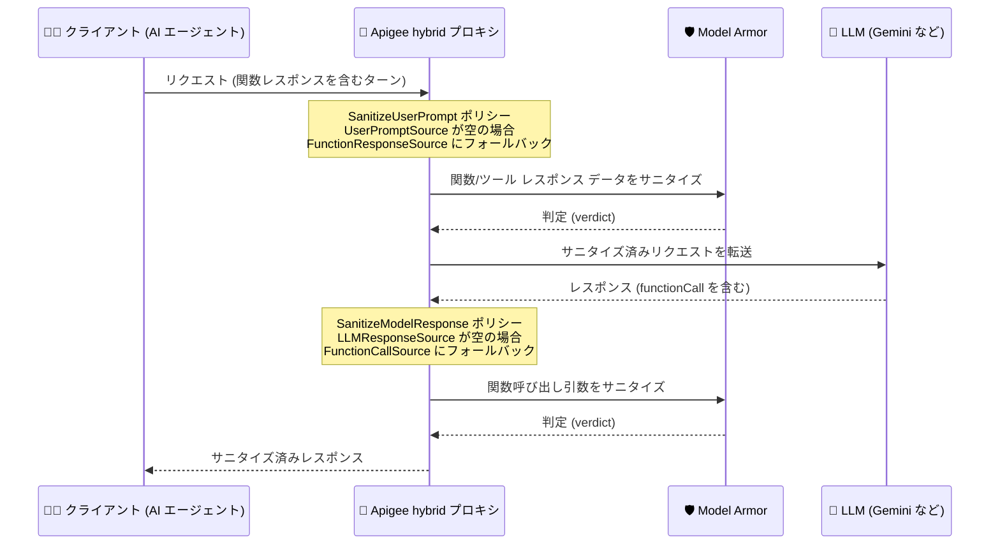

# Apigee hybrid: v1.16.14 リリース (Model Armor ポリシーの Function Calling 対応、バグ修正、セキュリティ修正)

**リリース日**: 2026-11-11

**サービス**: Apigee hybrid

**機能**: v1.16.14 パッチリリース (SanitizeUserPrompt / SanitizeModelResponse ポリシーの LLM Function Calling 対応、バグ修正、CVE 対応)

**ステータス**: リリース (パッチリリース)

📊 [このアップデートのインフォグラフィックを見る](https://takech9203.github.io/google-cloud-news-summary/20261111-apigee-hybrid-v1-16-14.html)

## 概要

2026 年 11 月 11 日、Apigee hybrid ソフトウェアの更新版 v1.16.14 がリリースされました。本リリースはパッチリリースであり、コンテナイメージは Apigee hybrid の Helm チャートに統合されているため、Helm チャートを使用してパッチにアップグレードすると、イメージも自動的に更新されます。通常、手動でのイメージ変更は不要です。

本リリースの最大の機能強化は、Model Armor と連携する **SanitizeUserPrompt ポリシーと SanitizeModelResponse ポリシーが LLM の Function Calling (ツール使用) フローに対応**したことです。新しいオプション XML 要素 `<FunctionResponseSource>` と `<FunctionCallSource>` により、関数呼び出しのコンテンツを抽出して Model Armor でサニタイズできるようになりました。AI エージェントや LLM アプリケーションを Apigee hybrid 経由で保護している組織にとって、エージェンティックなワークフローのセキュリティ カバレッジが大きく向上します。

このほか、gRPC 関連の挙動改善 (Google Cloud クライアント ライブラリ スタックの更新)、Synchronizer の `pollInterval` 設定が反映されない問題の修正、SSE (Server-Sent Events) ストリーミング関連の修正、OASValidation ポリシーの間欠的な HTTP 400 エラーの修正など 9 件のバグ修正と、`apigee-asm-ingress` / `apigee-asm-istiod` / `apigee-fluent-bit` / `apigee-hybrid-cassandra` などの複数コンテナに対する CVE 対応のセキュリティ修正が含まれています。

**アップデート前の課題**

- SanitizeUserPrompt ポリシーの `<UserPromptSource>` は最後のコンテンツ エントリのテキストを抽出するため、Function Calling のターン (最後のエントリがテキストではなく関数レスポンスの場合) では抽出結果が空になり、外部 API やデータベース由来の信頼できないデータを含む関数レスポンスが Model Armor のサニタイズ対象外だった
- 同様に、SanitizeModelResponse ポリシーの `<LLMResponseSource>` は、モデルがテキストではなく関数呼び出し (Function Call) を返すターンでは空を返し、関数呼び出しの引数がサニタイズされなかった
- Synchronizer の `pollInterval` 設定 (`synchronizer.pollInterval` など) が apigee-env Helm チャートと Apigee オペレーターに無視されていた
- 圧縮された `text/event-stream` レスポンスが EventFlow を持つプロキシを通過すると、ボディが破損していた
- Model Armor ポリシーが `HTTPClient.managementplane.skip.proxy` 設定を尊重せず、フォワード プロキシをバイパスできなかった
- 複数のコンテナ イメージに既知の脆弱性 (CVE) が存在していた

**アップデート後の改善**

- `<FunctionResponseSource>` (SanitizeUserPrompt) により、ユーザーターン内の関数/ツール レスポンス データを抽出して Model Armor でサニタイズできるようになった (`<UserPromptSource>` が空を返す場合のフォールバックとして動作)
- `<FunctionCallSource>` (SanitizeModelResponse) により、モデル レスポンス内の関数呼び出し引数を抽出してサニタイズできるようになった (`<LLMResponseSource>` が空を返す場合のフォールバックとして動作)
- デフォルト テンプレートは Gemini フォーマットを対象としており、追加設定なしで動作する (OpenAI / Anthropic フォーマットはカスタム JSONPath テンプレートで対応可能)
- SanitizeModelResponse ポリシーの SSE ストリームに対する連続スキャン (ContinuousScan) 双方向 gRPC ストリーミングに対応し、LLM プロバイダーネイティブの SSE JSON エンベロープとイベント フレーミングが保持されるようになった
- Apigee アナリティクスが、プロンプト方向とモデル レスポンス方向の両方で Model Armor のテンプレート・判定 (verdict)・一致フィルタをリクエストごとにレポートするようになった
- 6 つのコンテナ イメージの CVE が修正され、セキュリティ態勢が向上した

## アーキテクチャ図



LLM の Function Calling フローにおいて、新しい `<FunctionResponseSource>` と `<FunctionCallSource>` 要素がフォールバックとして機能し、関数レスポンスと関数呼び出し引数の両方を Model Armor でサニタイズする流れを示しています。

## サービスアップデートの詳細

### 主要機能

1. **SanitizeUserPrompt / SanitizeModelResponse ポリシーの Function Calling 対応**
   - `<FunctionResponseSource>` (SanitizeUserPrompt): ユーザーターンから関数/ツール レスポンス データを抽出。Function Calling のターンで `<UserPromptSource>` が空を返す場合のフォールバックとして使用される。関数レスポンスには外部 API やデータベース由来の信頼できないデータが含まれるため、サニタイズが必要
   - `<FunctionCallSource>` (SanitizeModelResponse): モデル レスポンスから関数呼び出し引数を抽出。`<LLMResponseSource>` が空を返す場合のフォールバックとして使用される
   - デフォルト テンプレートは Gemini フォーマットを対象とし、追加設定は不要。OpenAI および Anthropic フォーマットにはカスタム JSONPath テンプレートを設定する

2. **バグ修正 (9 件)**
   - **575563262**: Google Cloud クライアント ライブラリ スタックを Apigee hybrid 1.17 に合わせて更新 (protobuf 4.x、gRPC 1.82、GAX 2.83、Guava 33.5)。不正な形式の受信 gRPC リクエスト フレームは `grpc-status INTERNAL (13)` としてクライアントに報告され、アナリティクスに `x-apigee.grpc.status=13` として記録されるようになった。存在しない Google サービス アカウントを使用する ExternalCallout ポリシーは `UNAUTHENTICATED (16)` で失敗するようになった
   - **572875915**: apigee-env Helm チャートと Apigee オペレーターが Synchronizer の `pollInterval` 設定 (`synchronizer.pollInterval`、`envs[].pollInterval`、`envs[].components.synchronizer.pollInterval`) を無視する問題を修正。設定値が有効になり、60 秒未満の値は 60 秒に引き上げられる
   - **572025634**: 圧縮された `text/event-stream` ボディを持つレスポンスが EventFlow を持つプロキシで破損する問題を修正。圧縮された `text/event-stream` レスポンスは EventFlow 処理をスキップしてそのまま通過するようになった
   - **560272924**: SanitizeModelResponse ポリシーの SSE ストリームに対する連続スキャン (continuous-scan) 双方向 gRPC ストリーミングに対応。ネイティブ LLM プロバイダーの SSE JSON エンベロープとイベント フレーミングを保持
   - **555332621**: Model Armor ポリシーが `HTTPClient.managementplane.skip.proxy` を尊重しない問題を修正。設定時は Model Armor コールアウトが他の googleapis トラフィックと同様にフォワード プロキシをバイパスし、ストリーミング (ContinuousScan) の Model Armor トラフィックはフォワード プロキシを使用する
   - **549779897**: Apigee アナリティクスが、プロンプト方向とモデル レスポンス方向の両方で、リクエストごとに Model Armor のテンプレート・判定・一致フィルタをレポートするようになった
   - **524115876**: OASValidation ポリシーの厳格なパラメータ検証が高負荷時に有効なリクエストを拒否する間欠的な HTTP 400 エラーを修正
   - **519116013**: `apigee-hybrid-cassandra` コンテナのポート 7070 (Prometheus `jmx_exporter`) で、弱い Diffie-Hellman (DH) TLS 暗号スイートを無効化
   - **500345401**: apigee-telemetry Helm チャートが、OpenTelemetry Collector、Prometheus Adapter、Stackdriver Exporter に対して独立した tolerations と nodeSelector の設定に対応

3. **セキュリティ修正 (CVE 対応)**
   - 以下のコンテナ イメージの脆弱性に対するセキュリティ修正が適用された

   | コンテナ | 対応 CVE |
   |---------|---------|
   | apigee-asm-ingress | CVE-2026-116587, CVE-2026-5450, CVE-2026-5928 |
   | apigee-asm-istiod | CVE-2026-116587, CVE-2026-5450, CVE-2026-5928 |
   | apigee-fluent-bit | CVE-2026-27171, CVE-2026-76844, CVE-2026-85091 |
   | apigee-hybrid-cassandra | CVE-2026-49844 |
   | apigee-hybrid-cassandra-client | CVE-2026-116585, CVE-2026-116586, CVE-2026-116587 |
   | apigee-open-telemetry-collector | CVE-2026-116587 |

## 技術仕様

### Function Calling 対応の新 XML 要素

| 項目 | `<FunctionResponseSource>` | `<FunctionCallSource>` |
|------|---------------------------|------------------------|
| 対象ポリシー | SanitizeUserPrompt | SanitizeModelResponse |
| 役割 | ユーザーターン内の関数/ツール レスポンス データの抽出 | モデル レスポンス内の関数呼び出し引数の抽出 |
| フォールバック元 | `<UserPromptSource>` が空の場合 | `<LLMResponseSource>` が空の場合 |
| デフォルト値 (Gemini 形式) | `{jsonPath('$.contents[-1].parts[-1].functionResponse.response',request.content)}` | `{jsonPath('$.candidates[-1].content.parts[-1].functionCall.args',response.content)}` |
| 必須/任意 | 任意 | 任意 |
| 型 | String (メッセージ テンプレート構文、JSONPath 関数対応) | String (メッセージ テンプレート構文、JSONPath 関数対応) |

### ポリシー設定例 (SanitizeUserPrompt / SanitizeModelResponse)

```xml
<SanitizeUserPrompt async="false" continueOnError="false" enabled="true" name="sanitize-prompt">
  <IgnoreUnresolvedVariables>true</IgnoreUnresolvedVariables>
  <ModelArmor>
    <TemplateName>projects/{project}/locations/{location}/templates/{template-name}</TemplateName>
  </ModelArmor>
  <UserPromptSource>{jsonPath('$.contents[-1].parts[-1].text',request.content)}</UserPromptSource>
  <FunctionResponseSource>{jsonPath('$.contents[-1].parts[-1].functionResponse.response',request.content)}</FunctionResponseSource>
</SanitizeUserPrompt>
```

```xml
<SanitizeModelResponse async="false" continueOnError="false" enabled="true" name="sanitize-response">
  <IgnoreUnresolvedVariables>true</IgnoreUnresolvedVariables>
  <ModelArmor>
    <TemplateName>projects/{project}/locations/{location}/templates/{template-name}</TemplateName>
  </ModelArmor>
  <UserPromptSource>{jsonPath('$.contents[-1].parts[-1].text',request.content)}</UserPromptSource>
  <LLMResponseSource>{jsonPath('$.candidates[-1].content.parts',response.content)}</LLMResponseSource>
  <FunctionCallSource>{jsonPath('$.candidates[-1].content.parts[-1].functionCall.args',response.content)}</FunctionCallSource>
  <ContinuousScan>false</ContinuousScan>
</SanitizeModelResponse>
```

### Model Armor ポリシー利用に必要な IAM ロール

| ロール | 用途 |
|--------|------|
| `roles/modelarmor.user` (Model Armor User) | Apigee プロキシのデプロイに使用するサービス アカウントに付与 |
| `roles/modelarmor.viewer` (Model Armor Viewer) | 同上 |

## 設定方法

### 前提条件

1. Apigee hybrid v1.16.x を運用していること (SanitizeUserPrompt / SanitizeModelResponse ポリシーは Apigee hybrid v1.15.1 以降でサポート)
2. Model Armor API が有効化され、Model Armor テンプレートが作成済みであること
3. プロキシのデプロイに使用するサービス アカウントに Model Armor User / Viewer ロールが付与されていること

### 手順

#### ステップ 1: v1.16.14 へのアップグレード

```bash
# Helm チャートのバージョンを確認して v1.16.14 にアップグレード
# (パッチリリースのため、Helm チャートによるアップグレードでイメージも自動更新される)
helm upgrade operator apigee-operator/ \
  --namespace apigee \
  --atomic \
  -f overrides.yaml
```

詳細な手順は公式ドキュメント「[Upgrading Apigee hybrid to v1.16](https://docs.cloud.google.com/apigee/docs/hybrid/v1.16/upgrade)」を参照してください。新規インストールの場合は「[The big picture](https://docs.cloud.google.com/apigee/docs/hybrid/v1.16/what-is-hybrid)」を参照します。

#### ステップ 2: Function Calling 対応のポリシー設定 (Gemini 形式の場合)

Gemini フォーマットの場合、デフォルト テンプレートで動作するため追加設定は不要です。明示的に設定する場合は、上記「技術仕様」のポリシー設定例のように `<FunctionResponseSource>` / `<FunctionCallSource>` 要素を追加します。

#### ステップ 3: OpenAI / Anthropic 形式を使用する場合のカスタム JSONPath 設定

```xml
<!-- 例: OpenAI / Anthropic フォーマットのペイロード構造に合わせて
     カスタム JSONPath テンプレートを設定する -->
<FunctionResponseSource>{jsonPath('$.<OpenAI または Anthropic の関数レスポンスのパス>',request.content)}</FunctionResponseSource>
```

デフォルト値は Gemini 形式を対象としているため、OpenAI / Anthropic 形式の API を扱う場合は、各フォーマットのペイロード構造に合わせた JSONPath を設定します。

## メリット

### ビジネス面

- **AI エージェントのセキュリティ強化**: Function Calling (ツール使用) を行うエージェンティックな AI アプリケーションでも、外部 API やデータベース由来の信頼できないデータを Model Armor で検査でき、プロンプト インジェクションや機密データ漏えいのリスクを低減できる
- **コンプライアンスと可観測性の向上**: Apigee アナリティクスで Model Armor のテンプレート・判定・一致フィルタがリクエストごとに記録されるため、AI トラフィックの監査やレポーティングが容易になる
- **脆弱性リスクの低減**: 複数コンテナの CVE 修正により、セキュリティ コンプライアンス要件への対応が進む

### 技術面

- **設定の手間が少ない**: Gemini フォーマットではデフォルト テンプレートがそのまま機能し、追加設定なしで Function Calling フローのサニタイズが有効になる
- **マルチ LLM 対応**: カスタム JSONPath テンプレートにより OpenAI / Anthropic フォーマットにも対応可能
- **ストリーミング対応の改善**: SSE ストリームの連続スキャンが双方向 gRPC ストリーミングに対応し、ネイティブの SSE イベント フレーミングを保持したままサニタイズできる
- **運用性の向上**: Synchronizer の pollInterval 設定の修正、テレメトリ コンポーネントごとの tolerations / nodeSelector 設定対応など、運用上の柔軟性が向上

## デメリット・制約事項

### 制限事項

- `<FunctionResponseSource>` / `<FunctionCallSource>` のデフォルト値は Gemini フォーマットを対象としており、OpenAI / Anthropic フォーマットではカスタム JSONPath テンプレートの設定が必要
- SanitizeUserPrompt / SanitizeModelResponse は Extensible ポリシーであり、Apigee のライセンスによってはコストや利用量への影響がある
- Synchronizer の `pollInterval` は 60 秒未満を設定しても 60 秒に引き上げられる
- ContinuousScan 使用時、Model Armor の Sensitive Data Protection (SDP) による匿名化 (redacted) テキストはクライアントに配信されない

### 考慮すべき点

- パッチリリースのため、Helm チャートでのアップグレードによりコンテナ イメージが自動更新される。手動でイメージを管理している場合は注意が必要
- CVE 修正が含まれるため、セキュリティの観点から早期のアップグレードが推奨される
- gRPC エラー挙動の変更 (不正フレームが `UNAVAILABLE (14)` から `INTERNAL (13)` に、ExternalCallout のサービス アカウント不存在が `UNAVAILABLE (14)` から `UNAUTHENTICATED (16)` に変更) により、gRPC ステータス コードに依存した監視・リトライ ロジックがある場合は影響を確認すること
- Model Armor コールアウトのフォワード プロキシ経由の挙動が変更されている (`HTTPClient.managementplane.skip.proxy` 設定時のバイパス) ため、プロキシ環境でのネットワーク経路を確認すること

## ユースケース

### ユースケース 1: AI エージェント ゲートウェイでのツール レスポンスの検査

**シナリオ**: Apigee hybrid を AI エージェントのゲートウェイとして使用し、エージェントが外部 API (検索、データベース照会など) をツールとして呼び出す構成。外部 API のレスポンスには信頼できないデータが含まれる可能性があり、間接的なプロンプト インジェクションのリスクがある。

**実装例**:
```xml
<SanitizeUserPrompt name="SUP-agent-gateway">
  <ModelArmor>
    <TemplateName>projects/my-project/locations/us-west1/templates/agent-template</TemplateName>
  </ModelArmor>
  <!-- Gemini 形式の場合はデフォルトで Function Calling ターンをカバー -->
</SanitizeUserPrompt>
```

**効果**: エージェントのツール呼び出し結果が LLM に渡る前に Model Armor で検査され、ツール レスポンス経由の間接プロンプト インジェクションや悪意ある URL の混入を検出・ブロックできる。

### ユースケース 2: 関数呼び出し引数の漏えい防止

**シナリオ**: LLM がテキストではなく関数呼び出し (functionCall) を返す場合に、その引数に機密データや不適切な内容が含まれないか検査したい。

**効果**: `<FunctionCallSource>` により、モデルが生成した関数呼び出し引数が実際のツール実行前に Model Armor でサニタイズされ、機密データの外部ツールへの流出や不正な引数によるツールの悪用を防止できる。

### ユースケース 3: CVE 対応のためのパッチ適用

**シナリオ**: セキュリティ チームの脆弱性スキャンで `apigee-asm-ingress` や `apigee-fluent-bit` などのコンテナに CVE が検出されており、対応が求められている。

**効果**: Helm チャートで v1.16.14 にアップグレードするだけで、対象コンテナ イメージの CVE 修正が自動的に適用され、脆弱性スキャンの指摘に対応できる。

## 料金

Apigee hybrid 自体のパッチ適用に追加料金は発生しません。SanitizeUserPrompt / SanitizeModelResponse ポリシーは Extensible ポリシーであり、Apigee のライセンス (サブスクリプションまたは従量課金) によってコストや利用量への影響が異なります。また、Model Armor の利用には Model Armor 側の料金が別途適用されます。

詳細は以下を参照してください。

- [Apigee 料金ページ](https://cloud.google.com/apigee/pricing)
- [Model Armor の料金](https://cloud.google.com/security-command-center/pricing)

## 利用可能リージョン

Apigee hybrid はユーザー管理の Kubernetes クラスタ上で動作するため、ランタイムのリージョン制約はユーザー環境に依存します。Model Armor テンプレートはリージョン リソースであるため、利用可能なロケーションは [Model Armor のドキュメント](https://docs.cloud.google.com/security-command-center/docs/model-armor-overview)を参照してください。

## 関連サービス・機能

- **Model Armor**: LLM のリスク軽減のための AI セキュリティ サービス。SanitizeUserPrompt / SanitizeModelResponse ポリシーのバックエンドとして、プロンプト インジェクション検出、機密データ保護 (SDP)、悪意ある URI 検出などのフィルタを提供
- **Apigee (SaaS 版)**: 同じ SanitizeUserPrompt / SanitizeModelResponse ポリシーが利用可能。hybrid はユーザー管理の Kubernetes 上でランタイムを運用する形態
- **Cloud Service Mesh (ASM)**: Apigee hybrid のイングレス (`apigee-asm-ingress`) とコントロール プレーン (`apigee-asm-istiod`) として使用されており、今回の CVE 修正の対象
- **Sensitive Data Protection (旧 Cloud DLP)**: Model Armor テンプレートの SDP フィルタとして、機密データの検査・匿名化に使用される
- **Cloud Monitoring / Apigee Analytics**: 今回の修正により、Model Armor のテンプレート・判定・一致フィルタがアナリティクスでリクエストごとにレポートされる

## 参考リンク

- 📊 [インフォグラフィック](https://takech9203.github.io/google-cloud-news-summary/20261111-apigee-hybrid-v1-16-14.html)
- [公式リリースノート](https://docs.cloud.google.com/release-notes#November_11_2026)
- [SanitizeUserPrompt ポリシー リファレンス](https://docs.cloud.google.com/apigee/docs/api-platform/reference/policies/sanitize-user-prompt-policy)
- [SanitizeModelResponse ポリシー リファレンス](https://docs.cloud.google.com/apigee/docs/api-platform/reference/policies/sanitize-llm-response-policy)
- [Model Armor の概要](https://docs.cloud.google.com/security-command-center/docs/model-armor-overview)
- [Apigee hybrid ドキュメント](https://docs.cloud.google.com/apigee/docs/hybrid)
- [Apigee 料金ページ](https://cloud.google.com/apigee/pricing)

## まとめ

Apigee hybrid v1.16.14 は、Model Armor 連携ポリシーの LLM Function Calling 対応という AI セキュリティ上の重要な機能強化と、複数コンテナの CVE 修正を含むパッチリリースです。Apigee hybrid を AI ゲートウェイとして活用している、またはエージェンティックな AI ワークロードを保護したい組織は、早期のアップグレードを推奨します。gRPC エラー ステータスの挙動変更があるため、アップグレード前に監視・エラー ハンドリングへの影響を確認してください。

---

**タグ**: #ApigeeHybrid #ModelArmor #AIセキュリティ #FunctionCalling #LLM #APIManagement #セキュリティ修正 #CVE #パッチリリース
