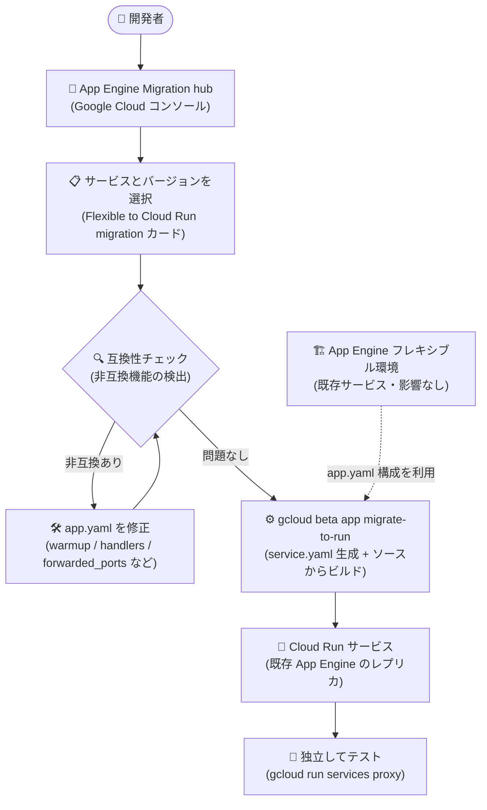

# App Engine フレキシブル環境: Migration hub による Cloud Run への移行 (Preview)

**リリース日**: 2026-11-11

**サービス**: App Engine flexible environment (.NET / Go / Java / Node.js / PHP / Python / Ruby / カスタムランタイム)

**機能**: Migration hub による互換性チェックと Cloud Run への移行

**ステータス**: Preview

📊 [このアップデートのインフォグラフィックを見る](https://takech9203.github.io/google-cloud-news-summary/20261111-app-engine-flexible-migration-hub-cloud-run.html)

## 概要

App Engine の Migration hub で、**App Engine フレキシブル環境のサービスの互換性をチェックし、Cloud Run へ移行できるようになりました** (Preview)。対象は .NET、Go、Java、Node.js、PHP、Python、Ruby、カスタムランタイムを含むフレキシブル環境のすべてのランタイムです。

Migration hub は Google Cloud コンソールの App Engine ページから利用でき、「Flexible to Cloud Run migration」カードで移行したいサービスとバージョンを選択すると、互換性チェッカーが非互換の機能を自動検出します。問題がなければ、`gcloud beta app migrate-to-run` コマンドを使ってローカルの `app.yaml` 構成からコンテナイメージをビルドし、Cloud Run サービスとしてデプロイできます。

重要な点として、この移行手順は**既存の App Engine アプリの機能やトラフィックフローには影響しません**。新しく作成される Cloud Run サービスは App Engine サービスのレプリカであり、独立してテストできます。App Engine フレキシブル環境と Cloud Run はどちらもフルマネージドのコンテナネイティブなアプリケーションプラットフォームですが、構造的な違いがあるため、段階的に検証しながら移行を進められるこの仕組みは、モダナイゼーションを検討するユーザーにとって大きな助けになります。

**アップデート前の課題**

- App Engine フレキシブル環境から Cloud Run への移行は、`app.yaml` と Cloud Run の設定の対応関係を手動で調査・変換する必要があった
- 移行前にアプリケーションが Cloud Run と互換性があるか (warmup、静的ファイルハンドラー、転送ポートなど) を体系的に確認する手段がなかった
- 移行作業が既存の本番サービスに影響しないかの不安があり、検証用の環境構築にも手間がかかった

**アップデート後の改善**

- Migration hub の互換性チェッカーが `app.yaml` 内の非互換設定を自動検出し、修正方法のガイダンスを提示するようになった
- `gcloud beta app migrate-to-run` コマンド 1 つで、`app.yaml` から Cloud Run 用の `service.yaml` を自動生成し、ソースからコンテナイメージをビルドして Cloud Run にデプロイできるようになった
- 既存の App Engine アプリに影響を与えずに、レプリカとして作成された Cloud Run サービスを独立してテストできるようになった
- `--dry-run` フラグで移行やデプロイを行わずに互換性チェックのみを実行でき、`--export-only` フラグで `service.yaml` の生成のみも可能になった

## アーキテクチャ図



Migration hub で互換性をチェックし、問題を解消したうえで `gcloud beta app migrate-to-run` によりローカルの `app.yaml` 構成から Cloud Run サービスをデプロイする流れです。既存の App Engine サービスのトラフィックには影響しません。

## サービスアップデートの詳細

### 主要機能

1. **Migration hub での互換性チェック (Flexible to Cloud Run migration カード)**
   - コンソールの App Engine ページ → ナビゲーションメニューの「Migration hub」からアクセス
   - 移行対象のサービスとバージョンを選択して「Check compatibility」をクリックすると、互換性チェッカーが非互換機能を特定
   - ブロッキングとなる非互換がないことを確認後、「Review & Deploy」セクションに進み、デプロイ用の gcloud コマンドを取得

2. **`gcloud beta app migrate-to-run` コマンドによるデプロイ**
   - `app.yaml` が存在するソースディレクトリで実行すると、Cloud Run 用の `service.yaml` を同じディレクトリに生成
   - ソースコードからコンテナイメージをビルドし、Cloud Run サービスとしてデプロイ
   - `--appyaml=PATH` で別ディレクトリの `app.yaml` を指定可能
   - `--dry-run` で移行・デプロイせずに互換性チェックのみを実行
   - `--export-only=EXPORT_PATH` で `service.yaml` の生成・エクスポートのみを実行 (デプロイなし)

3. **全ランタイム対応**
   - .NET、Go、Java、Node.js、PHP、Python、Ruby に加え、カスタムランタイムにも対応
   - フレキシブル環境はもともとコンテナベースであるため、ソースベースのビルドとデプロイで移行

4. **既存アプリへの無影響・独立テスト**
   - 移行手順は既存の App Engine アプリの機能やトラフィックフローに影響しない
   - 新しい Cloud Run サービスはレプリカとして作成され、`gcloud run services proxy` でプライベートにテスト可能

## 技術仕様

### 互換性チェッカーが検出する非互換機能

| `app.yaml` の設定 | 問題点 | 対処方法 |
|------|------|------|
| `inbound_services: - warmup` | Cloud Run はコンテナのエントリポイントでウォームアップするため warmup リクエスト不要 | セクションを削除。初期化処理は起動時に実行するか、スタートアップ プローブや最小インスタンス数を利用 |
| `error_handlers` (カスタムエラーページ) | Cloud Run は非対応 | アプリケーションコード内でエラー処理を実装、または Cloud Load Balancing のカスタムエラーレスポンスを利用 |
| `handlers` (URL ルーティング・静的ファイル) | Cloud Run は `app.yaml` のルーティングや静的ファイルハンドラーに非対応 | アプリ内で静的ファイルを配信するか Cloud Storage を利用。ルーティングはアプリコードまたは Cloud Load Balancing で実装 |
| `network.forwarded_ports` (ホストポートマッピング、UDP、複数ポート) | Cloud Run は単一コンテナポートへの TCP インバウンドのみ対応 | 単一の数値ポートのみ指定するか、設定を削除して Cloud Run 側でコンテナポートを構成。複数ポート指定時は最初のポートのみ適用 (警告表示) |
| `resources.disk_size_gb` | Cloud Run はデフォルトでインメモリ ファイルシステムのため設定は無視される (警告表示) | メモリを消費せずファイル書き込みが必要な場合は、エフェメラルディスク ボリュームまたは Cloud Storage ボリュームマウントを構成 |

### App Engine フレキシブル環境と Cloud Run の主な違い

| 項目 | App Engine フレキシブル環境 | Cloud Run |
|------|------|------|
| デプロイ単位の呼称 | Version (バージョン) | Revision (リビジョン) |
| デフォルトの公開設定 | パブリック (デフォルトで公開) | プライベート (未認証アクセスは明示的に許可が必要) |
| サービス URL | `appspot.com` ドメイン | `run.app` ドメイン |
| 構成方法 | `app.yaml` によるファイルベース構成 | コンソール / gcloud で構成 (YAML もサポート)。未指定の設定は前リビジョンの値を維持 |
| デフォルトリソース | 1 vCPU / 0.6 GB | 1 vCPU / 512 MB |
| リクエストタイムアウト (デフォルト) | 60 分 | 5 分 |
| 最大同時実行数 (デフォルト) | なし | 80 |
| 最小 / 最大インスタンス (デフォルト) | 2 / 20 | 0 / 100 |
| スケーリング基盤 | Compute Engine Autoscaler | Cloud Run 独自の高速スケーリング (スケールトゥゼロ対応) |

## 設定方法

### 前提条件

1. App Engine アプリケーションがエラーなく動作しており、ソースコードにアクセスできること
2. Cloud Run Admin API と Artifact Registry API を有効化していること
3. gcloud CLI でプロジェクトとリージョンを構成していること

```bash
gcloud auth login
gcloud config set project PROJECT_ID
gcloud config set run/region REGION
gcloud components update
```

### 手順

#### ステップ 1: 互換性チェック (dry-run)

```bash
# app.yaml があるディレクトリで実行 (移行・デプロイは行わない)
gcloud beta app migrate-to-run --dry-run
```

互換性チェックの結果を確認し、非互換機能があれば推奨される修正を `app.yaml` に適用します。コンソールの場合は、App Engine ページ → Migration hub → 「Flexible to Cloud Run migration」カードでサービスとバージョンを選択し、「Check compatibility」をクリックします。

#### ステップ 2: Cloud Run へのデプロイ

```bash
# app.yaml があるソースディレクトリで実行
gcloud beta app migrate-to-run

# app.yaml が別ディレクトリにある場合
gcloud beta app migrate-to-run --appyaml=PATH

# service.yaml の生成のみ (デプロイしない)
gcloud beta app migrate-to-run --export-only=EXPORT_PATH
```

コマンドは Cloud Run 用の `service.yaml` を生成し、`Proceed with the deployment?` に `Y` と答えるとソースコードからコンテナイメージをビルドして Cloud Run にデプロイします。

#### ステップ 3: デプロイした Cloud Run サービスのテスト

```bash
# プライベートにテスト (推奨): ローカルプロキシ経由でアクセス
gcloud run services proxy SERVICE_NAME
```

Cloud Run サービスはデフォルトでプライベートのため、サービス URL を直接ブラウザで開くと 403 Forbidden になります。プライベートにテストするか、公開が必要な場合はパブリックアクセスを有効化します。

## メリット

### ビジネス面

- **モダナイゼーションの加速**: Google Cloud が新規プロジェクトで推奨する Cloud Run への移行パスが整備され、GPU などの先進機能やより低いコストへのアクセスが容易になる
- **移行リスクの低減**: 既存の App Engine サービスに影響を与えずレプリカを作成して検証できるため、ビジネス継続性を保ちながら段階的に移行できる

### 技術面

- **互換性の事前検証**: 互換性チェッカーが `app.yaml` の非互換設定を自動検出し、具体的な修正方法を提示するため、移行後の障害を未然に防げる
- **構成変換の自動化**: `app.yaml` から Cloud Run の `service.yaml` への変換が自動化され、手動でのマッピング作業が不要になる
- **柔軟な実行モード**: `--dry-run` (チェックのみ)、`--export-only` (構成生成のみ)、通常実行 (ビルド + デプロイ) を使い分けられる

## デメリット・制約事項

### 制限事項

- Preview 段階の機能であり、Pre-GA Offerings Terms が適用される (サポートが限定される可能性がある)
- フレキシブル環境の移行はローカルの `app.yaml` とソースコードを使ったソースベースのデプロイが前提で、ソースコードへのアクセスが必要
- `inbound_services` (warmup)、`error_handlers`、`handlers`、ホストポートマッピング / UDP / 複数ポートの `forwarded_ports`、`disk_size_gb` などの非互換設定は事前に修正が必要
- `gcloud beta app migrate-to-run` は beta コマンドとして提供される

### 考慮すべき点

- Cloud Run サービスはデフォルトでプライベートのため、App Engine と同様に公開するには未認証アクセスの許可が別途必要
- サービス URL が `appspot.com` から `run.app` ドメインに変わるため、カスタムドメインや DNS の移行計画が必要
- フレキシブル環境は Compute Engine Autoscaler ベース (最小インスタンス 2) だが、Cloud Run はスケールトゥゼロを含む異なるスケーリング特性を持つため、デフォルト値 (リクエストタイムアウト 5 分、同時実行数 80 など) の見直しが必要
- 構成管理の考え方が異なる (App Engine は毎回全設定を適用、Cloud Run は未指定の設定を前リビジョンから引き継ぐ)

## ユースケース

### ユースケース 1: フレキシブル環境で稼働中の Python Web アプリの段階的移行

**シナリオ**: フレキシブル環境で長年運用してきた Python 製 Web アプリケーションを、スケールトゥゼロによるコスト削減を目的に Cloud Run へ移行したい。ただし本番トラフィックへの影響は避けたい。

**実装例**:
```bash
# 1. 互換性のみチェック
cd my-python-app
gcloud beta app migrate-to-run --dry-run

# 2. 指摘された非互換設定 (handlers など) を app.yaml から削除・修正

# 3. Cloud Run にレプリカをデプロイ
gcloud beta app migrate-to-run

# 4. プロキシ経由で動作検証
gcloud run services proxy my-python-app
```

**効果**: 既存の App Engine サービスを稼働させたまま Cloud Run 上のレプリカで検証でき、問題がなければ DNS やロードバランサーの切り替えで段階的にトラフィックを移行できる。

### ユースケース 2: カスタムランタイムで運用するコンテナアプリの IaC 移行

**シナリオ**: カスタムランタイム (独自 Dockerfile) でフレキシブル環境を利用しており、Cloud Run 用の構成ファイルを Infrastructure as Code のリポジトリで管理したい。

**実装例**:
```bash
# service.yaml の生成のみ行い、リポジトリにコミットして管理
gcloud beta app migrate-to-run --export-only=./cloud-run-config
```

**効果**: 既存の `app.yaml` から変換された `service.yaml` をベースに、デプロイパイプラインを Cloud Run 向けに再構築でき、構成のレビュー・バージョン管理がしやすくなる。

## 料金

Migration hub および互換性チェック自体に関する個別の料金情報は、リリースノートおよびドキュメントには記載されていません。移行の過程では以下の料金が発生し得ます。

- デプロイ時のコンテナイメージビルド: Cloud Build の料金
- コンテナイメージの保存: Artifact Registry の料金
- 移行後のサービス実行: Cloud Run の料金 (リクエストベース課金 / インスタンスベース課金)

詳細は [Cloud Run の料金ページ](https://cloud.google.com/run/pricing) を参照してください。

## 利用可能リージョン

リージョン固有の制限に関する情報はリリースノートに記載されていません。Cloud Run サービスは gcloud で構成したリージョン (`gcloud config set run/region REGION`) にデプロイされます。詳細は [Cloud Run のロケーション](https://cloud.google.com/run/docs/locations) を参照してください。

## 関連サービス・機能

- **Cloud Run**: 移行先となるフルマネージドのコンテナ実行プラットフォーム。スケールトゥゼロや GPU などの先進機能を提供
- **Cloud Build**: `migrate-to-run` 実行時にソースコードからコンテナイメージをビルド
- **Artifact Registry**: ビルドされたコンテナイメージの保存先 (API の有効化が必要)
- **Cloud Load Balancing**: 移行後のカスタムエラーページや URL ルーティング、段階的なトラフィック切り替えに活用
- **Cloud Storage**: `handlers` で配信していた静的ファイルの移行先として利用可能 (静的ウェブサイトホスティング、ボリュームマウント)
- **App Engine スタンダード環境の Cloud Run 移行**: スタンダード環境にも同様の移行パス (イメージベース / ソースベース) が提供されている

## 参考リンク

- 📊 [インフォグラフィック](https://takech9203.github.io/google-cloud-news-summary/20261111-app-engine-flexible-migration-hub-cloud-run.html)
- [公式リリースノート](https://docs.cloud.google.com/release-notes#November_11_2026)
- [Deploy an App Engine app in the flexible environment to Cloud Run](https://docs.cloud.google.com/appengine/migration-center/run/migrate-app-engine-flexible-to-run)
- [Compare App Engine with Cloud Run](https://docs.cloud.google.com/appengine/migration-center/run/compare-gae-with-run)
- [gcloud beta app migrate-to-run リファレンス](https://docs.cloud.google.com/sdk/gcloud/reference/beta/app/migrate-to-run)
- [Cloud Run 料金ページ](https://cloud.google.com/run/pricing)

## まとめ

App Engine フレキシブル環境の全ランタイムを対象に、Migration hub による互換性チェックと Cloud Run への移行パスが Preview で提供されました。既存サービスに影響を与えずにレプリカを作成して検証できるため、フレキシブル環境を利用中のチームはまず `gcloud beta app migrate-to-run --dry-run` で互換性を確認し、Cloud Run 移行の実現可能性を評価することをおすすめします。

---

**タグ**: App Engine, App Engine flexible environment, Cloud Run, Migration hub, マイグレーション, Preview, サーバーレス, コンテナ
