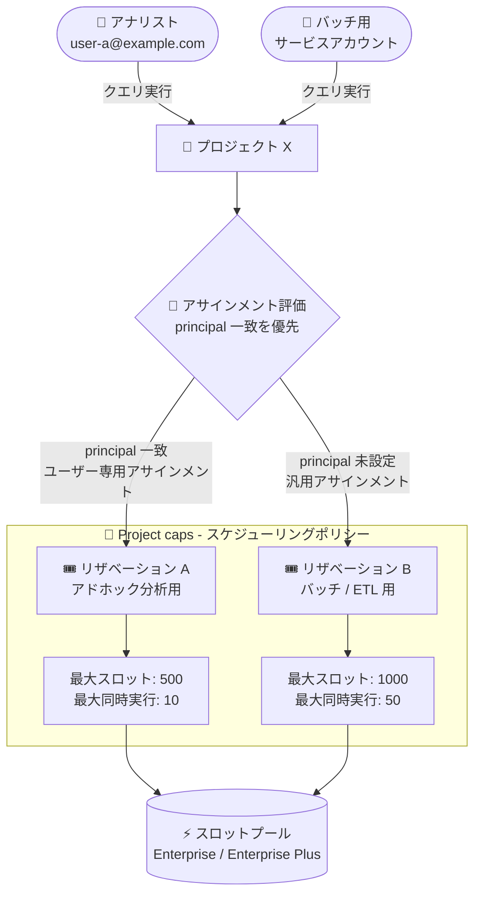

# BigQuery: リザベーションの Project caps (スケジューリングポリシー) と Principal ベースのルーティングが GA

**リリース日**: 2026-11-11

**サービス**: BigQuery

**機能**: Project caps (スケジューリングポリシー) / リザベーションアサインメントの principal プロパティ

**ステータス**: GA (一般提供) — BigQuery Enterprise / Enterprise Plus エディションのみ

📊 [このアップデートのインフォグラフィックを見る](https://takech9203.github.io/google-cloud-news-summary/20261111-bigquery-reservation-project-caps-principal-routing.html)

## 概要

BigQuery のワークロード管理 (リザベーション) に関する 2 つの機能が一般提供 (GA) になりました。いずれも BigQuery Enterprise および Enterprise Plus エディションでのみ利用できます。

1 つ目は **Project caps (スケジューリングポリシー)** です。リザベーション内でプロジェクトごとに「最大スロット数」と「最大同時実行クエリ数」の上限を設定できます。これにより、BigQuery のデフォルトであるフェアスケジューリングの動作をカスタマイズし、特定のプロジェクトがリザベーションのキャパシティを過剰に消費することを防げます。上限はリザベーションレベルのデフォルトとして設定することも、アサインメントルール (Project cap) として特定プロジェクトに対する個別オーバーライドとして設定することも可能です。

2 つ目は **Principal ベースのリザベーションルーティング** です。リザベーションアサインメントにオプションの `principal` プロパティを指定することで、ジョブを実行するユーザー、サービスアカウント、またはサードパーティ ID (Workforce / Workload Identity 連携の ID) に基づいて、クエリを特定のリザベーションにルーティングできます。これまでアサインメントの単位はプロジェクト・フォルダ・組織などのリソース階層に限られていましたが、ID 単位でのきめ細かなワークロード分離が可能になりました。大規模なマルチテナント環境や、BI ツール・バッチ処理・アドホック分析が同居する環境でのキャパシティ管理を担う管理者に有用なアップデートです。

**アップデート前の課題**

- フェアスケジューリングでは、リザベーションを共有する各プロジェクトが利用可能なキャパシティを均等に分け合うため、特定プロジェクトのスロット消費や同時実行数に明示的な上限を設けることができなかった
- 特定プロジェクトの暴走的なクエリ実行 (大量のスロット消費や大量の同時クエリ投入) がリザベーションを共有する他のプロジェクトの性能に影響するのを防ぐには、リザベーションを分割するしかなかった
- リザベーションアサインメントはプロジェクト・フォルダ・組織といったリソース階層単位でしか指定できず、同一プロジェクト内で「特定のユーザーやサービスアカウントのクエリだけ別のリザベーションに振り分ける」ことができなかった
- ID ごとにワークロードを分離するには、ユーザーやワークロードごとにプロジェクトを分ける必要があった

**アップデート後の改善**

- リザベーション内でプロジェクトごとの最大スロット数 (最小 100) と最大同時実行数を設定でき、1 つのリザベーションを複数プロジェクトで安全に共有できるようになった
- リザベーションレベルのデフォルト値と、プロジェクト単位のオーバーライド (アサインメントルール) の 2 段階で柔軟に制御できるようになった
- アサインメントに `principal` を指定することで、ユーザー・サービスアカウント・サードパーティ ID 単位でクエリのルーティング先リザベーションを制御できるようになった
- 同一リソース階層レベルでは principal が一致するアサインメントが汎用アサインメントより優先されるため、プロジェクト構成を変えずに ID ベースのワークロード分離を実現できるようになった

## アーキテクチャ図



同一プロジェクトから実行されたクエリでも、実行者の ID (principal) に応じて異なるリザベーションへルーティングされ、各リザベーションではプロジェクトごとの最大スロット数・同時実行数の上限 (Project caps) が適用されます。

## サービスアップデートの詳細

### 主要機能

1. **Project caps (スケジューリングポリシー) による上限設定**
   - **最大スロット数 (Maximum slots)**: リザベーション内で対象プロジェクトのクエリが消費するスロットを制限する。最小許容値は 100。厳密な制限ではなく、近似的な上限として適用される
   - **最大同時実行数 (Maximum concurrency)**: リザベーション内で対象プロジェクトに同時に許可されるクエリ数を制限する。クエリの受付 (admission) 時のみ適用され、実行中のクエリがキャンセルされることはない。実行中クエリ数より低い値に変更した場合、新規クエリは実行中クエリの完了までキューイングされる

2. **2 段階の設定レベル (デフォルトとオーバーライド)**
   - リザベーションレベルのデフォルト: リザベーション作成・更新時に「Project Concurrency」「Project Max Slots」を設定すると、そのリザベーションにアサインされたすべてのプロジェクトに適用される
   - プロジェクト単位のオーバーライド: アサインメントルール (ルールタイプ「Project cap」) として特定プロジェクトに個別の上限を設定し、デフォルトを上書きできる

3. **Principal ベースのリザベーションルーティング**
   - リザベーションアサインメント作成時にオプションの `principal` プロパティを指定すると、ジョブ実行者の ID に基づいてクエリのルーティング先を制御できる
   - 対応する ID 種別: Google アカウント (ユーザー)、サービスアカウント、Workforce Identity プールの単一 ID、Workload Identity プールの単一 ID
   - Google Cloud コンソール (User フィールド)、SQL (`CREATE ASSIGNMENT` の `principal` オプション)、bq CLI (`--principal` フラグ) で設定可能

4. **アサインメントの評価ロジック**
   - リソース階層 (プロジェクト → フォルダ → 組織) の順に評価される
   - 各階層レベルでは、まずジョブ実行者の principal に一致するアサインメントを確認し、なければ principal 未設定の汎用アサインメントを確認する
   - どちらも見つからなければ次の階層レベルへ進む
   - 注意: principal 付きのフォルダレベルアサインメントより、principal なしのプロジェクトレベルアサインメントが優先される (プロジェクトレベルの汎用アサインメントがある環境で特定ユーザーを確実にルーティングするには、同じプロジェクトレベルにユーザー専用アサインメントを作成する)

## 技術仕様

### Project caps の仕様と制限

| 項目 | 詳細 |
|------|------|
| 最大スロット数の最小値 | 100 (厳密ではなく近似的な上限) |
| 最大同時実行数の適用タイミング | クエリ受付時のみ (実行中クエリはキャンセルされない) |
| 設定変更の反映 | 最大 1 分。per-project の最大スロットオーバーライドの変更は新規クエリの開始後に有効化 |
| オーバーライドの対象 (assignee) | Google Cloud プロジェクトのみ (フォルダ・組織は非対応) |
| オーバーライドのジョブタイプ | 未設定または `JOB_TYPE_UNSPECIFIED` のみ |
| 適用外 | `ML_EXTERNAL` ジョブのトレーニングフェーズにはプロジェクトレベルのスロット上限が適用されない |
| 対応エディション | Enterprise / Enterprise Plus |

### Principal の指定形式 (IAM v2 プリンシパル識別子)

| ID 種別 | Principal 形式 |
|------|------|
| ユーザー | `principal://goog/subject/EMAIL_ADDRESS` |
| サービスアカウント | `principal://iam.googleapis.com/projects/-/serviceAccounts/EMAIL_ADDRESS` |
| Workforce Identity プール ID | `principal://iam.googleapis.com/locations/global/workforcePools/POOL_ID/subject/SUBJECT_ID` |
| Workload Identity プール ID | `principal://iam.googleapis.com/projects/PROJECT_NUMBER/locations/global/workloadIdentityPools/POOL_ID/subject/SUBJECT_ID` |

- ユーザー専用アサインメントのプロジェクトあたりのデフォルト上限は 100 (引き上げは Google へのフィードバック窓口経由で依頼)
- グループやドメイン全体の指定には対応せず、単一 ID のみ指定可能
- アサインメントと assignee (リザベーション利用側リソース) は同一組織・同一ロケーションである必要がある

### 必要な IAM 権限

| 操作 | 必要な権限 |
|------|------|
| リザベーション作成 | 管理プロジェクトに対する `bigquery.reservations.create` |
| アサインメント作成 | 管理プロジェクトと assignee に対する `bigquery.reservationAssignments.create` |
| 対応する事前定義ロール | BigQuery Admin / BigQuery Resource Admin / BigQuery Resource Editor |

## 設定方法

### 前提条件

1. BigQuery Enterprise または Enterprise Plus エディションのリザベーションを使用していること
2. 管理プロジェクト (リザベーションを所有するプロジェクト) に対する `bigquery.reservations.create` / `bigquery.reservationAssignments.create` 権限を持っていること
3. アサインメント対象リソースとリザベーションが同一組織・同一ロケーションにあること

### 手順

#### ステップ 1: リザベーションにデフォルトのスケジューリングポリシーを設定する

Google Cloud コンソールで **BigQuery > 管理 > Workload management** からリザベーションを作成・編集し、Advanced settings で以下を設定します。

- **Override project concurrency**: プロジェクトごとの同時実行クエリ数の上限
- **Override project max slots**: プロジェクトごとのスロット消費の上限

これらはリザベーションにアサインされたすべてのプロジェクトに対するデフォルト値として機能します。

#### ステップ 2: 特定プロジェクトに Project cap (オーバーライド) を作成する

コンソールの **Workload management > Assignment rules** タブから、ルールタイプ「Project cap」を選択してプロジェクト・リザベーション・Max slots / Max concurrency を指定します。

```bash
# bq CLI での例 (プロジェクト単位のオーバーライドはジョブタイプを未設定にする)
bq mk \
  --project_id=ADMIN_PROJECT_ID \
  --location=LOCATION \
  --reservation_assignment \
  --reservation_id=RESERVATION_NAME \
  --assignee_type=PROJECT \
  --assignee_id=TARGET_PROJECT_ID
```

Project cap の assignee はプロジェクトのみで、ジョブタイプは未設定 (`JOB_TYPE_UNSPECIFIED`) である必要があります。

#### ステップ 3: Principal ベースのアサインメントを作成する

SQL の `CREATE ASSIGNMENT` DDL で `principal` オプションを指定します。

```sql
CREATE ASSIGNMENT
  `ADMIN_PROJECT_ID.region-LOCATION.RESERVATION_NAME.ASSIGNMENT_ID`
OPTIONS (
  assignee = 'projects/PROJECT_ID',
  job_type = 'QUERY',
  principal = 'principal://goog/subject/user-a@example.com');
```

bq CLI の場合は `--principal` フラグを使用します。

```bash
bq mk \
  --project_id=ADMIN_PROJECT_ID \
  --location=LOCATION \
  --reservation_assignment \
  --reservation_id=RESERVATION_NAME \
  --assignee_type=PROJECT \
  --assignee_id=PROJECT_ID \
  --job_type=QUERY \
  --principal='principal://iam.googleapis.com/projects/-/serviceAccounts/batch-sa@example.iam.gserviceaccount.com'
```

アサインメント作成後は、少なくとも 5 分待ってからクエリを実行してください。待たない場合、クエリがオンデマンド料金で課金される可能性があります。

## メリット

### ビジネス面

- **リザベーションの統合によるコスト最適化**: 従来はノイジーネイバー対策としてプロジェクトごとにリザベーションを分割する必要があったが、Project caps により 1 つの大きなリザベーションを安全に共有でき、スロットの利用効率を高められる
- **部門・チーム単位の公平なキャパシティ配分**: プロジェクトごとの上限設定により、特定部門のワークロードが他部門の SLA に影響することを防げる
- **GA による本番適用**: Preview から GA に昇格したことで、本番環境のワークロード管理設計に正式に組み込めるようになった

### 技術面

- **ID ベースのワークロード分離**: 同一プロジェクト内でも BI ツール用サービスアカウント、ETL パイプライン、アナリストのアドホッククエリをそれぞれ別のリザベーションに振り分けられる
- **フェアスケジューリングの柔軟なカスタマイズ**: デフォルト (リザベーションレベル) とオーバーライド (プロジェクトレベル) の 2 段階制御で、きめ細かくかつ管理負荷を抑えた運用が可能
- **実行中クエリへの非破壊性**: 同時実行数の上限は受付時のみ適用されるため、設定変更が実行中のクエリを中断しない
- **Workforce / Workload Identity 連携に対応**: サードパーティ ID 基盤を利用する環境でも ID 単位のルーティングが可能

## デメリット・制約事項

### 制限事項

- BigQuery Enterprise / Enterprise Plus エディション限定 (Standard エディションおよびオンデマンドでは利用不可)
- 最大スロット数は厳密な制限ではなく近似的な上限であり、最小値は 100
- Project cap (オーバーライド) の assignee はプロジェクトのみで、フォルダ・組織には設定できない
- `ML_EXTERNAL` ジョブのトレーニングフェーズにはプロジェクトレベルのスロット上限が適用されない
- principal には単一 ID のみ指定可能で、グループは指定できない。ユーザー専用アサインメントはプロジェクトあたりデフォルト 100 件まで

### 考慮すべき点

- 設定変更の反映に最大 1 分かかり、最大スロットのオーバーライド変更は新規クエリの開始後に有効になる
- 同時実行数の上限を実行中クエリ数より下げると、新規クエリはキューイングされるため、レイテンシ要件のあるワークロードでは注意が必要
- principal なしのプロジェクトレベルアサインメントは、principal 付きのフォルダレベルアサインメントより優先される。プロジェクトレベルの汎用アサインメントが存在する場合、特定ユーザーを確実にルーティングするには同じプロジェクトレベルにユーザー専用アサインメントを追加する必要がある
- アサインメント作成直後 (5 分以内) のクエリはオンデマンド課金になる可能性がある

## ユースケース

### ユースケース 1: 全社共有リザベーションのノイジーネイバー対策

**シナリオ**: データ分析基盤チームが 5,000 スロットの Enterprise リザベーションを 20 のプロジェクトで共有している。月初のレポート処理で特定プロジェクトがスロットを占有し、他プロジェクトのダッシュボード更新が遅延する問題が発生していた。

**実装例**:
```
1. リザベーションのデフォルトとして Project Max Slots = 1000、
   Project Concurrency = 20 を設定
2. レポート処理プロジェクトには Assignment rule (Project cap) で
   Max slots = 2000 の個別オーバーライドを設定
```

**効果**: どのプロジェクトも設定した上限を超えてスロットを消費できなくなり、リザベーションを分割することなくノイジーネイバー問題を解消。スロットの利用効率も維持できる。

### ユースケース 2: 同一プロジェクト内での BI とバッチのワークロード分離

**シナリオ**: 1 つのデータウェアハウスプロジェクトに、Looker などの BI ツールが使うサービスアカウントと、夜間 ETL 用のサービスアカウント、アナリストのアドホッククエリが同居しており、ETL 実行中に BI ダッシュボードの応答が悪化する。

**実装例**:
```sql
-- BI 用サービスアカウントを低レイテンシ重視のリザベーションへ
CREATE ASSIGNMENT `admin-prj.region-asia-northeast1.bi-reservation.bi-sa-assign`
OPTIONS (
  assignee = 'projects/dwh-project',
  job_type = 'QUERY',
  principal = 'principal://iam.googleapis.com/projects/-/serviceAccounts/looker-sa@dwh-project.iam.gserviceaccount.com');

-- その他のクエリはプロジェクトレベルの汎用アサインメントで既定のリザベーションへ
```

**効果**: プロジェクトを分割することなく、ID 単位で BI・ETL・アドホックのワークロードを別々のリザベーションに分離でき、相互干渉を防止できる。

## 料金

両機能は BigQuery Enterprise / Enterprise Plus エディションのリザベーション機能の一部として提供されます。Release Notes およびドキュメントに追加料金の記載はありません。

BigQuery エディションのコンピュート料金は、スロット時間 (slot-hour) 単位の従量課金です (デフォルトで 1 分の最低課金時間)。Enterprise / Enterprise Plus エディションでは、1 年コミットメント (20% 割引) または 3 年コミットメント (40% 割引) のスロットコミットメントも利用できます。リージョンごとの単価は料金ページを参照してください。

- [BigQuery 料金](https://cloud.google.com/bigquery/pricing)

## 利用可能リージョン

リージョン固有の制限は Release Notes に記載されていません。BigQuery エディション (Enterprise / Enterprise Plus) が利用可能なロケーションで使用できます。詳細は [BigQuery のロケーション](https://docs.cloud.google.com/bigquery/docs/locations) を参照してください。

## 関連サービス・機能

- **BigQuery editions (Enterprise / Enterprise Plus)**: 両機能の利用に必須。アドバンスドワークロード管理 (アイドルスロット共有、ターゲット同時実行数) を提供
- **BigQuery slots autoscaling**: ベースラインスロットとオートスケーリングスロットによるキャパシティ管理。Project caps と組み合わせてリザベーション全体と個別プロジェクトの両面から制御できる
- **IAM (Workforce / Workload Identity 連携)**: principal プロパティで指定できる ID の基盤。サードパーティ ID でのルーティングに利用
- **INFORMATION_SCHEMA.JOBS / リザベーションモニタリング**: プロジェクトごとのスロット消費や同時実行数の実績を確認し、適切な上限値を設計するために活用
- **クエリキュー (Query queues)**: 同時実行数の上限超過時のクエリのキューイング動作に関連

## 参考リンク

- 📊 [インフォグラフィック](https://takech9203.github.io/google-cloud-news-summary/20261111-bigquery-reservation-project-caps-principal-routing.html)
- [公式リリースノート](https://docs.cloud.google.com/release-notes#November_11_2026)
- [ドキュメント: ワークロード管理の概要 (Project caps and scheduling policies)](https://docs.cloud.google.com/bigquery/docs/reservations-workload-management)
- [ドキュメント: ワークロードアサインメントの管理 (principal / Project cap の設定手順)](https://docs.cloud.google.com/bigquery/docs/reservations-assignments)
- [ドキュメント: ワークロードリザベーションの管理](https://docs.cloud.google.com/bigquery/docs/reservations-tasks)
- [ドキュメント: BigQuery エディションの概要](https://docs.cloud.google.com/bigquery/docs/editions-intro)
- [料金ページ](https://cloud.google.com/bigquery/pricing)

## まとめ

BigQuery のリザベーション管理に「プロジェクト単位の上限 (Project caps)」と「ID 単位のルーティング (principal)」という 2 つの強力な制御軸が GA として加わり、リザベーションを分割せずにノイジーネイバー対策とワークロード分離を実現できるようになりました。Enterprise / Enterprise Plus エディションで複数プロジェクト・複数ワークロードがリザベーションを共有している環境では、INFORMATION_SCHEMA やリザベーションモニタリングで現状のスロット消費を把握した上で、デフォルトのスケジューリングポリシーと principal ベースのアサインメントの導入を検討することを推奨します。

---

**タグ**: BigQuery, リザベーション, ワークロード管理, Project caps, スケジューリングポリシー, Principal, Enterprise エディション, GA
