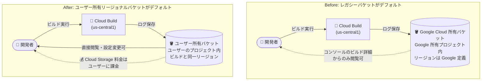

# Cloud Build: Cloud Storage へのビルドログ保存でユーザー所有のリージョンバケットがデフォルトに

**リリース日**: 2026-11-11

**サービス**: Cloud Build

**機能**: ビルドログの Cloud Storage 保存におけるデフォルトバケットの変更 (ユーザー所有・リージョナルバケット)

**ステータス**: Change (デフォルト動作の変更)

📊 [このアップデートのインフォグラフィックを見る](https://takech9203.github.io/google-cloud-news-summary/20261111-cloud-build-user-owned-regional-log-buckets.html)

## 概要

Cloud Build でビルドログを Cloud Storage に保存する際、これまでの Google Cloud 所有バケット (レガシーバケット) に代わり、**ユーザー所有のリージョナルバケットがデフォルトで使用される**ようになりました。これは、ビルド設定で `defaultLogsBucketBehavior` を `REGIONAL_USER_OWNED_BUCKET` に設定した場合と同じ動作が、明示的な設定なしで適用されることを意味します。

従来のデフォルト (レガシーバケット) では、ビルドログは Google Cloud 所有プロジェクト内のバケットに保存されていたため、ユーザーはバケットの設定変更やバケット内のログの直接閲覧ができず、リージョンも Google Cloud 側で決定されていました。今回の変更により、ビルドログはユーザー自身のプロジェクト内に Cloud Build が自動作成する、**ビルドと同一リージョンのバケット**に保存されるようになり、保持期間や暗号化などのバケット設定を自分で管理できるようになります。

この変更は、データレジデンシー (データ所在地) 要件への準拠や、ログの可視性・ガバナンス強化を求める組織にとって特に重要です。一方で、ログがユーザー所有バケットに保存されるため、**Cloud Storage のストレージ料金が自分のプロジェクトに課金される**点に注意が必要です。

**アップデート前の課題**

- デフォルトでは、ビルドログは Google Cloud 所有プロジェクト内のバケットに保存され、バケットの設定 (保持期間、ライフサイクル、暗号化など) をユーザーが変更できなかった
- Google Cloud 所有バケット内のログは、Google Cloud コンソールのビルド詳細ページの「ビルドログ」セクションからしか閲覧できなかった
- Google Cloud 所有バケットのリージョンは Google Cloud 側で定義されており、ビルドのリージョンと一致するとは限らず、データレジデンシー要件への対応が難しかった
- リージョン整合やユーザー所有バケットを利用するには、`defaultLogsBucketBehavior: REGIONAL_USER_OWNED_BUCKET` や `logsBucket` を明示的に設定する必要があった

**アップデート後の改善**

- 明示的な設定なしで、ビルドログがユーザーのプロジェクト内にある Cloud Build 作成・ユーザー所有のバケットにデフォルトで保存されるようになった
- ログバケットが常にビルドと同一リージョンに作成されるため、データレジデンシー要件への準拠が容易になった
- ユーザー所有バケットとして、保持期間・ライフサイクルルールなどのバケット設定の変更や、バケット内のログの直接閲覧が可能になった
- 同一プロジェクト・同一リージョンでの以降のビルドは、作成済みのバケットを再利用するため、リージョンごとに一貫したログ管理ができる

## アーキテクチャ図



Cloud Storage にビルドログを保存する場合のデフォルトの保存先が、Google Cloud 所有バケットからユーザーのプロジェクト内のビルドと同一リージョンのユーザー所有バケットに変更されたことを示す Before/After 比較図です。

## サービスアップデートの詳細

### 主要機能

1. **ユーザー所有リージョナルバケットのデフォルト化**
   - ビルドログを Cloud Storage に保存する場合、Cloud Build が作成するユーザー所有バケットがデフォルトで使用される
   - バケットはユーザーのプロジェクト内に作成され、ビルドと同一リージョンに配置される
   - 従来この動作を有効化するために必要だった `defaultLogsBucketBehavior: REGIONAL_USER_OWNED_BUCKET` の明示的な設定が不要になる

2. **リージョンごとのバケット自動作成・再利用**
   - 初回ビルド時に、ビルドを実行するリージョンに新しいバケットが自動作成される
   - 同一プロジェクト・同一リージョンでの以降のビルドは既存バケットを再利用する
   - 複数リージョンでビルドを実行する場合は、リージョンごとに個別のバケットが作成される

3. **ユーザーによるバケット管理**
   - 作成されたバケットはユーザー所有のため、ユーザー作成バケットと同様に設定変更 (保持期間、ライフサイクル、ラベルなど) が可能
   - バケット内のビルドログを Cloud Storage から直接閲覧できる

## 技術仕様

### ログ保存先の決定ロジック

| 設定 | 動作 |
|------|------|
| `logging: CLOUD_LOGGING_ONLY` | ログは Cloud Logging のみに送信 (`defaultLogsBucketBehavior` は無視) |
| `logging: NONE` | ログは保存されない |
| `logsBucket` を指定 | 指定したバケットに常に保存 (`defaultLogsBucketBehavior` は無視) |
| `logsBucket` 未指定 + `defaultLogsBucketBehavior: REGIONAL_USER_OWNED_BUCKET` | Cloud Build 作成・ユーザー所有のリージョナルバケットに保存 (**今回の変更によりデフォルト動作**) |
| `logsBucket` 未指定 + `defaultLogsBucketBehavior: LEGACY_BUCKET` | Google Cloud 所有プロジェクト内のバケットに保存 (従来のデフォルト動作を明示的に維持する場合に指定) |

### バケットタイプの比較

| 項目 | ユーザー所有リージョナルバケット (新デフォルト) | Google Cloud 所有バケット (レガシー) |
|------|------|------|
| バケットの所在 | ユーザーのプロジェクト内 | Google Cloud 所有プロジェクト内 |
| リージョン | ビルドと同一リージョン | Google Cloud 定義のリージョン |
| バケット設定の変更 | 可能 | 不可 |
| ログの閲覧 | バケットから直接閲覧可能 | ビルド詳細ページの「ビルドログ」のみ |
| ストレージ料金 | ユーザーに課金 (Cloud Storage 料金) | ユーザーへの課金なし |

### ログ閲覧に必要な IAM ロール

| 保存先 | 必要なロール |
|------|------|
| ユーザー作成/ユーザー所有の Cloud Storage バケット | Storage Object Viewer (`roles/storage.objectViewer`) |
| デフォルト (Google Cloud 所有) バケット | Viewer (`roles/viewer`) |
| Cloud Logging | Logs Viewer (`roles/logging.viewer`) |

## 設定方法

### 前提条件

1. ビルドに使用するサービスアカウントに、ログバケットへの書き込み権限があること (バケットとビルドが同一プロジェクトで Cloud Build レガシーサービスアカウントを使用している場合は追加権限は不要。それ以外の場合は、ビルド用サービスアカウントに Storage Admin (`roles/storage.admin`) などの権限付与が必要)
2. ビルドログの保存先として Cloud Storage を使用していること (`logging` が `GCS_ONLY` または `LEGACY` 相当)

### 手順

#### ステップ 1: 現在のログ設定の確認

```yaml
# cloudbuild.yaml の例: ログ関連フィールドを確認
steps:
  - name: 'gcr.io/cloud-builders/docker'
    args: ['build', '-t', 'us-central1-docker.pkg.dev/myproject/myrepo/myimage', '.']
options:
  # logging / logsBucket / defaultLogsBucketBehavior の設定を確認
  defaultLogsBucketBehavior: REGIONAL_USER_OWNED_BUCKET
```

`logsBucket` を指定している場合は従来通りそのバケットが使用されます。デフォルト動作に依存している場合は、今回の変更によりユーザー所有リージョナルバケットが使用されます。

#### ステップ 2: 従来の動作を維持したい場合 (レガシーバケットの明示指定)

```yaml
options:
  defaultLogsBucketBehavior: LEGACY_BUCKET
```

Google Cloud 所有バケットへの保存を継続したい場合は、`defaultLogsBucketBehavior` に `LEGACY_BUCKET` を明示的に設定します。

#### ステップ 3: Dockerfile からのビルド時の指定

```bash
# gcloud builds submit 実行時にフラグで指定
gcloud builds submit --default-buckets-behavior=regional-user-owned-bucket

# レガシー動作を維持する場合
gcloud builds submit --default-buckets-behavior=legacy-bucket
```

ビルド設定ファイルを使わずに Dockerfile からビルドする場合は、`--default-buckets-behavior` フラグで動作を指定できます。

## メリット

### ビジネス面

- **データレジデンシー要件への準拠**: ビルドログが常にビルドと同一リージョンのバケットに保存されるため、データ所在地に関するコンプライアンス要件を満たしやすくなる
- **ガバナンスの向上**: ログバケットがユーザーのプロジェクト内にあるため、組織のポリシー (保持期間、アクセス制御、監査) を自社の基準で適用できる

### 技術面

- **バケット設定の自由度**: ユーザー所有バケットとして、保持期間・ライフサイクルルール・ラベルなどを自由に構成できる
- **ログへの直接アクセス**: Cloud Storage バケットからいつでもログを直接閲覧・取得でき、他ツールとの連携も容易になる
- **設定不要でベストプラクティスを適用**: 従来は明示的な設定が必要だった推奨構成 (ユーザー所有・リージョン整合バケット) がデフォルトになる

## デメリット・制約事項

### 制限事項

- ユーザー所有バケットへのログ保存には Cloud Storage のストレージ料金が発生する (Google Cloud 所有バケットでは課金されなかった)
- 複数リージョンでビルドを実行する場合、リージョンごとに個別のバケットが作成されるため、管理対象のバケットが増える
- `logging` が `CLOUD_LOGGING_ONLY` または `NONE` の場合、および `logsBucket` が定義されている場合は、この変更の影響を受けない

### 考慮すべき点

- デフォルト動作に依存していた既存ビルドでは、ログの保存先とログ閲覧に必要な IAM ロールが変わる可能性がある (デフォルトバケットは `roles/viewer`、ユーザー所有バケットは `roles/storage.objectViewer` が必要)
- ビルド用サービスアカウントがレガシーサービスアカウント以外の場合、バケット作成・書き込みに必要な権限 (Storage Admin など) の付与が必要になることがある
- ログ保存コストを抑えたい場合は、作成されたバケットにライフサイクルルール (一定期間後の削除や低頻度アクセスクラスへの移行) を設定することを推奨
- 従来の動作を維持したい場合は `defaultLogsBucketBehavior: LEGACY_BUCKET` を明示的に設定する

## ユースケース

### ユースケース 1: データレジデンシー要件のある企業での CI/CD

**シナリオ**: 金融機関が、ビルドログを含むすべてのデータを特定リージョン (例: asia-northeast1) 内に保持することをコンプライアンス上求められている。

**実装例**:
```yaml
# cloudbuild.yaml — 追加設定なしでリージョン整合が実現 (明示する場合)
steps:
  - name: 'gcr.io/cloud-builders/docker'
    args: ['build', '-t', 'asia-northeast1-docker.pkg.dev/myproject/myrepo/app', '.']
options:
  defaultLogsBucketBehavior: REGIONAL_USER_OWNED_BUCKET
```

**効果**: asia-northeast1 で実行したビルドのログは自動的に同リージョンのユーザー所有バケットに保存され、データ所在地要件を満たしつつ、監査時にはバケットから直接ログを取得できる。

### ユースケース 2: ログ保持ポリシーの統一管理

**シナリオ**: 組織のセキュリティポリシーで、CI/CD ログを 90 日間保持した後に削除することが定められている。従来の Google Cloud 所有バケットではバケット設定を変更できなかった。

**効果**: ユーザー所有バケットに対してライフサイクルルール (90 日後に削除) を設定でき、組織のログ保持ポリシーを Cloud Build のログにも適用できる。保存コストの最適化にもつながる。

## 料金

Cloud Build 自体の料金に変更はありませんが、ビルドログがユーザー所有バケットに保存されるため、**Cloud Storage のストレージ料金・オペレーション料金がユーザーのプロジェクトに課金される**ようになります (従来の Google Cloud 所有バケットでは課金なし)。

Cloud Storage の Standard ストレージ (リージョナル) は $0.02/GiB/月から、オペレーションは $0.0004/1,000 オペレーションからです。無料枠として 5 GiB の Standard ストレージが提供されています。

### 料金例 (Standard ストレージ、$0.02/GiB/月のリージョンの場合)

| 使用量 (ビルドログの保存量) | 月額料金 (概算) |
|--------|-----------------|
| 5 GiB 以下 | $0 (無料枠内) |
| 10 GiB | 約 $0.20 |
| 100 GiB | 約 $2.00 |

ビルドログは通常サイズが小さいため、ほとんどのプロジェクトでコスト影響は軽微ですが、大量のビルドを実行する場合はライフサイクルルールによる自動削除の設定を推奨します。詳細は [Cloud Storage の料金ページ](https://cloud.google.com/storage/pricing) を参照してください。

## 利用可能リージョン

Cloud Build が利用可能なすべてのリージョンに適用されます。ログバケットはビルドを実行するリージョンごとに作成されます。利用可能なリージョンは [Cloud Build のロケーション](https://cloud.google.com/build/docs/locations) を参照してください。

## 関連サービス・機能

- **Cloud Storage**: ビルドログの保存先。ユーザー所有バケットとして保持期間・ライフサイクル・暗号化などを管理できる
- **Cloud Logging**: ビルドログのもう 1 つの保存先 (`logging: CLOUD_LOGGING_ONLY`)。ログ検索性や保持期間の制御を重視する場合の選択肢
- **IAM**: ユーザー所有バケットのログ閲覧には `roles/storage.objectViewer`、ビルド用サービスアカウントのバケット操作には `roles/storage.admin` などの権限管理が関連
- **Artifact Registry**: Cloud Build と組み合わせて使用される代表的なビルド成果物の保存先

## 参考リンク

- 📊 [インフォグラフィック](https://takech9203.github.io/google-cloud-news-summary/20261111-cloud-build-user-owned-regional-log-buckets.html)
- [公式リリースノート](https://docs.cloud.google.com/release-notes#November_11_2026)
- [ドキュメント: Build log storage overview](https://docs.cloud.google.com/build/docs/securing-builds/build-log-storage)
- [ドキュメント: Store and manage build logs](https://docs.cloud.google.com/build/docs/securing-builds/store-manage-build-logs)
- [Cloud Storage 料金ページ](https://cloud.google.com/storage/pricing)

## まとめ

Cloud Build のビルドログを Cloud Storage に保存する際のデフォルトが、Google Cloud 所有のレガシーバケットからユーザー所有のリージョナルバケットに変更されました。データレジデンシー準拠とログガバナンスの観点で推奨されていた構成がデフォルトになる一方、Cloud Storage 料金の発生とログ閲覧に必要な IAM ロールの違いに注意が必要です。デフォルト動作に依存している既存ビルドを棚卸しし、必要に応じてライフサイクルルールの設定や `LEGACY_BUCKET` の明示指定を検討してください。

---

**タグ**: #CloudBuild #CloudStorage #CICD #ビルドログ #データレジデンシー #Change
