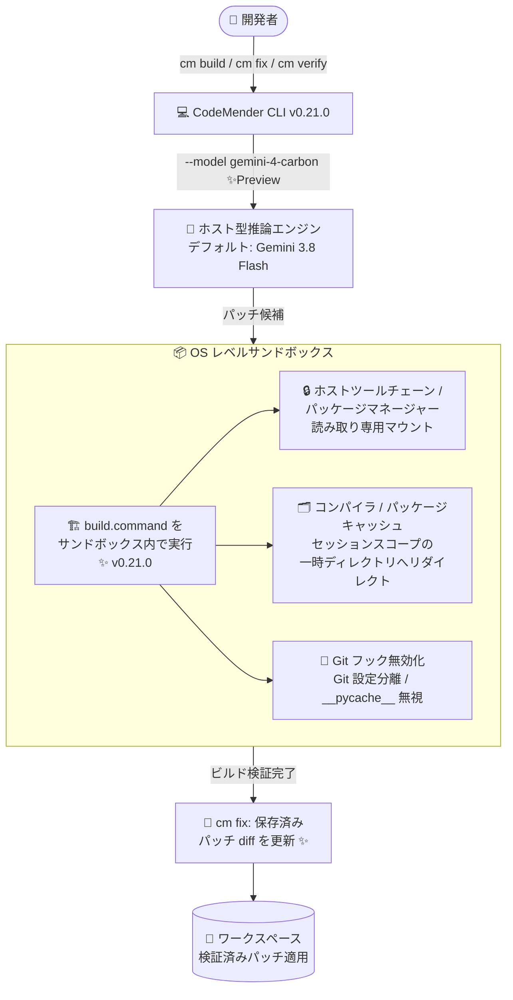

# Gemini Enterprise Agent Platform: CodeMender v0.21.0 アップデート (サンドボックス強化 & Gemini 4 Carbon 対応)

**リリース日**: 2026-11-11

**サービス**: Gemini Enterprise Agent Platform (CodeMender)

**機能**: CodeMender v0.21.0 - サンドボックス内ビルド検証・パッチ diff 更新・環境分離の強化 / Gemini 4 Carbon サポート (Preview)

**ステータス**: Fixed (v0.21.0 アップデート) + Feature (Gemini 4 Carbon サポート: Preview)

📊 [このアップデートのインフォグラフィックを見る](https://takech9203.github.io/google-cloud-news-summary/20261111-codemender-v0-21-0.html)

## 概要

Gemini Enterprise Agent Platform の AI コードセキュリティエージェント「CodeMender」の v0.21.0 がリリースされた。CodeMender は、コードベースの脆弱性をスキャン (`cm find`)、検証 (`cm verify`)、修正 (`cm fix`) する自律型エージェントであり、推論はクラウド側のホスト型エンジン、パッチの適用・ビルド・テストはローカルの OS レベルサンドボックス内で行う実行モデルを採用している。

v0.21.0 の中心テーマは「サンドボックス境界の徹底」である。サンドボックス有効時に `cm build` と `cm fix` のビルド検証が `build.command` をサンドボックス内で実行するようになり、ホストのツールチェーンとパッケージマネージャーのディレクトリは読み取り専用でマウント、コンパイラ・パッケージキャッシュはセッションスコープの一時ディレクトリにリダイレクトされる。さらに、リポジトリの Git フックの無効化、ホスト Git 設定の分離、Python バイトコードキャッシュ (`__pycache__`) の無視といったコマンド実行環境の分離も導入された。`cm fix` はビルド検証完了後に保存済みパッチ diff を更新 (refresh) するようになり、検証結果とパッチの整合性が保たれる。加えて、停止セッションの 30 分タイムアウト、PoC 実行出力の保持、サンドボックス障害時のパッチ生成自動リトライという 3 件のバグ修正が含まれる。

同日、CodeMender が Gemini 4 Carbon (前日 2026-11-10 に GA となった Google のフロンティアモデル) を Preview サポートした。`cm find`、`cm verify`、`cm fix` に `--model gemini-4-carbon` を渡すことで利用でき、デフォルトモデルは引き続き Gemini 3.8 Flash である。対象ユーザーは、CodeMender で脆弱性スキャン・自動修正を行う開発チーム、特にホスト環境の汚染リスクを最小化したい DevSecOps チームや、複雑な脆弱性に対してより強力な推論モデルを試したいセキュリティエンジニアである。

**アップデート前の課題**

- サンドボックス有効時でも、`cm build` および `cm fix` のビルド検証における `build.command` の実行はサンドボックス内で完結しておらず、ビルド・テスト実行時の分離が不十分だった
- ビルド時にホストのツールチェーンやパッケージマネージャーのディレクトリ、コンパイラ・パッケージキャッシュへ書き込みが発生し得るため、エージェントのビルド実行がホスト環境 (共有キャッシュなど) を汚染するリスクがあった
- リポジトリに仕込まれた Git フックやホストの Git 設定、stale な `__pycache__` がコマンド・ビルド実行に影響し得た
- ビルド検証後に保存済みパッチ diff が更新されず、検証中の変更がパッチに反映されないことがあった
- 応答のないセッションがタイムアウトせずに停止したままになることがあった
- PoC (再現スクリプト) がエラーになると実行出力が失われ、ビルド失敗・タイムアウト・セットアップ問題の診断が困難だった
- 実行途中でサンドボックスに障害が発生するとパッチ生成が失敗していた
- モデル選択肢に Gemini 4 Carbon が含まれていなかった

**アップデート後の改善**

- サンドボックス有効時、`cm build` と `cm fix` のビルド検証が `build.command` をサンドボックス内で実行するようになり、ビルド・テストを含むエンドツーエンドの検証がサンドボックス境界内で完結するようになった
- サンドボックス化された `cm build`、`cm fix`、`cm verify` では、ホストのツールチェーン・パッケージマネージャーディレクトリが読み取り専用でマウントされ、対応するコンパイラ・パッケージキャッシュはセッションスコープの一時ディレクトリにリダイレクトされるため、ホスト環境への副作用が防止される
- コマンド・ビルド実行中は、リポジトリの Git フックが無効化され、ホスト Git 設定が分離され、`__pycache__` が無視されるため、実行環境の再現性と安全性が向上した
- `cm fix` がビルド検証完了後に保存済みパッチ diff を更新するようになり、最終的なパッチと検証済みコードの整合性が保証される
- 無応答のアクティブターンに 30 分のタイムアウトが追加され、停止セッションがクリーンにキャンセル・復旧されるようになった
- PoC 実行時のエラーでも stdout / stderr が保持され、障害診断が容易になった
- 実行途中のサンドボックス障害時は新しいサンドボックス環境で自動リトライされるようになった
- `--model gemini-4-carbon` で Gemini 4 Carbon (Preview) を利用できるようになった

## アーキテクチャ図



v0.21.0 では、`build.command` の実行がサンドボックス内に移り、ホストツールチェーンの読み取り専用化・キャッシュの隔離・Git フック無効化によってビルド検証がホスト環境から分離される。検証完了後は保存済みパッチ diff が更新され、ワークスペースに適用される。

## サービスアップデートの詳細

### 主要機能

1. **サンドボックス内ビルドコマンド実行とパッチ diff 更新**
   - サンドボックス有効時、`cm build` および `cm fix` のビルド検証が、設定済みの `build.command` をサンドボックス内で実行するようになった
   - `cm fix` はビルド検証の完了後に保存済みパッチ diff を更新 (refresh) するようになり、検証プロセスを経た最終状態がパッチに正しく反映される

2. **読み取り専用ホストツールチェーンと隔離キャッシュ**
   - サンドボックス化された `cm build`、`cm fix`、`cm verify` の実行では、ホストのツールチェーンおよびパッケージマネージャーのディレクトリが読み取り専用でマウントされる
   - 対応するコンパイラキャッシュ・パッケージキャッシュは、セッションスコープの一時ディレクトリにリダイレクトされる
   - エージェントが実行するビルドがホストの共有キャッシュやツールチェーンを書き換えることがなくなり、ホスト環境の完全性が保たれる

3. **コマンド実行環境の分離**
   - コマンド・ビルド実行中は、リポジトリの Git フックが無効化される (悪意あるフックの実行防止)
   - ホストの Git 設定が分離される
   - リポジトリの Python バイトコードキャッシュ (`__pycache__`) が無視され、stale なキャッシュによる予期しない挙動を防ぐ

4. **バグ修正 (3 件)**
   - 無応答のアクティブターンに 30 分のタイムアウトを追加し、停止したセッションがクリーンにキャンセル・復旧されるようになった
   - PoC (reproducer) エラー発生時も実行出力 (stdout / stderr) を保持し、ビルド失敗・タイムアウト・セットアップ問題の診断を支援する
   - 実行途中のサンドボックス障害でパッチ生成が失敗する問題を、新しいサンドボックス環境での自動リトライにより修正した

5. **Gemini 4 Carbon サポート (Preview)**
   - `cm find`、`cm verify`、`cm fix` に `--model gemini-4-carbon` を渡すことで、Gemini 4 Carbon を推論モデルとして利用できる
   - デフォルトモデルは引き続き Gemini 3.8 Flash
   - Gemini 4 Carbon は 2026-11-10 に GA となった Google のフロンティアモデルで、コーディングやサイバーセキュリティを含む複雑なタスク向けに設計されている
   - Gemini 4 Carbon には組み込みのサイバーセーフティ機能があり、エクスプロイト生成や脆弱性検証に関わるリクエストをブロックする場合がある。セーフティブロックが発生すると自動的に Gemini 3.8 Flash Cyber でリトライされ、プロジェクトに Gemini 3.8 Flash Cyber (Fairwind Program) へのアクセスがない場合は Gemini 3.8 Flash にフォールバックする

## 技術仕様

### v0.21.0 のサンドボックス強化の内訳

| 項目 | v0.20.0 以前 | v0.21.0 |
|------|--------------|---------|
| `build.command` の実行場所 (サンドボックス有効時) | サンドボックス内での実行が保証されない | `cm build` / `cm fix` のビルド検証でサンドボックス内実行 |
| ホストツールチェーン / パッケージマネージャー | 書き込み可能性あり | 読み取り専用マウント (`cm build` / `cm fix` / `cm verify`) |
| コンパイラ / パッケージキャッシュ | ホストの共有キャッシュを使用 | セッションスコープの一時ディレクトリへリダイレクト |
| リポジトリ Git フック | 実行され得る | コマンド・ビルド実行中は無効化 |
| ホスト Git 設定 | 共有 | 分離 |
| `__pycache__` | 参照され得る | コマンド・ビルド実行中は無視 |
| 保存済みパッチ diff | ビルド検証後に更新されない場合あり | ビルド検証完了後に自動更新 |

### 既存のサンドボックス機構 (参考)

CodeMender CLI はデフォルトで OS レベルサンドボックス内で動作する。

| OS | 分離機構 |
|----|----------|
| Linux | カーネル名前空間 (CLONE_NEWNS、CLONE_NEWUSER など) + seccomp フィルタ |
| macOS | sandbox-exec (Seatbelt) |
| Windows | AppContainer + ACL (Experimental) |

- ネットワーク分離: デフォルトは `sandbox.network.profile: "permissive-closed"` (アウトバウンド遮断)。ビルドで外部依存取得が必要な場合は事前フェッチ、`permissive-open`、または `--sandbox=false` を検討
- 資格情報分離: `~/.ssh`、`~/.config/gcloud` などのホスト資格情報ディレクトリを除外し、`*_TOKEN` / `*_SECRET` などのシークレット系環境変数を除去
- `.git/hooks`、`.git/config`、`.hg/hgrc`、`.codemender` は常に読み取り専用

### CodeMender がサポートするモデル (v0.21.0 時点)

| モデル | フラグ指定 | 備考 |
|--------|-----------|------|
| Gemini 3.8 Flash | `--model gemini-3.8-flash` | デフォルト |
| Gemini 3.8 Flash Cyber | `--model gemini-3.8-flash-cyber` | Fairwind Program 経由 |
| Gemini 4 Argon | `--model gemini-4-argon` | サイバーセーフティ組み込み |
| Gemini 4 Argon Cyber Permissive | `--model gemini-4-argon-cyber-permissive` | Fairwind Program 経由 |
| Gemini 4 Carbon | `--model gemini-4-carbon` | ✨ 今回追加 (CodeMender では Preview) |
| Gemini 4 Carbon for cyber | `--model gemini-4-carbon-cyber-permissive` | Fairwind Program 経由 |
| Gemini 3.7 Flash | `--model gemini-3.7-flash` | 2027-01-28 リタイア予定 |
| Gemini 3.6 Flash | `--model gemini-3.6-flash` | 非推奨。2026-11-19 リタイア予定 |
| Gemini 3.5 Flash / 3.1 Pro Preview | `--model gemini-3.5-flash` / `--model gemini-3.1-pro-preview` | - |

`--model` フラグは `cm find`、`cm verify`、`cm fix` でサポートされる。`config.yaml` ではモデルを設定できない。

## 設定方法

### 前提条件

1. CodeMender へのアクセス権を持つ Google Cloud プロジェクト (CodeMender は限定された顧客向けの Preview)
2. CodeMender CLI のインストールと Application Default Credentials (ADC) の設定
3. `config.yaml` で `build.command` が設定済みであること (例: `build: { command: "make build && make test" }`)
4. サンドボックスが有効であること (`sandbox.enabled: true`、デフォルト)

### 手順

#### ステップ 1: CLI を v0.21.0 に更新

```bash
cm update
```

v0.21.0 に更新することで、サンドボックス内ビルド実行・キャッシュ隔離・環境分離・バグ修正が適用される。

#### ステップ 2: サンドボックス内でのビルド検証を確認

```bash
# サンドボックス有効 (デフォルト) のままビルドを実行
cm build

# ネットワーク依存のビルドが失敗する場合は、依存を事前フェッチするか
# config.yaml で network profile を変更する
# sandbox:
#   network:
#     profile: "permissive-open"
```

v0.21.0 以降、`build.command` はサンドボックス内で実行される。デフォルトのネットワーク分離 (`permissive-closed`) では `npm install` や `pip install` などの外部依存取得が失敗するため、依存関係はホスト側で事前にインストールしておく。コンパイラ・パッケージキャッシュはセッションスコープの一時ディレクトリに向くため、初回ビルドはホストの共有キャッシュを使う場合より時間がかかる可能性がある。

#### ステップ 3: Gemini 4 Carbon を指定して実行 (Preview)

```bash
# スキャンで Gemini 4 Carbon を使用
cm find . --model gemini-4-carbon

# 検証・修正でも同様に指定可能
cm verify FINDING_ID --model gemini-4-carbon
cm fix FINDING_ID --model gemini-4-carbon
```

指定しない場合はデフォルトの Gemini 3.8 Flash が使用される。Gemini 4 Carbon のサイバーセーフティ機能によりブロックが発生した場合は、Gemini 3.8 Flash Cyber → Gemini 3.8 Flash の順で自動フォールバックする。

## メリット

### ビジネス面

- **サプライチェーンリスクの低減**: 悪意ある Git フックやビルドスクリプトがホスト環境 (ツールチェーン、共有キャッシュ、Git 設定) を改変するリスクが構造的に遮断され、未知のコードベースや外部由来のリポジトリに対しても CodeMender を安全に実行しやすくなる
- **運用の安定化**: 停止セッションの自動タイムアウト・サンドボックス障害時の自動リトライにより、長時間実行や CI 組み込み時の「ハングしたまま」「途中失敗でやり直し」といった運用負荷が減る
- **モデル選択の柔軟性**: 複雑な脆弱性に対してフロンティアモデル (Gemini 4 Carbon) を選択でき、精度とコストのトレードオフをユースケースごとに最適化できる

### 技術面

- **ビルド検証のエンドツーエンド分離**: パッチ適用だけでなく `build.command` によるビルド・テストまでサンドボックス内で完結し、ホスト環境への副作用 (キャッシュ汚染、ツールチェーン改変) がなくなる
- **再現性の向上**: セッションスコープのキャッシュ、Git 設定の分離、`__pycache__` の無視により、ホスト固有の状態に依存しないクリーンなビルド検証が可能になる
- **診断性の向上**: PoC エラー時にも stdout / stderr が保持されるため、ビルド失敗・タイムアウト・セットアップ問題の原因究明が容易になる
- **パッチ整合性の保証**: ビルド検証後のパッチ diff 自動更新により、「検証したコード」と「適用されるパッチ」の乖離が解消される

## デメリット・制約事項

### 制限事項

- CodeMender は Preview であり、限定された顧客のみ利用可能。Pre-GA Offerings Terms が適用される
- CodeMender における Gemini 4 Carbon サポートは Preview 段階
- サンドボックスのネットワーク分離はドメイン単位の許可リストに未対応 (`permissive-closed` か `permissive-open` の二択)
- Gemini 4 Carbon は組み込みのサイバーセーフティ機能により、エクスプロイト生成・脆弱性検証に関わるリクエストをブロックする場合がある (自動フォールバックあり)。`cm verify` はサイバーモデル (Fairwind Program 経由) との組み合わせが最適とされている
- Windows のサンドボックスは Experimental

### 考慮すべき点

- キャッシュがセッションスコープの一時ディレクトリにリダイレクトされるため、ホストの共有ビルドキャッシュ (ccache、ローカル Maven/Go キャッシュなど) の恩恵を受けられず、サンドボックス内ビルドの所要時間が従来より長くなる可能性がある
- デフォルトのネットワーク分離下では、ビルド中の外部依存取得 (`npm install` など) が失敗する。v0.21.0 でビルドがサンドボックス内実行になったことで、これまでホスト側で動いていたビルドが失敗するようになるケースがあり得るため、依存の事前フェッチやネットワークプロファイルの見直しを行う
- Git フックに依存したビルド・テストフロー (フックでコード生成を行うなど) は、コマンド実行中のフック無効化により挙動が変わる可能性がある
- 30 分の無応答タイムアウトにより、極端に長いビルド検証を伴うセッションの挙動が変わる可能性があるため、長時間ビルドのプロジェクトでは動作を確認する

## ユースケース

### ユースケース 1: 外部由来リポジトリの安全なスキャンと修正

**シナリオ**: OSS フォークや買収先のコードベースなど、完全には信頼できないリポジトリに対して脆弱性スキャンと自動修正を行いたい。リポジトリに悪意ある Git フックやビルドスクリプトが含まれている可能性を考慮し、ホスト環境を保護したい。

**実装例**:
```bash
# CLI を v0.21.0 以降に更新
cm update

# サンドボックス有効 (デフォルト) のままスキャン → 検証 → 修正
cm find .
cm verify FINDING_ID
cm fix FINDING_ID
```

**効果**: ビルド・テストを含むすべてのコマンド実行がサンドボックス内で完結し、Git フックは無効化、ホストツールチェーンは読み取り専用、キャッシュはセッションスコープに隔離されるため、悪意あるコードがホスト環境へ影響を及ぼす経路が遮断される。

### ユースケース 2: 複雑な脆弱性に対する Gemini 4 Carbon の活用

**シナリオ**: マルチテナントのセッション検証ロジックなど、コードベースを横断する複雑な脆弱性に対して、デフォルトモデルでは修正パッチの品質が安定しない。

**実装例**:
```bash
# フロンティアモデルで検証・修正を実行
cm verify FINDING_ID --model gemini-4-carbon -c "Focus analysis on the multi-tenant session validation path"
cm fix FINDING_ID --model gemini-4-carbon
```

**効果**: 持続的なエージェントワークフローと複雑な推論に強い Gemini 4 Carbon を適用し、難度の高い脆弱性の検証・修正品質の向上が期待できる。日常のスキャンはデフォルトの Gemini 3.8 Flash、難しい finding のみ Carbon という使い分けでコストも最適化できる。

### ユースケース 3: ビルド失敗の診断効率化

**シナリオ**: `cm verify` の PoC 実行が環境問題 (依存不足、タイムアウト) で失敗するが、従来は出力が失われ原因究明に時間がかかっていた。

**効果**: v0.21.0 では reproducer エラー時にも stdout / stderr が保持されるため、ビルド失敗・タイムアウト・セットアップ問題を実行ログから直接診断でき、サンドボックスのネットワークプロファイルや依存の事前フェッチといった対処を迅速に判断できる。

## 料金

CodeMender の利用はセッションのトークン使用量に基づいて課金される。v0.21.0 のサンドボックス強化自体による料金体系の変更はない。Gemini 4 Carbon は Gemini 3.8 Flash とはモデル単価が異なるため、`--model gemini-4-carbon` を利用する場合はトークン課金への影響を確認すること。詳細は料金ページを参照。

- [Gemini Enterprise Agent Platform 料金](https://cloud.google.com/vertex-ai/pricing)

## 利用可能リージョン

CodeMender はグローバルに利用可能 (限定された顧客向けの Preview)。

## 関連サービス・機能

- **Gemini 4 Carbon (Gemini Enterprise Agent Platform)**: 2026-11-10 に GA となったフロンティアモデル。今回 CodeMender から Preview として利用可能になった。サイバーセーフティ組み込みで、ブロック時は Gemini 3.8 Flash Cyber → Gemini 3.8 Flash に自動フォールバック
- **Fairwind Program**: Gemini 3.8 Flash Cyber や Gemini 4 Carbon for cyber などの防御的サイバーセキュリティモデルへのアクセスを提供するプログラム。`cm verify` はサイバーモデルとの組み合わせが最適
- **Cloud Build / GitHub Actions**: CodeMender の CI/CD 統合先。CI パイプラインではサンドボックスを無効化する構成が一般的なため、v0.21.0 のサンドボックス強化はローカル・サンドボックス有効環境が主な対象となる
- **Wiz (AI Threat Defense)**: Google AI Threat Defense の一部として、Wiz が CodeMender を呼び出して脆弱性の優先順位付けと修正をオーケストレーションする

## 参考リンク

- 📊 [インフォグラフィック](https://takech9203.github.io/google-cloud-news-summary/20261111-codemender-v0-21-0.html)
- [公式リリースノート](https://docs.cloud.google.com/release-notes#November_11_2026)
- [CodeMender ドキュメント](https://docs.cloud.google.com/gemini-enterprise-agent-platform/agents/codemender)
- [モデルの指定 (Specifying the model)](https://docs.cloud.google.com/gemini-enterprise-agent-platform/agents/codemender#specifying-the-model)
- [環境のセットアップとサンドボックス設定](https://docs.cloud.google.com/gemini-enterprise-agent-platform/agents/codemender/set-up-environment)
- [脆弱性の修正とパッチ適用 (cm fix)](https://docs.cloud.google.com/gemini-enterprise-agent-platform/agents/codemender/fix-and-patch)
- [スキャンと検証 (cm find / cm verify)](https://docs.cloud.google.com/gemini-enterprise-agent-platform/agents/codemender/scan-and-verify)

## まとめ

CodeMender v0.21.0 は、`build.command` のサンドボックス内実行、ホストツールチェーンの読み取り専用化、キャッシュ・Git 環境の隔離により、ビルド検証を含むエージェント実行全体をホスト環境から分離する、セキュリティ境界の大幅な強化リリースである。あわせて Gemini 4 Carbon (Preview) のサポートにより、難度の高い脆弱性にフロンティアモデルを適用する選択肢が加わった。`cm update` での早期アップデートを推奨するが、ビルドがサンドボックス内実行に移ることでネットワーク依存のビルドやキャッシュ性能に影響が出る可能性があるため、依存の事前フェッチとネットワークプロファイルの確認もあわせて行いたい。

---

**タグ**: #GeminiEnterpriseAgentPlatform #CodeMender #Gemini4Carbon #サンドボックス #セキュリティ #AIエージェント #DevSecOps #Preview
