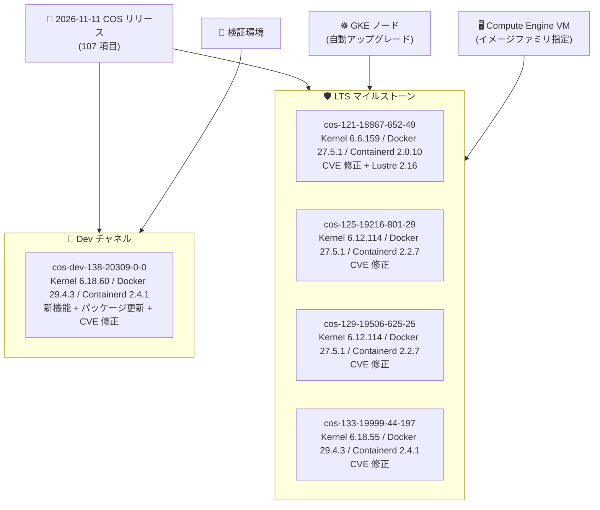

# Container-Optimized OS (COS): 5 イメージのセキュリティ・メンテナンスアップデート

**リリース日**: 2026-11-11

**サービス**: Container-Optimized OS (COS)

**機能**: セキュリティパッチ (CVE 修正)、パッケージアップグレード、Lustre クライアント 2.16 対応ほか

**ステータス**: Available

📊 [このアップデートのインフォグラフィックを見る](https://takech9203.github.io/google-cloud-news-summary/20261111-container-optimized-os-security-updates.html)

## 概要

2026 年 11 月 11 日、Google Cloud は Container-Optimized OS (COS) の 5 つのイメージリリースを公開した。対象は開発チャネルの cos-dev-138-20309-0-0 と、LTS マイルストーンの cos-121-18867-652-49、cos-125-19216-801-29、cos-129-19506-625-25、cos-133-19999-44-197 である。今回は 107 件のリリースノート項目からなる大規模なメンテナンスリリースであり、内容の大半は OS パッケージのアップグレードと CVE 修正である。

セキュリティ面では、openssl、glibc、curl、expat、libpcre2 などの基盤ライブラリに加え、docker、containerd、cri-tools、cni-plugins、kubernetes、guest-agent、google-osconfig-agent といったコンテナランタイム・エージェント系コンポーネントの CVE が広範に修正された。特に CVE-2026-84304 と CVE-2026-84445 は複数コンポーネント・複数マイルストーンにまたがって修正されており、Go ベースのコンポーネント群に共通する脆弱性対応とみられる。

機能面では、cos-dev-138 での 64k ページサイズの iRDMA サポート、64k カーネルでの PCI peer-to-peer DMA 有効化、A4X-Max イメージでの RTC サポート、Lustre クライアントドライバ v2.16 対応 (cos-dev-138 / cos-121)、ステートフルパーティションの ext4 ジャーナル自動リサイズなどが追加された。対象ユーザーは GKE ノードや Compute Engine VM で COS を使用しているすべてのユーザーである。

**アップデート前の課題**

- openssl (CVE-2025-9230、CVE-2026-14456 など)、glibc (CVE-2026-4438、CVE-2026-6368)、curl (CVE-2026-18924 ほか 4 件) など基盤ライブラリに未修正の脆弱性が存在していた
- docker、containerd、cri-tools、cni-plugins、kubernetes、ゲストエージェント群に CVE-2026-84304、CVE-2026-84445、CVE-2026-116587 などの脆弱性が残存していた
- COS で Lustre クライアントドライバ 2.16 系が利用できなかった
- 64k ページサイズカーネルで iRDMA や PCI peer-to-peer DMA がサポートされていなかった
- ステートフルパーティションを拡張しても ext4 ジャーナルのサイズが追従しなかった (cos-dev-138 で修正)

**アップデート後の改善**

- 5 イメージにわたり基盤ライブラリとコンテナ関連コンポーネントの CVE が一括修正され、脆弱性スキャンの指摘事項が解消される
- cos-dev-138 と cos-121 で Lustre クライアントドライバ 2.16 (Managed Lustre 連携に利用) が利用可能になった
- cos-dev-138 で 64k ページサイズの iRDMA サポートと PCI peer-to-peer DMA が有効化され、HPC / AI ワークロード向け I/O 機能が拡充された
- cos-dev-138 で A4X-Max イメージの RTC サポート、NVIDIA ドライバ v580.196.07 / v595.112.07 対応、fstrim.timer の定期実行 (シンプロビジョニングストレージのブロック回収) が追加された
- cos-dev-138 で curl v8.22.0、openssh v10.6_p1、ca-certificates v20260816.3.131.1 など多数のパッケージが最新化された

## アーキテクチャ図



今回のリリースが Dev チャネル 1 イメージと LTS 4 マイルストーンに展開される構成を示す。本番の GKE ノードや Compute Engine VM は LTS イメージファミリ経由で更新を受け取る。

## サービスアップデートの詳細

今回はメンテナンスリリースのダイジェストとして、リリースごとのハイライトと注目すべき CVE 修正をまとめる。

### cos-dev-138-20309-0-0 (Dev チャネル)

| コンポーネント | バージョン |
|------|------|
| Kernel | COS-6.18.60 |
| Docker | v29.4.3 |
| Containerd | v2.4.1 |

**主な機能追加・変更**

- **64k ページサイズの iRDMA サポート追加**: 64k ページカーネルで Intel RDMA (iRDMA) が利用可能に
- **PCI peer-to-peer DMA の有効化 (64k カーネル)**: GPU とストレージ / NIC 間の直接データ転送を 64k ページカーネルでも利用可能に
- **A4X-Max イメージの RTC サポート追加**: リアルタイムクロック対応 (カーネル設定 CONFIG_RTC_DRV_NCT3018Y=m なども有効化)
- **Lustre クライアントドライバ v2.16.0_p60 のサポート**: 並列ファイルシステム Lustre の新ドライバに対応
- **ext4 ジャーナルの自動リサイズ**: ステートフルパーティションの拡張時にジャーナルも適切にリサイズされるように
- **NVIDIA ドライバ v580.196.07 / v595.112.07 のサポート追加**、cos-gpu-installer v2.7.12 (r615 以降のドライバ向け ucode ファームウェアをインストール)
- **fstrim.timer の定期実行を有効化**: シンプロビジョニングストレージ上の未使用ブロックを定期的に回収
- Linux カーネルを v6.18.60 に更新、openssh v10.6_p1、ca-certificates、nss v3.132、gnutls v3.8.13、e2fsprogs v1.47.4 など約 30 パッケージをアップグレード

**主な CVE 修正**

| 対象コンポーネント | CVE |
|------|------|
| dev-libs/openssl | CVE-2025-9230、CVE-2026-14456 |
| sys-libs/glibc | CVE-2026-4438、CVE-2026-6368 |
| net-misc/curl (v8.22.0) | CVE-2026-18924、CVE-2026-13608、CVE-2026-80229、CVE-2026-80255、CVE-2026-19931 |
| docker | CVE-2026-53489 |
| containerd | CVE-2026-116587、CVE-2026-84304、CVE-2026-84445 |
| kubernetes | CVE-2026-84445 |
| cri-tools | CVE-2024-41110、CVE-2026-35469、CVE-2026-41567、CVE-2026-84304、CVE-2026-32285 |
| cni-plugins | CVE-2026-33186、CVE-2026-84304、CVE-2026-84445 |
| google-osconfig-agent | CVE-2024-25621、CVE-2026-53488、CVE-2026-33186、CVE-2026-39830/39832/39833/39834、CVE-2026-42508、CVE-2026-63209、CVE-2026-84304、CVE-2026-45022、CVE-2026-84445 |
| guest-agent / google-guest-agent | CVE-2026-29181、CVE-2026-34986、CVE-2026-84304 |
| node-problem-detector | CVE-2026-63209、CVE-2026-84304、CVE-2026-29181 |
| nvidia-container-toolkit | CVE-2025-52565 |
| dev-libs/expat | CVE-2026-77214 |
| dev-libs/libpcre | CVE-2026-103111 |
| app-arch/brotli (v1.0.10) | CVE-2026-111497 |
| cos-extensions | CVE-2026-116587 |

### cos-121-18867-652-49 (COS 121 LTS)

| コンポーネント | バージョン |
|------|------|
| Kernel | COS-6.6.159 |
| Docker | v27.5.1 |
| Containerd | v2.0.10 |

**主な機能追加・変更**

- **Lustre クライアントドライバ 2.16 対応**: 新パッケージ `lustre-client-drivers-2_16` として提供

**主な CVE 修正**

| 対象コンポーネント | CVE |
|------|------|
| dev-libs/openssl (v3.0.22) | CVE-2026-63076、CVE-2026-75803、CVE-2026-35189 |
| docker | CVE-2026-33747、CVE-2026-33748、CVE-2026-39883 |
| cri-tools | CVE-2024-25621、CVE-2025-31133、CVE-2026-32285 |
| dev-lang/go | CVE-2026-97032、CVE-2026-78663 |
| net-misc/curl | CVE-2026-92392 |
| libpcre2 (v10.49) | CVE-2026-86145、CVE-2026-103111 |
| pyjwt (v2.14.0) | CVE-2026-102266、CVE-2026-102267、CVE-2026-102268、CVE-2026-102271 |
| dev-libs/expat (v2.8.5) | CVE-2026-93990 |
| net-libs/libpcap (v1.10.7) | CVE-2026-0799 |
| guest-agent / google-guest-agent | CVE-2026-116587、CVE-2026-84445 |
| google-osconfig-agent | CVE-2026-53488 |

### cos-125-19216-801-29 (COS 125 LTS)

| コンポーネント | バージョン |
|------|------|
| Kernel | COS-6.12.114 |
| Docker | v27.5.1 |
| Containerd | v2.2.7 |

**主な CVE 修正**

| 対象コンポーネント | CVE |
|------|------|
| net-misc/openssh | CVE-2026-106583 |
| dev-python/pyasn1 | CVE-2026-119196、CVE-2026-30922 |
| net-misc/wget | CVE-2026-15146 |
| docker | CVE-2026-33747 |
| google-osconfig-agent | CVE-2026-44973 |
| dev-lang/go | CVE-2026-78663、CVE-2026-97031 |
| cos-extensions | CVE-2026-84304 |

### cos-129-19506-625-25 (COS 129 LTS)

| コンポーネント | バージョン |
|------|------|
| Kernel | COS-6.12.114 |
| Docker | v27.5.1 |
| Containerd | v2.2.7 |

**主な CVE 修正**

| 対象コンポーネント | CVE |
|------|------|
| app-arch/tar | CVE-2025-45582 |
| dev-python/oauthlib | CVE-2026-118669 |
| docker | CVE-2026-63209 |

### cos-133-19999-44-197 (COS 133 LTS)

| コンポーネント | バージョン |
|------|------|
| Kernel | COS-6.18.55 |
| Docker | v29.4.3 |
| Containerd | v2.4.1 |

**主な CVE 修正**

| 対象コンポーネント | CVE |
|------|------|
| cni-plugins | CVE-2026-32285、CVE-2026-84304 |

## 技術仕様

### 対象マイルストーンとサポート期限

| マイルストーン | 今回のイメージ | x86 イメージファミリ | サポート終了 |
|------|------|------|------|
| COS 138 Dev | cos-dev-138-20309-0-0 | cos-dev | 未定 (開発チャネル) |
| COS 121 LTS | cos-121-18867-652-49 | cos-121-lts | 2027 年 3 月 |
| COS 125 LTS | cos-125-19216-801-29 | cos-125-lts | 2028 年 2 月 |
| COS 129 LTS | cos-129-19506-625-25 | cos-129-lts | 2028 年 7 月 |
| COS 133 LTS | cos-133-19999-44-197 | cos-133-lts | 2028 年 11 月 |

出典: [COS Versioning (docs.cloud.google.com/container-optimized-os/docs/concepts/versioning)](https://cloud.google.com/container-optimized-os/docs/concepts/versioning)

### 複数マイルストーン・複数コンポーネントにまたがる CVE 修正

| CVE | 修正されたコンポーネント | 対象リリース |
|------|------|------|
| CVE-2026-84304 | cni-plugins、containerd、cri-tools、google-guest-agent、google-osconfig-agent、node-problem-detector、cos-extensions | cos-dev-138、cos-125、cos-133 |
| CVE-2026-84445 | cni-plugins、containerd、kubernetes、google-osconfig-agent、google-guest-agent | cos-dev-138、cos-121 |
| CVE-2026-116587 | containerd、cos-extensions、guest-agent | cos-dev-138、cos-121 |
| CVE-2026-32285 | cri-tools、cni-plugins | cos-dev-138、cos-121、cos-133 |
| CVE-2026-78663 | dev-lang/go | cos-121、cos-125 |
| CVE-2026-103111 | dev-libs/libpcre、libpcre2 | cos-dev-138、cos-121 |
| CVE-2026-33747 | docker | cos-121、cos-125 |
| CVE-2026-63209 | docker、google-osconfig-agent、node-problem-detector | cos-dev-138、cos-129 |

## 設定方法

### 前提条件

1. GKE ノードまたは Compute Engine VM で COS イメージ (cos-cloud プロジェクト) を使用していること
2. GKE の場合、ノード自動アップグレードが有効であれば本リリースは自動的に適用される

### 手順

#### ステップ 1: 使用中の COS イメージバージョンの確認

```bash
# Compute Engine VM のイメージを確認
gcloud compute instances describe INSTANCE_NAME \
  --zone=ZONE --format="value(disks[0].licenses)"

# COS インスタンス内からバージョンを確認
cat /etc/os-release
```

#### ステップ 2: 最新 LTS イメージへの更新 (Compute Engine)

```bash
# 最新の COS 133 LTS イメージを確認
gcloud compute images describe-from-family cos-133-lts \
  --project=cos-cloud

# 新イメージで VM を再作成 (例)
gcloud compute instances create my-instance \
  --image-family=cos-133-lts \
  --image-project=cos-cloud \
  --zone=us-central1-a
```

#### ステップ 3: GKE ノードプールの更新

```bash
# ノードプールを手動でアップグレード (ノードイメージの更新)
gcloud container clusters upgrade CLUSTER_NAME \
  --node-pool=POOL_NAME \
  --zone=ZONE
```

GKE ではノード自動アップグレードにより新しい COS イメージが順次ロールアウトされるため、通常は手動操作は不要である。

## メリット

### ビジネス面

- **脆弱性スキャン指摘の一括解消**: openssl、glibc、curl、docker、containerd など広範なコンポーネントの CVE が修正され、コンプライアンス要件 (脆弱性管理) への対応が容易になる
- **サポート継続中の全 LTS マイルストーンに同時展開**: COS 121 / 125 / 129 / 133 のいずれを利用していても、マイルストーンを維持したままセキュリティ修正を受け取れる

### 技術面

- **コンテナランタイム・エージェント群の一斉修正**: docker、containerd、cri-tools、cni-plugins、kubernetes、guest-agent、osconfig-agent、node-problem-detector と、ノードを構成するコンポーネント全体が更新される
- **Lustre 2.16 クライアント対応 (cos-dev-138 / cos-121)**: 並列ファイルシステムを使う HPC / AI ワークロードで新しい Lustre ドライバを利用可能
- **64k ページカーネルの機能拡充 (cos-dev-138)**: iRDMA と PCI peer-to-peer DMA のサポートにより、Arm / 大規模メモリ構成での高性能 I/O に対応
- **fstrim.timer の定期実行 (cos-dev-138)**: シンプロビジョニングされたストレージの未使用ブロックが自動回収され、ストレージ効率が向上

## デメリット・制約事項

### 制限事項

- cos-dev-138 は開発チャネルのイメージであり、本番環境での使用は想定されていない。新機能 (64k iRDMA、PCI P2P DMA、RTC サポートなど) が LTS に到達する時期は未定
- 各 CVE の深刻度 (CVSS スコア) はリリースノートに記載されていないため、自組織への影響評価には NVD などでの個別確認が必要
- COS 121 LTS のサポートは 2027 年 3 月に終了するため、中期的には COS 125 以降への移行計画が必要

### 考慮すべき点

- GKE のノード自動アップグレードを無効化している場合、本リリースの CVE 修正は適用されない。手動でのノードプール更新が必要
- Docker / Containerd のバージョンはマイルストーンごとに異なる (COS 121: Docker 27.5.1 / Containerd 2.0.10、COS 133: Docker 29.4.3 / Containerd 2.4.1)。ランタイムバージョンに依存するワークロードは移行時に検証が必要
- 大量のパッケージ更新を含むメンテナンスリリースのため、重要ワークロードではカナリアノードプールなどでの段階的ロールアウトを推奨

## ユースケース

### ユースケース 1: セキュリティコンプライアンス対応 (GKE ノードの CVE 解消)

**シナリオ**: セキュリティチームの脆弱性スキャンで、GKE ノードの openssl (CVE-2025-9230)、glibc (CVE-2026-4438)、containerd (CVE-2026-84304) などが検出され、期限内の修正が求められている。

**実装例**:
```bash
# ノード自動アップグレードの有効化 (未設定の場合)
gcloud container node-pools update POOL_NAME \
  --cluster=CLUSTER_NAME \
  --zone=ZONE \
  --enable-autoupgrade
```

**効果**: 本リリースを含む最新 COS イメージがロールアウトされ、スキャンで検出された CVE が解消される。

### ユースケース 2: Managed Lustre を使う HPC / AI ワークロード

**シナリオ**: COS 121 ベースのノードから Lustre ファイルシステムに接続する HPC クラスタで、Lustre 2.16 系クライアントが必要になった。

**効果**: cos-121-18867-652-49 で追加された `lustre-client-drivers-2_16` パッケージにより、COS 121 LTS を維持したまま Lustre 2.16 クライアントドライバを利用できる。

## 関連サービス・機能

- **Google Kubernetes Engine (GKE)**: COS は GKE ノードのデフォルトイメージ (`cos_containerd`)。ノード自動アップグレードで本リリースが順次適用される
- **Compute Engine**: `cos-121-lts` 〜 `cos-133-lts` のイメージファミリを指定して VM を作成することで最新イメージを利用できる
- **Managed Lustre / Lustre**: 今回追加された Lustre クライアントドライバ 2.16 により並列ファイルシステム接続に対応
- **Security Command Center / Artifact Analysis**: ノード・イメージの CVE 検出と、本リリース適用による解消状況の確認に使用
- **Cloud Monitoring / Logging**: node-problem-detector (今回 CVE 修正対象) が検出したノード異常の監視に使用

## 参考リンク

- 📊 [インフォグラフィック](https://takech9203.github.io/google-cloud-news-summary/20261111-container-optimized-os-security-updates.html)
- [公式リリースノート](https://docs.cloud.google.com/release-notes#November_11_2026)
- [COS Dev リリースノート](https://cloud.google.com/container-optimized-os/docs/release-notes/dev)
- [COS 121 リリースノート](https://cloud.google.com/container-optimized-os/docs/release-notes/m121)
- [COS 125 リリースノート](https://cloud.google.com/container-optimized-os/docs/release-notes/m125)
- [COS 129 リリースノート](https://cloud.google.com/container-optimized-os/docs/release-notes/m129)
- [COS 133 リリースノート](https://cloud.google.com/container-optimized-os/docs/release-notes/m133)
- [COS バージョニングとライフサイクル](https://cloud.google.com/container-optimized-os/docs/concepts/versioning)
- [GKE ノードイメージ](https://cloud.google.com/kubernetes-engine/docs/concepts/node-images)

## まとめ

今回のアップデートは、COS のサポート中の全 LTS マイルストーン (121 / 125 / 129 / 133) と開発チャネルにまたがる大規模なセキュリティ・メンテナンスリリースである。openssl、glibc、curl といった基盤ライブラリから docker、containerd、kubernetes などのコンテナスタック、ゲストエージェント群まで広範な CVE が修正されているため、GKE ではノード自動アップグレードの有効化を確認し、Compute Engine で COS を直接使用している場合は早期のイメージ更新を推奨する。cos-dev-138 に入った 64k ページ iRDMA や PCI P2P DMA、Lustre 2.16 対応は、今後の LTS で HPC / AI ワークロード向け機能として展開が見込まれる変更として注目しておきたい。

---

**タグ**: #ContainerOptimizedOS #COS #GKE #Security #CVE #LTS #Docker #Containerd #Lustre
