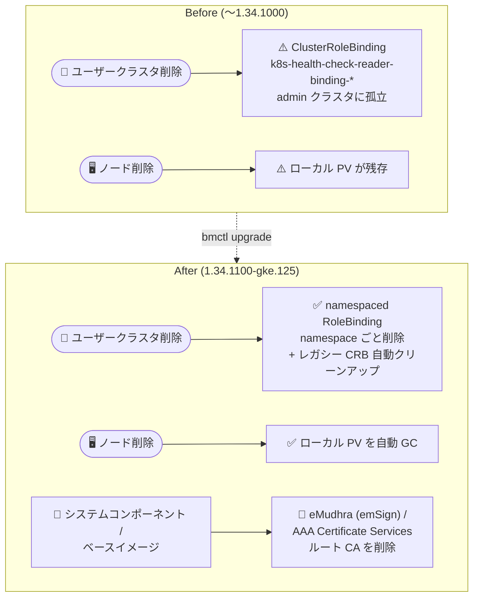

# Google Distributed Cloud (software only) for bare metal: 1.34.1100-gke.125 リリース

**リリース日**: 2026-11-11

**サービス**: Google Distributed Cloud (software only) for bare metal

**機能**: バージョン 1.34.1100-gke.125 リリース (ルート CA トラストストア更新 + 多数の不具合修正)

**ステータス**: Announcement + Feature + Fixed (GA パッチリリース)

📊 [このアップデートのインフォグラフィックを見る](https://takech9203.github.io/google-cloud-news-summary/20261111-gdc-bare-metal-1-34-1100.html)

## 概要

Google Distributed Cloud (software only) for bare metal (旧称 Anthos clusters on bare metal) のバージョン 1.34.1100-gke.125 がダウンロード可能になりました。本リリースは Kubernetes v1.34.12-gke.500 上で動作します。1.34 系列の直前のパッチ 1.34.1000-gke.111 (2026 年 10 月 22 日、Kubernetes v1.34.7-gke.200) からのアップデートで、ベースの Kubernetes バージョンも v1.34.7 から v1.34.12 に更新されています。

本リリースの柱は 2 つです。1 つ目はセキュリティ強化で、信頼が失効 (distrusted) した eMudhra (emSign) および AAA Certificate Services ルート CA をシステムコンポーネントとコンテナベースイメージのトラストストアから削除し、侵害された eMudhra 中間 CA を拒否するようになりました。2 つ目は運用上の不具合修正で、ユーザークラスタ削除時に admin クラスタに孤立した ClusterRoleBinding が残る問題、ノード削除時にローカル PersistentVolume が残存する問題、etcd メンバー誤削除の問題など、クラスタライフサイクル管理に関わる 8 件の修正が含まれます。

オンプレミスのベアメタル環境で GDC クラスタを運用する管理者が対象です。なお、同日に GDC (software only) for VMware でも同一バージョン番号 1.34.1100 がリリースされており、そちらは別レポート (`2026-11-11-gdc-vmware-1-34-1100.md`) で扱っています。また、同じ CA トラストストア更新は 1.35 系列では 1.35.700-gke.124 (2026 年 11 月 4 日) で先行して導入されています。

**アップデート前の課題**

- システムコンポーネントやコンテナベースイメージのトラストストアに、業界的に信頼が失効した eMudhra (emSign) / AAA Certificate Services ルート CA が残っており、これらを起点とする証明書チェーンを受け入れる余地があった
- ユーザークラスタを削除すると、admin クラスタに孤立した `k8s-health-check-reader-binding-<cluster-namespace>` ClusterRoleBinding が残り、クラスタスコープのリソースとして手動クリーンアップが必要だった
- クラスタからノードを削除しても、そのノードのローカル PersistentVolume リソースがガベージコレクションされず残存した
- コントロールプレーンノードのリセット / 削除時に、別ノードの IP アドレスが同じプレフィックスを共有する場合 (例: `10.201.0.2` と `10.201.0.26`)、誤った etcd / etcd-events メンバーが削除され、ノードが NotReady になりアップグレードが停止することがあった
- `bmctl check cluster --snapshot` が Node Agent スナップショット取得時に `panic: send on closed channel` で失敗する競合状態があった
- アップグレード / ロールバック中に定期的な構成ドリフトヘルスチェックが `version not supported` エラーで失敗していた
- audit-proxy が恒久的なエラーに対しても監査ログエクスポートを無限に再試行し、過剰な監査ログトラフィックを生成していた
- Kubernetes プリフライトヘルスチェックが対象クラスタの namespace だけでなく admin クラスタの全 namespace をスキャンし、無関係なクラスタに古い reconciling リソースがあるとアップグレードが失敗していた

**アップデート後の改善**

- 信頼を失ったルート CA の削除と侵害された中間 CA の拒否により、サプライチェーン上の証明書リスクが低減された
- ヘルスチェック権限が namespace スコープの RoleBinding に変更され、レガシーな ClusterRoleBinding は自動的にクリーンアップされるようになった (孤立リソースの手動掃除が不要に)
- ノード削除時にローカル PersistentVolume がガベージコレクションされるようになった (1.34.1100 へのアップグレード後に作成された PV に適用。既存の孤立 PV は手動削除が必要)
- etcd メンバーの特定が IP プレフィックスの部分一致に起因する誤削除を起こさなくなり、コントロールプレーンノードのリセット / 削除が安全になった
- ノードがイメージ展開中に再起動した場合の containerd の状態破損に対する耐性が向上した
- [Vulnerability fixes](https://docs.cloud.google.com/kubernetes-engine/distributed-cloud/bare-metal/docs/vulnerabilities) に記載の脆弱性が修正された

## アーキテクチャ図



ユーザークラスタ削除時の権限リソースが namespace スコープ化されて自動クリーンアップされるようになり、ノード削除時のローカル PV ガベージコレクションと、信頼失効ルート CA のトラストストアからの削除が加わったことを示しています。

## サービスアップデートの詳細

### 主要機能

1. **バージョン 1.34.1100-gke.125 の提供開始 (Announcement)**
   - Kubernetes v1.34.12-gke.500 上で動作
   - リリース後、GKE On-Prem API クライアント (Google Cloud コンソール、gcloud CLI、Terraform) でインストール / アップグレードに利用可能になるまで約 7〜14 日かかる
   - サードパーティストレージベンダーを使用している場合は、[認定済みストレージパートナー](https://docs.cloud.google.com/kubernetes-engine/enterprise/docs/resources/partner-storage)の一覧を確認する

2. **信頼失効ルート CA の削除 (Feature)**
   - システムコンポーネントとコンテナベースイメージを更新し、信頼が失効した eMudhra (emSign) および AAA Certificate Services ルート CA をトラストストアから削除
   - 侵害された eMudhra 中間 CA を拒否
   - 同じ変更は 1.35 系列の 1.35.700-gke.124 (2026-11-04) にも含まれており、系列横断で展開されているトラストストア更新

3. **クラスタライフサイクル関連の不具合修正 (Fixed)**
   - [Vulnerability fixes](https://docs.cloud.google.com/kubernetes-engine/distributed-cloud/bare-metal/docs/vulnerabilities) に記載の脆弱性を修正
   - ユーザークラスタ削除時の孤立 ClusterRoleBinding 問題を修正 (namespaced RoleBinding 化 + レガシーオブジェクトの自動クリーンアップ)
   - `bmctl check cluster --snapshot` の `panic: send on closed channel` 競合状態を修正
   - ノード削除時のローカル PersistentVolume ガベージコレクションを修正 (アップグレード後に作成された PV に適用、既存の孤立 PV は手動削除)
   - IP プレフィックス共有時の etcd / etcd-events メンバー誤削除を修正
   - イメージ展開中のノード再起動に対する containerd の状態破損耐性を向上
   - アップグレード / ロールバック中の構成ドリフトヘルスチェックの `version not supported` エラーを修正
   - audit-proxy の恒久的エラー時の無限再試行を修正
   - Kubernetes プリフライトヘルスチェックのスキャン範囲を対象クラスタの namespace に限定

## 技術仕様

### リリース情報

| 項目 | 詳細 |
|------|------|
| バージョン | 1.34.1100-gke.125 |
| Kubernetes バージョン | v1.34.12-gke.500 |
| 直前の 1.34 パッチ | 1.34.1000-gke.111 (2026-10-22、Kubernetes v1.34.7-gke.200) |
| GKE On-Prem API クライアント対応 | リリース後約 7〜14 日で Console / gcloud / Terraform から利用可能 |
| 対象環境 | オンプレミスのベアメタルサーバー (software only デプロイ) |
| 同日リリース | GDC (software only) for VMware 1.34.1100 (別レポート) |

### ヘルスチェック権限の変更 (修正内容)

| 項目 | 変更前 | 変更後 |
|------|--------|--------|
| 権限リソース | ClusterRoleBinding `k8s-health-check-reader-binding-<cluster-namespace>` (クラスタスコープ) | namespace スコープの RoleBinding |
| ユーザークラスタ削除時 | admin クラスタに孤立リソースが残る | namespace とともに削除される |
| レガシーリソース | 手動削除が必要 | 自動クリーンアップ |

## 設定方法

### 前提条件

1. 既存の GDC (software only) for bare metal クラスタが 1.34 系列へのアップグレードパス上にあること (1.34.x からのパッチアップグレード、または 1.33 系列からのマイナーアップグレード)
2. サードパーティストレージ利用時は、本リリースで認定済みのストレージパートナーであることを確認

### 手順

#### ステップ 1: アップグレード計画の確認

公式の [Upgrade clusters](https://docs.cloud.google.com/kubernetes-engine/distributed-cloud/bare-metal/docs/how-to/upgrade) ドキュメントに従い、admin クラスタ → ユーザークラスタの順でアップグレードを計画します。

#### ステップ 2: bmctl によるアップグレード (例)

```bash
# クラスタ構成ファイルの anthosBareMetalVersion を 1.34.1100-gke.125 に更新後
bmctl upgrade cluster -c CLUSTER_NAME \
    --kubeconfig ADMIN_KUBECONFIG
```

GKE On-Prem API クライアント (Console / gcloud / Terraform) を使用する場合は、リリースから約 7〜14 日後にバージョンが選択可能になります。

#### ステップ 3: 既存の孤立リソースのクリーンアップ確認

ローカル PersistentVolume のガベージコレクション修正は、1.34.1100 へのアップグレード後に作成された PV にのみ適用されます。アップグレード前に孤立した PV が残っている場合は手動削除が必要です。

```bash
# 孤立したローカル PV の確認例
kubectl get pv --kubeconfig ADMIN_KUBECONFIG | grep -i released
```

## メリット

### ビジネス面

- **セキュリティコンプライアンスの維持**: 業界的に信頼が失効した CA をオンプレミス環境のトラストストアからも排除し、エアギャップ気味の環境でもパブリッククラウドと同等の証明書衛生を維持できる
- **運用コストの削減**: 孤立 ClusterRoleBinding や残存 PV の手動クリーンアップ作業が不要になり、クラスタの作成・削除を繰り返す環境 (検証環境、マルチテナント基盤) の運用負荷が下がる

### 技術面

- **アップグレードの信頼性向上**: etcd メンバー誤削除、プリフライトチェックの過剰スキャン、構成ドリフトチェックの誤検知という、アップグレード停止につながる 3 つの問題が同時に解消された
- **診断ツールの安定化**: `bmctl check cluster --snapshot` の panic 修正により、障害調査時のスナップショット取得が安定する
- **ノード障害耐性の向上**: イメージ展開中の再起動による containerd 状態破損への耐性が向上し、不意の電源断などからの復旧性が高まる

## デメリット・制約事項

### 制限事項

- ローカル PersistentVolume のガベージコレクション修正は、1.34.1100-gke.125 へのアップグレード後に作成された PV にのみ適用される。既存の孤立 PV は手動削除が必要
- GKE On-Prem API クライアント (Console / gcloud / Terraform) からの利用はリリース後約 7〜14 日待つ必要がある

### 考慮すべき点

- 削除された eMudhra (emSign) / AAA Certificate Services ルート CA にチェーンする証明書を社内システムや外部連携先で使用している場合、システムコンポーネントからの TLS 接続が失敗するようになるため、事前に証明書の発行元を確認する
- サードパーティストレージベンダー利用時は、本リリースでの認定状況をアップグレード前に確認する

## 料金

Google Distributed Cloud (software only) の料金はソフトウェアライセンス (GKE Enterprise) ベースです。本リリース自体による料金変更はありません。詳細は料金ページを参照してください。

- [Google Distributed Cloud (software only) 料金](https://cloud.google.com/distributed-cloud/bare-metal/docs/pricing)

## 利用可能リージョン

オンプレミス (顧客所有のベアメタルハードウェア) で動作するソフトウェアのため、Google Cloud リージョンに依存しません。

## 関連サービス・機能

- **GDC (software only) for VMware**: 同日に同一バージョン番号 1.34.1100 がリリースされており、ヘルスチェック権限修正や audit-proxy 修正など多くの修正が共通 (別レポート参照)
- **GKE On-Prem API (Cloud Console / gcloud / Terraform)**: クラスタライフサイクル管理のクライアント。新バージョンはリリース後約 7〜14 日で利用可能
- **GKE Enterprise (フリート管理)**: GDC クラスタのフリート登録・構成管理・ポリシー適用の基盤
- **Cloud Audit Logs**: audit-proxy 経由で監査ログを Google Cloud にエクスポートする。本リリースで無限再試行の問題が修正された

## 参考リンク

- 📊 [インフォグラフィック](https://takech9203.github.io/google-cloud-news-summary/20261111-gdc-bare-metal-1-34-1100.html)
- [公式リリースノート (Google Cloud 全体)](https://docs.cloud.google.com/release-notes#November_11_2026)
- [GDC for bare metal リリースノート](https://docs.cloud.google.com/kubernetes-engine/distributed-cloud/bare-metal/docs/release-notes)
- [クラスタのアップグレード](https://docs.cloud.google.com/kubernetes-engine/distributed-cloud/bare-metal/docs/how-to/upgrade)
- [脆弱性修正一覧 (Vulnerability fixes)](https://docs.cloud.google.com/kubernetes-engine/distributed-cloud/bare-metal/docs/vulnerabilities)
- [認定済みストレージパートナー](https://docs.cloud.google.com/kubernetes-engine/enterprise/docs/resources/partner-storage)

## まとめ

1.34.1100-gke.125 は、信頼失効した eMudhra (emSign) / AAA Certificate Services ルート CA のトラストストアからの削除と、アップグレード停止や孤立リソース残存につながる 8 件の不具合修正を含む、1.34 系列の重要なパッチリリースです。特にクラスタの作成・削除を頻繁に行う環境や、コントロールプレーンノードの入れ替えを予定している環境では、etcd メンバー誤削除や孤立 ClusterRoleBinding の修正の恩恵が大きいため、早期の適用を推奨します。適用前には、削除された CA にチェーンする証明書を利用していないかの確認を忘れないでください。

---

**タグ**: Google Distributed Cloud, GDC, bare metal, Kubernetes, オンプレミス, セキュリティ, ルート CA, eMudhra, アップグレード, etcd, RBAC, パッチリリース
