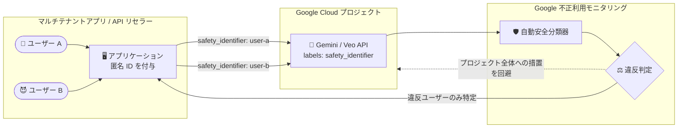

# Gemini Enterprise Agent Platform: エンドユーザー safety_identifier リクエストラベルが GA

**リリース日**: 2026-11-11

**サービス**: Gemini Enterprise Agent Platform

**機能**: 不正利用モニタリング向けエンドユーザー safety_identifier リクエストラベル

**ステータス**: GA (General Availability)

📊 [このアップデートのインフォグラフィックを見る](https://takech9203.github.io/google-cloud-news-summary/20261111-gemini-enterprise-agent-platform-safety-identifier-labels.html)

## 概要

Gemini Enterprise Agent Platform において、エンドユーザー向けの `safety_identifier` リクエストラベルが一般提供 (GA) になりました。Gemini の `generateContent` / `streamGenerateContent` と Veo の `predictLongRunning` API 呼び出しで、リクエストボディの `labels` フィールドに匿名化されたユーザーごとの ID を渡せるようになります。

この機能は、API リセラー、モデルアグリゲーター、外部ユーザーを抱えるマルチテナントアプリケーションを主な対象としています。Google は生成 AI トラフィックを利用規約 (AUP: Acceptable Use Policy) および Prohibited Use Policy の違反検出のためにモニタリングしていますが、`safety_identifier` を付与することで、ポリシー違反を特定のエンドユーザーに帰属 (attribution) させることができ、Google Cloud プロジェクト全体に対する強制措置 (enforcement action) を回避するのに役立ちます。

一部の悪質なエンドユーザーの行為によってプロジェクト全体、ひいてはサービス全体が停止されるリスクを軽減できるため、生成 AI を組み込んだ SaaS やコンシューマー向けアプリを運用する事業者にとって重要なアップデートです。

**アップデート前の課題**

- 不正利用モニタリングによるポリシー違反の検出・強制措置はプロジェクト単位で扱われ、どのエンドユーザーが違反行為を行ったかを Google 側に伝える標準的な手段がなかった
- マルチテナントアプリや API リセラーでは、一部のエンドユーザーの悪用がプロジェクト全体の利用制限・停止につながるリスクがあった
- 悪質ユーザーの特定と対処をアプリケーション側で独自に行う必要があった

**アップデート後の改善**

- `labels` フィールドの `safety_identifier` キーで匿名化されたユーザーごとの ID を渡すことが GA としてサポートされ、ポリシー違反を個々のエンドユーザーに帰属させられるようになった
- ターゲットを絞った帰属により、プロジェクト全体への強制措置を防ぐことに役立つようになった
- Gemini (グローバル・マルチリージョン・リージョナルエンドポイント) と Veo (リージョナルエンドポイント) の両方で本番利用が可能になった

## アーキテクチャ図



アプリケーションがエンドユーザーごとの匿名 ID を `safety_identifier` ラベルとして API リクエストに付与することで、Google の不正利用モニタリングはポリシー違反を個々のユーザーに帰属させ、プロジェクト全体への強制措置を回避できます。

## サービスアップデートの詳細

### 主要機能

1. **エンドユーザー単位の違反帰属 (Targeted Attribution)**
   - リクエストボディの `labels` フィールドに `safety_identifier` キーで匿名化されたユーザー ID を渡す
   - Google がポリシー違反を特定のエンドユーザーに帰属できるようになり、プロジェクト全体への強制措置の回避に役立つ

2. **Gemini と Veo の主要 API をサポート**
   - Gemini: `generateContent` / `streamGenerateContent` (グローバル、マルチリージョン、リージョナルの各エンドポイント)
   - Veo: `predictLongRunning` (`us-central1` などのリージョナルエンドポイント)

3. **追加権限・追加料金なし**
   - 必要な権限は推論に使う `aiplatform.endpoints.predict` のみで、追加の IAM 権限は不要
   - ラベルの付与による追加の API 料金は発生しない

## 技術仕様

### safety_identifier の要件

| 項目 | 詳細 |
|------|------|
| 設定場所 | リクエストボディの `labels` フィールド (キー: `safety_identifier`) |
| フォーマット | 1〜63 文字。小文字英字・数字・アンダースコア (`_`)・ハイフン (`-`) のみ |
| 違反時の挙動 | 63 文字超過や大文字・記号 (`@` や `.` など) を含むと HTTP 400 `INVALID_ARGUMENT` エラー |
| ハッシュ利用 | SHA-256 でユーザー ID をハッシュ化する場合、小文字 16 進ダイジェストを 63 文字以下に切り詰める |
| プライバシー | メールアドレスや氏名などの PII (個人識別情報) を含めない。匿名化したユーザー名や切り詰めたハッシュを使用 |
| 対応モデル・API | Gemini `generateContent` / `streamGenerateContent`、Veo `predictLongRunning` |
| 権限 | `aiplatform.endpoints.predict` のみ (追加 IAM 権限は不要) |
| 料金 | 追加の API 料金なし |
| ユニーク値の上限 | 1 つのラベルキーにつき Cloud Billing アカウントあたり 1,000 を超えるユニーク値はコストレポートから除外される場合がある (不正利用の帰属には影響しない) |

### リクエスト例 (REST)

```json
POST https://aiplatform.googleapis.com/v1/projects/PROJECT_ID/locations/global/publishers/google/models/gemini-3.5-flash:generateContent

{
  "contents": [
    {
      "role": "user",
      "parts": [{ "text": "Summarize the key responsibilities of an API gateway." }]
    }
  ],
  "labels": {
    "safety_identifier": "user_session_001"
  }
}
```

### リクエスト例 (Python / Google Gen AI SDK)

```python
from google import genai
from google.genai import types

client = genai.Client(
    vertexai=True,
    project="PROJECT_ID",
    location="global",
)

response = client.models.generate_content(
    model="gemini-3.5-flash",
    contents="Summarize the key responsibilities of an API gateway.",
    config=types.GenerateContentConfig(
        labels={"safety_identifier": "user_session_001"},
    ),
)
print(response.text)
```

## 設定方法

### 前提条件

1. Gemini Enterprise Agent Platform で Gemini または Veo の API を利用していること
2. 呼び出し元に `aiplatform.endpoints.predict` 権限があること (通常の推論権限のみで可)
3. エンドユーザーごとに一意かつ匿名化された ID (PII を含まない) を生成する仕組みがあること

### 手順

#### ステップ 1: エンドユーザー ID の匿名化

```bash
# 例: ユーザー ID を SHA-256 でハッシュ化し、小文字 16 進で 63 文字以下に切り詰める
echo -n "user@example.com" | sha256sum | cut -c1-63
```

メールアドレスなどの PII をそのまま使わず、匿名化したユーザー名またはハッシュの切り詰め値を使用します。

#### ステップ 2: API リクエストに labels を付与

```bash
curl -X POST \
  -H "Authorization: Bearer $(gcloud auth print-access-token)" \
  -H "Content-Type: application/json; charset=utf-8" \
  -d @request.json \
  "https://aiplatform.googleapis.com/v1/projects/PROJECT_ID/locations/global/publishers/google/models/gemini-3.5-flash:generateContent"
```

`request.json` の `labels.safety_identifier` に、ステップ 1 で生成した匿名 ID を設定します。ローカルでのテストでは上記のようにユーザー認証情報を使い、本番環境ではサービスアカウントを接続した Application Default Credentials (ADC) を使用します。

## メリット

### ビジネス面

- **サービス継続性のリスク低減**: 一部の悪質なエンドユーザーの行為によってプロジェクト全体が強制措置 (利用制限・停止) の対象となるリスクを軽減できる
- **マルチテナントビジネスの保護**: API リセラーや SaaS 事業者が、テナント間の「もらい事故」を防ぎ、健全なユーザーへの影響を最小化できる
- **追加コストなし**: ラベル付与による追加料金は発生せず、既存の料金体系のまま利用できる

### 技術面

- **実装が容易**: リクエストボディに `labels` フィールドを 1 つ追加するだけで、追加の IAM 権限やインフラ変更は不要
- **ストリーミング・動画生成にも対応**: `streamGenerateContent` や Veo の `predictLongRunning` もカバーし、主要な生成 AI ワークロードで一貫して利用できる
- **プライバシーに配慮した設計**: PII を送らず匿名 ID やハッシュで帰属を行うため、ユーザープライバシーを守りながら不正対策ができる

## デメリット・制約事項

### 制限事項

- 値は 1〜63 文字で、小文字英字・数字・アンダースコア・ハイフンのみ。違反すると HTTP 400 `INVALID_ARGUMENT` でリクエスト自体が失敗する
- 対応 API は Gemini の `generateContent` / `streamGenerateContent` と Veo の `predictLongRunning` に限られる (Veo はリージョナルエンドポイントのみ)
- 1 つのラベルキーに Cloud Billing アカウントあたり 1,000 を超えるユニーク値が紐付くと、コストレポートからそのキーが除外される場合がある (不正利用の帰属には影響なし)

### 考慮すべき点

- `safety_identifier` に PII (メールアドレス、氏名など) を含めてはならない。ID 設計の段階で匿名化・ハッシュ化の方針を決めておく必要がある
- ユーザー数が多いサービスでは、ラベルは Cloud Billing のコスト分析用途 (1,000 ユニーク値上限) とは特性が異なる点を理解して運用する
- 不正利用モニタリング自体の仕組み (自動分類器による検出、疑わしい場合のプロンプトログ保存と人手レビュー) は Google Cloud Platform 利用規約に基づいて行われるため、対象範囲を利用規約で確認しておく

## ユースケース

### ユースケース 1: 生成 AI SaaS でのテナント保護

**シナリオ**: Gemini を組み込んだ文章生成 SaaS を数万ユーザーに提供している。ごく一部のユーザーが Prohibited Use Policy に違反するプロンプトを繰り返し送信しており、プロジェクト全体への強制措置が懸念される。

**実装例**:
```python
config = types.GenerateContentConfig(
    labels={"safety_identifier": tenant_user.anonymized_id},  # 例: "tenant42-u-9f3a..."
)
```

**効果**: 違反行為が特定のエンドユーザーに帰属されるため、プロジェクト全体ではなく問題のあるユーザーに対象を絞った対応が可能になり、他の健全なユーザーへのサービス提供を継続できる。

### ユースケース 2: API リセラー / モデルアグリゲーターの不正対策

**シナリオ**: 複数の顧客アプリに対して Gemini / Veo API を再販しており、どの顧客のどのユーザーが問題行動をしているかを Google 側と連携して切り分けたい。

**効果**: `safety_identifier` により違反の発生源がユーザー単位で特定され、ポリシーフィードバックがプロジェクト全体ではなく該当ユーザーに向くため、リセラー事業全体の停止リスクを抑えつつ該当ユーザーのみを自社側で措置できる。

## 料金

`safety_identifier` ラベルの付与自体に追加の API 料金は発生しません。必要な権限も推論用の `aiplatform.endpoints.predict` のみです。Gemini / Veo の API 利用料金は通常どおり適用されます。

なお、ラベルキーのユニーク値が Cloud Billing アカウントあたり 1,000 を超えると、そのキーはコストレポートから除外される場合があります (不正利用の帰属には影響しません)。

- 料金の詳細: [Vertex AI / Agent Platform の料金ページ](https://cloud.google.com/vertex-ai/pricing)

## 利用可能リージョン

- **Gemini** (`generateContent` / `streamGenerateContent`): グローバル、マルチリージョン、リージョナルの各エンドポイントでサポート
- **Veo** (`predictLongRunning`): `us-central1` などのリージョナルエンドポイントでサポート

## 関連サービス・機能

- **API 呼び出しへのラベル付与 (request body labels)**: `safety_identifier` は汎用のリクエストボディラベルの仕組みの上に実装されており、コストセンターや環境名などのラベルと同じ `labels` フィールドで併用できる (Google モデルは 1 回の呼び出しで最大 64 ラベル)
- **Cloud Billing レポート / 課金データエクスポート**: リクエストボディラベルは Cloud Billing にも転送され、ラベル単位でのコスト分析に利用できる
- **推論リクエストメタデータログ (Cloud Logging)**: ラベルはログエントリの `labels` フィールドに記録され、Logs Explorer でユーザー単位の利用状況をクエリできる
- **不正利用モニタリング (Abuse Monitoring)**: Google の自動安全分類器と (必要時の) 人手レビューによる AUP / Prohibited Use Policy 違反検出の仕組み。本機能はこのモニタリングに対するユーザー単位の帰属情報を提供する

## 参考リンク

- 📊 [インフォグラフィック](https://takech9203.github.io/google-cloud-news-summary/20261111-gemini-enterprise-agent-platform-safety-identifier-labels.html)
- [公式リリースノート](https://docs.cloud.google.com/release-notes#November_11_2026)
- [Pass an end-user safety identifier in API calls (不正利用モニタリング)](https://docs.cloud.google.com/gemini-enterprise-agent-platform/models/abuse-monitoring#pass-safety-identifier)
- [Add labels to API calls (ラベルの要件)](https://docs.cloud.google.com/gemini-enterprise-agent-platform/models/capabilities/add-labels-to-api-calls)
- [料金ページ](https://cloud.google.com/vertex-ai/pricing)

## まとめ

エンドユーザー `safety_identifier` リクエストラベルの GA により、マルチテナントアプリや API リセラーは、匿名化されたユーザー ID を 1 行追加するだけでポリシー違反の帰属をユーザー単位に絞り込み、プロジェクト全体への強制措置リスクを大きく低減できます。外部ユーザー向けに Gemini / Veo を提供しているサービスでは、PII を含まない ID 設計 (匿名ユーザー名や SHA-256 ハッシュの切り詰め) を定めた上で、すべての推論リクエストへの `safety_identifier` 付与を標準実装とすることを推奨します。

---

**タグ**: #GeminiEnterpriseAgentPlatform #Gemini #Veo #AbuseMonitoring #SafetyIdentifier #TrustAndSafety #GA
