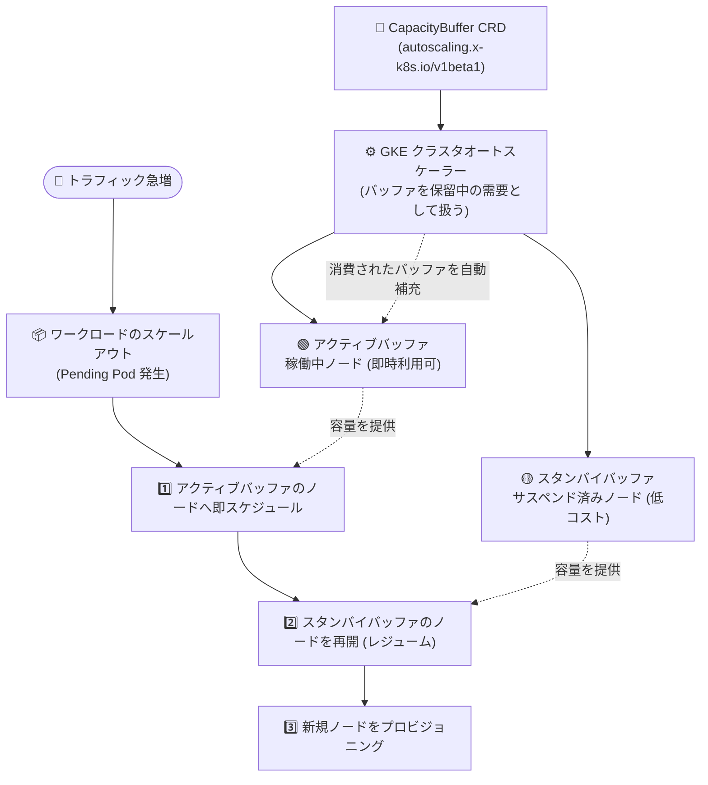

# Google Kubernetes Engine: Capacity Buffers (容量バッファ) が GA

**リリース日**: 2026-11-11

**サービス**: Google Kubernetes Engine (GKE)

**機能**: Capacity Buffers (アクティブ / スタンバイ容量バッファ)

**ステータス**: 一般提供 (GA)

📊 [このアップデートのインフォグラフィックを見る](https://takech9203.github.io/google-cloud-news-summary/20261111-gke-capacity-buffers-ga.html)

## 概要

GKE の Capacity Buffers (容量バッファ) が、アクティブバッファとスタンバイバッファの両方を含めて一般提供 (GA) になりました。バージョン 1.37.1-gke.3020000 以降を実行する GKE Standard クラスタおよび Autopilot クラスタで利用できます。

Capacity Buffers は、Kubernetes のカスタムリソース `CapacityBuffer` (`autoscaling.x-k8s.io/v1beta1`) を使用して、コンピュート容量を事前プロビジョニングし、オプションでサスペンド (一時停止) 状態で待機させる機能です。GKE クラスタオートスケーラーが CapacityBuffer リソースを「保留中の需要」として扱い、余剰容量が常に確保されるようにノードをプロビジョニングします。これにより、ワークロードのスケールアウトを高速化し、スケール時に GPU 不足などの容量制約 (stockout) に遭遇するリスクを軽減できます。

バーストトラフィックへの即応性が求められるオンラインサービスや、スケールアップの遅延がユーザー体験に直結するワークロードを運用する Platform チーム・SRE にとって、「速度 (アクティブバッファ)」と「コスト (スタンバイバッファ)」のバランスを宣言的に制御できる重要な機能です。

**アップデート前の課題**

- クラスタオートスケーラーによるスケールアウトでは、新規ノードのプロビジョニングと起動を待つ必要があり、急激なトラフィック増加時に Pod が Pending のまま待たされることがあった
- 余剰容量を確保するには、バルーン Pod (低優先度のプレースホルダ Pod) を使ったオーバープロビジョニングを自前で構築・運用する必要があった
- スケールアウト時にリージョン・ゾーンの在庫状況によっては必要なマシンタイプを確保できない (容量制約) リスクがあった
- 待機容量を確保すると、実際に使われていない間も稼働ノード分のコンピュート料金が常に発生した

**アップデート後の改善**

- `CapacityBuffer` カスタムリソースを宣言するだけで、クラスタオートスケーラーがバッファ容量を自動的にプロビジョニング・維持するようになった
- アクティブバッファにより、稼働中ノードへ即座に Pod をスケジュールでき、スケールアップのレイテンシを最小化できるようになった
- スタンバイバッファにより、ノードをサスペンド状態で待機させ、サスペンド中は CPU / メモリのコンピュート料金なしで容量を事前確保できるようになった
- 固定レプリカ数、リソース上限、参照ワークロードに対するパーセンテージ指定など、柔軟なバッファサイズの定義が可能になった
- GA となり本番環境で安心して利用できるようになった (Standard / Autopilot の両方をサポート)

## アーキテクチャ図



CapacityBuffer リソースを定義すると、クラスタオートスケーラーが待機容量を事前にプロビジョニングします。スケールアウト時には「アクティブバッファ → スタンバイバッファ (再開) → 新規ノード」の優先順位で Pending Pod がスケジュールされ、消費されたバッファは自動的に補充されます。

## サービスアップデートの詳細

### 主要機能

1. **アクティブバッファ (Active buffer)**
   - 稼働中のノードを待機容量として維持する戦略 (`provisioningStrategy: "buffer.x-k8s.io/active-capacity"`、デフォルト)
   - ノードがすでに起動しているため、スケールアップ時に最小のレイテンシで Pod をスケジュールできる
   - ワークロードがアクティブバッファを消費すると、互換性のあるスタンバイバッファのノード再開、または新規ノードのプロビジョニングによって自動的に補充される

2. **スタンバイバッファ (Standby buffer)**
   - サスペンド (一時停止) 状態のノードを待機容量として維持する戦略 (`provisioningStrategy: "buffer.gke.io/standby-capacity"`)
   - アクティブバッファよりコスト効率が高い一方、ノード再開 (レジューム) の短い遅延が発生する
   - サスペンドまでの猶予時間 (`buffer.gke.io/standby-capacity-init-time`、デフォルト 5m) とノードのリフレッシュ頻度 (`buffer.gke.io/standby-capacity-refresh-frequency`、デフォルト 24h、最大 120h) をアノテーションでカスタマイズ可能
   - DaemonSet を使ってサスペンド前にコンテナイメージをプリロードし、再開後のワークロード起動を高速化できる

3. **柔軟なバッファサイズ定義**
   - **固定レプリカ数**: PodTemplate を参照し、バッファユニット数を `replicas` で直接指定
   - **リソース上限**: バッファが消費する CPU / メモリの総量を `limits` で指定し、ユニット数は自動計算
   - **パーセンテージベース**: Deployment / StatefulSet / ReplicaSet / Job など scale サブリソースを持つオブジェクトを `scalableRef` で参照し、ワークロードの規模に応じてバッファサイズを動的に調整
   - `replicas` と `percentage` を併用して大きい方を下限とし、`limits` を上限として組み合わせることも可能

4. **スケジューリングの優先順位制御**
   - Pending Pod は「アクティブバッファの稼働ノード → 未サスペンドのスタンバイノード → サスペンド済みスタンバイノード → 新規プロビジョニングノード」の順にスケジュールされる
   - デフォルトではスケジューリング制約が一致する任意の Pod がバッファ容量を利用可能
   - 特定のワークロード専用にバッファを予約したい場合は、workload separation (taint / toleration + nodeSelector) で分離できる
   - カスタム ComputeClass と組み合わせて、プロビジョニングされるノードのマシンファミリー優先順位を制御可能

## 技術仕様

### 主要スペック

| 項目 | 詳細 |
|------|------|
| API | `autoscaling.x-k8s.io/v1beta1` / `CapacityBuffer` |
| 対応クラスタ | GKE Standard / Autopilot (バージョン 1.37.1-gke.3020000 以降) |
| プロビジョニング戦略 | `buffer.x-k8s.io/active-capacity` (デフォルト) / `buffer.gke.io/standby-capacity` |
| サイズ指定 | `replicas` (固定数) / `limits` (リソース上限) / `percentage` + `scalableRef` (割合) |
| 課金モデル | ノードベース課金のみ対応 (Autopilot の Pod ベース課金は非対応) |
| スタンバイの init-time | デフォルト 5m (アノテーションで変更可) |
| スタンバイの refresh 頻度 | デフォルト 24h、最大 120h (5 日) |
| バッファの反映時間 | 変更が反映されるまで最大 5 分程度 |

### CapacityBuffer マニフェスト例 (スタンバイバッファ)

```yaml
apiVersion: autoscaling.x-k8s.io/v1beta1
kind: CapacityBuffer
metadata:
  name: customized-standby-buffer
  namespace: my-namespace
  annotations:
    buffer.gke.io/standby-capacity-init-time: "15m"
    buffer.gke.io/standby-capacity-refresh-frequency: "12h"
spec:
  podTemplateRef:
    name: buffer-unit-template
  replicas: 3
  provisioningStrategy: "buffer.gke.io/standby-capacity"
```

## 設定方法

### 前提条件

1. GKE クラスタ (Standard または Autopilot) がバージョン 1.37.1-gke.3020000 以降で稼働していること
2. Standard クラスタではノードプール自動作成 (node pool auto-creation) の有効化を推奨 (無効の場合、既存ノードプールのスケールアップのみ)。スタンバイバッファは Standard ではノードプール自動作成が必須
3. Autopilot クラスタのスタンバイバッファにはカスタム ComputeClass が必要
4. ノードベース課金モデルのワークロードであること (特定ハードウェアを選択する Autopilot ワークロードを含む)

### 手順

#### ステップ 1: バッファユニットを定義する PodTemplate を作成

```yaml
# buffer-pod-template.yaml
apiVersion: v1
kind: PodTemplate
metadata:
  name: buffer-unit-template
  namespace: capacity-buffer-example  # CapacityBuffer と同じ namespace
template:
  spec:
    terminationGracePeriodSeconds: 0
    containers:
      - name: buffer-container
        image: registry.k8s.io/pause:3.9
        resources:
          requests:
            cpu: "1"
            memory: "1Gi"
          limits:
            cpu: "1"
            memory: "1Gi"
```

バッファ容量 1 ユニットあたりのリソース要件 (この例では 1 CPU / 1 GiB) を定義します。カスタム ComputeClass を使う場合は `nodeSelector: cloud.google.com/compute-class: <名前>` を追加します。

#### ステップ 2: CapacityBuffer リソースを作成して適用

```bash
cat <<EOF > cb-fixed-replicas.yaml
apiVersion: autoscaling.x-k8s.io/v1beta1
kind: CapacityBuffer
metadata:
  name: fixed-replica-buffer
  namespace: capacity-buffer-example
spec:
  podTemplateRef:
    name: buffer-unit-template
  replicas: 3
  provisioningStrategy: "buffer.x-k8s.io/active-capacity"
EOF

kubectl apply -f cb-fixed-replicas.yaml
```

`provisioningStrategy` を `"buffer.gke.io/standby-capacity"` に変更するとスタンバイバッファになります。

#### ステップ 3: バッファのステータスを確認

```bash
kubectl get capacitybuffer fixed-replica-buffer -n capacity-buffer-example
```

ステータスが `ReadyForProvisioning` となり、`replicas` フィールドに定義した数が反映されていれば成功です。バッファの変更が反映されるまでには最大 5 分程度かかることがあります。

## メリット

### ビジネス面

- **ユーザー体験の向上**: トラフィック急増時のスケールアップ遅延を最小化し、レイテンシ悪化やリクエスト取りこぼしを防止できる
- **コスト最適化**: スタンバイバッファならサスペンド中の CPU / メモリ課金が発生せず、常時稼働のオーバープロビジョニングよりも低コストで待機容量を確保できる
- **容量リスクの軽減**: 需要ピーク時にノードを確保できない容量制約 (stockout) のリスクを事前プロビジョニングで回避できる

### 技術面

- **宣言的な容量管理**: バルーン Pod などの自前の仕組みを廃止し、Kubernetes ネイティブなカスタムリソースで待機容量を宣言的に管理できる
- **自動補充**: バッファが消費されると、クラスタオートスケーラーがスタンバイノードの再開や新規プロビジョニングで自動的に補充する
- **柔軟なサイズ制御**: 固定数・リソース上限・ワークロード比率 (パーセンテージ) を組み合わせ、下限と上限を設定できる
- **既存機能との統合**: カスタム ComputeClass、workload separation、イメージプリロード用 DaemonSet と組み合わせて細かく制御できる

## デメリット・制約事項

### 制限事項

- GKE バージョン 1.37.1-gke.3020000 以降が必要
- ノードベース課金モデルのみ対応。Autopilot の Pod ベース課金ワークロードでは使用不可
- スタンバイバッファの追加制限:
  - Standard クラスタではノードプール自動作成が必須、Autopilot クラスタではカスタム ComputeClass が必須
  - GPU / TPU 搭載ノード、ローカル SSD は非対応
  - Confidential GKE Nodes は非対応
  - ノードイメージは Container-Optimized OS と Ubuntu のみ対応 (Windows Server は非対応)
  - Compute Engine のサスペンド / レジューム制限に準拠: メモリ 208 GB 超のノードや CSEK 保護ディスク、ベアメタルインスタンスは非対応。サスペンド処理時間はメモリサイズに比例
- スタンバイノードの再開には、そのマシンタイプ・CPU プラットフォーム世代のゾーン内空き容量が必要。サスペンドされた Spot VM は再開時にオンデマンド VM へ変換できない

### 考慮すべき点

- バッファ容量はデフォルトで `scalableRef` 参照先に限定されず、スケジューリング制約が一致する任意の Pending Pod が消費できる。特定ワークロード専用にするには workload separation の設定が必要
- スケールダウン時、余剰ノードはスタンバイバッファへ再サスペンドされるのではなく削除され、スタンバイバッファは新規ノードのプロビジョニング + サスペンドで別途補充される
- カスタム ComputeClass で `activeMigration.optimizeRulePriority: true` と高優先度の Spot VM ルールを併用すると、スタンバイノードが Spot VM へ移行され再開できなくなる場合がある
- アクティブバッファの稼働ノードは vCPU / メモリ / ディスク / IP アドレスの Compute Engine クォータを消費する。サスペンド済みノードは vCPU / メモリクォータは消費しないが、IP アドレスとディスククォータ (サスペンド時のメモリ保存用 Persistent Disk を含む) は消費する
- Kubernetes の ResourceQuota 上は、アクティブ / スタンバイいずれのバッファユニットも Pod が稼働しているものとしてカウントされる
- 多数の個別ワークロードにそれぞれ専用バッファを割り当てると、バッファごとにノードプールが必要となりプロビジョニング・補充が遅くなるため避ける

## ユースケース

### ユースケース 1: スパイクトラフィックに備えるオンラインサービス

**シナリオ**: EC サイトのセール開始時やテレビ放映直後など、数分以内に数倍のトラフィックが発生するサービスで、HPA によるスケールアウトがノード起動待ちで間に合わない。

**実装例**:
```yaml
apiVersion: autoscaling.x-k8s.io/v1beta1
kind: CapacityBuffer
metadata:
  name: frontend-burst-buffer
  namespace: production
spec:
  scalableRef:
    apiGroup: apps
    kind: Deployment
    name: frontend
  percentage: 20          # 現在のレプリカ数の 20% を常にバッファとして確保
  provisioningStrategy: "buffer.x-k8s.io/active-capacity"
```

**効果**: 稼働中のアクティブバッファノードへ Pending Pod が即座にスケジュールされ、スケールアップのレイテンシがほぼゼロになる。ワークロードの規模に追従してバッファサイズも自動調整される。

### ユースケース 2: コストを抑えた容量確保 (バッチ / 定時処理)

**シナリオ**: 毎日決まった時間帯に大量のバッチ処理を実行するが、稼働ノードを常時確保するとコストが高い。一方、実行時にノードを確保できない容量制約のリスクは避けたい。

**効果**: スタンバイバッファでノードをサスペンド状態で確保しておくことで、待機中は CPU / メモリのコンピュート料金なし (ディスク等の少額課金のみ) で容量を事前確保できる。バッチ開始時はノードの再開のみで済むため、新規プロビジョニングより高速かつ確実にスケールできる。イメージプリロード用 DaemonSet と組み合わせれば再開後の起動もさらに高速化できる。

## 料金

Capacity Buffers 機能自体に追加料金はなく、ノードベース課金の標準的なコンピュート料金に準じます (事前プロビジョニングされた容量の課金)。

| バッファタイプ | 課金内容 |
|----------------|----------|
| アクティブバッファ | 稼働中 VM に対して通常のノードベースのコンピュート料金が発生 |
| スタンバイバッファ (サスペンド中) | CPU / メモリのコンピュート料金は発生しない。VM ブートディスクやメモリ状態保存用ストレージ、静的外部 IP アドレスなどの少額の料金のみ発生 |
| スタンバイバッファ (再開後) | ワークロードをホストするために再開された時点から通常のノードベースのコンピュート料金が発生 |

詳細は [GKE の料金ページ](https://cloud.google.com/kubernetes-engine/pricing) および [サスペンド済みインスタンスの料金](https://docs.cloud.google.com/compute/docs/instances/suspend-stop-reset-instances-overview#pricing) を参照してください。

## 利用可能リージョン

リージョン固有の制限は公式ドキュメントに明記されていません。GKE バージョン 1.37.1-gke.3020000 以降のクラスタで利用できます。なお、スタンバイノードの再開には対象ゾーンの Compute Engine 空き容量が必要です。

## 関連サービス・機能

- **GKE クラスタオートスケーラー / ノードプール自動作成**: CapacityBuffer を保留中の需要として扱い、ノードのプロビジョニング・補充を行う基盤。Standard クラスタではノードプール自動作成の有効化を推奨
- **カスタム ComputeClass**: バッファノードのマシンファミリー優先順位 (N4 → C4 など) を制御。Autopilot のスタンバイバッファでは必須
- **Compute Engine のサスペンド / レジューム**: スタンバイバッファの基盤機能。サスペンド中はメモリ状態が Persistent Disk に保存される
- **Workload Separation (taint / toleration)**: 特定ワークロード専用にバッファを予約する場合に使用
- **Horizontal Pod Autoscaler (HPA)**: Pod のスケールアウトを担当し、Capacity Buffers がそのための余剰ノード容量を事前確保する補完関係

## 参考リンク

- 📊 [インフォグラフィック](https://takech9203.github.io/google-cloud-news-summary/20261111-gke-capacity-buffers-ga.html)
- [公式リリースノート](https://docs.cloud.google.com/release-notes#November_11_2026)
- [About capacity buffers (概要ドキュメント)](https://docs.cloud.google.com/kubernetes-engine/docs/concepts/capacity-buffer)
- [Configure a capacity buffer (設定ガイド)](https://docs.cloud.google.com/kubernetes-engine/docs/how-to/configure-capacity-buffer)
- [CapacityBuffer CRD リファレンス](https://docs.cloud.google.com/kubernetes-engine/docs/reference/crds/capacitybuffer)
- [GKE 料金ページ](https://cloud.google.com/kubernetes-engine/pricing)

## まとめ

GKE Capacity Buffers の GA により、バルーン Pod などの自前の仕組みに頼らず、Kubernetes ネイティブなカスタムリソースでスケールアウト用の待機容量を宣言的に管理できるようになりました。即応性重視ならアクティブバッファ、コスト重視ならサスペンド中のコンピュート課金が発生しないスタンバイバッファと、要件に応じた使い分けが可能です。バーストトラフィックや容量制約への備えが必要なワークロードを GKE 1.37.1-gke.3020000 以降で運用している場合は、既存のオーバープロビジョニング手法からの移行を検討することを推奨します。

---

**タグ**: #GoogleKubernetesEngine #GKE #CapacityBuffer #Autoscaling #ClusterAutoscaler #Autopilot #GA #CostOptimization
