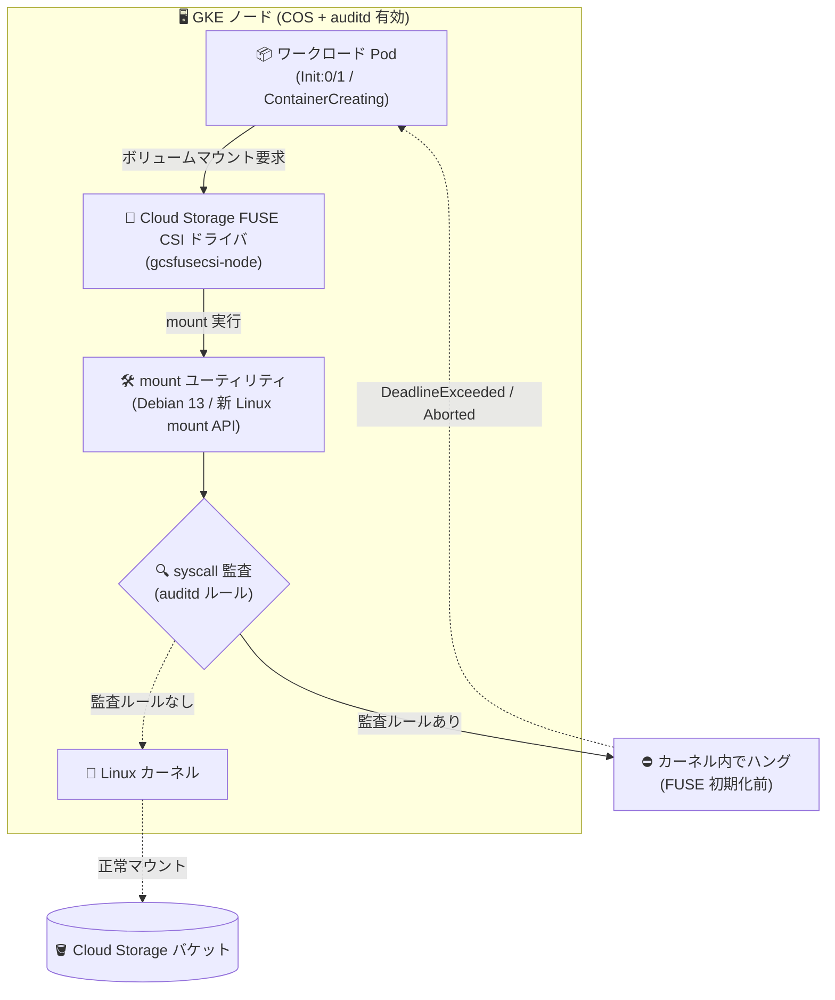

# Google Kubernetes Engine: auditd 有効ノードで Cloud Storage FUSE CSI ドライバのマウントがハングする既知の問題

**リリース日**: 2026-11-11

**サービス**: Google Kubernetes Engine (GKE)

**機能**: Cloud Storage FUSE CSI ドライバ / Linux auditd ロギング

**ステータス**: Issue (既知の問題・修正対応中)

📊 [このアップデートのインフォグラフィックを見る](https://takech9203.github.io/google-cloud-news-summary/20261111-gke-gcsfuse-csi-auditd-mount-hang-issue.html)

## 概要

Google Kubernetes Engine (GKE) において、Linux syscall 監査 (syscall auditing) が有効になっているノード (例: Linux auditd ロギングを有効化した Container-Optimized OS ノード) で、Cloud Storage FUSE CSI ドライバのボリュームマウントが無期限にハングする既知の問題が公表されました。

この問題の影響を受けると、Cloud Storage FUSE ボリュームを使用する Pod が起動できず `Init:0/1` や `ContainerCreating` のステータスのまま停止します。さらに、削除中の Pod は `Terminating` 状態のまま残り、ノードのドレイン (ノードプールのアップグレード時のドレインを含む) が完了しない可能性があります。セキュリティ監査要件のために auditd ロギングを有効化しているクラスタで、ML ワークロードなどが Cloud Storage バケットをファイルシステムとしてマウントしている場合に特に注意が必要です。

原因は、影響を受ける GKE バージョンにおいて Cloud Storage FUSE CSI ドライバが Debian 13 ベースイメージを使用するようになり、その mount ユーティリティが新しい Linux mount API を使用することにあります。syscall 監査がアクティブな場合、FUSE ファイルシステムが初期化される前にカーネル内でマウント操作がハングします。`gcsfusecsi-node` Pod を再起動しても問題は解消されません。修正は現在対応中 (a fix is in progress) です。

**影響を受ける環境**

- Linux syscall 監査ルールがロードされているノード (auditd ロギングを有効化した Container-Optimized OS ノードなど)
- Cloud Storage FUSE CSI ドライバのボリュームを使用するワークロード
- 後述の「影響を受ける GKE バージョン」に該当するクラスタ

**影響を受けない環境**

- syscall 監査ルールがロードされていないノードは影響を受けません
- auditd ロギングは GKE Autopilot ではサポートされていないため、本問題の前提となる構成は主に Standard クラスタ (Container-Optimized OS ノード) に該当します

## アーキテクチャ図



auditd の syscall 監査ルールがロードされたノードでは、Debian 13 ベースの mount ユーティリティが使用する新しい Linux mount API の呼び出しが、FUSE ファイルシステム初期化前にカーネル内でハングし、Pod のボリュームマウントが完了しなくなるメカニズムを示しています。

## 問題の詳細

### 症状

1. **Pod が起動しない**
   - Cloud Storage FUSE CSI ドライバのボリュームを使用する Pod が `Init:0/1` や `ContainerCreating` などのステータスのまま進まない
   - Pod イベントに以下のようなエラーが表示される

   ```text
   MountVolume.SetUp failed for volume "VOLUME_NAME" : rpc error:
     code = DeadlineExceeded desc = context deadline exceeded

   MountVolume.SetUp failed for volume "VOLUME_NAME" : rpc error:
     code = Aborted desc = An operation with the given volume key TARGET_PATH already exists
   ```

2. **Pod の削除が完了しない**
   - 削除中の Pod が `Terminating` 状態のまま残る

3. **ノードドレインが停止する**
   - ノードのドレインが完了しない可能性がある
   - ノードプールのアップグレード時のドレインも含まれるため、**クラスタのアップグレードが停滞するリスク**がある

4. **再起動では復旧しない**
   - `gcsfusecsi-node` Pod を再起動しても問題は解消されない

### 影響を受ける GKE バージョン

| マイナーバージョン | 影響を受けるバージョン |
|------|------|
| 1.31 | 1.31.14-gke.2963000 以降 |
| 1.32 | 1.32.13-gke.2714000 以降 |
| 1.33 | 1.33.13-gke.1973000 以降 |
| 1.34 | 1.34.12-gke.1209000 以降 |
| 1.35 | 1.35.8-gke.2014000 以降 |
| 1.36 | 1.36.5-gke.1817000 以降 |
| 1.37 | 1.37.1-gke.1777000 以降 |

### 根本原因

| 項目 | 詳細 |
|------|------|
| 直接原因 | 影響バージョンの Cloud Storage FUSE CSI ドライバが Debian 13 ベースイメージを使用し、その mount ユーティリティが新しい Linux mount API を使用する |
| 発生条件 | ノードで syscall 監査 (auditd の監査ルール) がアクティブであること |
| ハング箇所 | FUSE ファイルシステムの初期化前に、マウント操作がカーネル内でハング |
| 影響を受けない条件 | syscall 監査ルールがロードされていないノード |

## 回避策

Release Notes に記載されている回避策は以下のとおりです。

### 回避策: auditd ロギングの無効化とノードの再作成

Cloud Storage FUSE CSI ドライバを使用するクラスタで Linux auditd ロギングを無効化し、その後、影響を受けるノードを再作成して、ノードにロードされている監査ルールをクリアします。

#### ステップ 1: auditd ロギング用 DaemonSet の削除

公式ドキュメント ([Linux auditd ロギング](https://docs.cloud.google.com/kubernetes-engine/docs/how-to/linux-auditd-logging)) の手順に従い、ロギング DaemonSet と関連リソースを削除します。

```bash
kubectl delete daemonset cos-auditd-logging -n cos-auditd
kubectl delete configmap fluent-bit-config -n cos-auditd
```

#### ステップ 2: auditd 無効化用 DaemonSet の適用

`cos-auditd-logging-disable` DaemonSet を適用し、各ノードの systemd サービスの変更を元に戻します。

```bash
kubectl apply -f 'https://raw.githubusercontent.com/GoogleCloudPlatform/k8s-node-tools/master/troubleshooting/os-audit/cos-auditd-logging-disable.yaml'
```

#### ステップ 3: 影響を受けるノードの再作成

ノードにロードされている監査ルールをクリアするため、影響を受けるノードを再作成します。

### auditd ロギングを維持する必要がある場合

セキュリティ要件などで auditd ロギングを有効のまま維持する必要がある場合は、**Cloud カスタマーケアに問い合わせる**よう案内されています。修正は現在対応中です。

## 考慮すべき点

### 運用面の考慮事項

- **アップグレードの停滞リスク**: ノードドレインが完了しないため、ノードプールのアップグレードが停滞する可能性がある。影響バージョンへのアップグレードを計画している場合は、auditd と Cloud Storage FUSE CSI ドライバの併用有無を事前に確認する
- **セキュリティ要件とのトレードオフ**: 回避策は auditd ロギングの無効化を伴うため、OS 監査ログをセキュリティフォレンジックに利用している環境では、無効化の影響をセキュリティチームと確認する必要がある
- **ノード再作成が必須**: auditd の DaemonSet を削除するだけでは、既にノードにロードされた監査ルールはクリアされないため、ノードの再作成が必要
- **再有効化の制約**: `cos-auditd-logging-disable` DaemonSet をデプロイした後は、ノードを再作成しない限り auditd ロギングを再有効化できない (公式ドキュメントの記載)

### 影響確認のポイント

- 対象クラスタの GKE バージョンが影響バージョンに該当するかを確認する
- `Init:0/1` / `ContainerCreating` で停止している Pod のイベントに `DeadlineExceeded` / `Aborted` のマウントエラーが出ていないかを確認する
- ノードに auditd の syscall 監査ルールがロードされているかを確認する (auditd ロギング DaemonSet のデプロイ有無など)

## 関連サービス・機能

- **Cloud Storage FUSE CSI ドライバ**: Cloud Storage バケットをローカルファイルシステムとして GKE Pod にマウントする機能。ML ワークロードの学習データ・モデル・チェックポイントの保存に多く利用される
- **Container-Optimized OS (COS)**: GKE ノードのデフォルトノードイメージ。auditd ロギングは COS ノードの GKE Standard クラスタでのみサポートされる
- **Linux auditd ロギング**: ノード上の OS 監査ログ (バイナリ実行、ログイン試行、ネットワーク接続など) を収集し Cloud Logging に送信する仕組み。DaemonSet でノードごとに構成する
- **Cloud Logging**: auditd ログの送信先。回避策の実施後、`LOG_ID("linux-auditd")` のログが新規生成されていないことの確認に使用できる

## 参考リンク

- 📊 [インフォグラフィック](https://takech9203.github.io/google-cloud-news-summary/20261111-gke-gcsfuse-csi-auditd-mount-hang-issue.html)
- [公式リリースノート (2026-11-11)](https://docs.cloud.google.com/release-notes#November_11_2026)
- [Cloud Storage FUSE CSI ドライバの概要](https://docs.cloud.google.com/kubernetes-engine/docs/concepts/cloud-storage-fuse-csi-driver)
- [Cloud Storage FUSE CSI ドライバのセットアップ](https://docs.cloud.google.com/kubernetes-engine/docs/how-to/cloud-storage-fuse-csi-driver-setup)
- [Linux auditd ロギングの有効化・無効化](https://docs.cloud.google.com/kubernetes-engine/docs/how-to/linux-auditd-logging)

## まとめ

auditd ロギングを有効化した GKE ノードで Cloud Storage FUSE CSI ドライバを使用している場合、Pod の起動不能・削除停滞・ノードドレインの停滞 (アップグレード停滞を含む) が発生する可能性がある重要な既知の問題です。該当構成のクラスタを運用している場合は、まず影響バージョンへの該当有無とマウントエラーの有無を確認し、auditd ロギングの無効化とノード再作成による回避策の適用、または auditd を維持する必要がある場合は Cloud カスタマーケアへの問い合わせを検討してください。修正は現在対応中のため、今後の Release Notes の続報を確認することを推奨します。

---

**タグ**: #GKE #CloudStorageFUSE #CSIDriver #auditd #ContainerOptimizedOS #KnownIssue #Kubernetes
