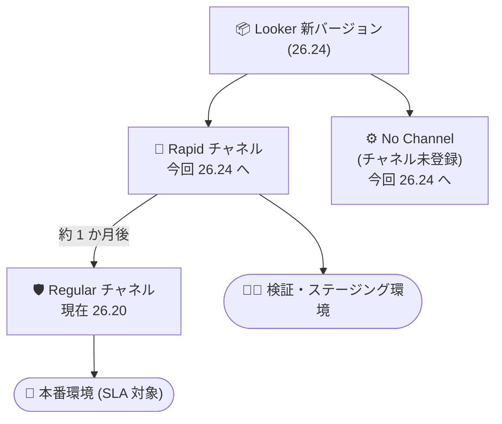

# Looker (Google Cloud core): リリースチャネルで Looker 26.24 の展開を開始

**リリース日**: 2026-11-11

**サービス**: Looker (Google Cloud core)

**機能**: リリースチャネルにおける Looker 26.24 の展開開始

**ステータス**: Announcement

📊 [このアップデートのインフォグラフィックを見る](https://takech9203.github.io/google-cloud-news-summary/20261111-looker-26-24-release-channels.html)

## 概要

Looker (Google Cloud core) の各リリースチャネルにおいて、最新バージョンの展開が開始されました。今回のアナウンスでは、**Rapid チャネル**と **No Channel (チャネル未登録)** の最新バージョンが **Looker 26.24** となり、順次デプロイが始まります。一方、**Regular チャネル**の最新バージョンは **Looker 26.20** であり、Rapid チャネルから約 1 か月遅れのケイデンスが維持されています。

Looker (Google Cloud core) のリリースチャネルは、新機能への早期アクセスと本番環境の運用安定性のバランスをインスタンス単位で選択できる仕組み (Preview) です。今回のアナウンスは、各チャネルがどのバージョンに到達しているかを示す定期的な展開通知であり、インスタンス管理者は自身のインスタンスが登録されているチャネルに応じて、アップグレードのタイミングを把握しておく必要があります。

なお、Looker 26.24 自体は 2026 年 11 月 6 日のリリースノートで Looker (original) 向けの展開 (2026 年 11 月 8 日開始、12 月 8 日最終展開予定) が先行してアナウンスされており、ダッシュボードのフィルタ関連機能 (「Filters as tiles」など) に関する変更が含まれることが案内されています。Looker (Google Cloud core) への展開は本アナウンスのとおり、チャネルごとに順次行われます。

**アップデート前の課題**

- Rapid / No Channel のインスタンスは Looker 26.20 以前のバージョンで稼働しており、26.24 に含まれる機能改善や修正を利用できなかった
- 管理者は各チャネルの最新バージョンを把握していないと、メンテナンスやアップグレードのタイミングを計画しにくかった

**アップデート後の改善**

- Rapid チャネルおよび No Channel のインスタンスに Looker 26.24 が順次展開され、最新の機能改善と修正が適用される
- Regular チャネルは 26.20 に据え置かれ、本番環境向けに約 1 か月の安定化期間を確保した予測可能な更新ケイデンスが維持される

## アーキテクチャ図



新バージョンはまず Rapid チャネル (および従来ケイデンスの No Channel) に展開され、約 1 か月後に Regular チャネルへ到達します。検証環境を Rapid、本番環境を Regular に登録することで、新機能の事前検証と本番の安定運用を両立できます。

## サービスアップデートの詳細

### 今回の展開状況

| チャネル | 最新バージョン | 備考 |
|------|------|------|
| Rapid | **Looker 26.24** | 今回のロールアウトで展開開始 |
| No Channel | **Looker 26.24** | 従来のリリースプロセスで展開開始 |
| Regular | **Looker 26.20** | Rapid の約 1 か月遅れのケイデンス |

※ このリリースノート項目は 2026 年 11 月 12 日に追加されました。

### リリースチャネルの比較

| 項目 | Rapid | Regular | No Channel |
|------|------|------|------|
| 主な目的 | 新機能への最速アクセス | 安定性と予測可能な更新の両立 | 従来の Looker (Google Cloud core) リリースプロセス |
| 推奨環境 | 非本番・ステージング・検証 | 本番環境 (推奨) | — (Preview 期間中のデフォルト) |
| バージョン適用時期 | 毎月、最速で適用 | Rapid の約 1 か月後 | 毎月 (従来ケイデンス) |
| メンテナンスウィンドウ / 拒否期間 | 設定不可 | 設定可能 | 設定可能 |
| SLA | 対象外 | 標準 SLA の対象 | 標準 SLA の対象 |
| セキュリティパッチ | 利用可能になり次第即適用 | ASP フラグ (`--accelerated-security-patch-enabled`) で即時適用を選択可能 | ASP 利用不可 |

### チャネルの確認・変更方法

インスタンスが登録されているチャネルと現在のバージョンは、Google Cloud コンソールのインスタンス詳細タブ、または gcloud CLI で確認できます。

```bash
gcloud looker instances describe INSTANCE_NAME \
  --region=REGION \
  --format=config
```

出力の `RELEASE_CHANNEL` フィールドと `VERSION` フィールドで、チャネルと稼働バージョンを確認できます。チャネルの変更はコンソールの編集画面または `--release-channel=` フラグで行います。

- 遅いチャネル → 速いチャネル (例: Regular → Rapid): 即時に新しいバージョンへ更新される
- 速いチャネル → 遅いチャネル (例: Rapid → Regular): バージョンが揃うまで最大 2 か月程度、現在のバージョンに留まる場合がある

## 管理者が確認すべきポイント

- **Rapid / No Channel のインスタンス**: Looker 26.24 への更新が順次適用されます。メンテナンス通知にオプトインしている場合、アップグレードの少なくとも 72 時間前にメールが届きます (Rapid はメンテナンスウィンドウを設定できないため、通知ベースで把握)
- **No Channel のインスタンス**: メンテナンスウィンドウを設定している場合はそのウィンドウ内で、未設定の場合はロールアウトから 2 週間以内に更新されます。更新を延期したい場合は最大 60 日の拒否メンテナンス期間を設定できます
- **Regular チャネルのインスタンス**: 今回は 26.20 のままで、26.24 は約 1 か月後に展開される見込みです
- **更新内容の確認**: Looker 26.24 の変更点 (機能・修正・Breaking Change) は公式リリースノートの 2026 年 11 月 6 日の項目で事前に確認できます

## デメリット・制約事項

- リリースチャネル機能は Preview であり、Pre-GA Offerings Terms が適用されます
- Rapid チャネルのインスタンスはメンテナンスウィンドウ・拒否メンテナンス期間を設定できず、SLA の対象外となるため、本番環境での利用は推奨されません
- 更新作業は通常 1 時間程度で、ダウンタイムが発生する可能性があります

## 関連サービス・機能

- **Looker (original)**: 26.24 は Looker (original) に対して 2026 年 11 月 8 日から展開が先行してアナウンスされており、Google Cloud core と共通の機能変更が含まれます
- **メンテナンスウィンドウ / 拒否メンテナンス期間**: Regular / No Channel のインスタンスで更新タイミングを制御する仕組み。Rapid では利用不可
- **Accelerated Security Patching (ASP)**: Regular チャネルで重要なセキュリティ修正を即時適用するためのオプションフラグ

## 参考リンク

- 📊 [インフォグラフィック](https://takech9203.github.io/google-cloud-news-summary/20261111-looker-26-24-release-channels.html)
- [公式リリースノート](https://docs.cloud.google.com/release-notes#November_11_2026)
- [Looker リリースノート (26.24 の変更内容)](https://docs.cloud.google.com/looker/docs/release-notes)
- [Looker (Google Cloud core) のリリースプロセスとリリースチャネル](https://docs.cloud.google.com/looker/docs/looker-core-release-process)
- [メンテナンスウィンドウと拒否メンテナンス期間の設定](https://docs.cloud.google.com/looker/docs/looker-core-maintenance)

## まとめ

Looker (Google Cloud core) の Rapid チャネルと No Channel で Looker 26.24 の展開が始まり、Regular チャネルは 26.20 が最新のままです。管理者は自身のインスタンスのチャネルを `gcloud looker instances describe` で確認し、Rapid / No Channel のインスタンスについては 26.24 の変更内容 (フィルタ関連の新機能など) をリリースノートで事前に把握しておくことを推奨します。本番環境では Regular チャネルへの登録と ASP フラグの活用により、安定性とセキュリティの両立を検討してください。

---

**タグ**: Looker, Looker (Google Cloud core), リリースチャネル, Looker 26.24, Rapid チャネル, Regular チャネル, アップグレード
