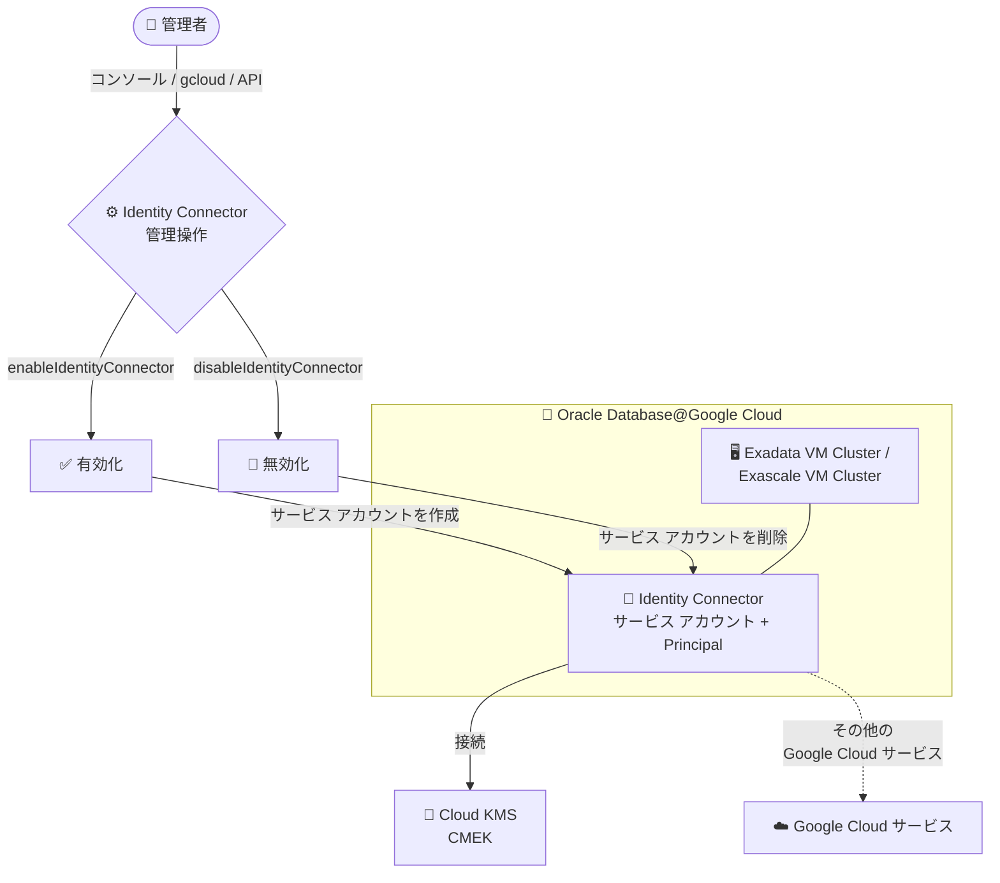

# Oracle Database@Google Cloud: Identity Connector の作成時オプション化と作成後の有効化/無効化 (GA)

**リリース日**: 2026-11-11

**サービス**: Oracle Database@Google Cloud

**機能**: Exadata VM Cluster / Exascale VM Cluster における Identity Connector なしでのクラスタ作成と、作成後の有効化/無効化

**ステータス**: GA (一般提供)

📊 [このアップデートのインフォグラフィックを見る](https://takech9203.github.io/google-cloud-news-summary/20261111-oracle-database-identity-connector-optional-ga.html)

## 概要

Oracle Database@Google Cloud において、Exadata VM Cluster および Exascale VM Cluster を **Identity Connector なしで作成**できるようになり、さらに**クラスタ作成後に Identity Connector を有効化・無効化**できる機能が一般提供 (GA) になりました。操作は Google Cloud コンソール、gcloud CLI、API のいずれからも実行できます。

Identity Connector (Workload Identity Connector) は、Oracle Database@Google Cloud のクラスタを Cloud Key Management Service (Cloud KMS) や顧客管理暗号鍵 (CMEK) などの Google Cloud サービスに接続するためのコンポーネントです。Google Cloud CMEK をクラスタで利用する場合は Identity Connector の有効化が必須ですが、CMEK を使わず Oracle 管理キーのみで運用するケースでは必ずしも必要ではありません。今回のアップデートにより、クラスタのライフサイクルとは独立して Identity Connector の有効/無効をいつでも切り替えられるようになり、構成の柔軟性が大きく向上しました。

対象ユーザーは、Oracle Database@Google Cloud で Exadata Database Service (Exadata VM Cluster) または Exadata Database Service on Exascale Infrastructure (Exascale VM Cluster) を運用し、CMEK の利用方針やセキュリティ要件に応じて Google Cloud サービスとの接続を制御したい組織です。

**アップデート前の課題**

- クラスタ作成時に Identity Connector が常に自動プロビジョニングされ、CMEK を使わない場合でも作成を省略する選択肢がなかった
- クラスタ作成後に Identity Connector の有効/無効を切り替える手段が提供されていなかった
- クラスタ作成時に Identity Connector のセットアップが失敗した場合、作成後に再有効化するための標準化された手順がなかった

**アップデート後の改善**

- クラスタ作成時に Identity Connector の自動プロビジョニングを無効化 (gcloud では `--identity-connector-disabled` フラグ) してクラスタを作成できるようになった
- クラスタ作成後に、コンソール・gcloud CLI・API のいずれからでも Identity Connector を有効化/無効化できるようになった
- Identity Connector のセットアップが失敗した場合も、Operations タブでエラーを確認したうえで再度有効化を試行できるようになった

## アーキテクチャ図



Identity Connector はクラスタに紐づくサービス アカウント (Principal) を介して Cloud KMS (CMEK) などの Google Cloud サービスへの接続を担います。今回の GA により、この接続コンポーネントをクラスタ作成時に省略したり、作成後にコンソール・gcloud・API からいつでも有効化/無効化したりできるようになりました。

## サービスアップデートの詳細

### 主要機能

1. **Identity Connector なしでのクラスタ作成**
   - 従来はクラスタ作成時に Identity Connector がデフォルトで自動作成されていた
   - gcloud の場合、`--identity-connector-disabled` フラグを指定すると作成時の自動プロビジョニングを無効化できる (省略時または `false` の場合は従来どおり自動作成)
   - Google Cloud CMEK を利用する予定がない場合に、不要なコンポーネントの作成を省略できる

2. **作成後の Identity Connector 有効化**
   - Exadata VM Cluster: `gcloud oracle-database cloud-vm-clusters enable-identity-connector`
   - Exascale VM Cluster: `gcloud oracle-database exadb-vm-clusters enable-identity-connector`
   - コンソールではクラスタ詳細ページの「Identity Connector」セクションの「Manage」ダイアログにあるトグルで切り替え
   - 有効化には数分かかる場合があり、リージョンによってはさらに時間を要することがある

3. **作成後の Identity Connector 無効化**
   - Exadata VM Cluster: `gcloud oracle-database cloud-vm-clusters disable-identity-connector`
   - Exascale VM Cluster: `gcloud oracle-database exadb-vm-clusters disable-identity-connector`
   - 無効化するとクラスタに関連付けられたサービス アカウント (Principal 含む) が削除される
   - 操作の進行状況はクラスタ詳細ページの「Operations」タブで確認できる

## 技術仕様

### 対象リソースと操作方法

| 項目 | 詳細 |
|------|------|
| 対象リソース | Exadata VM Cluster (`cloudVmClusters`)、Exascale VM Cluster (`exadbVmClusters`) |
| 操作手段 | Google Cloud コンソール、gcloud CLI、REST API (`oracledatabase/v1`) |
| API メソッド | `:enableIdentityConnector`、`:disableIdentityConnector` (POST) |
| 作成時の制御 | gcloud: `--identity-connector-disabled` フラグ (デフォルトは自動プロビジョニング) |
| CMEK との関係 | Identity Connector の有効化は Google Cloud CMEK 利用の前提条件 |
| ステータス | GA (一般提供) |

### 必要な IAM 権限

| 対象 | 必要な権限 | 含まれるロール |
|------|-----------|----------------|
| Exadata VM Cluster | `oracledatabase.cloudVmClusters.enableIdentityConnector`<br>`oracledatabase.cloudVmClusters.disableIdentityConnector` | `roles/oracledatabase.admin`<br>`roles/oracledatabase.cloudVmClusterAdmin` |
| Exascale VM Cluster | `oracledatabase.exadbVmClusters.enableIdentityConnector`<br>`oracledatabase.exadbVmClusters.disableIdentityConnector` | `roles/oracledatabase.admin`<br>`roles/oracledatabase.exadbVmClusterAdmin` |

## 設定方法

### 前提条件

1. Oracle Database@Google Cloud API が有効化されており、対象の Exadata VM Cluster または Exascale VM Cluster が存在すること
2. 上記の IAM 権限 (enable/disable IdentityConnector) を含むロールが付与されていること
3. プロジェクトが VPC Service Controls の境界内にある場合、必要な egress ルールを追加していること (追加しないと Identity Connector は接続できない)

### 手順

#### ステップ 1: Identity Connector を有効化する (gcloud)

```bash
# Exadata VM Cluster の場合
gcloud oracle-database cloud-vm-clusters enable-identity-connector CLUSTER_ID \
  --project=PROJECT_ID \
  --location=REGION

# Exascale VM Cluster の場合
gcloud oracle-database exadb-vm-clusters enable-identity-connector CLUSTER_ID \
  --project=PROJECT_ID \
  --location=REGION
```

コンソールの場合は、クラスタ詳細ページの「Identity Connector」セクションで「Manage」をクリックし、「Identity Connector enabled」トグルをオンにして保存します。

#### ステップ 2: Identity Connector を無効化する (gcloud / API)

```bash
# Exadata VM Cluster の場合 (gcloud)
gcloud oracle-database cloud-vm-clusters disable-identity-connector CLUSTER_ID \
  --project=PROJECT_ID \
  --location=REGION

# Exascale VM Cluster の場合 (REST API)
curl -X POST \
  -H "Authorization: Bearer $(gcloud auth print-access-token)" \
  -H "Content-Type: application/json" \
  "https://oracledatabase.googleapis.com/v1/projects/PROJECT_ID/locations/REGION/exadbVmClusters/CLUSTER_ID:disableIdentityConnector" \
  -d '{}'
```

無効化の前に、クラスタ上のデータベースが CMEK を使用していないことを確認してください (CMEK 使用中は無効化できません)。

#### ステップ 3: 操作状況の確認

クラスタ詳細ページの「Operations」タブで、有効化/無効化オペレーションの状況とエラーの有無を確認します。クラスタ作成時に Identity Connector のステータスが「Not enabled」になっている場合も、同タブでセットアップ エラーを確認してから再度有効化を試行します。

## メリット

### ビジネス面

- **構成の柔軟性向上**: CMEK を使う/使わないというセキュリティ方針の変更に対して、クラスタを再作成することなく Identity Connector の有効/無効で追従できる
- **最小権限の原則への準拠**: CMEK を利用しない環境では Google Cloud サービスへの接続経路 (サービス アカウント) 自体を持たない構成を選択でき、監査やコンプライアンス要件に対応しやすい

### 技術面

- **マルチインターフェース対応**: コンソール・gcloud CLI・REST API のすべてで同一操作が可能で、IaC や運用自動化に組み込みやすい
- **障害復旧手順の明確化**: クラスタ作成時に Identity Connector のセットアップが失敗しても、クラスタ自体は作成され、後から有効化を再試行できる

## デメリット・制約事項

### 制限事項

- クラスタ上のいずれかのデータベースが Google Cloud CMEK を使用している間は、Identity Connector を無効化できない。先に対象データベースを Oracle 管理キーに切り替える必要がある
- Identity Connector を無効化すると、クラスタに関連付けられたサービス アカウント (Principal 含む) が削除される。再有効化すると新しいサービス アカウントが作成され、以前の IAM ロールと権限は引き継がれないため、新しい Principal に鍵へのアクセス権を再付与する必要がある

### 考慮すべき点

- Google Cloud CMEK を利用する場合、Identity Connector の有効化は必須の前提条件である
- 有効化には数分以上かかる場合がある (リージョンによって所要時間が異なる)
- プロジェクトが VPC Service Controls の境界内にある場合、必要な egress ルールを追加しないと Identity Connector は接続できない
- クラスタ作成時に Identity Connector のセットアップが失敗してもクラスタ作成自体は成功する場合があるため、作成後にステータスが「Not enabled」でないか確認するとよい

## ユースケース

### ユースケース 1: CMEK 非利用環境での最小構成クラスタ作成

**シナリオ**: Oracle 管理キーのみで運用するポリシーの組織が、Google Cloud サービスへの接続コンポーネントを持たない Exascale VM Cluster を作成したい。

**実装例**:
```bash
gcloud oracle-database exadb-vm-clusters create my-cluster \
  --location=us-east4 \
  --identity-connector-disabled \
  ... # その他の必須フラグ
```

**効果**: 不要なサービス アカウントが作成されず、クラスタから Google Cloud サービスへの接続経路を持たないシンプルかつ監査しやすい構成を実現できる。

### ユースケース 2: 運用途中からの CMEK 導入

**シナリオ**: Identity Connector なしで作成・運用してきた Exadata VM Cluster で、セキュリティ要件の強化に伴い Google Cloud CMEK の利用が決定した。

**効果**: クラスタを再作成することなく、`enable-identity-connector` コマンドまたはコンソール操作で Identity Connector を有効化し、新しく作成された Principal に Cloud KMS 鍵へのアクセス権を付与するだけで CMEK へ移行できる。

## 料金

このアップデートに伴う追加料金に関する記載は Release Notes およびドキュメントにはありません。Oracle Database@Google Cloud の料金の詳細は公式ページを参照してください。

- 料金ページ: https://cloud.google.com/oracle/database/pricing

## 利用可能リージョン

リージョン固有の制限に関する記載はありません。Identity Connector の有効化に要する時間はリージョンによって異なる場合があります。Oracle Database@Google Cloud の利用可能ロケーションはドキュメントを参照してください。

## 関連サービス・機能

- **Cloud Key Management Service (Cloud KMS) / CMEK**: Identity Connector は、クラスタが Cloud KMS や CMEK に接続するための前提コンポーネント。CMEK を利用する場合は有効化が必須
- **IAM (Identity and Access Management)**: Identity Connector の有効化/無効化には専用の IAM 権限が必要。また、有効化時に作成される Principal への鍵アクセス権付与も IAM で管理する
- **VPC Service Controls**: プロジェクトがサービス境界内にある場合、Identity Connector の接続には egress ルールの設定が必要
- **Workload Identity Federation**: Identity Connector はサービス アカウント キーを使わずに外部ワークロードから Google Cloud リソースへアクセスする仕組みの一種 (Workload Identity Connector) として機能する

## 参考リンク

- 📊 [インフォグラフィック](https://takech9203.github.io/google-cloud-news-summary/20261111-oracle-database-identity-connector-optional-ga.html)
- [公式リリースノート](https://docs.cloud.google.com/release-notes#November_11_2026)
- [Enable and disable Identity Connector](https://docs.cloud.google.com/oracle/database/docs/enable-disable-identity-connector)
- [gcloud oracle-database cloud-vm-clusters enable-identity-connector](https://docs.cloud.google.com/sdk/gcloud/reference/oracle-database/cloud-vm-clusters/enable-identity-connector)
- [gcloud oracle-database exadb-vm-clusters enable-identity-connector](https://docs.cloud.google.com/sdk/gcloud/reference/oracle-database/exadb-vm-clusters/enable-identity-connector)
- [gcloud oracle-database exadb-vm-clusters disable-identity-connector](https://docs.cloud.google.com/sdk/gcloud/reference/oracle-database/exadb-vm-clusters/disable-identity-connector)
- [料金ページ](https://cloud.google.com/oracle/database/pricing)

## まとめ

Exadata VM Cluster と Exascale VM Cluster で Identity Connector がオプション化され、クラスタ作成後にコンソール・gcloud・API からいつでも有効化/無効化できるようになりました。CMEK の利用方針に応じて接続コンポーネントの有無を柔軟に制御できるため、Oracle Database@Google Cloud を運用するチームは自社のセキュリティ要件に照らして Identity Connector の要否を見直し、無効化時のサービス アカウント削除と再有効化時の権限再付与の挙動を運用手順に反映することを推奨します。

---

**タグ**: Oracle Database@Google Cloud, Exadata, Exascale, Identity Connector, CMEK, Cloud KMS, GA, セキュリティ
