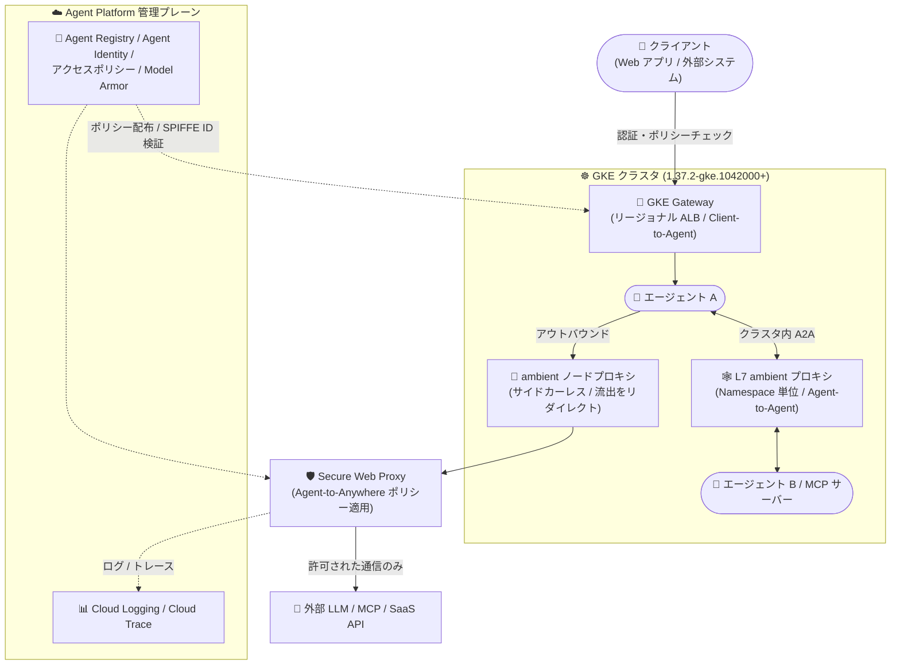

# Gemini Enterprise Agent Platform: Agent Gateway for GKE (Preview)

**リリース日**: 2026-11-12

**サービス**: Gemini Enterprise Agent Platform / Google Kubernetes Engine (GKE)

**機能**: Agent Gateway for GKE — GKE 上のエージェントトラフィックを一元管理するガバナンスレイヤー

**ステータス**: Preview

📊 [このアップデートのインフォグラフィックを見る](https://takech9203.github.io/google-cloud-news-summary/20261112-agent-gateway-for-gke-preview.html)

## 概要

Gemini Enterprise Agent Platform の **Agent Gateway for GKE** が Preview として公開されました。GKE バージョン **1.37.2-gke.1042000 以降** のクラスタ (現時点では Rapid チャンネルで利用可能、他チャンネルへの展開は近日予定) が対象で、GKE 上で稼働するエージェントへの流入 (Client-to-Agent)、エージェントからの流出 (Agent-to-Anywhere)、エージェント間 (Agent-to-Agent) のすべてのトラフィックを制御する一元的な管理レイヤーを提供します。

Agent Gateway はこれまで、Agent Runtime / Gemini Enterprise 向けの Google 管理型ゲートウェイと、Google Cloud 外の Kubernetes クラスタ向けの Agent Gateway for cross-cloud (前日 2026-11-11 に Limited Preview、[関連レポート](./2026-11-11-agent-gateway-cross-cloud-limited-preview.md)) が提供されており、GKE 向けは「Coming soon」の位置づけでした。今回のアップデートにより、自己管理の GKE クラスタ上のエージェントと MCP サーバーにも、Agent Runtime 上のエージェントと同じ Agent Identity・Agent Registry・ポリシーによるガバナンスを適用できるようになります。

構成は Kubernetes ネイティブです。流入トラフィックは GKE Gateway API (リージョナルアプリケーションロードバランサ) で受け、流出トラフィックは GKE の ambient ネットワーキングがサイドカーなしで Secure Web Proxy にリダイレクトし、クラスタを出る前にポリシーを適用します。クラスタ内のエージェント間トラフィックは Namespace 単位で動作する Layer 7 ambient プロキシが統制します。GKE 上でエージェントを運用し、使い慣れた Kubernetes ツールでエージェントトラフィックを統制したいプラットフォームチーム・セキュリティチームが主な対象です。

**アップデート前の課題**

- Agent Gateway のガバナンス (Agent Identity、Agent Registry、アクセスポリシー、Model Armor) は Agent Runtime / Gemini Enterprise 上のエージェントが中心で、自己管理の GKE クラスタ上のエージェントは対象外 (GKE 対応は「Coming soon」で早期アクセス申請が必要) だった
- GKE 上のエージェントの流入・流出・エージェント間トラフィックに一貫したアイデンティティベースのアクセス制御を適用するには、サービスメッシュのサイドカー導入や Envoy 設定、独自のプロキシ構成を自前で設計・運用する必要があった
- エージェントのプロンプト / レスポンスへの安全性スクリーニング (プロンプトインジェクション対策など) をエージェントコードやクラスタごとに個別実装する必要があった

**アップデート後の改善**

- GKE 1.37.2-gke.1042000 以降のクラスタで Agent Gateway for GKE を Preview として利用できるようになり、GKE 上のエージェントと MCP サーバーが Agent Platform のガバナンス対象に含められるようになった
- Agent Runtime 上のエージェントと同一の Agent Identity・Agent Registry・ポリシーを GKE 上のエージェントにも適用でき、Kubernetes ネイティブなリソースと GKE Gateway API でガバナンスを構成できるようになった
- GKE ambient ネットワーキングにより、サイドカーなしで流出トラフィックを Secure Web Proxy へリダイレクトし、トラフィックがクラスタを出る前にポリシーを適用できるようになった
- 各エージェントの SPIFFE アイデンティティに基づくアクセス制御、Model Armor によるプロンプト / レスポンスのスクリーニング、流出トラフィックの TLS インスペクション、拡張バインディングによるカスタムポリシーエンジン連携が可能になった

## アーキテクチャ図



クライアントからの流入は GKE Gateway (リージョナルアプリケーションロードバランサ) が、エージェントからの流出は ambient ネットワーキング経由の Secure Web Proxy が、クラスタ内のエージェント間通信は Namespace 単位の Layer 7 ambient プロキシが、それぞれ中央で定義したポリシーを適用します。

## サービスアップデートの詳細

### 主要機能

1. **3 つの通信経路を対象とした一元的なトラフィックガバナンス**
   - Client-to-Agent (流入): クライアントトラフィックは GKE Gateway (リージョナルアプリケーションロードバランサ) 経由でクラスタに入り、エージェントに到達する前に認証とポリシーチェックが行われる
   - Agent-to-Anywhere (流出): GKE ambient ネットワーキングがサイドカーなしでアウトバウンドトラフィックを Secure Web Proxy にリダイレクトし、トラフィックがクラスタを出る前にポリシーを適用
   - Agent-to-Agent (クラスタ内): Namespace 単位で動作する Layer 7 ambient プロキシがエージェント間トラフィックを統制

2. **Kubernetes ネイティブなポリシー構成**
   - プラットフォームチームは Kubernetes ネイティブのリソースと GKE Gateway API を使ってガバナンスを構成
   - Agent Runtime 上のエージェントを統制するものと同じ Agent Identity・Agent Registry・ポリシーが GKE 上のエージェントにもそのまま適用される

3. **アイデンティティベースのアクセス制御と安全性ガードレール**
   - 各エージェントの SPIFFE アイデンティティに基づくアクセス制御
   - Model Armor によるプロンプト / レスポンスのスクリーニング (プロンプトインジェクション、ジェイルブレイク、機密データ漏洩のブロック)
   - 流出エージェントトラフィックの TLS インスペクション
   - 拡張バインディング (extension bindings) によるカスタムポリシーエンジンの組み込み

4. **プロトコル対応と可観測性**
   - MCP (SSE / HTTP POST)、A2A、REST / gRPC (HTTP/1.1、HTTP/2) をサポート
   - MCP トラフィックは JSON-RPC リクエストを検査してツール名・メソッド属性を抽出し、ツール単位の細かなアクセスポリシーを適用可能
   - アクセスログとトレースを Cloud Logging / Cloud Trace に集約 (Agent Observability)

## 技術仕様

### デプロイモデルにおける位置づけ

| 項目 | 詳細 |
|------|------|
| デプロイモデル | Agent Gateway on Google Cloud (自己管理型) |
| 対象 GKE バージョン | 1.37.2-gke.1042000 以降 (現時点では Rapid チャンネル、他チャンネルは近日対応) |
| プロキシインフラ | ユーザープロジェクト内で稼働 (Client-to-Agent: GKE Gateway API、Agent-to-Anywhere: Secure Web Proxy、Pod 間: ambient ネットワーキング) |
| 管理プレーン | Agent Runtime と共通の中央コントロールプレーン (Agent Identity、Agent Registry、アクセスポリシー) |
| アイデンティティ | エージェントごとの SPIFFE アイデンティティに基づくアクセス制御 |
| 安全性 | Model Armor によるプロンプト / レスポンスのスクリーニング、流出トラフィックの TLS インスペクション |
| 拡張性 | 拡張バインディングによるカスタムポリシーエンジン連携 |
| 可観測性 | アクセスログ → Cloud Logging、トレース → Cloud Trace |

### サポートされるプロトコル

| プロトコル | 内容 |
|------------|------|
| MCP (Model Context Protocol) | SSE / HTTP POST によるインバウンド・アウトバウンドの MCP ツール呼び出しをガバナンス。JSON-RPC 検査によるツール単位の認可が可能 |
| A2A (Agent-to-Agent) | エージェント間のタスク委譲・実行 API をガバナンス |
| REST / gRPC | HTTP/1.1 および HTTP/2 (gRPC) トラフィックをサポート |

### 制限事項 (Agent Gateway 全般)

- Agent Gateway インスタンス 1 つにつき、Agent Registry に登録されたリソースを最大 5,000 までガバナンス可能

## 設定方法

### 前提条件

1. GKE バージョン 1.37.2-gke.1042000 以降のクラスタ (現時点では Rapid リリースチャンネルで利用可能)
2. サポートリージョン (europe-west1 または us-central1) でのクラスタ稼働
3. 流出ガバナンスを利用する場合: GKE ambient ネットワーキングの有効化と Secure Web Proxy インスタンスのデプロイ
4. Secure Web Proxy / Network Services の構成権限 (`roles/networkservices.admin` など) および GKE クラスタ管理権限 (`roles/container.clusterAdmin`)

### 手順 (概要)

詳細な手順は公式ドキュメント「Agent Gateway for GKE overview」を参照してください。以下は構成要素の概要です。

#### ステップ 1: Rapid チャンネルのクラスタを用意

```bash
# Rapid チャンネルで対象バージョン以降のクラスタを作成
gcloud container clusters create CLUSTER_NAME \
  --location=us-central1 \
  --release-channel=rapid \
  --cluster-version=1.37.2-gke.1042000
```

GKE 1.37.2-gke.1042000 以降が必要です。既存クラスタの場合はバージョンとチャンネルを確認します。

#### ステップ 2: 流入 (Client-to-Agent) の構成

GKE Gateway API を使用して Gateway リソース (リージョナルアプリケーションロードバランサ) を作成し、クライアントからエージェントへのトラフィックを Agent Gateway の認証・ポリシーチェック経由にします。

#### ステップ 3: 流出 (Agent-to-Anywhere) の構成

ambient ネットワーキングを有効化した Namespace でエージェントを稼働させ、`GCPBackend` カスタムリソースで Secure Web Proxy をゲートウェイエンドポイントとして定義します。

```yaml
# 例: Secure Web Proxy をゲートウェイエンドポイントとして登録
apiVersion: networking.gke.io/v1
kind: GCPBackend
metadata:
  name: swp-backend
  namespace: AGENT_NAMESPACE
spec:
  serviceUris:
    - //networkservices.googleapis.com/projects/PROJECT_ID/locations/REGION/gateways/SWP_NAME
```

#### ステップ 4: Agent Registry への登録とポリシー定義

Agent Platform の中央コントロールプレーンでエージェントと MCP サーバーを Agent Registry に登録し、アクセスポリシーや Model Armor テンプレートを定義します。

```bash
# Agent Gateway の管理には gcloud network-services agent-gateways を使用
gcloud network-services agent-gateways --help
```

## メリット

### ビジネス面

- **既存 GKE 投資の活用**: エージェントを Agent Runtime へ移行することなく、既に運用している GKE クラスタのまま Agent Platform の統一ガバナンスを導入できる
- **一貫したセキュリティポスチャ**: Agent Runtime / Gemini Enterprise / GKE (さらに cross-cloud) にまたがって、1 つのレジストリと 1 セットのポリシーで最小権限のセキュリティ統制を実現できる
- **監査対応の簡素化**: エージェントのアクセスログとトレースが Cloud Logging / Cloud Trace に集約され、エージェント活動の完全な監査証跡を確保できる

### 技術面

- **サイドカーレスの流出制御**: ambient ネットワーキングがサイドカーなしでアウトバウンドトラフィックを Secure Web Proxy にリダイレクトするため、Pod へのサイドカー注入やアプリケーションコードの変更が不要
- **クラスタを出る前のポリシー適用**: 流出ポリシーはトラフィックがクラスタを離れる前に適用され、データ流出 (exfiltration) リスクを低減できる
- **Kubernetes ネイティブな運用**: GKE Gateway API と Kubernetes リソースでガバナンスを構成でき、プラットフォームチームが使い慣れたツールチェーンで運用可能
- **細粒度のツール認可**: MCP の JSON-RPC 検査により、エージェントが呼び出せる MCP ツールを名前・メソッド属性単位で制御できる

## デメリット・制約事項

### 制限事項

- Preview 段階の機能であり、Pre-GA Offerings Terms が適用される。機能や提供時期は変更される可能性がある
- GKE 1.37.2-gke.1042000 以降が必要で、現時点では Rapid リリースチャンネルのみで利用可能 (他チャンネルは近日対応予定)
- 利用可能リージョンは europe-west1 と us-central1 の 2 リージョンに限定
- Agent Gateway インスタンス 1 つあたり、Agent Registry 登録リソースは最大 5,000 まで

### 考慮すべき点

- 自己管理型デプロイモデルのため、GKE Gateway (ロードバランサ) や Secure Web Proxy などのプロキシインフラはユーザープロジェクト内で自ら作成・運用する必要がある
- Rapid チャンネルは最新機能をいち早く利用できる一方、本番ワークロードには安定性の観点で注意が必要。本番導入は他チャンネルへの展開を待つ判断も検討する
- GKE ambient ネットワーキング (Preview) には、流出ポリシーが Namespace 単位であること、ホスト名フィルタリングに TLS インスペクションが必要なこと、TLS インスペクション利用時は Secure Web Proxy のプライベート CA 証明書をコンテナイメージに手動で組み込む必要があることなどの制限がある
- Model Armor、Secure Web Proxy、アプリケーションロードバランサ、Cloud Logging / Cloud Trace など、組み合わせて構成するサービスは各サービスの標準料金で課金される

## ユースケース

### ユースケース 1: GKE 上のマルチエージェントシステムへの統一ガバナンス導入

**シナリオ**: GKE 上で複数の LLM エージェントと MCP サーバーを運用している企業が、どのエージェントがどの外部 API・MCP ツールを呼び出せるかをアイデンティティベースで制御し、プロンプトインジェクション対策を全エージェントに一括適用したい。

**実装例**:
```text
1. Rapid チャンネルの GKE 1.37.2-gke.1042000+ クラスタにエージェントをデプロイ
2. エージェントと MCP サーバーを Agent Registry に登録
3. ambient ネットワーキングを有効化し、流出トラフィックを Secure Web Proxy 経由に構成
4. SPIFFE アイデンティティベースのアクセスポリシーと Model Armor テンプレートを中央で定義
5. MCP の JSON-RPC 検査でツール単位の認可ポリシーを適用
```

**効果**: エージェントコードを変更せずに、全エージェントへ一貫した最小権限ポリシーと安全性スクリーニングを適用。未承認の外部 API や MCP ツールへのアクセスをクラスタを出る前にブロックできる。

### ユースケース 2: クラスタ内エージェント間 (A2A) 通信の統制と可視化

**シナリオ**: 同一クラスタ内でオーケストレーターエージェントが複数のサブエージェントにタスクを委譲する構成で、エージェント間の呼び出し関係を統制・監査したい。

**効果**: Namespace 単位の Layer 7 ambient プロキシが A2A トラフィックを統制し、SPIFFE アイデンティティに基づき「どのエージェントがどのエージェントを呼び出せるか」を制御。呼び出しのログとトレースは Cloud Logging / Cloud Trace に集約され、マルチエージェントの挙動を可視化できる。

## 料金

Agent Gateway for GKE 自体の Preview 期間中の料金は、リリースノートおよび確認できたドキュメントには明記されていません。最新情報は公式ドキュメントを確認してください。

組み合わせて構成する以下のサービスは、各サービスの標準料金で課金されます。

| サービス | 課金 |
|----------|------|
| GKE クラスタ | 標準料金 |
| GKE Gateway (リージョナルアプリケーションロードバランサ) | 標準料金 |
| Secure Web Proxy | 標準料金 |
| Model Armor | 標準料金 |
| Cloud Logging / Cloud Trace | 標準料金 |

## 利用可能リージョン

- europe-west1
- us-central1

## 関連サービス・機能

- **Agent Gateway for cross-cloud**: 前日 (2026-11-11) に Limited Preview となった、Google Cloud 外 (EKS / AKS / OpenShift / ベアメタル) の Kubernetes クラスタ向けデプロイモデル。GKE 版と合わせて「どこで動くエージェントも 1 つのガバナンス」が揃いつつある ([関連レポート](./2026-11-11-agent-gateway-cross-cloud-limited-preview.md))
- **Agent Registry / Agent Identity**: エージェントと MCP サーバーの中央レジストリと検証可能なアイデンティティ基盤。Agent Runtime と GKE で共通に利用される
- **GKE Gateway API**: Client-to-Agent トラフィックの入口となるリージョナルアプリケーションロードバランサを Kubernetes ネイティブに構成
- **GKE ambient ネットワーキング**: サイドカーレスでトラフィックを横取りする L4 ノードプロキシ / L7 プロキシ基盤。Agent-to-Anywhere とクラスタ内 A2A の統制を担う
- **Secure Web Proxy**: 流出トラフィックのポリシー適用ポイント。URL フィルタリングや TLS インスペクションを提供
- **Model Armor**: プロンプト / レスポンスの安全性スクリーニング (プロンプトインジェクション、ジェイルブレイク、機密データ漏洩対策)
- **Cloud Logging / Cloud Trace**: エージェントのアクセスログと OpenTelemetry トレースの集約先 (Agent Observability)

## 参考リンク

- 📊 [インフォグラフィック](https://takech9203.github.io/google-cloud-news-summary/20261112-agent-gateway-for-gke-preview.html)
- [公式リリースノート](https://docs.cloud.google.com/release-notes#November_12_2026)
- [Agent Gateway 概要 (デプロイモデル)](https://docs.cloud.google.com/gemini-enterprise-agent-platform/govern/gateways/agent-gateway-overview)
- [GKE ambient ネットワーキングの準備](https://docs.cloud.google.com/kubernetes-engine/docs/how-to/prepare-ambient-networking)
- [ambient ネットワーキングから Secure Web Proxy への流出ルーティング](https://docs.cloud.google.com/kubernetes-engine/docs/how-to/ambient-egress-swp)
- [GKE 料金ページ](https://cloud.google.com/kubernetes-engine/pricing)

## まとめ

Agent Gateway for GKE の Preview 公開により、Google 管理ランタイム (Agent Runtime / Gemini Enterprise)、cross-cloud に続いて、自己管理の GKE クラスタでも Agent Platform の統一ガバナンスが利用可能になりました。GKE Gateway API と ambient ネットワーキングを組み合わせたサイドカーレス構成で、流入・流出・エージェント間のすべてのトラフィックに SPIFFE アイデンティティベースの制御と Model Armor スクリーニングを適用できる点が特長です。GKE でエージェントを運用するプラットフォーム / セキュリティチームは、Rapid チャンネルの検証用クラスタ (us-central1 または europe-west1) で ambient ネットワーキングと Gateway API の構成検証から始めることを推奨します。

---

**タグ**: #GeminiEnterpriseAgentPlatform #AgentGateway #GKE #GatewayAPI #AmbientNetworking #SecureWebProxy #ModelArmor #SPIFFE #MCP #A2A #Preview #AIエージェント #ガバナンス
