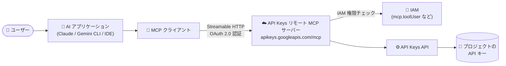

# API Keys API: リモート MCP サーバーが一般提供 (GA) 開始

**リリース日**: 2026-11-12

**サービス**: API Keys API

**機能**: API Keys リモート Model Context Protocol (MCP) サーバー

**ステータス**: GA (一般提供)

📊 [このアップデートのインフォグラフィックを見る](https://takech9203.github.io/google-cloud-news-summary/20261112-api-keys-remote-mcp-server-ga.html)

## 概要

API Keys API のリモート Model Context Protocol (MCP) サーバーが一般提供 (GA) になりました。AI アプリケーションやエージェントから MCP 経由で API Keys API に接続し、Google Cloud プロジェクト内の API キーの作成・確認・制限設定・ライフサイクル管理を自然言語ベースのワークフローで実行できます。

MCP (Model Context Protocol) は Anthropic が開発したオープンソースプロトコルで、AI アプリケーションが外部ツールやデータソースに接続する方法を標準化します。Google Cloud のリモート MCP サーバーは Google のインフラ上でホストされ、HTTP エンドポイントを提供するため、ユーザーがローカルに MCP サーバーを構築・運用する必要がありません。API Keys リモート MCP サーバーはグローバルエンドポイント `https://apikeys.googleapis.com/mcp` として提供されます。

対象ユーザーは、Claude、Gemini CLI、VS Code、Cursor などの MCP 対応 AI アプリケーションを利用する開発者や、API キー管理を自動化したいプラットフォーム管理者です。IAM によるアクセス制御のもとで、エージェントによる API キー運用の自動化を安全に実現できます。

**アップデート前の課題**

- AI エージェントから API キーを管理するには、gcloud CLI や REST API を呼び出すカスタムツールを自前で実装する必要があった
- API キーの棚卸し (一覧取得、制限の確認) や作成・削除といった定型作業を、コンソールやコマンドラインで手動実行する必要があった
- API Keys API を AI アプリケーションに統合する標準的な方法が GA として保証されていなかった

**アップデート後の改善**

- Google がホストするリモート MCP サーバーに接続するだけで、AI アプリケーションから API キー管理ツール群 (作成・取得・更新・削除・復元など 8 ツール) を利用可能になった
- MCP の標準ディスカバリ機構 (`tools/list`) によりツール仕様を自動取得でき、カスタム実装が不要になった
- GA となったことで、本番環境での利用を想定した安定性が提供されるようになった

## アーキテクチャ図



AI アプリケーション内の MCP クライアントが Google ホストのリモート MCP サーバーに HTTP で接続し、IAM による認可を経て API Keys API を操作します。ローカルでの MCP サーバー運用は不要です。

## サービスアップデートの詳細

### 主要機能

1. **API キーのライフサイクル管理ツール (8 種類)**
   - `apikeys_list_keys`: プロジェクトが所有する API キーの一覧をメタデータ・制限情報付きで取得
   - `apikeys_get_key`: 特定の API キーのメタデータを取得 (キー文字列自体は返さない)
   - `apikeys_get_key_string`: 実際のシークレット API キー文字列を取得 (機密情報として扱う必要あり)
   - `apikeys_create_key`: 新しい API キーを作成 (制限の指定も可能)
   - `apikeys_update_key`: 既存キーのメタデータ・制限・表示名を更新
   - `apikeys_delete_key`: API キーを削除 (削除後 30 日以内は復元可能)
   - `apikeys_undelete_key`: 削除された API キーを復元
   - `apikeys_lookup_key`: キー文字列から親プロジェクトとリソース名を逆引き

2. **グローバル MCP エンドポイント**
   - `https://apikeys.googleapis.com/mcp` として提供
   - Streamable HTTP トランスポートに対応し、MCP 標準仕様に準拠

3. **MCP ディスカバリ対応**
   - `tools/list` メソッドでツール仕様を動的に取得可能
   - AI アプリケーションがサーバーの機能 (ツール・プロンプト・リソース) を自動検出できる

## 技術仕様

### サーバー仕様

| 項目 | 詳細 |
|------|------|
| エンドポイント | `https://apikeys.googleapis.com/mcp` (グローバル) |
| トランスポート | Streamable HTTP |
| 認証・認可 | OAuth 2.0 + IAM (Google Cloud の全アイデンティティに対応) |
| ツール数 | 8 (作成 / 取得 / 一覧 / 更新 / 削除 / 復元 / キー文字列取得 / 逆引き) |
| 事前準備 | MCP サーバーの有効化と認証の設定が必要 |

### ツール一覧の取得例

```bash
curl --location 'https://apikeys.googleapis.com/mcp' \
  --header 'content-type: application/json' \
  --header 'accept: application/json, text/event-stream' \
  --data '{
    "method": "tools/list",
    "jsonrpc": "2.0",
    "id": 1
  }'
```

## 設定方法

### 前提条件

1. Google Cloud プロジェクトで [MCP サーバーを有効化](https://docs.cloud.google.com/mcp/enable-disable-mcp-servers)しておく
2. [MCP サーバーへの認証](https://docs.cloud.google.com/mcp/authenticate-mcp)を設定しておく (OAuth 2.0)
3. 必要な IAM ロールを付与しておく
   - MCP ツール呼び出し: MCP Tool User (`roles/mcp.toolUser`)
   - API キーの管理: API Keys Admin (`roles/serviceusage.apiKeysAdmin`)、閲覧のみの場合は API Keys Viewer (`roles/serviceusage.apiKeysViewer`)

### 手順

#### ステップ 1: IAM ロールの付与

```bash
# エージェント用のサービスアカウントに MCP ツール呼び出し権限を付与
gcloud projects add-iam-policy-binding PROJECT_ID \
  --member="serviceAccount:AGENT_SA@PROJECT_ID.iam.gserviceaccount.com" \
  --role="roles/mcp.toolUser"

# API キー管理権限を付与
gcloud projects add-iam-policy-binding PROJECT_ID \
  --member="serviceAccount:AGENT_SA@PROJECT_ID.iam.gserviceaccount.com" \
  --role="roles/serviceusage.apiKeysAdmin"
```

エージェント専用のアイデンティティを作成し、リソースへのアクセスを制御・監視することが推奨されています。

#### ステップ 2: AI アプリケーションに MCP サーバーを登録

```json
{
  "mcpServers": {
    "api-keys": {
      "serverUrl": "https://apikeys.googleapis.com/mcp"
    }
  }
}
```

MCP 対応 AI アプリケーション (Claude、Gemini CLI、VS Code など) の設定にリモート MCP サーバーとしてエンドポイントを追加します。クライアント別の設定方法は [Configure MCP in an AI application](https://docs.cloud.google.com/mcp/configure-mcp-ai-application) を参照してください。

## メリット

### ビジネス面

- **運用自動化の加速**: API キーの棚卸し・作成・制限設定・削除といった定型運用を AI エージェントに委譲でき、運用負荷を削減できる
- **GA による本番利用の安心感**: GA となったことで、本番ワークロードでの採用判断がしやすくなった

### 技術面

- **標準プロトコルによる統合**: MCP 標準に準拠しているため、カスタムツールの実装・保守が不要になり、幅広い MCP 対応クライアントからそのまま利用できる
- **IAM による細かなアクセス制御**: 「誰がどのリソースに対してどの MCP ツールを使えるか」を IAM の許可・拒否ポリシーで統制できる
- **マネージドなリモートサーバー**: Google のインフラ上で動作するため、ローカル MCP サーバーの構築・運用・アップデートが不要

## デメリット・制約事項

### 制限事項

- 利用前に MCP サーバーの有効化と OAuth 2.0 認証の設定が必要 (API キーの管理操作には認証済みプリンシパルが必要)
- `apikeys_delete_key` で削除したキーの復元可能期間は 30 日間

### 考慮すべき点

- `apikeys_get_key_string` は実際のシークレットキー文字列を返すため、極めて機密性の高い操作として扱う必要がある。エージェントに付与するロールは最小権限 (閲覧のみなら `roles/serviceusage.apiKeysViewer`) に絞ることを推奨
- エージェントが API キーを作成・変更できるようになるため、エージェント専用のアイデンティティを分離し、監査ログで操作を監視する運用設計が重要
- 多数の MCP サーバーを併用するとエージェントのコンテキストが肥大化するため、必要なサーバー・ツールに限定する設計が望ましい

## ユースケース

### ユースケース 1: AI エージェントによる API キーの棚卸しとセキュリティ監査

**シナリオ**: プロジェクト内に長年蓄積された API キーについて、制限 (API 制限・アプリケーション制限) が設定されていないキーを洗い出し、適切な制限を適用したい。

**実装例**:
```
エージェントへの指示例:
「このプロジェクトの API キーを一覧して、API 制限が未設定のキーを
 リストアップしてください。その後、各キーに適切な API 制限を
 設定してください。」

→ エージェントが apikeys_list_keys で一覧を取得し、
  apikeys_update_key で制限を適用
```

**効果**: 手動で 1 件ずつコンソールを確認する作業が不要になり、無制限キーの放置というセキュリティリスクを迅速に解消できる。

### ユースケース 2: 開発ワークフローへの組み込み

**シナリオ**: 新しいアプリケーションの開発時に、IDE 内の AI アシスタントから適切な API 制限付きの API キーを発行し、そのままコードに組み込みたい。

**効果**: コンソールと IDE の往復が不要になり、制限付きキーの発行がベストプラクティスに沿った形で自動化される。誤って広い権限のキーを発行するミスも減らせる。

## 料金

API Keys リモート MCP サーバー固有の料金情報はリリースノートおよび検索したドキュメントには記載されていません。最新の情報は以下を参照してください。

- [Google Cloud 料金](https://cloud.google.com/pricing)

## 利用可能リージョン

API Keys リモート MCP サーバーはグローバルエンドポイント (`https://apikeys.googleapis.com/mcp`) として提供されます。

## 関連サービス・機能

- **Identity and Access Management (IAM)**: MCP ツール呼び出しの認可を制御。MCP Tool User (`roles/mcp.toolUser`) と API Keys 関連ロールの組み合わせで最小権限を実現。IAM 自体にもリモート MCP サーバーが提供されている
- **Model Armor**: MCP のリクエスト・レスポンスをサニタイズし、プロンプトインジェクションや機密データ漏えい、ツールポイズニングなどのリスクを軽減 (対応サーバーで有効化可能)
- **Agent Registry**: プロジェクトで利用する MCP サーバーの管理・ディスカバリに利用
- **その他の Google Cloud リモート MCP サーバー**: IAM、Apigee API hub、Audit Manager など多数のサービスがリモート MCP サーバーを提供しており、組み合わせてエージェントの運用範囲を拡張できる

## 参考リンク

- 📊 [インフォグラフィック](https://takech9203.github.io/google-cloud-news-summary/20261112-api-keys-remote-mcp-server-ga.html)
- [公式リリースノート](https://docs.cloud.google.com/release-notes#November_12_2026)
- [API Keys MCP リファレンス](https://docs.cloud.google.com/api-keys/docs/reference/mcp)
- [Google Cloud MCP サーバー概要](https://docs.cloud.google.com/mcp/overview)
- [MCP サーバーへの認証](https://docs.cloud.google.com/mcp/authenticate-mcp)
- [MCP サーバーの有効化と無効化](https://docs.cloud.google.com/mcp/enable-disable-mcp-servers)
- [API Keys のアクセス制御](https://docs.cloud.google.com/api-keys/docs/access-control)

## まとめ

API Keys リモート MCP サーバーの GA により、AI エージェントから API キーのライフサイクル管理を標準プロトコル経由で安全に自動化できるようになりました。IAM による最小権限設計とエージェント専用アイデンティティの分離を前提に、まずは `apikeys_list_keys` を使った API キーの棚卸し・監査の自動化から試すことをおすすめします。

---

**タグ**: #APIKeys #MCP #ModelContextProtocol #AIエージェント #GA #セキュリティ #IAM
