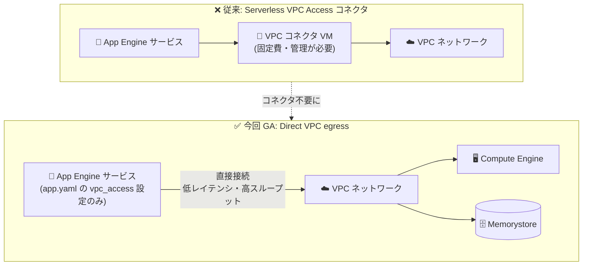
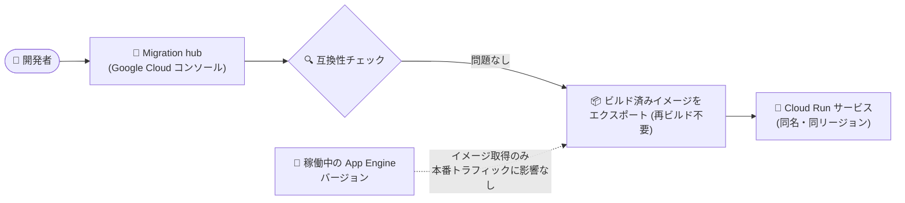

# App Engine スタンダード環境: Direct VPC egress GA / Migration hub からの Cloud Run デプロイ (Preview)

**リリース日**: 2026-11-12

**サービス**: App Engine standard environment (Go / Java / Node.js / PHP / Python / Ruby)

**機能**: Direct VPC egress の一般提供 (GA)、Migration hub からのアクティブバージョンの Cloud Run デプロイ (Preview)

**ステータス**: Direct VPC egress は GA、Cloud Run へのイメージベースデプロイは Preview

📊 [このアップデートのインフォグラフィックを見る](https://takech9203.github.io/google-cloud-news-summary/20261112-app-engine-standard-direct-vpc-egress-cloud-run-deploy.html)

## 概要

App Engine スタンダード環境 (全ランタイム: Go / Java / Node.js / PHP / Python / Ruby) に関する 2 つの重要なアップデートが発表されました。

1 つ目は **Direct VPC egress の一般提供 (GA)** です。これまで App Engine スタンダード環境から VPC ネットワーク内のリソース (Compute Engine VM、Memorystore など) へアクセスするには Serverless VPC Access コネクタの構成が必要でしたが、Direct VPC egress により、コネクタなしで `app.yaml` の設定だけで VPC へ直接トラフィックを送信できます。コネクタ VM の追加料金が不要になり、低レイテンシ・高スループットの直接ネットワークパスを利用できます。GA 昇格により本番ワークロードでも安心して採用できるようになりました。

2 つ目は **Migration hub からのアクティブバージョンの Cloud Run デプロイ (Preview)** です。Google Cloud コンソールの Migration hub から、App Engine スタンダード環境で稼働中のバージョンのコンテナイメージをそのまま Cloud Run にデプロイできます。ソースコードへのアクセスやアプリの再ビルドは不要で、デプロイは稼働中の App Engine トラフィックに一切影響を与えません。App Engine から Cloud Run への移行を検討するチームにとって、リスクなく移行検証を始められる大きな一歩です。

**アップデート前の課題**

- App Engine スタンダード環境から VPC 内リソースへアクセスするには Serverless VPC Access コネクタの作成・管理 (インスタンス数、マシンタイプ、スケーリング設定) が必要だった
- コネクタはトラフィックがなくても固定の VM 料金が発生し続けるため、コスト効率が悪かった
- コネクタ経由の通信はレイテンシが高く、スループットが低いうえ、コネクタのメンテナンス中に接続断が発生する可能性があった
- Direct VPC egress は Preview 段階であり、本番ワークロードでの採用には SLA 面の懸念があった
- App Engine アプリを Cloud Run に移行するには、ソースコードを用意してコンテナイメージを再ビルドする必要があり、ソースコードにアクセスできない (古いアプリや担当者変更など) 場合は移行が困難だった

**アップデート後の改善**

- Direct VPC egress が GA となり、`app.yaml` の `vpc_access` 設定のみで VPC へ直接接続できるようになった (コネクタ不要、追加料金なし)
- コネクタ VM の固定費が不要になり、ネットワーク Egress 料金のみの従量課金となった
- ネットワークタグをサービスバージョン単位で付与でき、きめ細かいファイアウォールルールや VPC Flow Logs が利用可能になった
- Migration hub から稼働中の App Engine バージョンのビルド済みイメージを、ソースコード不要・再ビルド不要で Cloud Run にデプロイできるようになった (Preview)
- Cloud Run へのデプロイは既存の App Engine トラフィックに影響せず、独立したレプリカとして安全に検証できるようになった

## アーキテクチャ図



Direct VPC egress により、コネクタ VM を介さず App Engine から VPC 内リソースへ直接アクセスできます。



Migration hub は稼働中の App Engine バージョンのコンテナイメージをそのまま Cloud Run にデプロイし、既存トラフィックには影響を与えません。

## サービスアップデートの詳細

### 主要機能

1. **Direct VPC egress (GA)**
   - `app.yaml` に `vpc_access` セクションを追加するだけで、App Engine サービスが VPC ネットワークへ直接トラフィックを送信可能
   - コネクタインスタンスの管理 (マシンタイプ、スケーリング設定) が不要になり、運用負荷を大幅に削減
   - コネクタと比較して低レイテンシ・高スループット。App Engine サービスと同じ速度でスケールし、コネクタメンテナンス時の接続断を回避
   - ネットワークタグをサービスバージョン単位で付与でき、サービスごとのファイアウォールルール適用が可能
   - VPC Flow Logs、Cloud NAT (Public NAT / Private NAT)、Shared VPC に対応

2. **Egress 設定の選択**
   - `private-ranges-only` (デフォルト): 内部 IP アドレス宛のトラフィックのみ VPC 経由。インターネット向けは従来の App Engine 経路を使用
   - `all-traffic`: すべてのアウトバウンドトラフィックを VPC 経由でルーティング (Cloud NAT との組み合わせで固定 Egress IP も実現可能)

3. **Migration hub からの Cloud Run デプロイ — イメージベースデプロイ (Preview)**
   - コンソールの Migration hub (App Engine ページ内) から、デプロイ済み App Engine バージョンのコンテナイメージを直接 Cloud Run にデプロイ
   - ソースコード不要、イメージの再ビルド不要。稼働中バージョンの完全なコピーをデプロイ
   - 互換性チェッカーが非互換機能 (レガシーバンドルサービスなど) を自動検出
   - CPU、メモリ、スケーリング、同時実行数、サービスアカウント、環境変数などの Cloud Run 設定を App Engine バージョンから自動導出 (デプロイ後に変更可能)
   - App Engine サービスと同名の Cloud Run サービスが、App Engine アプリのリージョンに対応する Cloud Run リージョンに作成される
   - デプロイされた Cloud Run サービスはデフォルトで非公開 (プライベート) であり、既存の App Engine トラフィックには影響しない

## 技術仕様

### Direct VPC egress と Serverless VPC Access コネクタの比較

| 項目 | Direct VPC egress | Serverless VPC Access コネクタ |
|------|-------------------|-------------------------------|
| レイテンシ | 低い | 高い |
| スループット | 高い | 低い |
| IP アドレス消費 | 多い (インスタンス数に比例) | 少ない |
| コスト | 追加の VM 料金なし (Egress 料金のみ) | コネクタ VM 料金が発生 |
| ネットワークタグ | サービス/バージョン単位で付与可能 | コネクタ単位で共有 |
| VPC Flow Logs | 対応 | - |

### Direct VPC egress の主な制限事項

| 項目 | 詳細 |
|------|------|
| IP アドレス消費 | 定常状態でインスタンス数の 2 倍の IP を使用。スケールダウン後も最大 20 分間 IP を保持 |
| サブネット要件 | IPv4 範囲は /26 以上を推奨。IP は 16 個単位 (/28) のブロックで予約 |
| 対応 IP 範囲 | RFC 1918、RFC 6598 (100.64.0.0/10)、クラス E (240.0.0.0/4) |
| インスタンス数 | デフォルトでバージョンあたり最大 100 インスタンス (クォータ引き上げ申請可能) |
| Direct VPC ingress | 非対応 (VPC からのインバウンドはロードバランサ経由) |
| コールドスタート | リージョンやユースケースに依存。まれに最大 1 分程度かかる場合あり |

### Direct VPC egress の設定 (app.yaml)

```yaml
vpc_access:
  network_interface:
    network: NETWORK
    subnet: SUBNET
    tags:
      - NETWORK_TAGS
  vpc_egress: private-ranges-only  # または all-traffic
```

### 必要な IAM ロール

- **Direct VPC egress**: App Engine サービスエージェントに `roles/appengine.serviceAgent` (デフォルトで付与済み) または `roles/compute.networkUser`
- **Cloud Run イメージベースデプロイ**: 実行ユーザーに `roles/run.developer`、`roles/iam.serviceAccountUser`、`roles/artifactregistry.reader` (Migration hub の「Match permissions」から一括付与可能)

## 設定方法

### 前提条件

1. プロジェクトに VPC ネットワークとサブネットが存在すること (Direct VPC egress)
2. Compute Engine API と Cloud Build API が有効であること
3. 最新の Google Cloud CLI (`gcloud components update`)
4. Cloud Run デプロイの場合: Cloud Run Admin API と Cloud Build API の有効化 (Migration hub から一括有効化可能)

### 手順

#### ステップ 1: Direct VPC egress の設定とデプロイ

```bash
# app.yaml に vpc_access セクションを追加後、デプロイ
gcloud app deploy
```

コネクタから移行する場合は、`vpc_access_connector` 設定を削除して `vpc_access` に置き換え、`--no-promote` でデプロイしてトラフィック分割による段階的な移行が推奨されます。移行完了後、不要になったコネクタは削除して課金を停止します。

#### ステップ 2: Migration hub から Cloud Run へイメージベースデプロイ (Preview)

コンソールの場合: 「App Engine」→「Migration hub」→「Standard to Cloud Run migration」カードでサービスとバージョンを選択 →「Check compatibility」で互換性確認 →「Image based deployment」タブ →「Deploy」

```bash
# gcloud CLI の場合: 稼働中バージョンのイメージをそのまま Cloud Run にデプロイ
gcloud beta app migrate-to-run --service=SERVICE --version=VERSION --from-image

# デプロイせずに Cloud Run の service.yaml のみ生成する場合
gcloud beta app migrate-to-run --service=SERVICE --version=VERSION \
  --from-image --export-only=EXPORT_PATH
```

#### ステップ 3: デプロイした Cloud Run サービスのテスト

```bash
# Cloud Run サービスはデフォルトで非公開のため、プロキシ経由でテスト (推奨)
gcloud run services proxy SERVICE_NAME
```

公開アクセスが必要な場合は、Cloud Run 側で public access を有効化します。

## メリット

### ビジネス面

- **コスト削減**: Direct VPC egress は追加料金なし。コネクタ VM の固定月額費用が不要になり、ネットワーク Egress 料金のみの支払いで済む
- **移行リスクの低減**: Cloud Run への移行検証を、本番トラフィックに影響なく、ソースコードや再ビルドなしで実施可能。移行プロジェクトの初期コストを大幅に削減
- **運用負荷の軽減**: コネクタのサイジング・監視・メンテナンスといった運用作業が不要に

### 技術面

- **パフォーマンス向上**: コネクタを経由しない直接ネットワークパスにより、低レイテンシ・高スループットを実現。App Engine のスケーリング速度に追従
- **セキュリティの粒度向上**: サービスバージョン単位のネットワークタグにより、サービスごとのファイアウォールルールが適用可能。VPC Flow Logs で Egress トラフィックを可視化
- **互換性の事前検証**: Migration hub の互換性チェッカーが、Cloud Run 移行時の非互換機能を事前に特定

## デメリット・制約事項

### 制限事項

- Direct VPC egress は IP アドレス消費が多く (定常時インスタンス数の 2 倍 + バージョン更新時のバッファ)、サブネットの空き IP 数がスケーリング上限になる
- Direct VPC egress を使用できるのはバージョンあたり最大 100 インスタンス (デフォルト、クォータ引き上げ可能)
- Direct VPC ingress は非対応 (VPC から App Engine へのインバウンドはロードバランサ経由)
- イメージベースの Cloud Run デプロイは Preview であり、Pre-GA 利用規約が適用される
- イメージベースデプロイは稼働中イメージのコピーであるため、ローカルの最新のコード変更は反映されない

### 考慮すべき点

- ネットワークインフラのメンテナンス時に短時間の接続断が発生する可能性があるため、クライアントライブラリでの接続リセット処理を推奨
- コールドスタートはリージョンやユースケースに依存し、まれに最大 1 分かかる場合がある。ゼロからのスケールで低レイテンシが必須の場合や IP 枯渇が懸念される場合は、引き続きコネクタも選択肢となる
- IP アドレスはエフェメラルのため、個別 IP ベースのポリシーは作成せず、サブネット全体の範囲でファイアウォールルールを設計する
- 同名の Cloud Run サービスが既に存在する場合、イメージベースデプロイは上書き (新リビジョン作成、トラフィック 100%) となる点に注意

## ユースケース

### ユースケース 1: Memorystore を利用する App Engine アプリのコネクタ廃止

**シナリオ**: App Engine スタンダード環境のアプリが Serverless VPC Access コネクタ経由で Memorystore (Redis/Valkey) にアクセスしており、コネクタの固定費とレイテンシが課題になっている。

**実装例**:
```yaml
# app.yaml
vpc_access:
  network_interface:
    network: default
    subnet: default
    tags:
      - gae-backend
  vpc_egress: private-ranges-only
```

トラフィック分割で新バージョンに段階的に切り替え、動作確認後にコネクタを削除。

**効果**: コネクタ VM の月額固定費を削減しつつ、キャッシュアクセスのレイテンシとスループットが改善。GA 版のため本番環境でも安心して利用可能。

### ユースケース 2: ソースコードが手元にないレガシーアプリの Cloud Run 移行検証

**シナリオ**: 数年前にデプロイされた App Engine アプリの Cloud Run 移行を検討しているが、当時のビルド環境やソースコードの正確な状態が不明で、再ビルドによる移行はリスクが高い。

**効果**: Migration hub から稼働中バージョンのイメージをそのまま Cloud Run にデプロイし、本番トラフィックに影響を与えずに Cloud Run 上での動作を検証できる。互換性チェッカーでブロッキング要因も事前に把握でき、移行判断を迅速化できる。

## 料金

- **Direct VPC egress**: 追加料金なし。ネットワーク Egress 料金のみ発生 (コネクタと同じレート)。コネクタで必要だったコンピュート料金 (Compute Engine VM 相当) は不要
- **Serverless VPC Access コネクタ**: コンピュート料金 + ネットワーク Egress 料金が発生。トラフィックがなくても課金が継続するため、Direct VPC egress 移行後は不要なコネクタの削除を推奨
- **Cloud Run デプロイ**: デプロイされた Cloud Run サービスには通常の Cloud Run 料金が適用される

詳細は [App Engine の料金ページ](https://cloud.google.com/appengine/pricing) および [Cloud Run の料金ページ](https://cloud.google.com/run/pricing) を参照してください。

## 利用可能リージョン

Direct VPC egress は App Engine スタンダード環境の全ランタイム (Go / Java / Node.js / PHP / Python / Ruby) で GA です。リージョンごとの提供状況は [App Engine のロケーションに関するドキュメント](https://cloud.google.com/appengine/docs/standard/locations) を参照してください。

イメージベースの Cloud Run デプロイでは、App Engine アプリのリージョンに対応する Cloud Run リージョンにサービスが作成されます。

## 関連サービス・機能

- **Cloud Run**: App Engine と多くのインフラを共有するサーバーレスコンテナ実行環境。Cloud Run では Direct VPC egress が先行して GA しており、今回 App Engine でも同等機能が GA
- **Serverless VPC Access**: 従来の VPC 接続手段。コールドスタートのレイテンシ要件や IP 制約がある場合の代替として引き続き利用可能
- **Cloud NAT**: `all-traffic` 設定との組み合わせで、App Engine からのアウトバウンド通信に固定 Egress IP を割り当て可能 (Public NAT / Private NAT 両対応)
- **VPC Flow Logs**: Direct VPC egress のトラフィックをサブネット単位でロギングし、ネットワークの可視性を向上
- **Shared VPC**: ホストプロジェクトの共有サブネットに対しても Direct VPC egress を構成可能
- **Artifact Registry**: イメージベースデプロイ時に App Engine のコンテナイメージの取得元となる (Artifact Registry Reader ロールが必要)

## 参考リンク

- 📊 [インフォグラフィック](https://takech9203.github.io/google-cloud-news-summary/20261112-app-engine-standard-direct-vpc-egress-cloud-run-deploy.html)
- [公式リリースノート](https://docs.cloud.google.com/release-notes#November_12_2026)
- [Configure Direct VPC egress](https://docs.cloud.google.com/appengine/docs/standard/vpc-direct-vpc)
- [Compare Direct VPC egress and Serverless VPC Access connectors (App Engine ネットワーキングのベストプラクティス)](https://docs.cloud.google.com/appengine/docs/standard/compare-direct-vpc-egress-connectors)
- [Migrate services to Direct VPC egress](https://docs.cloud.google.com/appengine/docs/standard/migrate-direct-vpc)
- [Shared VPC で Direct VPC egress を構成する](https://docs.cloud.google.com/appengine/docs/standard/shared-vpc-direct-vpc)
- [Deploy an existing App Engine app to Cloud Run (Use a previously built image)](https://docs.cloud.google.com/appengine/migration-center/run/migrate-app-engine-standard-to-run)
- [App Engine の料金](https://cloud.google.com/appengine/pricing)

## まとめ

Direct VPC egress の GA により、App Engine スタンダード環境の VPC 接続はコネクタ不要・追加料金なしの構成が本番環境の標準となります。Serverless VPC Access コネクタを利用中のチームは、トラフィック分割による段階的移行とコネクタ削除によるコスト削減を検討してください。また、Migration hub からのイメージベース Cloud Run デプロイ (Preview) により、ソースコードや再ビルドなしで移行検証を始められるため、App Engine から Cloud Run への移行を検討しているチームはまず互換性チェックの実行をおすすめします。

---

**タグ**: App Engine, Direct VPC egress, VPC, Cloud Run, Migration hub, Serverless, GA, Preview, ネットワーキング, 移行
