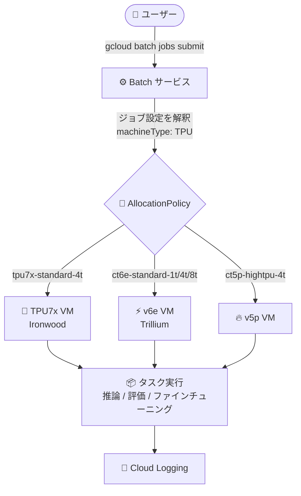

# Batch: TPU を使用するジョブが一般提供 (GA) に

**リリース日**: 2026-11-12

**サービス**: Batch

**機能**: TPU を使用するジョブ (TPU7x / v6e / v5p シングルホストスライス対応)

**ステータス**: GA (一般提供)

📊 [このアップデートのインフォグラフィックを見る](https://takech9203.github.io/google-cloud-news-summary/20261112-batch-tpu-jobs-ga.html)

## 概要

Google Cloud のフルマネージドなバッチ処理サービスである Batch において、TPU (Tensor Processing Unit) を使用するジョブが一般提供 (GA) になりました。TPU は Google が独自開発した機械学習 (ML) / AI ワークロード向けのアクセラレータであり、今回の GA により、Batch のジョブ定義で TPU マシンタイプを指定するだけで、推論、評価、ファインチューニング、トレーニングなどのワークロードを TPU で高速化できます。

サポートされるのは独立した TPU VM (シングルホスト TPU スライス) で、マシンタイプとしては第 7 世代の TPU7x (Ironwood、`tpu7x-*`)、v6e (Trillium、`ct6e-*`)、v5p (`ct5p-*`) が利用できます。ジョブのキューイング、VM のプロビジョニング、リトライ、ログ収集といったジョブ実行基盤の管理は Batch が担うため、ユーザーはタスクの定義に集中できます。

大規模な分散トレーニングというよりは、多数の独立したタスクを並列実行するユースケース (バッチ推論、モデル評価、小規模なファインチューニングなど) に適したアップデートであり、TPU をジョブ単位で手軽に消費したい ML エンジニアやデータサイエンティストが主な対象ユーザーです。

**アップデート前の課題**

- Batch が公式にサポートするアクセラレータは GPU (A4、A3、A2、G2 など) が中心で、TPU をフルマネージドなバッチジョブ基盤から直接利用する手段が限られていた
- TPU でバッチ的なワークロードを実行するには、Compute Engine 上で TPU VM を自前でプロビジョニング・管理するか、GKE などのクラスタ基盤を構築する必要があり、ジョブのキューイングやリトライを自分で実装する必要があった
- TPU ジョブ機能が GA でない間は、本番ワークロードへの適用判断が難しかった

**アップデート後の改善**

- ジョブ設定の `machineType` に TPU マシンタイプ (例: `ct5p-hightpu-4t`) を指定するだけで、Batch が TPU VM のプロビジョニングからタスク実行、ログ収集までを自動で処理するようになった
- TPU7x (Ironwood)、v6e (Trillium)、v5p という現行世代の TPU をシングルホストスライスとして選択できるようになった
- GA となったことで本番ワークロードでの利用が可能になり、オンデマンド、Spot、予約 (リザベーション) の各消費オプションと組み合わせてコストと可用性を最適化できるようになった

## アーキテクチャ図



Batch にジョブを送信すると、AllocationPolicy で指定した TPU マシンタイプに応じてシングルホスト TPU スライス (独立 TPU VM) がプロビジョニングされ、タスクが実行されます。ログは Cloud Logging に出力されます。

## サービスアップデートの詳細

### 主要機能

1. **TPU マシンタイプの直接指定によるジョブ実行**
   - ジョブ設定の `allocationPolicy.instances[].policy.machineType` に TPU マシンタイプを指定するだけで TPU ジョブを作成できる
   - GPU の場合と異なり `accelerators[]` フィールドは使用せず、TPU マシンタイプ自体で TPU を指定する
   - gcloud CLI、REST API (`jobs.create`) から利用可能

2. **3 世代の TPU をサポート (シングルホストスライス)**
   - TPU7x (Ironwood): `tpu7x-standard-4t`
   - v6e (Trillium): `ct6e-standard-1t`、`ct6e-standard-4t`、`ct6e-standard-8t` (8t はコアあたりスレッド数 1 が必要だが Batch が自動設定)
   - v5p: `ct5p-hightpu-4t`

3. **複数の消費オプションに対応**
   - オンデマンド (`STANDARD`): 事前の容量確保なしで柔軟に利用
   - Spot (`SPOT`): 最大 91% 割引。プリエンプションを許容できるフォールトトレラントなジョブ向け
   - 予約バウンド (`RESERVATION_BOUND`): 予約済み容量 (リザベーションブロック / サブブロックの指定も可) を確実に消費

## 技術仕様

### サポートされる TPU マシンタイプ

| TPU バージョン | マシンタイプ | 備考 |
|------|------|------|
| TPU7x (Ironwood) | `tpu7x-standard-4t` | 第 7 世代 TPU |
| v6e (Trillium) | `ct6e-standard-1t` / `ct6e-standard-4t` / `ct6e-standard-8t` | 8t はスレッド数 1 を Batch が自動設定 |
| v5p | `ct5p-hightpu-4t` | |

### TPU 世代ごとのチップ仕様 (参考)

| 項目 | v5p | v6e (Trillium) | TPU7x (Ironwood) |
|------|------|------|------|
| ピーク演算性能/チップ (BF16) | 459 TFLOPs | 918 TFLOPs | 2,307 TFLOPs |
| HBM 容量/チップ | 95 GiB | 32 GiB | 192 GiB |
| HBM 帯域/チップ | 2,765 GBps | 1,638 GBps | 7,380 GBps |

### ジョブ設定例 (オンデマンド / v5p)

```json
{
  "taskGroups": [
    {
      "taskSpec": {
        "runnables": [
          {
            "script": {
              "text": "echo Hello world from TPU task ${BATCH_TASK_INDEX}."
            }
          }
        ]
      },
      "taskCount": 3,
      "parallelism": 1
    }
  ],
  "allocationPolicy": {
    "instances": [
      {
        "policy": {
          "provisioningModel": "STANDARD",
          "machineType": "ct5p-hightpu-4t"
        }
      }
    ],
    "location": {
      "allowedLocations": ["zones/us-central1-a"]
    }
  },
  "logsPolicy": {
    "destination": "CLOUD_LOGGING"
  }
}
```

予約を消費する場合は `"provisioningModel": "RESERVATION_BOUND"` とし、`"reservation": "projects/PROJECT_ID/zones/ZONE/reservations/RESERVATION_NAME"` を追加します。

## 設定方法

### 前提条件

1. Batch の利用開始手順 (API の有効化など) を完了していること
2. プロジェクトに対する Batch Job Editor (`roles/batch.jobsEditor`) と、ジョブのサービスアカウント (デフォルトは Compute Engine デフォルトサービスアカウント) に対する Service Account User (`roles/iam.serviceAccountUser`) の IAM ロールを持っていること
3. 使用する TPU バージョンを提供するゾーン (かつ Batch がサポートするリージョン内) を選択していること
4. 予約を使用しない場合、対象 TPU の割り当て (クォータ) があること

### 手順

#### ステップ 1: ジョブ設定ファイルの作成

```bash
cat > tpu-job.json << 'EOF'
{
  "taskGroups": [
    {
      "taskSpec": {
        "runnables": [
          { "script": { "text": "echo Hello from TPU task ${BATCH_TASK_INDEX}." } }
        ]
      },
      "taskCount": 3,
      "parallelism": 1
    }
  ],
  "allocationPolicy": {
    "instances": [
      { "policy": { "provisioningModel": "STANDARD", "machineType": "ct5p-hightpu-4t" } }
    ],
    "location": { "allowedLocations": ["zones/us-central1-a"] }
  },
  "logsPolicy": { "destination": "CLOUD_LOGGING" }
}
EOF
```

TPU マシンタイプ、プロビジョニングモデル、TPU を提供する単一ゾーンを指定した JSON 設定を作成します。

#### ステップ 2: ジョブの送信

```bash
gcloud batch jobs submit tpu-job \
    --location us-central1 \
    --config tpu-job.json
```

`gcloud batch jobs submit` コマンドでジョブを送信します。Batch が TPU VM をプロビジョニングし、タスクを実行します。

## メリット

### ビジネス面

- **インフラ管理コストの削減**: TPU VM のプロビジョニング、ジョブキューイング、リトライ、ログ収集を Batch に任せられるため、自前のジョブ管理基盤の構築・運用が不要になる
- **コスト最適化の選択肢**: Spot VM (最大 91% 割引)、オンデマンド、予約を使い分けることで、ワークロードの優先度に応じたコスト最適化が可能
- **GA による本番適用**: 一般提供となったことで、本番環境の ML パイプラインへ安心して組み込める

### 技術面

- **シンプルなジョブ定義**: `machineType` に TPU マシンタイプを指定するだけで TPU ジョブを作成でき、GPU ジョブと同じ Batch の操作体系で扱える
- **最新世代 TPU へのアクセス**: TPU7x (Ironwood) を含む 3 世代の TPU をジョブ単位で利用できる
- **予約ブロックの細かな指定**: 予約バウンドジョブでは `reservationBlocks` / `reservationSubBlocks` によるターゲット指定が可能

## デメリット・制約事項

### 制限事項

- **シングルホスト TPU スライスのみ**: 複数 VM がインターコネクトで接続されたマルチホストスライスは非サポート。ジョブは複数のシングルホストスライスにまたがれるが、スライス間に ICI (チップ間インターコネクト) ネットワークはない
- **Flex-start (`FLEX_START`) 非サポート**: 対応する消費オプションは `RESERVATION_BOUND` / `STANDARD` / `SPOT` のみ
- **単一ゾーンの指定が必須**: `allowedLocations[]` に TPU を提供する特定の 1 ゾーン (予約利用時は予約のゾーン) を指定する必要がある
- **一部機能の非対応**: インスタンス柔軟性 (`instanceFlexibilityPolicy`) とコンパクトプレースメントポリシー (`collocation`) は使用不可。`accelerators[]` フィールドも TPU には使用できない

### 考慮すべき点

- 大規模な分散トレーニングなどマルチホストスライス (Pod 規模) が必要なワークロードには、Cloud TPU (Compute Engine) や GKE の TPU サポートを検討する
- Spot を使用する場合はプリエンプションを前提とした設計 (チェックポイント保存、リトライ設定) が必要
- `allowedLocations[]` フィールドはジョブのリージョン外の Compute Engine リソース指定のサポートが段階的に終了する (2026 年 7 月 31 日以降、既存利用プロジェクトは 2027 年 6 月 30 日以降)

## ユースケース

### ユースケース 1: TPU による大規模バッチ推論

**シナリオ**: 学習済みモデルを使い、数百万件の入力データに対する推論を夜間バッチで実行したい。各タスクは独立しており、分散学習のようなタスク間通信は不要。

**実装例**:
```json
{
  "taskGroups": [
    {
      "taskSpec": {
        "runnables": [
          { "container": { "imageUri": "gcr.io/PROJECT/inference:latest" } }
        ]
      },
      "taskCount": 100,
      "parallelism": 10
    }
  ],
  "allocationPolicy": {
    "instances": [
      { "policy": { "provisioningModel": "SPOT", "machineType": "ct6e-standard-4t" } }
    ],
    "location": { "allowedLocations": ["zones/ZONE"] }
  }
}
```

**効果**: v6e の推論性能を活用しつつ、Spot 価格 (最大 91% 割引) とタスク単位の自動リトライにより、低コストで大量の推論を完了できる。

### ユースケース 2: モデル評価・ハイパーパラメータ探索のファンアウト実行

**シナリオ**: ファインチューニング後のモデル候補を複数の評価データセット・ハイパーパラメータ設定で並列評価したい。

**効果**: 各評価を Batch のタスクとして並列実行し、タスクごとに独立した TPU VM を割り当てることで、クラスタ管理なしで評価サイクルを短縮できる。

## 料金

Batch 自体の利用に追加料金はありません。ジョブの実行に使用される基盤リソース (TPU VM、ディスクなど) の料金のみが課金されます。TPU の料金は世代・リージョン・消費オプション (オンデマンド / Spot / 確約利用割引) によって異なります。

- Spot VM は TPU を含む多くのリソースでオンデマンド価格から最大 91% の割引
- 予約 (確約利用) ではオンデマンドより低い価格で容量を確保可能

最新の料金は以下を参照してください。

- [Batch の料金](https://cloud.google.com/batch/pricing)
- [Cloud TPU の料金](https://cloud.google.com/tpu/pricing)

## 利用可能リージョン

TPU を使用するジョブは、Batch がサポートするリージョン内で、かつ使用する TPU バージョンを提供するゾーンを `allowedLocations[]` に単一指定して実行します。TPU のゾーン別提供状況は [TPU regions and zones](https://docs.cloud.google.com/tpu/docs/regions-zones) を、Batch の対応ロケーションは [Batch locations](https://docs.cloud.google.com/batch/docs/locations) を参照してください。

## 関連サービス・機能

- **Cloud TPU (Compute Engine)**: TPU VM を直接作成・管理する基盤。マルチホストスライスが必要な大規模トレーニングはこちらを利用
- **Compute Engine 予約 / 将来予約 (カレンダーモード)**: `RESERVATION_BOUND` ジョブで消費する TPU 容量の事前確保に使用
- **Cloud Logging**: ジョブのログ出力先 (`logsPolicy.destination: CLOUD_LOGGING`)
- **GKE の TPU サポート**: Kubernetes ベースで TPU ワークロードをオーケストレーションしたい場合の代替手段

## 参考リンク

- 📊 [インフォグラフィック](https://takech9203.github.io/google-cloud-news-summary/20261112-batch-tpu-jobs-ga.html)
- [公式リリースノート](https://docs.cloud.google.com/release-notes#November_12_2026)
- [ドキュメント: Create and run a job that uses TPUs](https://docs.cloud.google.com/batch/docs/create-run-job-tpus)
- [TPU7x (Ironwood) ドキュメント](https://docs.cloud.google.com/tpu/docs/tpu7x)
- [Batch の料金ページ](https://cloud.google.com/batch/pricing)
- [Cloud TPU の料金ページ](https://cloud.google.com/tpu/pricing)

## まとめ

Batch の TPU ジョブ対応が GA となり、ジョブ定義にマシンタイプを書くだけで TPU7x / v6e / v5p のシングルホストスライスを本番ワークロードで利用できるようになりました。バッチ推論やモデル評価など独立タスクの並列実行が中心のワークロードであれば、クラスタ管理不要で TPU を活用できる有力な選択肢です。まずは Spot + 小規模な `ct6e-standard-1t` でコストを抑えながら試し、ワークロードに応じて予約バウンドでの本番運用を検討することをおすすめします。

---

**タグ**: #Batch #TPU #TPU7x #Ironwood #Trillium #v5p #AI #機械学習 #GA
