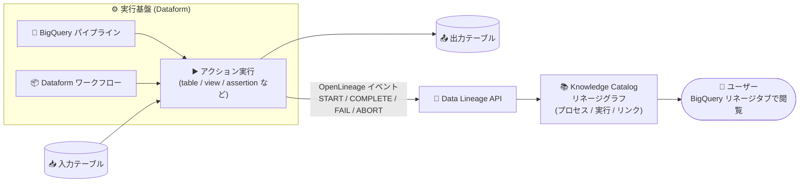

# BigQuery / Dataform: Knowledge Catalog でのテーブルレベルのデータリネージ追跡が GA

**リリース日**: 2026-11-12

**サービス**: BigQuery, Dataform

**機能**: Knowledge Catalog におけるテーブルレベルのデータリネージ追跡 (BigQuery パイプライン / Dataform ワークフロー)

**ステータス**: GA (一般提供)

📊 [このアップデートのインフォグラフィックを見る](https://takech9203.github.io/google-cloud-news-summary/20261112-bigquery-dataform-knowledge-catalog-table-lineage.html)

## 概要

BigQuery パイプラインと Dataform ワークフローで実行されるアクションのテーブルレベルのデータリネージを、Knowledge Catalog (旧 Dataplex Universal Catalog) で追跡できる機能が一般提供 (GA) になりました。Dataform がアクションの実行時に [OpenLineage](https://openlineage.io/) 形式のイベントを Data Lineage API に自動送信し、Knowledge Catalog と BigQuery のリネージグラフ上に「アクションが読み取るテーブル → Dataform プロセス → 書き込むテーブル」という流れが可視化されます。

重要なポイントは、**SQLX ファイルを一切変更することなくリネージが報告される**ことです。BigQuery パイプラインは Dataform を実行基盤としているため、本機能は BigQuery Studio で作成したパイプラインと、Dataform リポジトリで管理する SQL ワークフローの両方をカバーします。データエンジニア、データガバナンス担当者、アナリティクスエンジニアにとって、影響分析・原因調査・ガバナンス対応を大幅に効率化するアップデートです。

**アップデート前の課題**

- Dataform ワークフローや BigQuery パイプラインによるテーブル間の変換の流れは、Knowledge Catalog のリネージグラフに「どのパイプラインが生成したか」というプロセス情報として自動的には統合されず、依存関係の把握には SQLX コードの読解や手動のドキュメント管理が必要だった
- テーブル変更時の下流影響調査 (影響分析) や、不正データの発生源をワークフロー実行まで遡る調査 (原因分析) を手作業で行う必要があった
- BigQuery、Dataflow、Managed Service for Apache Airflow / Apache Spark など他サービスのリネージと、Dataform の変換処理を 1 つのグラフで俯瞰できなかった

**アップデート後の改善**

- Dataform の各アクションが `BIGQUERY_PIPELINES` ソースタイプのプロセスとして Knowledge Catalog に自動登録され、実行 (run) 単位でテーブル間リネージが記録されるようになった
- BigQuery コンソールのテーブル「リネージ」タブから Dataform プロセスノードを選択し、アクション・リポジトリ・実行履歴の確認や、Dataform リポジトリへの直接ジャンプ (Open in Dataform) が可能になった
- BigQuery、Managed Service for Apache Airflow、Managed Service for Apache Spark、Dataflow のリネージと統合された End-to-End のリネージグラフを閲覧できるようになった
- リネージ報告が失敗してもワークフロー実行自体は失敗しない設計のため、安心して有効化できる

## アーキテクチャ図



Dataform ワークフローまたは BigQuery パイプラインのアクション実行時に OpenLineage イベントが Data Lineage API へ送信され、Knowledge Catalog のリネージグラフとして BigQuery コンソールから閲覧できます。

## サービスアップデートの詳細

### 主要機能

1. **テーブルレベルリネージの自動報告 (SQLX 変更不要)**
   - アクション開始時に `START`、終了時に `COMPLETE` / `FAIL` / `ABORT` の OpenLineage イベントを Data Lineage API に送信
   - 各 Dataform アクションは `BIGQUERY_PIPELINES` ソースタイプの「プロセス」として、各実行は「run」として Knowledge Catalog に登録される
   - リネージはアクションの BigQuery 処理ロケーションのリージョナルエンドポイントに書き込まれ、利用不可の場合はグローバルエンドポイントにフォールバック

2. **リネージを報告するアクションタイプ**
   - テーブル、ビュー、増分テーブル、マテリアライズドビュー、アサーション、プロパティグラフ、データ準備、`hasOutput: true` のオペレーション: プロセス・run・テーブル間リンクをすべて報告
   - `hasOutput: true` でないオペレーション: プロセスと run のみ報告 (テーブル間リンクなし)
   - 宣言 (declaration): 他アクションの入力としてのみ出現。ノートブックと SQL ユニットテストは報告対象外

3. **4 つの主要ユースケースへの対応**
   - **影響分析**: テーブル変更前に下流のすべてのアクションとテーブルを特定
   - **原因分析**: 不正データを、それを書き込んだアクションとワークフロー実行まで遡って追跡
   - **ガバナンス**: プロジェクトをまたぐデータフローと、データを移動したパイプラインを提示
   - **End-to-End リネージ**: BigQuery、Managed Service for Apache Airflow / Apache Spark、Dataflow のリネージと 1 つのグラフで統合表示

4. **フェイルセーフ設計**
   - Data Lineage API の無効化、権限不足、クォータ超過が発生してもリネージ報告はスキップされるだけで、ワークフロー実行は影響を受けない
   - 報告結果は Cloud Logging の `dataform.googleapis.com/lineage_emission` ログ (outcome: `SUCCEEDED` / `SKIPPED` / `FAILED`) で監視可能

## 技術仕様

### データリネージ情報モデルへのマッピング

| データリネージオブジェクト | Dataform における対応 |
|------|------|
| プロセス (Process) | Dataform のアクション |
| 実行 (Run) | ワークフロー呼び出しにおけるアクションの 1 回の実行 |
| リネージイベント | その run における入力テーブルから出力テーブルへのリンク |

### リネージ報告の有効化設定 (workflow_settings.yaml)

初期ロールアウト期間中はオプトイン方式です。リポジトリまたは BigQuery パイプライン単位で `lineage.enabled` プロパティを設定します。

```yaml
# workflow_settings.yaml
lineage:
  enabled: true
```

デフォルト有効化後にオプトアウトする場合は `enabled: false` を設定します。プロジェクト全体で停止する場合は Data Lineage API 自体を無効化します。

## 設定方法

### 前提条件

1. Dataform リポジトリがあるプロジェクトと、リネージを閲覧するプロジェクトの両方で Data Lineage API (`datalineage.googleapis.com`) を有効化する
2. ワークフローを実行する ID に **Data Lineage Events Producer ロール** (`roles/datalineage.producer`) を付与する
   - カスタムサービスアカウント使用時: そのカスタムサービスアカウントに付与
   - 未設定時: Dataform サービスエージェント (`service-PROJECT_NUMBER@gcp-sa-dataform.iam.gserviceaccount.com`) に付与
3. 閲覧側には Data Lineage Viewer (`roles/datalineage.viewer`)、BigQuery Metadata Viewer、Dataform Viewer などの閲覧権限を付与する

### 手順

#### ステップ 1: API 有効化とロール付与

```bash
# Data Lineage API を有効化
gcloud services enable datalineage.googleapis.com --project=PROJECT_ID

# Dataform サービスエージェントに Producer ロールを付与
gcloud projects add-iam-policy-binding PROJECT_ID \
  --member="serviceAccount:service-PROJECT_NUMBER@gcp-sa-dataform.iam.gserviceaccount.com" \
  --role="roles/datalineage.producer"
```

#### ステップ 2: workflow_settings.yaml でリネージを有効化

```yaml
lineage:
  enabled: true
```

変更をリポジトリにコミット & プッシュすると、以降のワークフロー実行でリネージが報告されます。

#### ステップ 3: リネージの閲覧

1. Google Cloud コンソールで BigQuery ページに移動
2. Explorer ペインで Dataform アクションが生成したテーブルを選択
3. **リネージ** タブをクリック
4. Dataform プロセスノードを選択すると、アクション・リポジトリ・実行履歴を確認でき、「Open in Dataform」でリポジトリを直接開ける

#### (オプション) Dataform CLI からのリネージ報告

ローカルや CI からの実行でもリネージを報告できます。

```bash
dataform run --emit-lineage
```

`--emit-lineage` / `--no-emit-lineage` フラグは、その実行 1 回に限り `lineage.enabled` 設定をオーバーライドします。CLI は Application Default Credentials を使用し、各出力テーブルのプロジェクトにリネージを記録します。

## メリット

### ビジネス面

- **ガバナンス・監査対応の強化**: プロジェクト横断のデータフローと「どのパイプラインがデータを動かしたか」を公式のリネージグラフで提示でき、規制対応やデータガバナンス監査の工数を削減できる
- **データ品質インシデントの早期解決**: 不正データの発生源をアクションとワークフロー実行まで遡れるため、原因調査の時間を短縮できる

### 技術面

- **コード変更ゼロで導入可能**: SQLX ファイルの修正が不要で、`workflow_settings.yaml` の 1 ブロック追加と IAM 設定だけで有効化できる
- **パイプラインへの非干渉**: リネージ報告の失敗がワークフロー実行を失敗させないフェイルセーフ設計
- **統合リネージ**: BigQuery、Dataflow、Managed Service for Apache Airflow / Apache Spark など他サービスのリネージと同一グラフで End-to-End に追跡できる

## デメリット・制約事項

### 制限事項

- **テーブルレベルのみ**: Dataform からのリネージ報告はテーブルレベルに限られ、列レベル (column-level) リネージは報告されない
- 宣言、ノートブック、SQL ユニットテストはリネージを報告しない。`hasOutput: true` でないオペレーションはプロセスと run のみでテーブル間リンクは作成されない
- **ユーザー認証情報 (Google アカウント) で実行されたワークフロー呼び出しはリネージを報告しない**。リネージが必要な場合はカスタムサービスアカウントを使用する
- Data Lineage API の書き込みクォータ (標準ティアで約 1,000 アクション/分) の対象となる
- Dataform の個々の SQLX ファイルは Knowledge Catalog の個別エントリとしてはカタログ化されない (リポジトリ/ワークフローレベルのみ)

### 考慮すべき点

- 初期ロールアウト期間中はオプトイン (`lineage.enabled: true` の明示設定が必要)。将来デフォルト有効化された際にオプトアウトしたい場合は `enabled: false` を設定する
- Data Lineage API はプロジェクト単位で課金される。Dataplex API を無効化しても Data Lineage API の課金は止まらないため、停止するには Data Lineage API 自体を無効化する必要がある
- リネージメタデータの保持期間は 30 日間で、その間はメタデータストレージ SKU の課金対象となる
- 開発用プロジェクトでは不要な処理コストを避けるため、必要なプロジェクトでのみ Data Lineage API を有効化することが推奨される

## ユースケース

### ユースケース 1: テーブル変更前の影響分析

**シナリオ**: 中核となるディメンションテーブルのスキーマ変更を計画しており、Dataform ワークフローおよび BigQuery パイプラインで構築された下流のテーブル・ダッシュボードへの影響を事前に把握したい。

**実装例**:
```text
1. BigQuery コンソールで対象テーブルを選択し「リネージ」タブを開く
2. 下流方向のグラフを展開し、依存するすべての Dataform プロセスと出力テーブルを列挙
3. 各プロセスノードから「Open in Dataform」でリポジトリを開き、修正が必要な SQLX を特定
```

**効果**: 変更による破壊的影響を事前に洗い出し、ダッシュボード停止などのインシデントを未然に防止できる。

### ユースケース 2: 不正データの原因分析 (ルートコーズ分析)

**シナリオ**: ダッシュボードに異常な集計値が表示された。どの変換処理・どの実行が不正データを書き込んだのかを特定したい。

**効果**: リネージグラフを上流に遡り、該当テーブルを書き込んだ Dataform アクションとワークフロー呼び出し (run) を特定。Cloud Logging の実行ログと突き合わせて、修正対象のコードと再実行範囲を迅速に確定できる。

### ユースケース 3: マルチサービス環境での End-to-End ガバナンス

**シナリオ**: Dataflow でのストリーミング取り込み、Managed Service for Apache Airflow でのオーケストレーション、Dataform での変換が混在するデータ基盤で、組織横断のデータフローを 1 つのビューで説明する必要がある。

**効果**: Knowledge Catalog 上で各サービスのリネージが統合され、プロジェクトをまたぐデータの流れと担当パイプラインを単一のグラフで提示できる。

## 料金

データリネージは Knowledge Catalog の **Premium Processing SKU** (Data Compute Unit: DCU 単位) で課金されます。Dataform のリネージ取り込みでは、**テーブル間リネージリンクを書き込むイベントのみが課金対象**です。リネージメタデータ (プロセス、run、イベント、リンク) の保存 (30 日間保持) はメタデータストレージ SKU で課金されます。コンソールでのリネージ閲覧に BigQuery のクエリ/スキャン料金は発生しません。

### 料金例 (参考: Knowledge Catalog 料金)

| 項目 | 料金 (USD, 目安) |
|--------|-----------------|
| Premium Processing (データリネージ等) | $0.089 / DCU 時〜 |
| メタデータストレージ (月平均 1 MiB 超過分) | $2 / GiB / 月〜 |
| Data Lineage API 呼び出し (月 100 万回まで) | 無料 |
| Data Lineage API 呼び出し (月 100 万回超) | $10 / 10 万回〜 |

コストの分析には、Cloud Billing レポートでラベル `goog-dataplex-workload-type: LINEAGE` によるフィルタリングが利用できます。最新の料金は [Knowledge Catalog 料金ページ](https://cloud.google.com/dataplex/pricing) を参照してください。

## 利用可能リージョン

Dataform が利用可能なすべてのロケーションで Knowledge Catalog との連携を利用できます。リネージはアクションの BigQuery 処理ロケーションのリージョナルエンドポイントに書き込まれます。詳細は [Dataform のロケーション](https://docs.cloud.google.com/dataform/docs/locations) を参照してください。

## 関連サービス・機能

- **Knowledge Catalog (旧 Dataplex Universal Catalog)**: リネージグラフの保存・可視化基盤。Dataform リポジトリのメタデータも自動的にカタログ化される
- **Data Lineage API**: OpenLineage イベントの受け口。有効化・課金の単位となる API
- **BigQuery パイプライン**: Dataform を実行基盤とする BigQuery Studio のパイプライン機能。本アップデートの対象
- **Dataflow / Managed Service for Apache Airflow / Managed Service for Apache Spark**: それぞれ独自にリネージを報告し、Dataform のリネージと統合された End-to-End グラフを構成する
- **Cloud Logging / Cloud Monitoring**: `lineage_emission` ログによるリネージ報告状況の監視と、パイプライン失敗のアラート設定に使用

## 参考リンク

- 📊 [インフォグラフィック](https://takech9203.github.io/google-cloud-news-summary/20261112-bigquery-dataform-knowledge-catalog-table-lineage.html)
- [公式リリースノート](https://docs.cloud.google.com/release-notes#November_12_2026)
- [ドキュメント: Track data lineage in Knowledge Catalog (Dataform)](https://docs.cloud.google.com/dataform/docs/use-dataplex#data-lineage)
- [ドキュメント: About data lineage (Knowledge Catalog)](https://docs.cloud.google.com/knowledge-catalog/docs/about-data-lineage)
- [ドキュメント: View data lineage in Knowledge Catalog](https://docs.cloud.google.com/knowledge-catalog/docs/use-lineage)
- [ドキュメント: Introduction to BigQuery pipelines](https://docs.cloud.google.com/bigquery/docs/pipelines-introduction)
- [料金ページ (Knowledge Catalog)](https://cloud.google.com/dataplex/pricing)

## まとめ

BigQuery パイプラインと Dataform ワークフローのテーブルレベルリネージが Knowledge Catalog に GA として統合され、SQLX の変更なしに影響分析・原因分析・ガバナンス対応を実現できるようになりました。初期ロールアウト期間中はオプトインのため、まず本番の Dataform リポジトリで Data Lineage API の有効化とサービスアカウントへの `roles/datalineage.producer` 付与を行い、`workflow_settings.yaml` に `lineage.enabled: true` を設定して効果を確認することを推奨します。ユーザー認証情報での実行はリネージを報告しない点に注意し、カスタムサービスアカウントでの運用に揃えると確実です。

---

**タグ**: BigQuery, Dataform, Knowledge Catalog, Dataplex, データリネージ, Data Lineage API, OpenLineage, データガバナンス, GA
