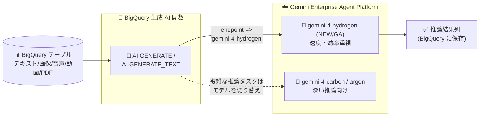

# BigQuery: 生成 AI 関数で gemini-4-hydrogen モデルをサポート (GA)

**リリース日**: 2026-11-12

**サービス**: BigQuery

**機能**: 生成 AI 関数での gemini-4-hydrogen モデルサポート

**ステータス**: GA (一般提供)

📊 [このアップデートのインフォグラフィックを見る](https://takech9203.github.io/google-cloud-news-summary/20261112-bigquery-generative-ai-gemini-4-hydrogen.html)

## 概要

BigQuery の生成 AI 関数が **gemini-4-hydrogen** モデルをサポートしました。このモデルは一般提供 (GA) です。`AI.GENERATE` や `AI.GENERATE_TEXT` などの生成 AI 関数から、SQL を離れることなく Gemini 4 世代の新モデルを呼び出し、テーブル内のテキスト・画像・音声・動画・PDF データに対して推論を実行できます。

Gemini 4 Hydrogen (`gemini-4-hydrogen`) は、同日 (2026-11-12) に Gemini Enterprise Agent Platform で GA になったモデルで、日常的なコーディング・エージェントワークフロー、マルチモーダル分析、ツール利用における**速度と効率**を重視して設計されています。入出力合計 1,048,576 トークンの統一上限、4 段階の思考レベル (LOW / MEDIUM / HIGH / XHIGH)、暗黙的コンテキストキャッシュ (durable caching デフォルト有効) を特徴とします。深い推論に特化した gemini-4-carbon (2026-11-10 に BigQuery 生成 AI 関数でサポート済み。[関連レポート](./2026-11-10-bigquery-graph-measures-gemini-4-carbon.md)) に対し、Hydrogen は大量行への適用が多い BigQuery のユースケースに適した、スループット・コスト効率寄りの選択肢となります。

主な対象ユーザーは、SQL ベースで LLM をデータパイプラインに組み込むデータエンジニア・データアナリスト、および BigQuery 上で大規模なテキスト処理 (要約、分類、抽出など) を行うチームです。

**アップデート前の課題**

- BigQuery の生成 AI 関数で利用できる Gemini 4 世代のモデルは、深い推論向けのフロンティアモデル (gemini-4-carbon、gemini-4-argon) に限られていた
- 速度・効率重視のモデルは gemini-3.8-flash など Gemini 3 世代にとどまっており、Gemini 4 世代の品質を大量行の推論にコスト効率よく適用する選択肢がなかった
- carbon / argon は思考トークンを多く消費する傾向があり、数千〜数百万行への行単位の生成 AI 関数適用ではトークン消費とレイテンシが課題になりやすかった

**アップデート後の改善**

- 生成 AI 関数のエンドポイントとして `gemini-4-hydrogen` を指定できるようになり、Gemini 4 世代の速度・効率重視モデルを SQL から直接利用可能になった (GA)
- 要約・分類・抽出といった日常的な大量データ処理と、carbon / argon による深い推論タスクを、ワークロードに応じて同じ生成 AI 関数のインターフェースで使い分けられるようになった
- Hydrogen の暗黙的コンテキストキャッシュ (4,096 トークン以上の共有プレフィックス) により、同一プロンプトプレフィックスを大量行に適用する BigQuery のバッチ的な利用パターンでキャッシュ効果が期待できるようになった

## アーキテクチャ図



BigQuery テーブルのデータを生成 AI 関数経由で Gemini Enterprise Agent Platform のモデルに送信するデータフローです。今回のアップデートで、エンドポイントに速度・効率重視の gemini-4-hydrogen を指定できるようになりました。

## サービスアップデートの詳細

### 主要機能

1. **生成 AI 関数での gemini-4-hydrogen サポート (GA)**
   - `AI.GENERATE` 関数や、リモートモデル経由の `AI.GENERATE_TEXT` TVF などの生成 AI 関数で `gemini-4-hydrogen` を指定可能
   - テキストに加え、ObjectRef / オブジェクトテーブル経由で画像・音声・動画・PDF などのマルチモーダルデータも分析対象にできる
   - 推論はすべて Agent Platform 側で実行され、結果は BigQuery に保存される

2. **Gemini 4 Hydrogen モデルの特徴 (Agent Platform 側で同日 GA)**
   - 日常的なコーディング・エージェントワークフロー、マルチモーダル分析、ツール利用における速度と効率を重視した設計
   - 入出力合計 1,048,576 トークンの統一上限 (出力には思考・関数呼び出し・最終応答を含む)。単一フォアグラウンドセグメントで最大 65,536 出力トークン、long decode (`continuation_token`) で最大 1,048,576 トークン (入力分を除く) まで拡張可能
   - 思考レベルは LOW / MEDIUM / HIGH / **XHIGH** の 4 段階 (デフォルトは HIGH、XHIGH は深い推論ワークロード向け)。`thinking_budget` や `thinking_level="MINIMAL"` の指定は HTTP 400 エラー
   - 暗黙的コンテキストキャッシュのみサポート (4,096 トークン以上、durable caching デフォルト有効)。明示的キャッシュは非サポート
   - Microsoft Office (.docx / .pptx / .xlsx など) と OpenDocument (.odt / .odp / .ods) ファイルの入力に対応
   - **短期リリース (short-term release)** として提供され、最低 45 日前の廃止通知ポリシーの対象

3. **モデルラインアップの拡充**
   - BigQuery の生成 AI 関数がサポートする Gemini モデルは、gemini-4-hydrogen の追加により、gemini-4-carbon / gemini-4-argon (フロンティア推論) と gemini-3.x flash 系に加えて、Gemini 4 世代の速度・効率モデルを含むラインアップとなった

## 技術仕様

### gemini-4-hydrogen の主な仕様

| 項目 | 詳細 |
|------|------|
| モデル ID | `gemini-4-hydrogen` |
| 提供形態 | GA (短期リリース、最低 45 日前の廃止通知ポリシー) |
| トークン上限 | 入出力合計 1,048,576 トークン (統一上限) |
| 出力トークン | 単一セグメント最大 65,536、long decode で最大 1,048,576 (入力分を除く) |
| 思考レベル | LOW / MEDIUM / HIGH (デフォルト) / XHIGH |
| コンテキストキャッシュ | 暗黙的キャッシュのみ (4,096 トークン以上、durable caching デフォルト有効) |
| 対応 API | GenerateContent API、Interactions API、OpenAI 互換 Chat Completions API |
| ツール | 関数呼び出し、コード実行、computer use、URL context、Grounding (Google 検索 / Google マップ / Enterprise Web Grounding など) |
| 消費オプション | Standard / Priority / Flex PayGo、バッチ推論、Provisioned Throughput (685 トークン/秒/GSU) |
| エンドポイント | global エンドポイントおよび us / eu マルチリージョン |

### BigQuery からの利用 (エンドポイント指定)

Agent Platform のモデルはマルチリージョンエンドポイントのみをサポートします。リージョンを省略した短縮名 (`gemini-4-hydrogen`) を指定した場合、クエリの実行リージョンに応じて us / eu / global エンドポイントが自動選択されます。特定のエンドポイントを使う場合は完全修飾名を指定します。

```sql
-- リモートモデルの作成 (gemini-4-hydrogen を指定)
CREATE OR REPLACE MODEL `mydataset.gemini_hydrogen`
  REMOTE WITH CONNECTION `us.my_connection`
  OPTIONS (ENDPOINT = 'gemini-4-hydrogen');
```

## 設定方法

### 前提条件

1. BigQuery と Vertex AI (Gemini Enterprise Agent Platform) を利用できる Google Cloud プロジェクトがあること
2. Agent Platform への接続用の Cloud リソース接続 (connection) が作成済みで、接続のサービスアカウントに必要なロールが付与されていること
3. リモートモデルの作成権限 (`bigquery.models.create` など) があること

### 手順

#### ステップ 1: リモートモデルを作成する

```sql
CREATE OR REPLACE MODEL `mydataset.gemini_hydrogen`
  REMOTE WITH CONNECTION `us.my_connection`
  OPTIONS (ENDPOINT = 'gemini-4-hydrogen');
```

`ENDPOINT` に `gemini-4-hydrogen` を指定してリモートモデルを作成します。

#### ステップ 2: 生成 AI 関数で推論を実行する

```sql
-- AI.GENERATE_TEXT TVF による一括テキスト生成
SELECT *
FROM AI.GENERATE_TEXT(
  MODEL `mydataset.gemini_hydrogen`,
  (
    SELECT CONCAT('次の製品レビューを 1 文で要約してください: ', review_text) AS prompt
    FROM `mydataset.product_reviews`
  ),
  STRUCT(TRUE AS flatten_json_output)
);
```

テーブルの各行に対して gemini-4-hydrogen による推論を実行し、結果を BigQuery の列として取得します。実行前に `AI.COUNT_TOKENS` 関数で入力トークン数を見積もることもできます。

## メリット

### ビジネス面

- **大量データへの LLM 適用コストの最適化**: 速度・効率重視の Hydrogen を使うことで、要約・分類・抽出などの日常的なタスクを、フロンティア推論モデルよりも少ないトークン消費・低レイテンシで大量行に適用しやすくなる
- **データ移動不要の AI 活用**: データを BigQuery から持ち出さずに最新の Gemini 4 世代モデルを利用でき、ガバナンスを維持したまま AI 活用を進められる

### 技術面

- **ワークロードに応じたモデル使い分け**: 同じ生成 AI 関数のインターフェースのまま、エンドポイント指定の変更だけで Hydrogen (速度・効率) と carbon / argon (深い推論) を切り替えられる
- **暗黙的キャッシュとの相性**: 同一のプロンプトプレフィックスを大量行に適用する BigQuery の典型的な利用パターンは、4,096 トークン以上の共有プレフィックスに対する暗黙的コンテキストキャッシュの恩恵を受けやすい
- **トークン・コストの可観測性**: クエリのジョブ情報で入力・出力・思考・キャッシュの各トークン数を確認でき、`bigquery_job_id_prefix` ラベルで Cloud Billing 上の Agent Platform 費用をジョブ単位で追跡できる

## デメリット・制約事項

### 制限事項

- Gemini 4 Hydrogen は**短期リリース**であり、最低 45 日前の通知を経て廃止される可能性がある。長期運用するパイプラインではモデル ID の更新を前提とした設計が必要
- Agent Platform のモデルはマルチリージョンエンドポイント (us / eu / global) のみをサポートし、リージョナルエンドポイントは利用できない
- 思考レベルは LOW / MEDIUM / HIGH / XHIGH のみで、`thinking_budget` や `thinking_level="MINIMAL"` は指定できない (HTTP 400 エラー)
- VPC Service Controls の境界内では、委任アクセス (delegated access) を使う ObjectRef 値を AI 関数で処理できない (単一引数の `OBJ.MAKE_REF(uri)` による直接アクセスで回避)

### 考慮すべき点

- デフォルトの思考レベルが HIGH のため、単純なタスクに大量適用する場合は思考トークンの消費に注意し、必要に応じて低い思考レベルの利用を検討する
- クォータ超過などによる行レベルエラーは該当行に NULL を返すため、結果の完全性が重要な場合はエラー処理 (マネージド AI 関数では `max_error_ratio`) を考慮する
- 2027-01-12 以降、Gemini 4 Hydrogen 以降のモデルでは TTL 設定付きのキャッシュ制御が利用可能になり、キャッシュ書き込みはデフォルトで標準入力トークン価格の 1.25 倍で課金される (保持期間が長いほど高くなる) 点を将来のコスト設計で考慮する

## ユースケース

### ユースケース 1: 製品レビューの大規模要約・分類

**シナリオ**: EC サイトの数百万件の製品レビューを、SQL パイプラインの中で要約し、トピック別に分類したい。

**実装例**:
```sql
SELECT
  review_id,
  AI.GENERATE(
    ('このレビューを 1 文で要約し、トピックを返してください: ', review_text),
    connection_id => 'us.my_connection',
    endpoint => 'gemini-4-hydrogen'
  ).result AS summary
FROM `mydataset.product_reviews`;
```

**効果**: 速度・効率重視の Hydrogen により、大量行への適用でもトークン消費とレイテンシを抑えながら Gemini 4 世代の品質で処理できる。共通のプロンプトプレフィックスには暗黙的キャッシュが効く。

### ユースケース 2: タスク特性に応じたモデルの使い分け

**シナリオ**: 日常的なログ要約・エンティティ抽出は低コストで回し、法務文書の高度な分析など複雑なタスクのみ深い推論モデルを使いたい。

**効果**: リモートモデルの `ENDPOINT` を `gemini-4-hydrogen` と `gemini-4-carbon` で使い分けるだけで、同一の SQL インターフェースのままコストと品質のバランスを最適化できる。

## 料金

生成 AI 関数は、クエリ実行に使用する BigQuery のコンピュートリソースへの課金に加えて、リモートモデルが Gemini Enterprise Agent Platform のモデルを呼び出すため、Agent Platform 側の料金 (gemini-4-hydrogen のトークン課金。思考トークンを含む) も発生します。実行前のトークン見積もりには `AI.COUNT_TOKENS` 関数を利用できます。

詳細は [BigQuery ML の料金](https://cloud.google.com/bigquery/pricing#bigquery-ml-pricing) および [Gemini Enterprise Agent Platform の生成 AI 料金](https://cloud.google.com/gemini-enterprise-agent-platform/generative-ai/pricing) を参照してください。

## 利用可能リージョン

Agent Platform のモデルはマルチリージョンエンドポイント (us / eu / global) のみをサポートします。gemini-4-hydrogen は global エンドポイントおよび us / eu マルチリージョンで提供されます。BigQuery の生成 AI 関数のモデル別サポートロケーションは [BigQuery のロケーション](https://docs.cloud.google.com/bigquery/docs/locations#bqml-loc) を参照してください。

## 関連サービス・機能

- **Gemini Enterprise Agent Platform**: 生成 AI 関数が呼び出すモデルの提供基盤。gemini-4-hydrogen は同日 (2026-11-12) に同プラットフォームで GA
- **BigQuery ML リモートモデル**: `CREATE MODEL ... REMOTE WITH CONNECTION` で Agent Platform のモデルを参照する仕組み
- **マネージド AI 関数 (AI.IF / AI.CLASSIFY / AI.SCORE / AI.AGG)**: フィルタリング・分類・スコアリング・集約を簡易に行う関数群。`max_error_ratio` によるエラー許容制御や、AI.IF / AI.CLASSIFY の最適化モード (Preview) も利用可能
- **gemini-4-carbon / gemini-4-argon**: 深い推論向けの Gemini 4 フロンティアモデル。gemini-4-carbon は 2026-11-10 に BigQuery 生成 AI 関数でサポート済み
- **Cloud Billing / Cloud Logging**: `bigquery_job_id_prefix` ラベルによるジョブ単位のコスト追跡と、リクエスト/レスポンスロギングによるモニタリング

## 参考リンク

- 📊 [インフォグラフィック](https://takech9203.github.io/google-cloud-news-summary/20261112-bigquery-generative-ai-gemini-4-hydrogen.html)
- [公式リリースノート](https://docs.cloud.google.com/release-notes#November_12_2026)
- [生成 AI の概要 (BigQuery)](https://docs.cloud.google.com/bigquery/docs/generative-ai-overview)
- [AI.GENERATE 関数リファレンス](https://docs.cloud.google.com/bigquery/docs/reference/standard-sql/bigqueryml-syntax-ai-generate)
- [AI.GENERATE_TEXT 関数リファレンス](https://docs.cloud.google.com/bigquery/docs/reference/standard-sql/bigqueryml-syntax-ai-generate-text)
- [リモートモデルの作成](https://docs.cloud.google.com/bigquery/docs/reference/standard-sql/bigqueryml-syntax-create-remote-model)
- [Gemini 4 Hydrogen デベロッパーガイド](https://docs.cloud.google.com/gemini-enterprise-agent-platform/models/guides/gemini-4-hydrogen)
- [料金ページ (BigQuery ML)](https://cloud.google.com/bigquery/pricing#bigquery-ml-pricing)

## まとめ

gemini-4-hydrogen のサポートにより、BigQuery の生成 AI 関数で Gemini 4 世代の速度・効率重視モデルが利用可能になり、大量データへの要約・分類・抽出といった日常的な LLM 処理をコスト効率よく SQL だけで実行できるようになりました。既に gemini-3.x flash 系や carbon を利用しているパイプラインでは、タスク特性に応じて Hydrogen への切り替えないし使い分けを検討する価値があります。ただし Hydrogen は短期リリース (最低 45 日前の廃止通知) である点を踏まえ、モデル ID を更新しやすいパイプライン設計にしておくことをおすすめします。

---

**タグ**: BigQuery, Generative AI, AI.GENERATE, AI.GENERATE_TEXT, Gemini 4 Hydrogen, Gemini Enterprise Agent Platform, Remote Model, GA
