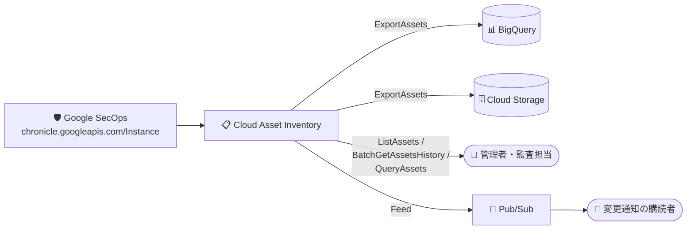

# Cloud Asset Inventory: Google Security Operations (Chronicle) Instance リソースタイプのサポート

**リリース日**: 2026-11-12

**サービス**: Cloud Asset Inventory

**機能**: Google Security Operations `chronicle.googleapis.com/Instance` リソースタイプの一般提供

**ステータス**: 一般提供 (Publicly Available)

📊 [このアップデートのインフォグラフィックを見る](https://takech9203.github.io/google-cloud-news-summary/20261112-cloud-asset-inventory-chronicle-instance.html)

## 概要

Cloud Asset Inventory で、Google Security Operations (旧 Chronicle) のリソースタイプ `chronicle.googleapis.com/Instance` が一般提供になりました。ExportAssets、ListAssets、BatchGetAssetsHistory、QueryAssets、および Feed の各 API を通じて、Google SecOps インスタンスのメタデータを他の Google Cloud リソースと同様に取得・監視できます。

Cloud Asset Inventory は、Google Cloud のアセットメタデータを表示・検索・エクスポート・監視・分析できるグローバルなメタデータインベントリサービスで、コンプライアンス追跡、定期監査、分析用途に設計されています。アセットの作成・更新・削除の履歴は最大 35 日間保持されます。今回のアップデートにより、SIEM/SOAR 基盤である Google SecOps のインスタンスも、組織全体のアセット棚卸しや変更監視の対象に含められるようになります。

セキュリティ運用基盤そのものの構成管理・監査が求められる組織 (金融、公共など規制業種を含む) にとって、Google SecOps インスタンスの存在と構成変更を標準の仕組みで追跡できることは、ガバナンス強化の観点で有用なアップデートです。

**アップデート前の課題**

- Google SecOps (Chronicle) インスタンスは Cloud Asset Inventory の対象外であり、組織・フォルダ・プロジェクト横断のアセット一覧やエクスポート結果に含まれなかった
- Google SecOps インスタンスの構成変更履歴を Cloud Asset Inventory の仕組み (履歴取得やフィード通知) で追跡できなかった
- SecOps インスタンスの棚卸しには Chronicle API (`projects.locations.instances`) を個別に呼び出す必要があった

**アップデート後の改善**

- ExportAssets により、Google SecOps インスタンスのメタデータを BigQuery や Cloud Storage へ他のアセットと一括でエクスポートできるようになった
- ListAssets / BatchGetAssetsHistory により、インスタンスの一覧取得と変更履歴 (最大 35 日) の取得が可能になった
- QueryAssets により、BigQuery SQL を使ったアセットクエリの対象に SecOps インスタンスを含められるようになった
- Feed API により、インスタンスの変更を Pub/Sub 経由でリアルタイムに通知できるようになった

## アーキテクチャ図



Google SecOps インスタンスのメタデータが Cloud Asset Inventory に取り込まれ、エクスポート (BigQuery / Cloud Storage)、一覧・履歴・SQL クエリ、フィードによるリアルタイム変更通知の各経路で利用できるようになります。

## サービスアップデートの詳細

### 主要機能

1. **ExportAssets によるエクスポート**
   - 指定時点の Google SecOps インスタンスのメタデータスナップショットを BigQuery や Cloud Storage へエクスポート可能
   - 組織・フォルダ・プロジェクト単位での一括エクスポートに対応

2. **ListAssets / BatchGetAssetsHistory による一覧・履歴取得**
   - プロジェクト・フォルダ・組織配下の SecOps インスタンスを一覧表示
   - 最大 35 日間の変更履歴 (作成・更新・削除) を取得可能

3. **QueryAssets による SQL クエリ**
   - BigQuery SQL 構文を使用してアセットメタデータに対するアドホックなクエリを実行可能

4. **Feed によるリアルタイム変更監視**
   - フィードを作成して Pub/Sub トピックに変更通知を配信
   - SecOps インスタンスの構成変更をほぼリアルタイムで検知可能

## 技術仕様

### 対応 API と制限

| 項目 | 詳細 |
|------|------|
| アセットタイプ | `chronicle.googleapis.com/Instance` |
| 対応 API | ExportAssets、ListAssets、BatchGetAssetsHistory、QueryAssets、Feed |
| 非対応 API | 分析 API (Policy Analyzer 等) および検索 API (SearchAllResources 等) では利用不可 |
| 実効タグ (Effective tags) | 非サポート |
| 参照先リソース | Chronicle API `projects.locations.instances` |
| 履歴保持期間 | 最大 35 日 (Cloud Asset Inventory 共通) |

## 設定方法

### 前提条件

1. Cloud Asset API (`cloudasset.googleapis.com`) が有効であること
2. 対象スコープ (プロジェクト / フォルダ / 組織) に対する Cloud Asset Inventory の閲覧権限 (例: `roles/cloudasset.viewer`) があること

### 手順

#### ステップ 1: SecOps インスタンスを一覧表示する

```bash
gcloud asset list \
  --project=PROJECT_ID \
  --asset-types="chronicle.googleapis.com/Instance" \
  --content-type=resource
```

プロジェクト内の Google SecOps インスタンスのメタデータを一覧表示します。

#### ステップ 2: 変更監視用のフィードを作成する

```bash
gcloud asset feeds create secops-instance-feed \
  --project=PROJECT_ID \
  --asset-types="chronicle.googleapis.com/Instance" \
  --content-type=resource \
  --pubsub-topic="projects/PROJECT_ID/topics/TOPIC_ID"
```

SecOps インスタンスに変更があった際に Pub/Sub トピックへ通知が配信されます。

## メリット

### ビジネス面

- **ガバナンスの強化**: セキュリティ運用基盤 (SIEM) 自体の存在と構成を組織全体のアセット管理・監査プロセスに組み込める
- **コンプライアンス対応**: 変更履歴の取得とリアルタイム通知により、SecOps インスタンスに対する監査証跡の整備が容易になる

### 技術面

- **統一されたインターフェース**: Chronicle API を個別に呼び出さなくても、Cloud Asset Inventory の標準 API 群で他のリソースと同じ方法で棚卸しできる
- **既存パイプラインへの統合**: BigQuery / Cloud Storage へのエクスポートや Pub/Sub フィードなど、既存のアセット管理パイプラインにそのまま組み込める

## デメリット・制約事項

### 制限事項

- 分析 API (Policy Analyzer など) および検索 API (SearchAllResources / SearchAllIamPolicies) では利用できない
- 実効タグ (Effective tags) はサポートされない
- Cloud Asset Inventory はリアルタイムクエリ用途には設計されておらず、結果整合性モデルのため最新状態の取得には各サービスの API を直接呼び出す必要がある

### 考慮すべき点

- 変更履歴の保持期間は最大 35 日のため、長期的な監査証跡が必要な場合は BigQuery などへの定期エクスポートを検討する

## ユースケース

### ユースケース 1: 組織全体の SecOps インスタンスの棚卸し

**シナリオ**: 複数プロジェクトで Google SecOps を利用している組織が、全インスタンスを定期的に棚卸しして監査レポートを作成したい。

**実装例**:
```bash
gcloud asset export \
  --organization=ORGANIZATION_ID \
  --asset-types="chronicle.googleapis.com/Instance" \
  --content-type=resource \
  --bigquery-table="projects/PROJECT_ID/datasets/DATASET_ID/tables/TABLE_ID" \
  --output-bigquery-force
```

**効果**: 組織配下の全 SecOps インスタンスのメタデータを BigQuery に集約し、SQL で監査レポートを自動生成できる。

### ユースケース 2: SecOps インスタンスの構成変更のリアルタイム検知

**シナリオ**: セキュリティ運用基盤そのものに対する意図しない変更 (作成・更新・削除) を即座に検知し、運用チームに通知したい。

**効果**: Feed + Pub/Sub により変更イベントを即時に受信し、Cloud Run functions などと組み合わせて通知・自動対応のワークフローを構築できる。

## 利用可能リージョン

Cloud Asset Inventory はグローバルなメタデータインベントリサービスとして提供されます。詳細は[公式ドキュメント](https://docs.cloud.google.com/asset-inventory/docs/asset-inventory-overview)を参照してください。

## 関連サービス・機能

- **Google Security Operations (Chronicle)**: 今回アセットタイプとして追加された SIEM/SOAR プラットフォーム。インスタンスは Chronicle API (`projects.locations.instances`) で管理される
- **BigQuery**: ExportAssets / QueryAssets のエクスポート先・クエリエンジンとして連携
- **Cloud Storage**: ExportAssets のエクスポート先として連携
- **Pub/Sub**: Feed API による変更通知の配信先
- **Security Command Center**: Cloud Asset Inventory のアセット情報を活用するセキュリティ管理サービス

## 参考リンク

- 📊 [インフォグラフィック](https://takech9203.github.io/google-cloud-news-summary/20261112-cloud-asset-inventory-chronicle-instance.html)
- [公式リリースノート](https://docs.cloud.google.com/release-notes#November_12_2026)
- [サポートされているアセットタイプ](https://docs.cloud.google.com/asset-inventory/docs/asset-types)
- [ExportAssets API リファレンス](https://docs.cloud.google.com/asset-inventory/docs/reference/rest/v1/TopLevel/exportAssets)
- [アセットの一覧表示](https://docs.cloud.google.com/asset-inventory/docs/listing-assets)
- [BatchGetAssetsHistory API リファレンス](https://docs.cloud.google.com/asset-inventory/docs/reference/rest/v1/TopLevel/batchGetAssetsHistory)
- [QueryAssets API リファレンス](https://docs.cloud.google.com/asset-inventory/docs/reference/rest/v1/TopLevel/queryAssets)
- [Feeds API リファレンス](https://docs.cloud.google.com/asset-inventory/docs/reference/rest/v1/feeds)
- [Cloud Asset Inventory の概要](https://docs.cloud.google.com/asset-inventory/docs/asset-inventory-overview)

## まとめ

Google SecOps (Chronicle) インスタンスが Cloud Asset Inventory の対象になったことで、セキュリティ運用基盤そのものを組織標準のアセット管理・監査プロセスに組み込めるようになりました。Google SecOps を利用している組織は、ExportAssets による定期的な棚卸しと Feed による変更監視の導入を検討することを推奨します。分析 API・検索 API では利用できない点には注意が必要です。

---

**タグ**: Cloud Asset Inventory, Google Security Operations, Chronicle, SIEM, ガバナンス, 監査, アセット管理
