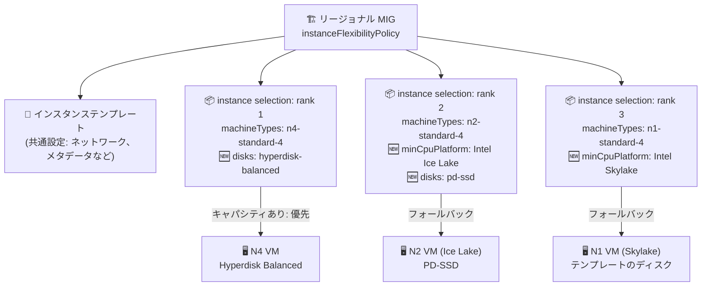

# Compute Engine: MIG インスタンスフレキシビリティのディスク・最小 CPU プラットフォームオーバーライドが GA

**リリース日**: 2026-11-12

**サービス**: Compute Engine

**機能**: MIG インスタンスフレキシビリティにおけるインスタンス選択ごとのディスク・最小 CPU プラットフォームのオーバーライド

**ステータス**: GA (一般提供)

📊 [このアップデートのインフォグラフィックを見る](https://takech9203.github.io/google-cloud-news-summary/20261112-compute-engine-mig-instance-flexibility-overrides-ga.html)

## 概要

Compute Engine のマネージドインスタンスグループ (MIG) におけるインスタンスフレキシビリティで、インスタンステンプレートに定義されたディスク (`disks`) と最小 CPU プラットフォーム (`minCpuPlatform`) のプロパティを、インスタンス選択 (instance selection) ごとにオーバーライドする機能が一般提供 (GA) になりました。

インスタンスフレキシビリティは、1 つの MIG 内に複数のマシンタイプを設定し、リアルタイムのリソース可用性に基づいて VM をプロビジョニングできる機能です。今回 GA になったオーバーライド機能により、ディスクタイプやブートイメージ、CPU プラットフォームの要件が異なるマシンタイプ (例: x86 の C4 と Arm の C4A、Persistent Disk 系の N2 と Hyperdisk 必須の N4 など) を単一の MIG に混在させることが可能になります。

キャパシティ確保 (ストックアウト対策) や最新世代マシンタイプへの段階的移行を進めたいインフラ運用者・SRE にとって、MIG の構成の自由度を大きく広げるアップデートです。

**アップデート前の課題**

- インスタンスフレキシビリティの `machineTypes` でマシンタイプを混在できても、ディスクと最小 CPU プラットフォームはインスタンステンプレートの単一の設定に縛られていた
- そのため、Hyperdisk が必須の最新世代 (N4、C4 など) と Persistent Disk を使う旧世代 (N2、N1 など) のように、ディスクタイプの要件が異なるマシンタイプを 1 つの MIG に混在させることが難しかった
- x86 と Arm のようにブートイメージが異なるアーキテクチャのマシンタイプを同一 MIG で扱えず、アーキテクチャごとに MIG を分割する運用が必要だった
- 本オーバーライド機能は Preview として提供されており、本番環境での利用には Pre-GA 提供条件が適用されていた

**アップデート後の改善**

- インスタンス選択ごとに `disks` を指定でき、ブートディスクのイメージ・ディスクタイプ・サイズや追加ディスクをマシンタイプの要件に合わせて切り替えられるようになった (テンプレートのディスクとは `deviceName` キーでマージされる)
- インスタンス選択ごとに `minCpuPlatform` を指定でき、特定の選択にのみ最小 CPU プラットフォームを適用したり、`AUTOMATIC` を指定してテンプレートの設定を解除し互換性のあるプラットフォームを自動選択させたりできるようになった
- ディスクタイプ、ブートイメージ、CPU プラットフォームの要件が異なるマシンタイプを単一の MIG に統合でき、キャパシティ確保と最新ハードウェアの活用を両立できるようになった
- GA により SLA を含む本番環境向けのサポート対象となった

## アーキテクチャ図



インスタンステンプレートの共通設定をベースに、インスタンス選択ごとにディスクと最小 CPU プラットフォームをオーバーライドし、MIG がリアルタイムの可用性とランク (優先度) に基づいて要件の異なる VM をプロビジョニングする構成を示しています。

## サービスアップデートの詳細

### 主要機能

1. **ディスク (`disks`) のオーバーライド**
   - インスタンス選択ごとにブートディスクのイメージ、ディスクタイプ (pd-balanced、pd-ssd、hyperdisk-balanced など)、サイズを指定可能
   - テンプレートのディスク設定と `deviceName` キーでマージされ、指定しない選択はテンプレートの設定をそのまま使用
   - x86 (C4) と Arm (C4A) のようにブートイメージが異なるアーキテクチャの混在や、Hyperdisk 必須のマシンタイプと Persistent Disk 系マシンタイプの混在が可能に

2. **最小 CPU プラットフォーム (`minCpuPlatform`) のオーバーライド**
   - インスタンス選択ごとに最小 CPU プラットフォーム (例: Intel Skylake、Intel Ice Lake) を指定可能
   - `AUTOMATIC` を指定すると、テンプレートの最小 CPU プラットフォーム設定をオーバーライドし、選択したマシンタイプに互換性のある任意のプラットフォームを MIG が自動選択
   - 例: N1 と N2 を混在させつつ、N1 だけに Intel Skylake を指定してパフォーマンスを確保

3. **ランクベースの優先度とキャパシティ評価との連動**
   - ランク (値が小さいほど高優先) を設定すると、MIG は全インスタンス選択・全ゾーンのリアルタイム可用性を同時に確認し、利用可能な中で最も優先度の高いマシンタイプでプロビジョニング
   - 未使用の予約 (Reservation) を優先的に消費
   - VM 修復時も update on repair と組み合わせて、元のマシンタイプが在庫切れの場合に代替マシンタイプ (それぞれのオーバーライド設定を適用) で再作成可能

## 技術仕様

### オーバーライド可能なプロパティ

| 項目 | 詳細 |
|------|------|
| `machineTypes` | インスタンス選択ごとのマシンタイプのリスト (従来からの機能)。テンプレートの `machineType` をオーバーライド |
| `disks` | ブートディスク・追加ディスクの設定。テンプレートのディスクと `deviceName` でマージ |
| `minCpuPlatform` | 最小 CPU プラットフォーム。`AUTOMATIC` 指定で自動選択も可能 |
| `rank` | インスタンス選択の優先度。値が小さいほど高優先 |

### インスタンスフレキシビリティポリシーの設定例

```json
"instanceFlexibilityPolicy": {
  "instanceSelections": {
    "first-preference": {
      "rank": 1,
      "machineTypes": ["n4-standard-4"],
      "disks": [
        {
          "autoDelete": true,
          "deviceName": "boot",
          "boot": true,
          "initializeParams": {
            "sourceImage": "projects/debian-cloud/global/images/family/debian-12",
            "diskSizeGb": "10",
            "diskType": "hyperdisk-balanced"
          }
        }
      ]
    },
    "second-preference": {
      "rank": 2,
      "machineTypes": ["n2-standard-4"],
      "minCpuPlatform": "Intel Ice Lake",
      "disks": [
        {
          "autoDelete": true,
          "deviceName": "boot",
          "boot": true,
          "initializeParams": {
            "sourceImage": "projects/debian-cloud/global/images/family/debian-12",
            "diskSizeGb": "10",
            "diskType": "pd-ssd"
          }
        }
      ]
    },
    "third-preference": {
      "rank": 3,
      "machineTypes": ["n1-standard-4"],
      "minCpuPlatform": "Intel Skylake"
    }
  }
}
```

テンプレートが `n2-standard-2` + `pd-balanced` の場合でも、N4 選択時は Hyperdisk Balanced、N2 選択時は PD-SSD + Ice Lake、N1 選択時はテンプレートのディスク + Skylake で VM が作成されます。

## 設定方法

### 前提条件

1. リージョナル MIG を使用する (ゾーン MIG はインスタンスフレキシビリティ非対応)
2. `minCpuPlatform` / `disks` をオーバーライドする場合、update on repair (修復時の構成更新) を有効化する
3. 既存のインスタンス選択にオーバーライドを追加する際は `machineTypes` フィールドも必ず含める (省略するとエラー)

### 手順

#### ステップ 1: 既存の MIG の構成を確認

```bash
gcloud beta compute instance-groups managed describe INSTANCE_GROUP_NAME \
    --region REGION
```

インスタンスフレキシビリティポリシーの更新時は、指定しなかったプロパティが上書き (削除) されるため、既存の構成を事前に確認します。

#### ステップ 2: インスタンス選択にオーバーライドを設定

```bash
gcloud beta compute instance-groups managed update INSTANCE_GROUP_NAME \
    --region REGION \
    --instance-flexibility-policy='{"instanceSelections": {
      "first-preference": {
        "rank": 1,
        "machineTypes": ["n4-standard-4"],
        "disks": [{"deviceName": "boot", "boot": true,
          "initializeParams": {"sourceImage": "projects/debian-cloud/global/images/family/debian-12",
            "diskType": "hyperdisk-balanced", "diskSizeGb": "10"}}]
      },
      "second-preference": {
        "rank": 2,
        "machineTypes": ["n2-standard-4"],
        "minCpuPlatform": "Intel Ice Lake"
      }
    }}'
```

YAML/JSON ファイルで管理する場合は `--instance-flexibility-policy` の代わりに `--flags-file=FILE_NAME.YAML` を使用できます。Google Cloud コンソールでは、インスタンス選択の編集画面で「Override CPU platform for this selection」「Override disks」のチェックボックスから設定できます。

## メリット

### ビジネス面

- **キャパシティ確保の強化**: ディスク要件の異なる最新世代を含む幅広いマシンタイプを 1 つの MIG で利用でき、在庫切れ (ストックアウト) によるスケールアウト失敗のリスクを低減
- **運用コストの削減**: アーキテクチャやディスク要件ごとに MIG を分割する必要がなくなり、管理対象リソースとオートスケーリング設定を集約できる

### 技術面

- **最新世代への段階的移行**: 最新世代 (Hyperdisk 必須の N4/C4 など) を高優先ランクに、旧世代をフォールバックに設定し、ディスクオーバーライドで要件差分を吸収しながら最新ハードウェアの比率を最大化できる
- **異種アーキテクチャの混在**: x86 と Arm でブートイメージを切り替えられるため、マルチアーキテクチャ対応ワークロードの単一 MIG 運用が可能
- **パフォーマンスの下限保証**: 選択ごとの `minCpuPlatform` 指定により、旧世代マシンタイプ使用時でも一定以上の CPU プラットフォームを保証できる

## デメリット・制約事項

### 制限事項

- ゾーン MIG はインスタンスフレキシビリティ非対応 (単一ゾーンのリージョナル MIG で代替)
- `minCpuPlatform` / `disks` のオーバーライド使用時は update on repair の有効化が必須
- オーバーライドで設定したディスクにはステートフルポリシーやインスタンスごとの構成 (per-instance config) を適用できない
- ローカル SSD のオーバーライドは、ローカル SSD 数を選択できるマシンタイプのみ対象 (`-lssd` バリアントは不可)
- 全インスタンス選択をまたいでマシンタイプは一意である必要がある (同じマシンタイプを異なる CPU プラットフォームで複数選択に登録できない)
- インスタンスフレキシビリティ自体が、EVEN 分散形状、自動ローリング更新・カナリア更新、VM の一時停止/停止、GPU VM の一括作成リサイズリクエスト、Flex-start VM と併用不可

### 考慮すべき点

- ポリシー更新時は、変更しないプロパティも含めてインスタンス選択の完全な構成を指定する必要がある (省略分は上書きされる)
- マシンタイプでサポートされないプロパティをオーバーライドに指定すると、そのマシンタイプでのインスタンス作成は失敗する
- ロードバランシングやオートスケーリングを効果的に機能させるため、性能が近いマシンタイプ同士を混在させることが推奨される
- 特定ハードウェアの確保を保証したい場合は予約 (Reservation) の併用が必要

## ユースケース

### ユースケース 1: Hyperdisk 必須の最新世代への移行とキャパシティフォールバック

**シナリオ**: N2 ベースの Web バックエンドを運用中。性能向上のため N4 への移行を進めたいが、N4 は Hyperdisk が必須でテンプレートの PD ディスク設定では混在できず、また N4 の在庫不足時にもスケールアウトを継続したい。

**実装例**:
```json
"instanceSelections": {
  "n4-preferred": {
    "rank": 1,
    "machineTypes": ["n4-standard-4"],
    "disks": [{"deviceName": "boot", "boot": true,
      "initializeParams": {"diskType": "hyperdisk-balanced",
        "sourceImage": "projects/debian-cloud/global/images/family/debian-12"}}]
  },
  "n2-fallback": {
    "rank": 2,
    "machineTypes": ["n2-standard-4"]
  }
}
```

**効果**: N4 のキャパシティがあるゾーンでは Hyperdisk Balanced 付きの N4 を優先的にプロビジョニングし、不足時は N2 にフォールバック。必要台数を常に確保しつつ最新世代の比率を最大化できる。

### ユースケース 2: x86 と Arm のマルチアーキテクチャ MIG

**シナリオ**: コンテナ化されたワークロードを x86 (C4) と Arm (C4A) の両方に対応させており、価格性能比とキャパシティの観点から両アーキテクチャを活用したい。ただしブートイメージがアーキテクチャごとに異なる。

**効果**: インスタンス選択ごとにブートディスクのソースイメージをオーバーライドすることで、x86 用と Arm 用のイメージを使い分けながら単一の MIG で両アーキテクチャを運用でき、MIG の分割管理が不要になる。

### ユースケース 3: 旧世代マシンタイプの性能下限の保証

**シナリオ**: N1 と N2 を混在させた MIG で、N1 に割り当てられた VM の性能ばらつき (古い CPU プラットフォームの割り当て) が問題になっている。

**効果**: N1 を含むインスタンス選択に `minCpuPlatform: "Intel Skylake"` を指定することで、N1 VM でも Skylake 以上の CPU プラットフォームを保証し、MIG 全体の性能の一貫性を確保できる。

## 料金

MIG およびインスタンスフレキシビリティ機能自体に追加料金はありません。プロビジョニングされた VM インスタンス (マシンタイプごとの料金)、ディスク (Persistent Disk / Hyperdisk のタイプ・サイズごとの料金) などの基盤リソースに対して通常の Compute Engine 料金が発生します。

ディスクオーバーライドにより選択ごとに異なるディスクタイプ (例: pd-balanced と hyperdisk-balanced) を使用する場合、ディスクタイプごとに単価が異なる点に注意してください。詳細は [Compute Engine の料金ページ](https://cloud.google.com/compute/all-pricing) および [ディスクの料金](https://cloud.google.com/compute/disks-image-pricing) を参照してください。

## 利用可能リージョン

リージョナル MIG が利用可能なすべてのリージョンで使用できます。ただし、各マシンタイプ (N4、C4A など) やディスクタイプ (Hyperdisk など) の提供状況はリージョン・ゾーンによって異なるため、[リージョンとゾーンのドキュメント](https://cloud.google.com/compute/docs/regions-zones) で確認してください。

## 関連サービス・機能

- **Compute Engine 予約 (Reservations)**: インスタンスフレキシビリティは未使用の予約を優先消費するため、特定ハードウェアの確保保証と併用できる
- **Spot VM**: インスタンスフレキシビリティ使用時、MIG はプリエンプション率が最も低いマシンタイプを自動選択し、中断を最小化
- **Cloud Load Balancing / オートスケーラー**: MIG のバックエンド運用で併用。性能が近いマシンタイプの混在が推奨される
- **Update on repair**: オーバーライド使用時に必須。VM 修復時に最新のフレキシビリティ構成 (代替マシンタイプ含む) を適用
- **Hyperdisk / Persistent Disk**: ディスクオーバーライドで切り替え対象となるブロックストレージ

## 参考リンク

- 📊 [インフォグラフィック](https://takech9203.github.io/google-cloud-news-summary/20261112-compute-engine-mig-instance-flexibility-overrides-ga.html)
- [公式リリースノート](https://docs.cloud.google.com/release-notes#November_12_2026)
- [About instance flexibility in MIGs](https://docs.cloud.google.com/compute/docs/instance-groups/about-instance-flexibility)
- [Configure instance flexibility in a MIG](https://docs.cloud.google.com/compute/docs/instance-groups/configure-instance-flexibility)
- [Change or remove instance flexibility configuration](https://docs.cloud.google.com/compute/docs/instance-groups/change-or-remove-instance-flexibility-configuration)
- [料金ページ](https://cloud.google.com/compute/all-pricing)

## まとめ

MIG のインスタンスフレキシビリティにおけるディスク・最小 CPU プラットフォームのオーバーライドが GA になり、ディスクタイプやブートイメージ、CPU プラットフォームの要件が異なるマシンタイプを単一の MIG で本番運用できるようになりました。Hyperdisk 必須の最新世代 (N4/C4) への段階的移行や x86/Arm 混在構成、キャパシティ確保の強化を検討しているチームは、update on repair の有効化などの前提条件を確認のうえ、既存 MIG へのオーバーライド設定の追加を検討することを推奨します。

---

**タグ**: Compute Engine, MIG, インスタンスフレキシビリティ, Hyperdisk, GA, キャパシティ管理
