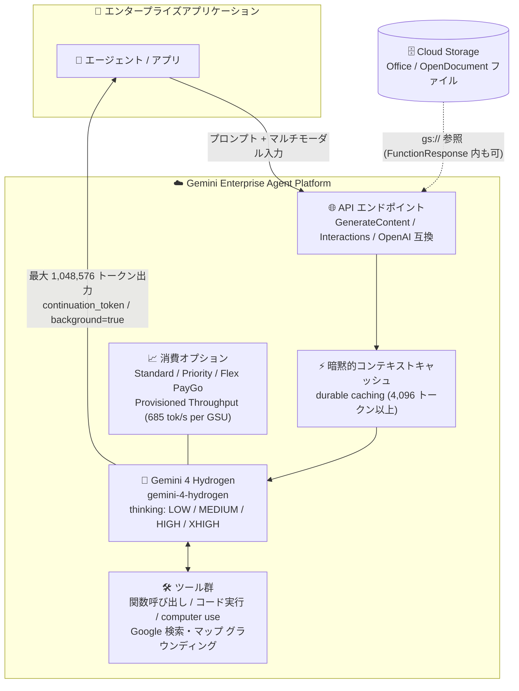

# Gemini Enterprise Agent Platform: Gemini 4 Hydrogen が一般提供 (GA) に

**リリース日**: 2026-11-12

**サービス**: Gemini Enterprise Agent Platform

**機能**: Gemini 4 Hydrogen (`gemini-4-hydrogen`) の一般提供開始 (短期リリース)

**ステータス**: GA (一般提供、短期リリース: 最低 45 日前の廃止予告ポリシー)

📊 [このアップデートのインフォグラフィックを見る](https://takech9203.github.io/google-cloud-news-summary/20261112-gemini-4-hydrogen-ga.html)

## 概要

Gemini Enterprise Agent Platform において、**Gemini 4 Hydrogen** (`gemini-4-hydrogen`) が一般提供 (GA) になりました。Gemini 4 Hydrogen は、日常的なコーディングやエージェントワークフロー、マルチモーダル分析、ツール利用における**速度と効率**を重視して設計されたモデルで、短期リリース (short-term release) として提供されます。短期リリースのモデルは、廃止 (retirement) が決定した場合でも最低 45 日前に通知され、後継モデルがリリースされた後も廃止日が告知されるまでは利用を継続できます。

Gemini 4 Carbon / Argon と同様に、入力と出力を合わせて 1,048,576 トークンの統合トークン上限と、`continuation_token` による最大 1M トークンのロングデコードをサポートします。思考レベルは `LOW` / `MEDIUM` / `HIGH` / `XHIGH` の 4 段階に拡張され、デフォルトは `HIGH`、深い推論ワークロード向けに `XHIGH` が追加されています。さらに、2027 年 1 月 12 日からは Gemini 4 Hydrogen 以降のモデルで TTL 設定によるキャッシュ書き込み制御がサポートされる予定です。

高速・低コストなワークホースモデルとして Gemini 3.8 Flash を利用しているチームにとって、Gemini 4 世代の機能 (統合 1M ウィンドウ、ロングデコード、XHIGH 思考レベル) を速度重視のワークロードに取り込める移行先候補となります。

**アップデート前の課題**

- 速度・効率重視のワークホースモデル (Gemini 3.8 Flash など) では、出力が最大 65,536 トークンで頭打ちになり、Gemini 4 世代の統合 1M トークンウィンドウやロングデコードは推論特化のフロンティアモデル (Argon / Carbon) に限られていた
- 思考レベルは `LOW` / `MEDIUM` / `HIGH` の 3 段階のみで、より深い推論が必要なワークロードに割り当てる上位レベルがなかった
- 暗黙的コンテキストキャッシュでは、何をどれだけの期間キャッシュするかをユーザー側で制御する手段が提供されていなかった
- Office / OpenDocument ファイルを `FunctionResponse` パート内のマルチモーダルコンテンツとして返すエージェントパターンが明示的にサポートされていなかった

**アップデート後の改善**

- `gemini-4-hydrogen` が GA となり、速度・効率重視のワークロードでも入出力合計 1,048,576 トークンの統合ウィンドウとロングデコード (最大 1M トークン出力) が利用可能になった
- 単一フォアグラウンドセグメントで、ストリーミング・非ストリーミングの両方で 65,536 出力トークンまで生成できるようになった (Gemini 4 Carbon は非ストリーミング時 32,768 トークンまで)
- 思考レベルに `XHIGH` が追加され、`LOW` / `MEDIUM` / `HIGH` / `XHIGH` の 4 段階で推論の深さを制御できるようになった (デフォルト: `HIGH`)
- 2027 年 1 月 12 日以降、TTL 設定によるキャッシュ書き込み制御 (何をキャッシュし、どれだけ保持するか) が Gemini 4 Hydrogen 以降のモデルでサポートされる
- Microsoft Office / OpenDocument ファイルを、インラインまたは Cloud Storage (`gs://`) から、さらにマルチモーダル `FunctionResponse` パート内でも入力できるようになった
- 関数呼び出し、コード実行、computer use、URL コンテキスト、Google 検索 / Google マップによるグラウンディング、Enterprise Web Grounding、Parallel / Exa Web Search、Agentic video understanding など、エージェント向けツール群をフルサポート

## アーキテクチャ図



アプリケーションは GenerateContent / Interactions / OpenAI 互換 API のいずれかで Gemini 4 Hydrogen を呼び出し、暗黙的キャッシュ、エージェント向けツール群、ロングデコード (サーバー管理のバックグラウンド実行を含む) を活用して高速なエージェントワークフローを実行します。

## サービスアップデートの詳細

### 主要機能

1. **統合 1M トークンウィンドウとロングデコード**
   - 入力・思考・関数呼び出し・最終レスポンスが 1 つの 1,048,576 トークンウィンドウを共有する
   - 単一フォアグラウンドセグメントはストリーミング・非ストリーミングともに最大 65,536 出力トークンを生成できる
   - Interactions API と GenerateContent API (`v1beta1`) の両方で、`continuation_token` によるロングデコードを使って最大 1,048,576 トークン (入力トークン分を除く) まで出力を拡張できる
   - Interactions API では `background=true` による非同期のサーバー管理バックグラウンド実行にも対応

2. **4 段階の思考レベル (`LOW` / `MEDIUM` / `HIGH` / `XHIGH`)**
   - デフォルトは `HIGH` で、深い推論ワークロード向けに `XHIGH` が利用できる
   - `thinking_budget` の指定や `thinking_level="MINIMAL"` の設定は HTTP 400 のバリデーションエラーを返す

3. **暗黙的コンテキストキャッシュ (durable caching 対応)**
   - 4,096 トークン以上の共有プロンプトプレフィックスに対して、durable caching が有効な自動の暗黙的コンテキストキャッシュがデフォルトで適用される
   - 明示的コンテキストキャッシュは非サポート

4. **キャッシュ書き込み制御と料金 (2027 年 1 月 12 日開始)**
   - Gemini 4 Hydrogen 以降のモデルで、TTL 設定によるキャッシュ制御機能がサポートされる
   - 何をキャッシュするか、キャッシュをどれだけの期間有効にするかを TTL 設定で選択できる
   - キャッシュ書き込みはデフォルトで標準入力トークン価格の 1.25 倍で課金され、保持期間が長いほどコストが高くなる

5. **Microsoft Office / OpenDocument ファイル入力**
   - Microsoft Office (`.docx`, `.dotx`, `.doc`, `.pptx`, `.ppt`, `.xlsx`, `.xls`) と OpenDocument (`.odt`, `.odp`, `.ods`) のファイルを、インラインまたは Cloud Storage (`gs://`) から入力できる
   - マルチモーダル `FunctionResponse` パート内でのファイル入力にも対応し、ツール実行結果としてドキュメントを返すエージェントパターンを構築できる

6. **豊富な機能・消費オプション・エンドポイント**
   - API: GenerateContent API、Interactions API、OpenAI 互換 Chat Completions API
   - ツール: 関数呼び出し、コード実行、computer use、URL コンテキスト、Grounding with Google Search、Google マップ、Enterprise Web Grounding、Parallel / Exa Web Search、Agentic video understanding
   - 消費オプション: Standard PayGo (Usage Tiers 付き)、Priority PayGo、Flex PayGo、バッチ推論、Provisioned Throughput (1 GSU あたり 685 トークン/秒)
   - エンドポイント: global エンドポイントおよび `us` / `eu` マルチリージョン

## 技術仕様

### モデル仕様

| 項目 | 詳細 |
|------|------|
| モデル ID | `gemini-4-hydrogen` |
| ステータス | GA (短期リリース: 最低 45 日前の廃止予告ポリシー) |
| 設計目標 | 日常的なコーディング・エージェントワークフロー・マルチモーダル分析・ツール利用における速度と効率 |
| コンテキストウィンドウ | 入力・出力 (思考、関数呼び出し、最終レスポンスを含む) 共有で 1,048,576 トークン |
| フォアグラウンド出力 | 最大 65,536 トークン (ストリーミング / 非ストリーミング共通) |
| ロングデコード | `continuation_token` により最大 1,048,576 トークン (入力分を除く)。Interactions API では `background=true` も利用可 |
| 思考レベル | `LOW` / `MEDIUM` / `HIGH` / `XHIGH` (デフォルト: `HIGH`)。`thinking_budget` と `MINIMAL` は HTTP 400 エラー |
| コンテキストキャッシュ | 暗黙的キャッシュのみ (durable caching デフォルト有効、4,096 トークン以上)。明示的キャッシュは非サポート |
| ファイル入力 | Microsoft Office / OpenDocument 形式 (インライン / `gs://`、`FunctionResponse` パート内も可) |
| 消費オプション | Standard PayGo (Usage Tiers)、Priority PayGo、Flex PayGo、バッチ推論、Provisioned Throughput (685 トークン/秒 per GSU) |
| 提供エンドポイント | global、`us` / `eu` マルチリージョン |

### 思考レベルの使い分け

| 思考レベル | 位置づけ |
|-----------|---------|
| `LOW` | 低レイテンシ・コスト重視の軽量タスク |
| `MEDIUM` | バランス型の一般タスク |
| `HIGH` (デフォルト) | 日常的なコーディング・エージェントタスクの標準設定 |
| `XHIGH` | 深い推論 (deep reasoning) が必要なワークロード向けの最上位レベル |

### リクエスト例

```json
{
  "model": "gemini-4-hydrogen",
  "contents": [
    {
      "role": "user",
      "parts": [
        { "text": "このリポジトリの単体テストの失敗原因を調査し、修正パッチを作成してください。" }
      ]
    }
  ],
  "generationConfig": {
    "thinkingConfig": {
      "thinkingLevel": "HIGH"
    },
    "maxOutputTokens": 65536
  }
}
```

## 設定方法

### 前提条件

1. Google Cloud プロジェクトで Gemini Enterprise Agent Platform の API が有効化されていること
2. 呼び出し元に適切な IAM 権限 (例: Vertex AI ユーザーロール) が付与されていること
3. 短期リリースのライフサイクルポリシー (最低 45 日前の廃止予告) を理解し、モデル更新に追従できる運用体制があること

### 手順

#### ステップ 1: モデル ID を指定してリクエストを送信

```bash
curl -X POST \
  -H "Authorization: Bearer $(gcloud auth print-access-token)" \
  -H "Content-Type: application/json" \
  "https://aiplatform.googleapis.com/v1/projects/PROJECT_ID/locations/global/publishers/google/models/gemini-4-hydrogen:generateContent" \
  -d '{
    "contents": [{
      "role": "user",
      "parts": [{"text": "このログから障害の原因を分析してください。"}]
    }],
    "generationConfig": {
      "thinkingConfig": {"thinkingLevel": "HIGH"}
    }
  }'
```

#### ステップ 2: Gemini 3.8 Flash からの移行調整

Gemini 3.8 Flash から移行する場合は、以下を確認します (詳細は[開発者ガイド](https://docs.cloud.google.com/gemini-enterprise-agent-platform/models/guides/gemini-4-hydrogen)を参照)。

- モデル ID を `gemini-4-hydrogen` に変更する
- `thinking_budget` を使用している場合は `thinking_level` (`LOW` / `MEDIUM` / `HIGH` / `XHIGH`) に置き換える (`thinking_budget` と `MINIMAL` は HTTP 400 エラーになる)
- 明示的コンテキストキャッシュを使用している場合は、暗黙的キャッシュ (デフォルト有効) に移行する
- デフォルトの思考レベルが `MEDIUM` (3.8 Flash) から `HIGH` (Hydrogen) に変わるため、レイテンシとトークン消費を再評価する

#### ステップ 3: 64K トークンを超える出力にはロングデコードを使用

```python
interaction = client.interactions.create(
    model="gemini-4-hydrogen",
    input="大規模なモジュールのリファクタリング案をコード全体とともに出力してください。",
    background=True,  # サーバー管理のバックグラウンド実行
    generation_config={
        "max_output_tokens": 262144,
        "thinking_level": "XHIGH",
    },
)
```

Interactions API の `background=true` を使うと、サーバー側で継続ループが実行され、65,536 トークンを超える出力を取得できます。クライアント側で制御したい場合は `continuation_token` を使った継続ループも利用できます (GenerateContent API は `v1beta1`)。

## メリット

### ビジネス面

- **高頻度ワークロードのコスト効率**: 速度と効率に最適化されたモデルを GA 品質で利用でき、日常的なコーディング支援やエージェント処理など呼び出し回数の多いワークロードに適する
- **柔軟な消費オプション**: Standard / Priority / Flex PayGo、バッチ推論、Provisioned Throughput から、ワークロードの優先度とコスト要件に応じて選択できる
- **キャッシュコストの最適化 (将来)**: 2027 年 1 月 12 日以降の TTL 設定付きキャッシュ制御により、キャッシュ戦略を自らコントロールできるようになる

### 技術面

- **速度重視でも 1M 統合ウィンドウ**: フロンティアモデル (Argon / Carbon) と同じ統合 1M トークンウィンドウとロングデコードを、効率重視のモデルで利用できる
- **ストリーミング/非ストリーミング共通の 64K 出力**: 非ストリーミングでも 65,536 トークンまで単一セグメントで生成でき、クライアント実装の分岐を減らせる
- **4 段階の思考レベル**: `LOW` から `XHIGH` まで、品質・レイテンシ・トークン消費のトレードオフをワークロード単位で細かく調整できる
- **エージェントツールのフルサポート**: computer use、コード実行、各種グラウンディング、Agentic video understanding まで単一モデルでカバーできる

## デメリット・制約事項

### 制限事項

- 短期リリースのため、長期提供モデル (12 か月以上の提供が保証されるモデル) と異なり、後継モデル登場後に最低 45 日の予告期間で廃止される可能性がある
- 明示的コンテキストキャッシュは非サポート (暗黙的キャッシュのみ)
- `thinking_budget` の指定や `thinking_level="MINIMAL"` は HTTP 400 バリデーションエラーになる
- `continuation_token` によるロングデコードは GenerateContent API では `v1beta1` での提供

### 考慮すべき点

- 短期リリースモデルを本番採用する場合は、廃止通知を監視し 45 日以内に移行できる体制 (評価パイプライン、モデル ID の設定外出しなど) を整えておく必要がある
- デフォルトの思考レベルが `HIGH` のため、レイテンシ・コストが重要なワークロードでは `LOW` / `MEDIUM` への引き下げを評価すべき (思考トークンも出力トークンとして課金される)
- 2027 年 1 月 12 日以降のキャッシュ書き込みはデフォルトで標準入力トークン価格の 1.25 倍で課金され、保持期間を延ばすほどコストが増えるため、TTL 設計がコストに直結する

## ユースケース

### ユースケース 1: 日常的なコーディングエージェント

**シナリオ**: CI パイプラインや IDE 連携のコーディングエージェントが、テスト失敗の調査、小〜中規模のリファクタリング、コードレビュー補助を高頻度で実行する。

**実装例**:
```python
response = client.models.generate_content(
    model="gemini-4-hydrogen",
    contents=[repo_context, "このテスト失敗の原因を特定し、修正を提案してください。"],
    config=GenerateContentConfig(
        thinking_config=ThinkingConfig(thinking_level="MEDIUM"),
    ),
)
```

**効果**: 速度・効率に最適化されたモデルにより、高頻度呼び出しでもレイテンシとコストを抑えつつ、1M 統合ウィンドウで大きなリポジトリコンテキストを扱える。

### ユースケース 2: ツール利用を伴うマルチモーダル業務エージェント

**シナリオ**: 社内業務エージェントが、Cloud Storage 上の Office / OpenDocument ファイル (契約書、集計シート、提案資料) をツール実行結果 (`FunctionResponse`) として受け取り、Google 検索グラウンディングや URL コンテキストと組み合わせて分析・要約する。

**効果**: ファイル変換の前処理なしにドキュメントをエージェントループへ直接組み込め、グラウンディングにより根拠の明示された分析結果を高速に得られる。

### ユースケース 3: 深い推論が必要なバッチ分析 (XHIGH + ロングデコード)

**シナリオ**: 夜間バッチで `thinking_level="XHIGH"` と `background=true` を使い、長大な分析レポートや大規模なコード生成を 64K トークン超の出力として生成する。

**効果**: サーバー管理のバックグラウンド実行により、クライアント側の継続処理なしで最大 1M トークン規模の出力を取得でき、深い推論と長い出力を要するジョブを自動化できる。

## 料金

Gemini 4 Hydrogen の正式な料金は[公式料金ページ](https://cloud.google.com/model-garden/pricing#gemini-4)を参照してください。消費オプションとして Standard PayGo (Usage Tiers 付き)、Priority PayGo、Flex PayGo、バッチ推論、Provisioned Throughput (1 GSU あたり 685 トークン/秒) が利用できます。

キャッシュ関連では、2027 年 1 月 12 日以降にキャッシュ書き込み制御が開始され、キャッシュ書き込みはデフォルトで標準入力トークン価格の 1.25 倍で課金されます (保持期間が長いほどコスト増)。

## 利用可能リージョン

global エンドポイントおよび `us` / `eu` マルチリージョンで利用できます。最新の提供状況は [Gemini 4 Hydrogen モデルページ](https://docs.cloud.google.com/gemini-enterprise-agent-platform/models/gemini/4-hydrogen)を参照してください。

## 関連サービス・機能

- **Gemini 3.8 Flash (`gemini-3.8-flash`)**: これまでの速度・効率重視ワークホースモデル。公式ドキュメントに Hydrogen への移行ガイダンスが用意されている
- **Gemini 4 Argon / Carbon**: 同じ Gemini 4 世代のフロンティア推論モデル。深い推論・最難関タスクには Carbon、効率的なフロンティア推論には Argon、速度・効率最優先のタスクには Hydrogen という使い分けが可能
- **Interactions API**: `background=true` による非同期バックグラウンド実行と `previous_interaction_id` によるサーバー側の会話状態管理を提供
- **Provisioned Throughput**: スループットを予約してオンデマンドより優先処理する消費オプション。Hydrogen は 1 GSU あたり 685 トークン/秒
- **コンテキストキャッシュ**: 暗黙的キャッシュ (durable caching) による自動コスト削減に加え、2027 年 1 月 12 日から TTL 設定によるキャッシュ書き込み制御が利用可能になる予定

## 参考リンク

- 📊 [インフォグラフィック](https://takech9203.github.io/google-cloud-news-summary/20261112-gemini-4-hydrogen-ga.html)
- [公式リリースノート](https://docs.cloud.google.com/release-notes#November_12_2026)
- [Gemini 4 Hydrogen モデルページ](https://docs.cloud.google.com/gemini-enterprise-agent-platform/models/gemini/4-hydrogen)
- [Gemini 4 Hydrogen 開発者ガイド](https://docs.cloud.google.com/gemini-enterprise-agent-platform/models/guides/gemini-4-hydrogen)
- [Get started with Gemini 4](https://docs.cloud.google.com/gemini-enterprise-agent-platform/models/start/get-started-with-gemini-4)
- [Gemini モデルバージョンとライフサイクル](https://docs.cloud.google.com/gemini-enterprise-agent-platform/models/model-versions)
- [Provisioned Throughput 対応モデル](https://docs.cloud.google.com/gemini-enterprise-agent-platform/models/provisioned-throughput/supported-models)
- [料金ページ](https://cloud.google.com/model-garden/pricing#gemini-4)

## まとめ

速度と効率に最適化された Gemini 4 Hydrogen が GA となり、1M 統合トークンウィンドウ、ロングデコード、4 段階の思考レベル (`XHIGH` 含む)、豊富なツールサポートを備えたワークホースモデルが Gemini 4 世代に加わりました。Gemini 3.8 Flash で高頻度ワークロードを運用しているチームは、開発者ガイドの移行手順に沿って評価を開始することを推奨します。ただし短期リリース (最低 45 日前の廃止予告) であるため、モデル更新に追従できる運用体制とのセットでの採用が前提となります。

---

**タグ**: Gemini Enterprise Agent Platform, Gemini 4 Hydrogen, 生成 AI, LLM, GA, 短期リリース, エージェント, コンテキストキャッシュ, Provisioned Throughput
