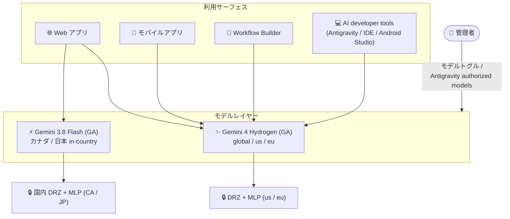

# Gemini Enterprise: Gemini 4 Hydrogen GA をはじめとする 4 つのアップデート

**リリース日**: 2026-11-12

**サービス**: Gemini Enterprise

**機能**: Gemini 4 Hydrogen GA / Gemini Notebook for business への名称変更 / Gemini 3.8 Flash のカナダ・日本リージョン GA / スキルバージョンの表示と復元

**ステータス**: GA (名称変更を含む)

📊 [このアップデートのインフォグラフィックを見る](https://takech9203.github.io/google-cloud-news-summary/20261112-gemini-enterprise-gemini-4-hydrogen-updates.html)

## 概要

2026 年 11 月 12 日、Gemini Enterprise に関連する 4 つのアップデートが同日に発表されました。中心となるのは、最新モデル **Gemini 4 Hydrogen** が Gemini Enterprise の Web アプリ、モバイルアプリ、Workflow Builder、AI developer tools で一般提供 (GA) になったことです。`global`、`us`、`eu` のマルチリージョンでサポートされ、`us` と `eu` ではデータレジデンシー (at-rest DRZ) と ML 処理 (MLP) のコミットメントにも対応します。

あわせて、**Gemini 3.8 Flash がカナダと日本の in-country リージョンで GA** となり、国内でのデータ保存 (DRZ) と ML 処理 (MLP) に対応した状態で利用できるようになりました。日本リージョン (asia-northeast1) でデータレジデンシー要件を持つ組織にとって重要なアップデートです。さらに、**Gemini Notebook Enterprise が「Gemini Notebook for business」に名称変更** (機能・API エンドポイントは変更なし) され、**スキルのバージョン履歴の表示・復元機能**も追加されました。

対象ユーザーは、Gemini Enterprise を全社導入している管理者、データレジデンシー要件を持つ規制業種 (特にカナダ・日本の組織)、スキルを作成・運用するユーザー、Antigravity などの AI developer tools を利用する開発者です。

**アップデート前の課題**

- 最新世代の Gemini 4 系モデル (Carbon、Argon) は in-country リージョンでは利用できず、使用するにはグローバルエンドポイントへのルーティングを警告ダイアログで承認する必要があった
- カナダ・日本の in-country リージョンでは、利用できる最新モデルが限られ、国内 DRZ / MLP を維持したまま新しい Flash 系モデルを使うことができなかった
- スキルを更新すると以前の内容を確認する手段がなく、誤った編集をした場合に過去の状態へ戻すことができなかった
- 「Gemini Notebook Enterprise」という名称は、Workspace 側の「Gemini Notebook」との関係がわかりにくかった

**アップデート後の改善**

- Gemini 4 Hydrogen が Web アプリ・モバイルアプリ・Workflow Builder・AI developer tools の 4 つのサーフェスで GA となり、`us` / `eu` では DRZ と MLP を維持したまま最新モデルを利用可能になった
- Gemini 3.8 Flash がカナダ・日本の in-country リージョンで GA となり、国内 at-rest DRZ と MLP に対応。カナダ・日本リージョンの Web アプリではデフォルトで有効
- スキルのオーナーがバージョン履歴を表示し、過去バージョンの指示やファイルを読み取り専用で確認し、任意のバージョンを最新として復元できるようになった
- 製品名が「Gemini Notebook for business」に統一され、位置付けが明確になった (API エンドポイントは従来と同一で移行作業は不要)

## アーキテクチャ図

Gemini 4 Hydrogen は 4 つのサーフェスすべてから利用でき、管理者がモデルトグルや Antigravity authorized models 設定で可用性を制御します。Gemini 3.8 Flash はカナダ・日本の in-country リージョンで国内データレジデンシーを維持したまま利用できます。

## サービスアップデートの詳細

### 主要機能

1. **Gemini 4 Hydrogen の一般提供 (GA)**
   - Gemini Enterprise の Web アプリ、モバイルアプリ、Workflow Builder、AI developer tools で利用可能
   - ロケーション: `global`、`us`、`eu` マルチリージョンをサポート。`us` と `eu` では at-rest データレジデンシー (DRZ) と ML 処理 (MLP) に対応
   - Web アプリ / モバイルアプリではデフォルトで無効。管理者がモデルトグルで有効化する
   - AI developer tools では、「Antigravity authorized models」がデフォルト選択の場合、ライセンスユーザーに対してデフォルトで有効。組織がカスタムモデルリストを指定している場合は、管理者が手動で Gemini 4 Hydrogen を選択する必要がある

2. **Gemini Notebook Enterprise の名称変更 (→ Gemini Notebook for business)**
   - リブランドのみで、製品機能は従来と同一
   - API は従来と同じエンドポイントを使用するため、既存のインテグレーションへの影響なし
   - Gemini Notebook for business はキュレーションしたソース (ドキュメント、Web サイトなど) に基づく AI リサーチアシスタントで、Gemini Enterprise (Standard / Plus) のサブスクリプションに含まれるほか、単体製品としても購入可能

3. **Gemini 3.8 Flash のカナダ・日本リージョン GA**
   - カナダ (northamerica-northeast1) と日本 (asia-northeast1) の in-country リージョンで GA
   - 国内での at-rest データレジデンシー (DRZ) と ML 処理 (MLP) をサポート
   - カナダ・日本リージョンの Web アプリでは**デフォルトで有効**。管理者は「Model availability」配下の Gemini 3.8 Flash トグルでアクセスを管理できる

4. **スキルバージョンの表示と復元**
   - スキルのオーナーが、Skills ページでスキルのバージョン履歴を表示できる
   - 過去バージョンの指示 (instructions) とファイルを読み取り専用モードで確認可能
   - 過去バージョンを最新バージョンとして復元できる

## 技術仕様

### モデル可用性とデータレジデンシー

| モデル | 対応ロケーション | DRZ / MLP | デフォルト状態 |
|------|------|------|------|
| Gemini 4 Hydrogen | global / us / eu マルチリージョン | us / eu で DRZ + MLP 対応 | Web / モバイル: オフ。AI developer tools: デフォルト選択時はオン |
| Gemini 3.8 Flash (カナダ・日本) | ca / asia-northeast1 (in-country) | 国内 DRZ + MLP 対応 | カナダ・日本リージョンの Web アプリでオン |

### in-country リージョンに関する留意点

| 項目 | 詳細 |
|------|------|
| in-country リージョンの提供形態 | GA (アローリスト制)。利用には Google アカウントチームへの連絡が必要 |
| 非対応モデルを有効化した場合 | トラフィックはグローバルエンドポイントにルーティングされ、リージョナルなデータレジデンシーは適用されない (警告ダイアログの承認が必要) |
| 組織ポリシーとの関係 | リソースロケーション組織ポリシーで `global` が許可されていない場合、非対応モデルのトグルを有効化できない |
| スキルデータの保存場所 | ユーザー作成スキルはアプリのロケーションの Gemini Enterprise ストレージに保存 (at-rest DRZ 対応、MLP は非対応) |

### AI developer tools の対象

AI developer tools には Antigravity アプリ、Antigravity CLI、Antigravity for IDEs、Android Studio が含まれます。データレジデンシーは選択したモデルのコミットメントに従います。

## 設定方法

### 前提条件

1. Gemini Enterprise アプリが作成済みであること
2. 管理タスクには Gemini Enterprise Admin IAM ロール (`roles/discoveryengine.agentspaceAdmin`) が必要
3. in-country リージョン (カナダ・日本など) の利用にはアローリスト登録が必要 (Google アカウントチームに連絡)

### 手順

#### ステップ 1: Web アプリで Gemini 4 Hydrogen を有効化する

Google Cloud コンソールで対象の Gemini Enterprise アプリを開き、モデル管理設定から Gemini 4 Hydrogen のトグルをオンにします。Gemini 4 Hydrogen はデフォルトでオフのため、管理者による明示的な有効化が必要です。

#### ステップ 2: AI developer tools のモデルを確認する

「Antigravity authorized models」がデフォルト選択の場合、Gemini 4 Hydrogen はライセンスユーザーに対して自動的に有効になります。カスタムモデルリストを使用している組織では、AI developer tools 設定で管理者が Gemini 4 Hydrogen を手動で追加します。

#### ステップ 3: (カナダ・日本リージョン) Gemini 3.8 Flash のアクセスを管理する

カナダ・日本リージョンの Web アプリでは Gemini 3.8 Flash がデフォルトで有効です。無効化したい場合は、「Model availability」配下の Gemini 3.8 Flash トグルで制御します。

#### ステップ 4: スキルのバージョンを表示・復元する

Gemini Enterprise Web アプリの Skills ページで対象スキルのバージョン履歴を開き、過去バージョンの指示とファイルを読み取り専用で確認します。問題のあるバージョンから戻したい場合は、過去バージョンを最新バージョンとして復元します。

## メリット

### ビジネス面

- **データレジデンシー要件と最新モデルの両立**: 日本・カナダの規制業種 (金融、公共など) が、国内 DRZ / MLP を維持したまま Gemini 3.8 Flash を利用可能に。従来はグローバルエンドポイントへのルーティングを許容する必要があった
- **全サーフェスで一貫したモデル体験**: チャット (Web / モバイル)、エージェント構築 (Workflow Builder)、開発 (Antigravity 等) のすべてで同一の最新モデル Gemini 4 Hydrogen を利用でき、組織全体の AI 活用レベルを底上げできる
- **スキル運用の安全性向上**: バージョン復元により、スキルの編集ミスが業務プロセスへ影響するリスクを低減し、組織的なスキル共有を安心して進められる

### 技術面

- **Workflow Builder での最新モデル利用**: Gemini Agent ノードで Gemini 4 Hydrogen を選択でき、エージェント / ワークフローの推論品質を向上できる (Workflow Builder は Gemini 3.0 以降のモデルをサポート)
- **API 互換性の維持**: Gemini Notebook for business への名称変更では API エンドポイントが変わらないため、既存の自動化やインテグレーションの改修は不要
- **ガバナンスの一元管理**: モデルトグル、Antigravity authorized models、組織ポリシー (リソースロケーション) を組み合わせて、モデル利用とデータ所在を一元的に統制できる

## デメリット・制約事項

### 制限事項

- Gemini 4 Hydrogen の DRZ / MLP 対応は `us` / `eu` マルチリージョンのみで、in-country リージョン (カナダ、日本など) は対象外
- Gemini 3.8 Flash の in-country GA は今回カナダと日本のみ (他の in-country リージョンは対象外)
- in-country リージョンの利用自体がアローリスト制のため、事前の申請が必要
- スキルバージョンの表示・復元を行えるのはスキルのオーナーのみ

### 考慮すべき点

- Web アプリ / モバイルアプリでは Gemini 4 Hydrogen がデフォルトでオフのため、有効化しない限りユーザーは利用できない。モデル展開ポリシーを事前に決めておく
- カナダ・日本リージョンでは Gemini 3.8 Flash がデフォルトでオンになるため、モデル利用を厳格に管理している組織はトグル設定を確認する
- in-country リージョンで非対応モデル (Gemini 4 Hydrogen 含む) を有効化すると、トラフィックがグローバルエンドポイントにルーティングされ、データレジデンシーのコミットメントが適用されなくなる点に注意
- ドキュメントや社内資料で「Gemini Notebook Enterprise」の名称を使用している場合は、「Gemini Notebook for business」への表記更新を計画する

## ユースケース

### ユースケース 1: 日本国内のデータレジデンシー要件下での AI アシスタント展開

**シナリオ**: 日本の金融機関が、顧客データを国内に保持する要件 (国内 DRZ / MLP) を満たしながら、全社員に Gemini Enterprise を展開したい。

**実装例**: 日本 in-country リージョン (asia-northeast1) に Gemini Enterprise アプリをプロビジョニングし、デフォルトで有効な Gemini 3.8 Flash を標準モデルとして利用する。リソースロケーション組織ポリシーで `global` を制限し、非対応モデルの有効化による意図しないグローバルルーティングを防止する。

**効果**: 国内でのデータ保存と ML 処理を維持したまま GA モデルを利用でき、規制要件とユーザー体験を両立できる。

### ユースケース 2: Workflow Builder での高度なエージェント構築

**シナリオ**: 業務部門が Workflow Builder で構築している承認ワークフローの推論品質を向上させたい。

**効果**: Gemini Agent ノードのモデルとして GA となった Gemini 4 Hydrogen を選択することで、複雑な条件判断や文書要約を含むワークフローの精度を向上できる。GA モデルのため本番ワークフローにも安心して採用できる。

### ユースケース 3: 組織共有スキルの安全な改善サイクル

**シナリオ**: ブランドボイスや契約レビューなどの共有スキルを継続的に改善しているが、改悪時に即座に切り戻したい。

**効果**: スキルオーナーがバージョン履歴から過去の指示・ファイルを確認し、問題があれば以前のバージョンを最新として復元できるため、スキルの改善サイクルを安全に高速化できる。

## 料金

Gemini Enterprise はエディション (Business / Standard / Plus / Frontline / Pay-as-you-go) ごとのシートベースのサブスクリプション料金です。今回の 4 つのアップデートによる追加料金は発表されていません。Gemini Notebook for business は単体でも購入可能です (最大 5,000 ライセンス、月額または年額)。

詳細は [Gemini Enterprise のエディション比較](https://docs.cloud.google.com/gemini/enterprise/docs/editions)および[料金ページ](https://cloud.google.com/gemini-enterprise/pricing)を参照してください。

## 利用可能リージョン

- **Gemini 4 Hydrogen**: `global`、`us`、`eu` マルチリージョン (DRZ / MLP は `us` / `eu` で対応)
- **Gemini 3.8 Flash (今回の GA 対象)**: カナダ (`ca`)、日本 (`asia-northeast1`) の in-country リージョン (国内 DRZ / MLP 対応)
- in-country リージョンの利用はアローリスト制 (GA with allowlist)

詳細は [Gemini Enterprise のデータレジデンシー](https://docs.cloud.google.com/gemini/enterprise/docs/locations)を参照してください。

## 関連サービス・機能

- **Google Antigravity**: AI developer tools の中核。Antigravity authorized models 設定により、Gemini 4 Hydrogen を含む利用可能モデルを管理者が制御する
- **Workflow Builder**: ノーコード / ローコードでチャットエージェントとワークフローを構築するプラットフォーム。Gemini Agent ノードで Gemini 4 Hydrogen を選択可能
- **Gemini Notebook for business (旧 Gemini Notebook Enterprise)**: キュレーションしたソースに基づく AI リサーチアシスタント。Gemini Enterprise Standard / Plus に含まれる
- **組織ポリシー (リソースロケーション)**: `global` ロケーションを制限することで、非対応モデル有効化によるグローバルエンドポイントへのルーティングを防止できる

## 参考リンク

- 📊 [インフォグラフィック](https://takech9203.github.io/google-cloud-news-summary/20261112-gemini-enterprise-gemini-4-hydrogen-updates.html)
- [公式リリースノート](https://docs.cloud.google.com/release-notes#November_12_2026)
- [Gemini Enterprise のロケーションとデータレジデンシー](https://docs.cloud.google.com/gemini/enterprise/docs/locations)
- [Web アプリの機能管理](https://docs.cloud.google.com/gemini/enterprise/docs/manage-web-app-features)
- [AI developer tools 設定の構成](https://docs.cloud.google.com/gemini/enterprise/docs/ai-developer-tools-settings)
- [Workflow Builder](https://docs.cloud.google.com/gemini/enterprise/docs/workflow-builder)
- [スキルの使用](https://docs.cloud.google.com/gemini/enterprise/docs/skills)
- [スキルの管理 (管理者向け)](https://docs.cloud.google.com/gemini/enterprise/docs/manage-skills)
- [Gemini Notebook for business と Gemini Enterprise の選択](https://docs.cloud.google.com/gemini/enterprise/docs/choose-product)
- [料金ページ](https://cloud.google.com/gemini-enterprise/pricing)

## まとめ

今回のアップデートは、最新モデル (Gemini 4 Hydrogen) の全サーフェス GA と、データレジデンシー対応の地理的拡大 (カナダ・日本での Gemini 3.8 Flash GA) が柱であり、特に日本の規制業種にとって Gemini Enterprise 採用のハードルを下げる内容です。管理者はまずモデルトグルと Antigravity authorized models の設定を確認し、組織のモデル展開ポリシーに沿って Gemini 4 Hydrogen の有効化を計画してください。スキルを運用しているチームは、バージョン復元機能を前提とした改善サイクルの導入を検討する価値があります。

---

**タグ**: Gemini Enterprise, Gemini 4 Hydrogen, Gemini 3.8 Flash, Gemini Notebook for business, データレジデンシー, Workflow Builder, Antigravity, スキル, GA
