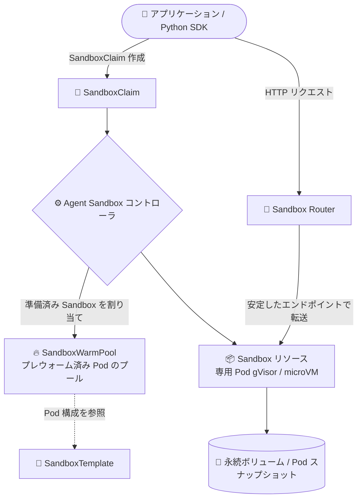

# Google Kubernetes Engine (GKE): Agent Sandbox on GKE が GA (一般提供開始)

**リリース日**: 2026-11-12

**サービス**: Google Kubernetes Engine (GKE)

**機能**: Agent Sandbox on GKE

**ステータス**: GA (一般提供)

📊 [このアップデートのインフォグラフィックを見る](https://takech9203.github.io/google-cloud-news-summary/20261112-gke-agent-sandbox-ga.html)

## 概要

Agent Sandbox on GKE が一般提供 (GA) となりました。Agent Sandbox on GKE は、AI エージェントのような「分離された、ステートフルな、単一レプリカのワークロード」を実行するために最適化された仕組みで、サポートされているすべての GKE バージョンで動作します。追加料金なしで利用でき、オープンソースの Agent Sandbox (Kubernetes SIG Apps 配下のプロジェクト) のインストール手順を使って GKE クラスタに導入します。

AI エージェントは LLM が生成した信頼できないコードを実行することが多く、ノードのカーネルからの分離が重要です。Agent Sandbox on GKE は、GKE Sandbox (gVisor または microVM) によるカーネルレベルの分離を備えた専用 Pod を各エージェントに提供し、標準の Kubernetes API で管理できます。ウォームプールにより通常 1 秒未満で実行環境をプロビジョニングでき、対話型エージェントのレイテンシ要件にも対応します。

なお、公式ドキュメントでは、多くのエージェントワークロードには同一ノード上でより多くのエージェントを実行できる Agent Substrate on GKE の利用が推奨されており、Agent Sandbox on GKE は「各エージェントに専用 Pod が必要」「GPU/TPU を使う」「完全な Kubernetes PodSpec が必要」「GKE Autopilot クラスタで実行する」といったケースに適しています。

**アップデート前の課題**

- LLM が生成した信頼できないコードを安全に実行するには、gVisor ノードプールの構成、NetworkPolicy、セキュリティ設定などを個別に設計・組み合わせる必要があった
- ステートフルで単一レプリカのエージェント環境を Kubernetes で表現するには、StatefulSet などを用いた複雑な構成管理が必要だった
- 標準の Kubernetes Pod のスケジューリングとイメージ取得・起動を待つ必要があり、対話型エージェントに求められる高速な環境払い出しが難しかった

**アップデート後の改善**

- Sandbox カスタムリソースにより、安定したホスト名・ネットワーク ID・永続ストレージを持つ分離環境を宣言的な API ひとつで管理できるようになった
- SandboxClaim / SandboxWarmPool / SandboxTemplate によるクレームモデルとウォームプールで、通常 1 秒未満のサブセカンドプロビジョニングが可能になった
- GA となり、サポートされているすべての GKE バージョンで追加費用なしに本番利用できるようになった (GKE リソース自体の料金は適用)

## アーキテクチャ図



アプリケーションは SandboxClaim を作成するだけで、コントローラがウォームプールから準備済みの Sandbox (カーネル分離された専用 Pod) を 1 秒未満で割り当てます。Sandbox Router が安定したエンドポイントを提供し、エージェント Pod へのトラフィックを中継します。

## サービスアップデートの詳細

### 主要機能

1. **カーネルレベルの分離**
   - GKE Sandbox (gVisor または microVM) により、LLM が生成した信頼できないコードをノードのカーネルから分離
   - セルフマネージドのオープンソース Kata Containers との組み合わせも可能 (ただし Google Cloud 製品ではなく、サポート・SLA の対象外)
   - SandboxTemplate ごとにデフォルト拒否の NetworkPolicy が自動作成され、エージェント内の不正コードが内部ネットワークや GKE コントロールプレーンへアクセスすることを防止

2. **サブセカンドプロビジョニング (ウォームプール)**
   - SandboxWarmPool が準備完了状態の Pod を持つ Sandbox をプールとして維持
   - SandboxClaim 作成時にイメージ取得や起動を待たずに割り当てられ、通常 1 秒未満で実行環境を提供
   - Pod スナップショットと組み合わせると、事前構成済みの状態から Pod を復元可能

3. **クレームモデルによる宣言的な環境リクエスト**
   - SandboxClaim / SandboxWarmPool / SandboxTemplate の 3 つのカスタムリソースで、環境のリクエストとプロビジョニングの実装詳細を分離
   - StatefulSet と異なり、利用者は基盤の Pod やストレージ構成を直接管理せずに Sandbox をリクエスト可能
   - プールに準備済み Sandbox がない場合は、コントローラがテンプレートから新規作成

4. **サスペンド / レジュームと Pod スナップショット統合**
   - Sandbox リソースの `spec.operatingMode` を `Suspended` にすると Pod を削除しつつ Sandbox リソースと永続ボリュームを保持し、`Running` に戻すと再開
   - GKE Pod スナップショット機能と統合し、コンテナの完全な状態を保存・復元可能
   - アイドル検出は行わないため、サスペンドのタイミングはアプリケーション側で判断

5. **SDK によるプログラマティックアクセス**
   - Python SDK (`k8s-agent-sandbox`) などのクライアントライブラリで、Kubernetes YAML を管理せずに Sandbox リソースをリクエスト・操作可能
   - LangChain や Vertex AI Agentic SDK などの Python ベースのエージェントフレームワークから直接分離環境を作成・利用できる

## 技術仕様

### 対応環境と要件

| 項目 | 詳細 |
|------|------|
| GKE バージョン | サポートされているすべての GKE バージョンで動作 |
| Pod スナップショット利用時 | GKE 1.35.3-gke.1234000 以降が必要。gVisor のみ対応 (microVM 不可)、E2 マシンタイプと TPU は非対応 |
| 分離ランタイム | gVisor および microVM (GKE Sandbox)。指定しない場合はカーネル分離なしで実行されるため、信頼できないコードの実行には不可 |
| GPU / TPU | gVisor ランタイムでのみ利用可能 (サポート対象の GPU モデル / TPU バージョンに限る)。microVM では非対応 |
| クラスタモード | Autopilot (gVisor 自動有効化) / Standard (gVisor 有効なノードプールを作成) |
| インストール | オープンソースの Agent Sandbox コントローラ (例: v1.0.6) をクラスタに導入。アップグレードは利用者が実施 |
| CRD | `Sandbox`、`SandboxTemplate`、`SandboxClaim`、`SandboxWarmPool` |

### 推奨セキュリティポリシー適用時の必須設定

推奨の `secure-sandbox-policy` (ValidatingAdmissionPolicy) を適用した場合、Sandbox / SandboxTemplate のマニフェストには以下が必須です。

| 必須設定 | 内容 |
|------|------|
| `runtimeClassName: gvisor` | gVisor ランタイムで実行 (microVM を含む他ランタイムは拒否) |
| `automountServiceAccountToken: false` | デフォルトのサービスアカウントトークンの自動マウントを禁止 |
| `securityContext.runAsNonRoot: true` | root ユーザーでの実行を禁止 |
| `securityContext.capabilities.drop: ["ALL"]` | すべての Linux ケーパビリティを削除 |
| `resources.limits` | DoS 防止のため CPU / メモリ上限を必須化 |
| `nodeSelector` / `tolerations` | `sandbox.gke.io/runtime: gvisor` をターゲットにし、対応する taint への toleration を含める |

また、`hostNetwork` / `hostPID` / `hostIPC`、`privileged: true`、HostPath ボリューム、`capabilities.add`、`hostPort`、カスタム sysctl などは禁止されます。

## 設定方法

### 前提条件

1. 課金が有効な Google Cloud プロジェクトと GKE API の有効化
2. GKE クラスタ (Autopilot 推奨。Standard の場合は gVisor を有効にしたノードプールが必要)

### 手順

#### ステップ 1: 環境変数の設定とクラスタ作成

```bash
export CLUSTER_NAME="agent-sandbox-cluster"
export LOCATION="us-central1"
export AGENT_SANDBOX_VERSION="v1.0.6"

# Autopilot クラスタを作成 (gVisor は自動で有効)
gcloud container clusters create-auto ${CLUSTER_NAME} \
  --location=${LOCATION}

# 認証情報を取得
gcloud container clusters get-credentials ${CLUSTER_NAME} \
  --location=${LOCATION}
```

Standard クラスタの場合は `--sandbox=type=gvisor` を指定した gVisor 有効のノードプールを別途作成します。

#### ステップ 2: Agent Sandbox コントローラのインストール

```bash
# リリースマニフェストを適用 (コントローラ + CRD)
kubectl apply -f https://github.com/kubernetes-sigs/agent-sandbox/releases/download/${AGENT_SANDBOX_VERSION}/sandbox-with-extensions.yaml

# コントローラの起動を待機
kubectl rollout status deployment/agent-sandbox-controller \
  --namespace=agent-sandbox-system \
  --timeout=120s

# CRD のインストールを確認
kubectl get crd \
  sandboxes.agents.x-k8s.io \
  sandboxtemplates.extensions.agents.x-k8s.io \
  sandboxclaims.extensions.agents.x-k8s.io \
  sandboxwarmpools.extensions.agents.x-k8s.io
```

Helm チャートによるインストールも可能です。

#### ステップ 3: 推奨セキュリティポリシーの適用

```bash
kubectl apply -f https://raw.githubusercontent.com/kubernetes-sigs/agent-sandbox/${AGENT_SANDBOX_VERSION}/examples/policy/vap/secure-sandbox-policy.yaml
kubectl apply -f https://raw.githubusercontent.com/kubernetes-sigs/agent-sandbox/${AGENT_SANDBOX_VERSION}/examples/policy/vap/secure-sandbox-binding.yaml
```

要件を満たさない Sandbox リソースはアドミッションコントローラにより拒否されます。

#### ステップ 4: Sandbox リソースのデプロイ

```yaml
apiVersion: agents.x-k8s.io/v1beta1
kind: Sandbox
metadata:
  name: sandbox-example
spec:
  podTemplate:
    spec:
      runtimeClassName: gvisor
      automountServiceAccountToken: false
      securityContext:
        runAsNonRoot: true
        runAsUser: 1000
      nodeSelector:
        sandbox.gke.io/runtime: gvisor
      tolerations:
        - key: "sandbox.gke.io/runtime"
          value: "gvisor"
          effect: "NoSchedule"
      containers:
        - name: my-container
          image: busybox
          command: ["/bin/sh", "-c"]
          args: ["sleep 3600000"]
          securityContext:
            capabilities:
              drop: ["ALL"]
            allowPrivilegeEscalation: false
          resources:
            limits:
              cpu: "100m"
              memory: "128Mi"
```

```bash
kubectl apply -f sandbox.yaml
kubectl get sandbox
```

高速な起動が必要な場合は、SandboxTemplate / SandboxWarmPool / SandboxClaim を使うクレームモデルを利用します。Python クライアントを使う場合は、Sandbox Router を `agent-sandbox-system` 名前空間にデプロイします。

## メリット

### ビジネス面

- **追加コストなし**: Agent Sandbox 自体はオープンソースで追加料金なし。GKE リソース分の費用のみで AI エージェント基盤を構築できる
- **GA による本番適用**: 一般提供となり、本番ワークロードでの採用判断がしやすくなった
- **エージェント開発の高速化**: Python SDK により、AI エンジニアが Kubernetes の詳細を意識せずに分離環境を利用でき、開発生産性が向上

### 技術面

- **VM 相当の分離と Kubernetes ネイティブ運用の両立**: 宣言的・標準化された API により、VM に近い分離・永続性特性を Kubernetes プリミティブだけで実現
- **サブセカンドの環境払い出し**: ウォームプールにより対話型エージェントに必要な低レイテンシの環境プロビジョニングを実現
- **多層防御**: gVisor によるカーネル分離、デフォルト拒否 NetworkPolicy、ValidatingAdmissionPolicy による構成強制を組み合わせたセキュリティ

## デメリット・制約事項

### 制限事項

- Pod スナップショットは GKE 1.35.3-gke.1234000 以降が必要で、gVisor のみ対応 (microVM 不可)。E2 マシンタイプおよび TPU では利用不可
- GPU / TPU は gVisor ランタイムかつサポート対象のモデル / バージョンでのみ利用可能 (microVM 非対応)
- 推奨セキュリティポリシーを適用すると gVisor 以外のランタイム (microVM 含む) は拒否される
- Pod スナップショットなど一部の基盤機能は Preview 段階またはリージョン限定の場合がある

### 考慮すべき点

- オープンソースのコントローラは利用者自身がインストール・アップグレードを管理する必要がある (v1.0.0 より前からのアップグレードでは v1beta1 API への移行が必要)
- アイドル状態のエージェントの自動検出は行われないため、サスペンドの判断ロジックはアプリケーション側で実装する必要がある
- GKE Sandbox ランタイム (gVisor / microVM) を指定しない場合はカーネル分離なしで実行されるため、信頼できないコードの実行には使用しないこと
- 多くのエージェントワークロードでは Agent Substrate on GKE の方が集積度が高く推奨される。専用 Pod、GPU/TPU、完全な PodSpec、Autopilot が必要な場合に Agent Sandbox を選択する

## ユースケース

### ユースケース 1: AI エージェントのコード実行サンドボックス

**シナリオ**: LLM が生成した Python コードをエージェントが実行するサービスで、信頼できないコードをノードや他のワークロードから隔離しつつ、対話のたびに高速に実行環境を払い出したい。

**実装例**:
```python
# Agent Sandbox Python SDK (k8s-agent-sandbox) の利用イメージ
# SandboxClaim を SDK が作成し、ウォームプールから準備済み環境を取得
# LangChain や Vertex AI Agentic SDK などのフレームワークから直接利用可能
```

**効果**: gVisor によるカーネル分離で安全性を確保しつつ、ウォームプールにより 1 秒未満で実行環境を提供。デフォルト拒否の NetworkPolicy で内部ネットワークへの不正アクセスも防止。

### ユースケース 2: 永続的な開発環境・ノートブック環境のホスティング

**シナリオ**: 開発者ごとに分離されたクラウドベースのコーディング環境や、Jupyter Notebook のような対話型ツールのシングルコンテナセッションを提供したい。

**効果**: Sandbox リソースが安定したホスト名・ネットワーク ID・永続ストレージを提供し、StatefulSet の複雑さなしにステートフルな単一 Pod サービスを運用できる。アイドル時はサスペンドしてコンピュートコストを削減し、必要時に再開できる。

## 料金

Agent Sandbox on GKE はオープンソースソフトウェアであり、追加料金なしで利用できます。ただし、作成するリソース (Agent Sandbox コントローラが使用するコンピュートリソースを含む) には通常の GKE 料金が適用されます。

- [GKE 料金ページ](https://cloud.google.com/kubernetes-engine/pricing)

## 利用可能リージョン

サポートされているすべての GKE バージョンで動作します。ただし、Pod スナップショットなど一部の基盤機能は Preview 段階または特定リージョンでの提供となる場合があります。詳細は公式ドキュメントを参照してください。

## 関連サービス・機能

- **Agent Substrate on GKE**: 同一ノード上でより多くのエージェントを実行できる代替アーキテクチャ。多くのエージェントワークロードではこちらが推奨
- **GKE Sandbox (gVisor / microVM)**: Agent Sandbox が利用するカーネル分離の基盤技術
- **GKE Pod スナップショット**: コンテナの完全な状態を保存・復元し、サスペンド / レジュームやウォームプールの高速復元を実現
- **Agent Gateway for GKE**: 同日に Preview 発表された、GKE 上のエージェント間トラフィックを集中管理するゲートウェイ機能
- **Vertex AI Agentic SDK / LangChain**: Python SDK 経由で Agent Sandbox の分離環境を直接利用できるエージェントフレームワーク

## 参考リンク

- 📊 [インフォグラフィック](https://takech9203.github.io/google-cloud-news-summary/20261112-gke-agent-sandbox-ga.html)
- [公式リリースノート](https://docs.cloud.google.com/release-notes#November_12_2026)
- [About Agent Sandbox on GKE](https://docs.cloud.google.com/kubernetes-engine/docs/concepts/machine-learning/agent-sandbox)
- [Install Agent Sandbox on GKE](https://docs.cloud.google.com/kubernetes-engine/docs/how-to/how-install-agent-sandbox)
- [Agent Sandbox (GitHub - kubernetes-sigs)](https://github.com/kubernetes-sigs/agent-sandbox)
- [GKE 料金ページ](https://cloud.google.com/kubernetes-engine/pricing)

## まとめ

Agent Sandbox on GKE の GA により、LLM が生成する信頼できないコードをカーネルレベルで分離しつつ、1 秒未満で払い出せるエージェント実行環境を、追加費用なしに標準の Kubernetes API で構築できるようになりました。AI エージェント基盤を GKE 上に構築している、または検討中のチームは、まず Agent Substrate on GKE との比較 (専用 Pod、GPU/TPU、完全な PodSpec、Autopilot の要否) でアーキテクチャを選定し、該当する場合はオープンソースのコントローラと推奨セキュリティポリシーを導入して評価を始めることを推奨します。

---

**タグ**: #GKE #AgentSandbox #AIエージェント #gVisor #GKESandbox #Kubernetes #セキュリティ #GA
